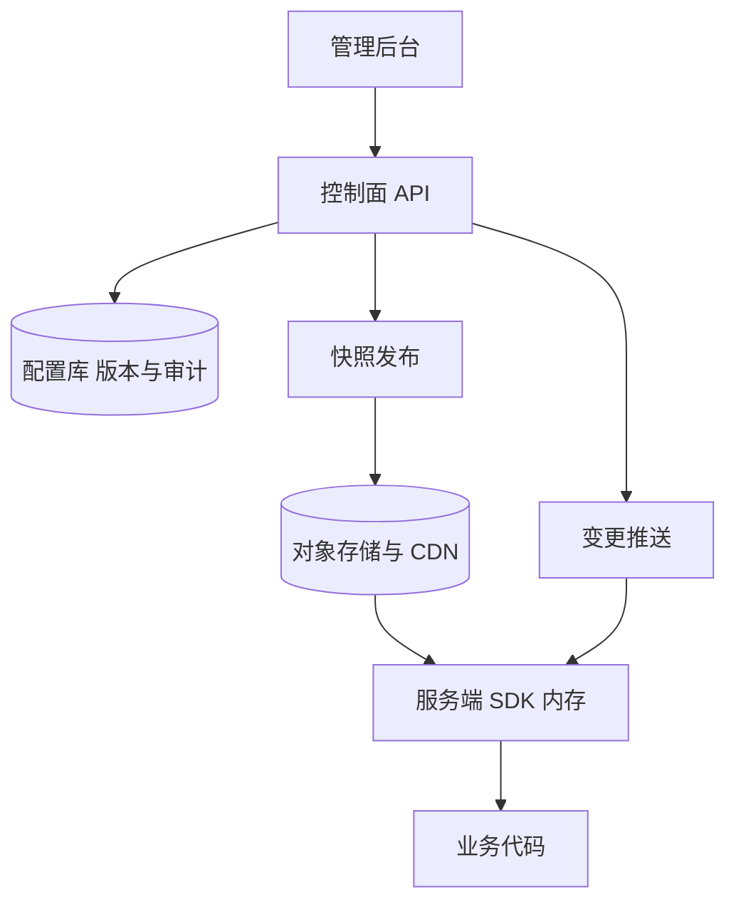

## Q
**功能开关服务（Feature Flag Service）**｜系统设计

设计一个功能开关服务：支持全局开/关（kill switch）、按百分比灰度放量、以及"粘性"的用户分配（同一用户反复请求，看到的结果始终一致，放量比例从 10% 提到 20% 时，原来在 10% 里的用户不会被踢出去）。服务要可靠地管理不同用户群体的功能可见性，并保证用户体验一致。常见变体：在使用 AI 辅助的编码面试里，要求写出可运行的内存版本，没有网络调用（不要 API、不要长连接）。

给出完整解答：需求、核心实体与接口、整体设计、深入问题、取舍、不同级别的期望。

## A
**一句话。** 开关的判定发生在每一次业务请求的热路径上，所以核心设计是"控制面与数据面分离"：配置集中管理、判定在客户端 SDK 本地用确定性哈希完成，不依赖网络；粘性靠哈希而不是存储来实现。

**60 分钟路线。**

| 时间 | 做什么 |
|---|---|
| 0–5 分 | 要求：读写悬殊，判定在热路径上，不能依赖网络 |
| 5–10 分 | 实体 `Flag`、`Context` 和接口 |
| 10–25 分 | 整体设计：控制面、快照、SDK 本地判定、降级 |
| 25–50 分 | 深入：哈希粘性、配置传播、判定顺序 |
| 50–60 分 | 追问：盐与跨语言一致、治理、本地还是集中判定 |

**需求。**
功能：
1. 创建、修改、删除开关；全局开/关，且关闭优先级最高（紧急熔断）。
2. 百分比放量：把某开关对 X% 的用户打开，X 可以逐步调大或调小。
3. 粘性分配：同一用户对同一开关的结果稳定；调大百分比只增加用户，不让已有用户翻转。
4. 定向规则：白名单用户、按属性（国家、套餐、版本）定向；多变体（A/B/C）按权重分配。
5. 评估接口：给定开关键和用户上下文，返回值；变更要在秒级到分钟级内生效。
6. 审计：谁在何时改了什么，可回滚。

非功能：
- 评估延迟：微秒到毫秒级（本地内存），不在请求路径上发网络调用。
- 吞吐：评估次数极高（每个服务实例每秒数万次），写入（改开关）极低，读写比极端悬殊。
- 可用性：控制面全挂时，所有服务仍然能按最后已知配置继续工作。
- 规模假设：数千个开关，配置总量小（几 MB 以内），成千上万个服务实例，客户端（浏览器、移动端）数亿用户。
- 一致性：配置传播最终一致（秒级）；同一用户在不同服务、不同语言里得到相同结果。

**核心实体与接口。**
实体：`Flag(key, enabled, defaultValue, variants[{name, weight}], rolloutPercent, rules[], salt, version, updatedBy)`；评估上下文 `Context(userId, attributes{})`；`AuditLog`。
接口：
- 控制面：`PUT /flags/{key}`（带版本，乐观并发）、`POST /flags/{key}/rollback`、`GET /flags`、`GET /flags/{key}/audit`。
- 数据面（SDK）：`isEnabled(flagKey, context, default)`、`variant(flagKey, context, default)`；SDK 从配置服务拿到的是整份规则快照。
- 客户端（浏览器、手机）：`GET /evaluate?user=...` 返回该用户已解析好的开关值，规则本身不下发。

**整体设计。**



1. 控制面：管理员通过后台修改开关，控制面校验后写入配置库（带版本号，每次修改是新版本，保留历史），并写审计日志。随后把全量规则快照（一个 JSON 文件加版本号）发布到对象存储，前面挂 CDN。
2. 传播：服务端 SDK 启动时拉取快照放入内存，之后两种方式保持更新——长轮询或定时轮询（每 10 到 30 秒带 `ETag`，没变化就返回 304），以及可选的服务器推送（SSE 或发布订阅）把"有新版本"通知出去，缩短到秒级。
3. 评估：业务代码调用 SDK，SDK 在内存里按固定顺序求值，无网络调用。
4. 降级：控制面或 CDN 不可用时，SDK 继续用内存里最后一份快照；冷启动又拿不到配置时，用本地磁盘缓存或代码里的默认值。
5. 客户端 SDK：浏览器、手机不应拿到全部规则（泄露定向策略，也太大），而是请求一个评估服务（边缘部署），按用户返回已解析的值，并在边缘缓存短时间。
6. 曝光日志：评估结果（尤其 A/B 实验）异步批量上报到 Kafka，供实验分析使用，不阻塞请求。

**深入。**
1. 【必讲】粘性的百分比放量：用哈希，而不是存储。
- 问题：要让同一用户稳定地落在"开"或"关"，并且放量比例调大时只增加不翻转。
- 选项 A：随机数加存储——第一次评估时随机决定并把结果写入分配表。粘性最强，但每次评估要读存储（热路径上的网络调用），表规模是（用户数 × 开关数），且多服务要共享。选项 B：确定性哈希——`bucket = hash(flagKey + salt + userId) mod 10000`，当 `bucket < percent × 100` 时开启。同一输入永远得到同一桶，不需要存任何东西。
- 单调性：用户的桶号不随 `percent` 变化，所以把 10% 调到 20%，原本在前 10% 的桶里的用户仍然开着，只是新增了一批用户；调小则从最高的桶开始关闭。
- **内存版哈希分桶示意：** 一小段示意（内存版，足够在编码面试里直接写出）：
```python
import hashlib
def bucket(flag_key: str, salt: str, user_id: str) -> int:
    # 稳定哈希：同一输入永远同一桶，不依赖存储
    h = hashlib.sha1(f"{flag_key}:{salt}:{user_id}".encode()).digest()
    return int.from_bytes(h[:4], "big") % 10000
def is_enabled(flag: dict, user_id: str) -> bool:
    if not flag["enabled"]:                      # 全局关闭优先级最高
        return False
    if user_id in flag.get("allow", ()):         # 白名单
        return True
    return bucket(flag["key"], flag["salt"], user_id) < flag["percent"] * 100
```
2. 【必讲】传播与一致性：
- 问题：改了开关多快生效？不同实例会不会短时间看到不同值？
- 选项：只轮询，最简单，延迟等于轮询间隔；推送加轮询兜底，秒级生效。紧急熔断应当走推送，并允许把轮询间隔缩短。
- 快照有版本号，SDK 只接受更高版本，不会被迟到的旧快照覆盖；一个请求内多次评估应使用同一份快照（取一次引用，快照是不可变对象，更新时整体替换，天然线程安全）。
- 降级：控制面不可用时用内存里最后一份快照。多个服务之间短暂不一致是允许的；对于必须一致的链路，把评估结果在入口计算一次并随请求向下游传递。
3. 【必讲】判定顺序与优先级：
- 固定顺序，便于推理和排障：全局熔断（关）→ 白名单/黑名单 → 属性定向规则（按顺序，第一条命中生效）→ 百分比放量 → 默认值。
- 每次评估可以返回"原因"（命中哪条规则），写进日志，排查"为什么这个用户看到了"极其有用。
- 前置依赖：开关 B 依赖开关 A 已开启，需要在快照里检测并禁止循环依赖。
4. 【追问再讲】粘性的细节：盐、跨语言一致、何时才需要存储。
- **盐让开关互相独立：** 盐：不同开关要使用不同的哈希输入（加上开关键和 `salt`），否则每个开关都是"用户 ID 排名前 X%"开启，同一批用户永远是所有实验的小白鼠。需要整体重新洗牌某个开关时，换 `salt`。
- 跨语言一致：哈希函数要有明确定义（如 MurmurHash3 的 32 位输出，或 SHA-1 取前 4 字节），并给出一组标准测试向量，保证 Java、Go、JavaScript 的 SDK 结果完全相同。
- 何时才需要存储：多变体权重改变会让一部分用户的变体变化，若要求"一旦分配永不改变"（正式实验、付费功能权限），则在首次分配时写入分配表并优先读它；这是少数场景的补充，不是默认路径。
5. 【追问再讲】控制面的安全与治理：
- 权限与审批：生产环境的修改需要角色权限，重要开关要求双人审批；变更写审计，支持一键回滚到上个版本。
- 环境隔离：开发、预发、生产分开配置；放量计划可以定时（凌晨自动从 5% 升到 25%），并设护栏——错误率或延迟指标恶化时自动回退。
- 【加分】生命周期：开关用完必须清理（长期存在的开关是技术债），为开关记录责任人和过期时间，提醒下线。

**取舍与追问。** 按被问到的可能性排，通常口述就够：
- 集中判定还是本地判定：集中判定（每次问服务）规则永远最新，但引入网络延迟和单点；本地判定延迟极低、抗故障，代价是传播有延迟。热路径几乎一律选本地判定。
- 为什么不用数据库做每次判定：读 QPS 过高，且开关本身不应成为业务的可用性依赖。
- 匿名用户：没有 `userId` 时用设备 ID 或 Cookie 作为分桶键；登录后键变化会导致结果翻转，要么登录前后统一用同一个稳定标识，要么为需要稳定的开关指定 `bucketBy` 属性。
- 编码面试版：一个线程安全的内存实现——`FlagStore` 持有不可变的 `dict` 快照，更新时整体替换引用；`evaluate(flag, context)` 按上面的顺序求值，哈希分桶；不需要网络。
- 配置过大：开关数量上万时按服务或项目拆分快照，SDK 只订阅自己需要的部分。

**级别期望。**
- 中级：配置库加评估接口，说明百分比放量要对用户固定（哈希而不是每次随机）。
- 高级：控制面与数据面分离，SDK 本地判定，确定性哈希的粘性与单调性，快照与轮询传播，降级到最后已知配置。
- 资深/Staff：跨语言哈希一致性、推送加轮询的传播与熔断时效、客户端开关的评估服务与隐私、曝光日志与实验分析、审批、回滚与护栏、开关生命周期治理。

**先修概念。** [[hi-system-design-core-concepts-api-design|API 设计]]、[[hi-system-design-core-concepts-caching|缓存]]、[[hi-system-design-core-concepts-consistent-hashing|一致性哈希]]、[[hi-system-design-deep-dives-zookeeper|ZooKeeper]]、[[hi-system-design-patterns-realtime-updates|实时更新]]、[[hi-system-design-core-concepts-cap-theorem|CAP 定理]]

**同类题。** [[oa-q38-feature-flags|功能开关（编码题）]]、[[distributed-rate-limiter|分布式限流器（动态规则分发）]]、[[hi-system-design-problem-breakdowns-distributed-rate-limiter|分布式限流器（拆解）]]、[[solution-key-value-store|键值存储]]
