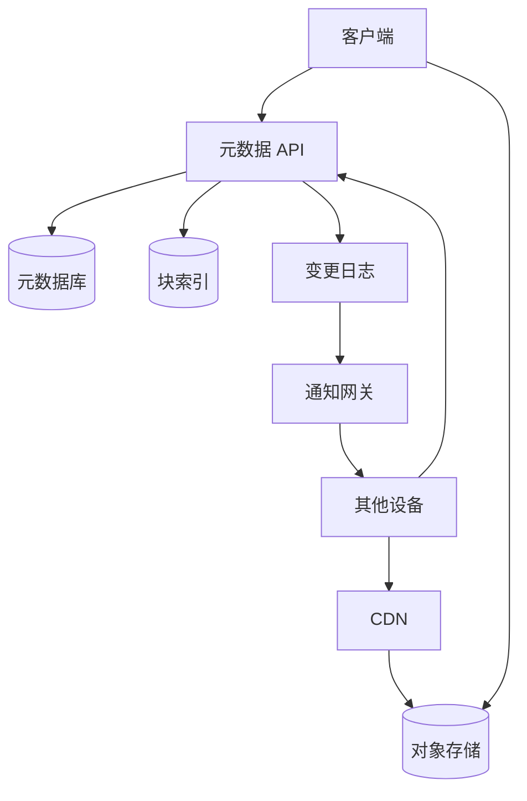

## Q
**设计云盘与文件同步系统（Dropbox / Google Drive）**｜系统设计

设计一个文件存储与同步产品：用户可以在任意设备上传、下载、分享文件，并且各台设备上的文件夹自动保持一致。单个文件可以大到 50 GB，必须支持断点续传；整体可能到 EB 级（每个用户有存储配额，例如 15 GB）。面试官的关注点各有不同：大文件上传与续传、元数据表结构、重命名和移动文件夹要多快、复制与分享的语义、远端变化如何推送到本地（"是每个文件一条连接，还是每个客户端一条连接？既然有推送为什么还要轮询？"）、客户端要实现哪些函数、冲突怎么处理、安全。

给出完整解答：需求、核心实体与接口、整体设计、深入问题、取舍、不同级别的期望。

## A
**一句话。** 文件的字节和文件的"名字/位置/版本"是两种完全不同的数据：字节巨大、不可变、按内容寻址，放进对象存储并去重；元数据小、频繁变化、要强一致，放进分片数据库；同步就是"客户端拿着游标追着元数据变更日志走，缺什么字节再去拿"。

**需求。**
- 功能：从任意设备上传、下载文件；分享给其他用户（只读/可编辑）；多设备自动同步；查看版本历史并恢复；（可选）移动、重命名、复制文件夹。
- 非功能：
  - 文件最大 50 GB，上传可暂停、可续传；
  - 可用性优先于强一致（网络不好也要能用，之后合并），但元数据提交本身要原子；
  - 数据极高持久性（对象存储通常声称 11 个 9）；
  - 同步延迟：远端变化几秒内到达在线设备；
  - 节省带宽：只传变化的部分；
  - 安全：传输与静态加密，访问控制。
- 估算：50 GB 在 100 Mbps 链路上需要 50e9 × 8 ÷ 100e6 ≈ 4,000 秒 ≈ 67 分钟，期间任何网络抖动都会让整个文件重来，所以必须切块。按 5 MB 一块是 10,000 块；每块 32 字节的 SHA-256 指纹，一个文件版本的块清单约 320 KB，数据库可以承受。若有 10 亿用户、平均存 1 GB，是 1 EB 量级：三副本要 3 EB，纠删码（erasure coding，约 1.5 倍开销）只要 1.5 EB，所以冷数据用纠删码。

**核心实体与接口。**
- 实体：
  - 节点（Node：文件和文件夹放同一张表，`nodeId`、`namespaceId`、`parentId`、`name`、是否文件夹、当前版本）；
  - 文件版本（FileVersion：`nodeId`、`version`、总大小、有序的块指纹清单、修改设备）；
  - 块（Chunk：指纹、大小、对象存储位置、引用计数）；
  - 分享（Share：`namespaceId`/`nodeId`、被分享者、权限）；
  - 变更日志（ChangeLog：每个命名空间一条单调递增的游标，记录"哪个节点在哪个版本发生了什么"）；
  - 设备（Device：`deviceId`、游标位置）。
- 接口：
  - `POST /files {parentId, name, size, fileFingerprint, chunkFingerprints[]}` → `{fileId, missingChunks[], uploadUrls[]}`（只为缺失的块签发预签名 URL）；
  - 客户端把块直接传给对象存储（预签名 URL），然后 `POST /files/{id}/commit {baseVersion}` 提交；
  - `GET /files/{id}/download` → 清单 + 带签名的下载链接（走 CDN）；
  - `GET /changes?namespace=...&cursor=N` → 自游标 N 以来的变更列表和新游标；
  - `POST /nodes/{id}/move {newParentId, newName}`；`POST /shares`。

**整体设计。**

上传（以 50 GB 为例）：
1. 客户端把文件切块（5–10 MB），对每块算 SHA-256，另外算整个文件的指纹。
2. 客户端把清单（指纹列表）发给元数据 API。服务端到块索引里查哪些指纹已经存在（别的文件、别的用户已经传过的），只返回缺失的块和对应的预签名分片上传 URL。
3. 客户端并行把缺失的块直传对象存储，不经过我们的应用服务器（否则 50 GB 会占满应用服务器的带宽和连接）。每块上传完成后服务端校验：对象存储的完成事件通知服务端，服务端核对大小和指纹，通过后才把块标记为 `READY`，不信任客户端自称的"我传完了"。
4. 所有块都就绪后，客户端调用 `commit {baseVersion}`。服务端在一个事务里：检查文件当前版本是否等于 `baseVersion`（乐观并发控制），写入新的 `FileVersion` 和块清单，递增块引用计数，追加一条变更日志，更新用户配额。
5. 断点续传：客户端重启后拿着整文件指纹询问服务端"这个上传有哪些块已经就绪"，只补传缺的。未提交的上传 24 小时后清理。

下载：服务端返回块清单和签名链接，客户端并行下载（热文件走 CDN），按清单拼起来。

同步：
1. 本地：客户端用文件系统事件（FSEvents、inotify）监视文件夹，并维护一个本地数据库（路径 → 上次同步版本、块指纹）。变化时重新切块，只上传指纹变了的块（增量同步，delta sync），然后提交。
2. 远端：服务端的每次提交都追加到该命名空间的变更日志，并通知在线设备"命名空间 X 有新游标"。设备收到提示后调用 `GET /changes?cursor=本地游标`，拿到变更列表，只下载自己没有的块，然后推进本地游标。
3. 通知是"提示"，不是"真相"：推送可能丢，所以设备还会定时（如每几分钟）用游标拉一次。每个客户端保持一条长连接（WebSocket 或长轮询），连接上订阅的是"我所属的命名空间"，而不是每个文件一条连接。

**深入。**
1. 大文件与切块方式：
   - 固定大小切块：实现最简单，但在文件开头插入一个字节会让之后所有块的边界后移、指纹全变，增量同步失效；
   - 内容定义切块（content-defined chunking）：用滚动哈希在内容的"特征点"处切分，插入只影响附近一两块；代价是客户端 CPU 开销和块大小不均；
   - 选内容定义切块（目标块大小约 4–8 MB，设上下限），因为同步产品的核心体验就是"改了一小处，只传一小处"。压缩只对文本等可压缩类型值得做，图片视频已压缩过，白耗 CPU。
2. 元数据表结构、重命名和移动：
   - 邻接表：每个节点存 `parentId` 和 `name`。移动或重命名 = 更新这一行的两个字段，与子树大小无关，O(1)，历史上也不影响子节点；列出目录用 `(parentId)` 索引；
   - 路径字符串/物化路径：读路径快，但移动一个有 10 万文件的文件夹要改 10 万行；
   - 选邻接表，路径解析逐级查并缓存。唯一约束 `(parentId, name)` 防同名。复制文件夹是元数据的复制 + 块引用计数 +1，不复制任何字节。
3. 冲突：两台设备都基于 v3 修改同一个文件。提交时第一个赢得 v4，第二个因为 `baseVersion` 不匹配收到冲突错误；客户端把自己的版本另存为"文件名（冲突副本，设备名）"并同时同步下来，由用户合并。自动合并只适合协同文档这类有操作日志的产品，通用文件同步不尝试。
4. 去重与安全：
   - 块按指纹全局去重，同样的文件只存一份，节省大量空间；引用计数归零后延迟删除（先标记，GC 周期回收），防止竞态下误删；
   - 跨用户去重有"确认攻击"风险：攻击者上传某个文件的指纹，服务端说"已存在"就泄露了别人有这个文件。对策：上传前要求客户端证明持有内容（对服务端给的随机挑战算哈希）；或者对敏感账号只做同用户内去重；
   - 端到端加密与去重冲突：客户端加密后指纹各不相同，无法去重，这是安全与成本之间的取舍；
   - 预签名 URL 有效期几分钟、绑定对象键和方法；元数据 API 每次都校验权限；静态数据用 KMS 信封加密。
5. 分享：
   - 方案 A：把分享列表塞进文件元数据，查"分享给我的"要全表扫描；
   - 方案 B：单独的分享表，同时建两个索引——按节点（谁有权访问）、按被分享者（我能看到什么）。
   - 选 B，并把被分享的文件夹作为独立的命名空间（有自己的变更日志），被分享者"挂载"到自己的目录树里。这样权限变更只是增删挂载，同步逻辑统一。
6. 扩展：元数据按 `namespaceId` 分片，同一用户或同一共享文件夹的数据在一个分片内，事务不跨片；块索引按指纹哈希分片；对象存储本身水平扩展；通知网关按命名空间路由；冷数据转纠删码和低成本存储层。

**取舍与追问。**
- "为什么推送了还要轮询？" 推送通道有损且不可靠（连接断了、网关重启、消息丢失）；游标是幂等的追赶机制，推送只负责降低延迟，轮询负责最终正确。
- "每个文件一条连接吗？" 不，一个客户端一条连接，里面复用多个命名空间的通知；每个文件一条连接会让连接数乘以文件数，不可行。
- "客户端要实现哪些函数？" 监视文件夹、切块与哈希、查询缺失块、并行上传下载与重试、本地状态库、应用远端变更、冲突处理、暂停恢复与限速。
- "一致性模型" 元数据提交是强一致（单分片事务 + 版本比较），设备之间的视图是最终一致（追游标）。
- "Blob 存储变体"：只提供对象的增删和键值，不需要同步部分；重点在块存储、元数据分层、纠删码与修复、GC，以及小文件合并（把大量小文件打包成大对象，元数据里记偏移）。
- "配额 15 GB"：按逻辑大小在提交事务里扣减；去重不减少用户的配额占用，否则用户可以通过"探测哪些文件已存在"猜出别人的数据。
- 成本：流量主要是出口带宽，用 CDN 和对象存储的就近读取降低；热文件缓存，冷文件下沉。

**级别期望。**
- 中级：元数据与文件内容分离、对象存储 + 预签名直传、切块续传、基本的同步思路（轮询或推送拉取）。
- 高级：块指纹去重与增量同步、变更日志游标、乐观并发与冲突副本、分享表的双索引、重命名为什么是邻接表。
- 资深/专家：内容定义切块的利弊、去重的安全问题（确认攻击、与加密冲突）、命名空间抽象、EB 级的存储分层与纠删码、GC 与引用计数的竞态、通知通道的可靠性设计。

**先修概念。**
- [[hi-system-design-patterns-large-blobs|大文件（Blob）处理]]
- [[hi-system-design-patterns-realtime-updates|实时更新]]
- [[hi-system-design-core-concepts-data-modeling|数据建模]]
- [[hi-system-design-core-concepts-sharding|分片（Sharding）]]
- [[hi-system-design-core-concepts-caching|缓存]]
- [[hi-system-design-core-concepts-api-design|API 设计]]

**同类题。**
- [[hi-system-design-problem-breakdowns-dropbox|文件存储（Dropbox）]]
- [[solution-file-sync|设计题解：文件同步]]
- [[solution-object-storage|设计题解：对象存储]]：块存储与纠删码
- [[hi-system-design-problem-breakdowns-google-docs|协同文档（Google Docs）]]：需要自动合并时的做法
