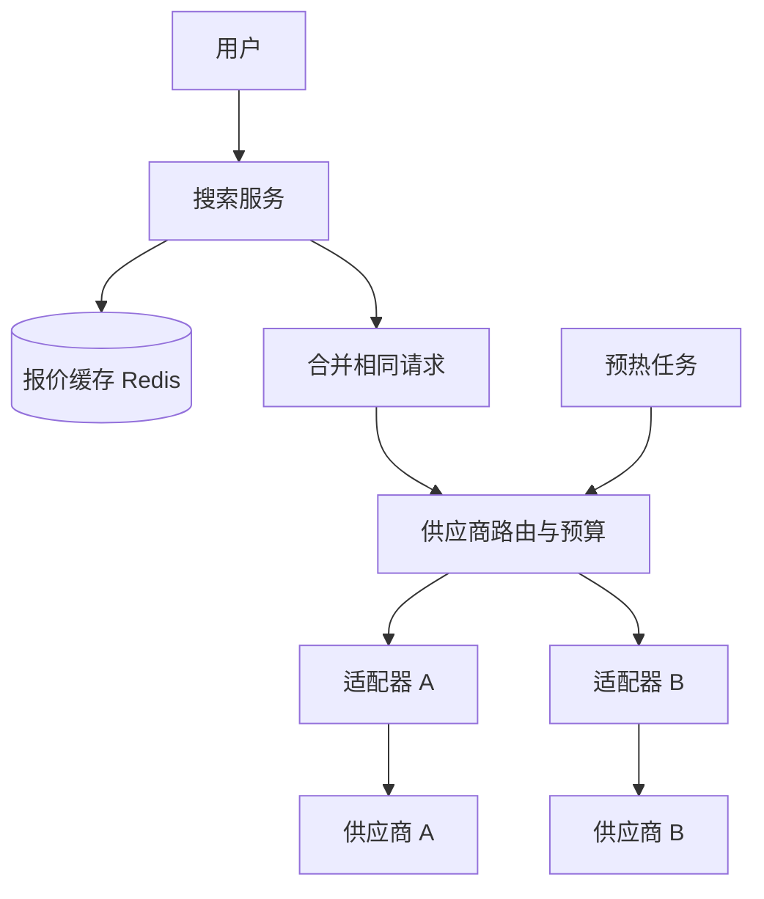

## Q
**设计机票搜索系统（多供应商聚合，按调用计费）**｜系统设计

设计一个机票搜索与比价系统：价格来自多个第三方供应商（vendor / supplier，例如航司直连、GDS、批发商），供应商的 API 要实时调用，而且每次调用都要付钱（计量计费，常伴有速率限制和"搜索与预订比"的约束）。用户输入出发地、目的地、日期、人数后看到各家报价并比较。目标是在体验可接受的延迟内，把供应商 API 的开销压到最低。面试官常给出一个"原始版本"的高层设计（用户请求同步扇出到所有供应商再合并），让你"尽可能改进并讨论取舍"。

给出完整解答：需求、核心实体与接口、整体设计、深入问题、取舍、不同级别的期望。

## A
**一句话。** 这题本质是"在价格新鲜度、延迟和供应商账单之间做经济学权衡"：每一次对供应商的调用都是有成本的决策，所以设计的核心是缓存、合并重复请求、按期望收益挑选供应商、以及把昂贵的"最终确认价格"推迟到用户真正选中某个行程的时候。

**需求。**
- 功能：按出发地、目的地、日期（可选弹性日期）、人数、舱位搜索；展示各家报价并排序比较；点击某个行程时给出最新价格并跳转或预订；展示价格的更新时间。
- 非功能：
  - 首批结果 1–2 秒内出现，完整结果 3–5 秒内；
  - 供应商调用成本最小化（成本是第一等指标）；
  - 容忍个别供应商慢或挂；
  - 价格允许在搜索阶段略微过期，但最终价格必须准确；
  - 严格遵守各供应商的速率限制与搜索预订比约束。
- 估算（示例，帮助量化优化收益）：每天 100 万次搜索，不做任何优化时每次扇出 5 家，每次调用 0.001 美元 → 500 万次调用 × 0.001 = 5,000 美元/天。如果缓存命中率 90%，调用降到 50 万次，成本约 500 美元/天；再把每次平均扇出从 5 家降到 2 家，约 20 万次、约 200 美元/天。优化是乘法关系，每一项都值得做。

**核心实体与接口。**
- 实体：
  - 搜索键（SearchKey：出发地、目的地、日期、人数、舱位，规范化后作缓存键）；
  - 报价（Offer：供应商、行程键（航班号 + 起飞时间 + 舱位 + 票价基础）、价格、币种、`fetchedAt`、`expiresAt`）；
  - 供应商画像（VendorProfile：单次调用成本、速率限制、延迟分位数、成功率、覆盖的航司/航线、对每条航线的历史"胜率"）；
  - 搜索会话（SearchSession：`searchId`、已返回的供应商、截止时间）。
- 接口：
  - `POST /searches {origin, dest, date, pax, cabin}` → `{searchId}`；
  - `GET /searches/{id}/stream`（SSE，先推缓存结果，再陆续推各供应商的新结果）；
  - `POST /offers/{id}/validate` → 实时向该供应商确认价格并返回最终价；
  - 内部：供应商适配器接口 `search(key) -> offers[]`，统一各家协议和字段。

**整体设计。**

1. 搜索服务把请求规范化成搜索键（日期取当地日期、人数与舱位归一），先查缓存。命中且仍新鲜的报价立刻通过 SSE 推给用户，用户一两百毫秒内就能看到东西。
2. 未命中或已过期的部分，进入"请求合并"：同一搜索键同时到达的多个请求只放行一个去调供应商，其余订阅这个飞行中的结果（single-flight，用分布式租约或 Redis 里的占位键实现）。热门航线开售时的瞬时并发不会变成 N 倍的账单。
3. 供应商路由器决定"这次要调哪几家"（见深入 2），并对每家供应商做令牌桶限速与日预算检查；超限的供应商直接跳过。
4. 适配器并行调用选中的供应商，设置严格超时（例如 2.5 秒）。每家返回后：归一化报价、写入缓存、通过 SSE 推给用户。超时之后到达的结果仍然写入缓存（不浪费已付的钱），只是不再推给这次搜索。
5. 合并与去重：以行程键归并不同供应商的同一行程，保留最低价并记录是哪家，也保留次低价作为备选；排序后输出。
6. 用户点击某行程时才调用 `validate`：向该行程所属的那一家供应商实时确认价格与余票。这一步一次一家，成本只在有真实意向时才发生。
7. 预热任务根据历史搜索热度，提前刷新热门航线日期的缓存（见深入 3）。

**深入。**
1. 缓存：缓存什么、存多久。
   - 键：规范化搜索键；值：每家供应商各自的报价列表（分开存，新增或下线供应商不会让整条缓存失效）；
   - TTL 取决于价格变化的速度：临近起飞（3 天内）价格波动大，TTL 约 5 分钟；一到四周的航班约 30 分钟；更远的日期可以 2–6 小时。更好的做法是按航线实际观测到的价格变化率自适应调整 TTL；
   - 用户可见"价格更新于 X 分钟前"，并在 `validate` 时修正。价格变了的比例是缓存策略的核心监控指标，如果在点击确认时价差太大，说明 TTL 偏长；
   - 两层缓存：搜索服务的进程内小缓存（几秒，吸收瞬时重复）+ Redis 集群；对象压缩存储。
2. 供应商选择：不是每次都调全部。
   - 全部扇出：简单，延迟取决于最慢的那一家，成本最高；
   - 按覆盖过滤：只调覆盖这条航线航司的供应商（从历史结果统计出每家覆盖哪些航线）；
   - 按期望收益选择：为每条航线维护每家供应商的"胜率"（给出过最低价的比例），只调胜率超过阈值或成本效益比高的几家；留出 5% 的流量做探索（多臂老虎机的 ε-贪心），让统计不过时；
   - 分层调用：先调便宜且快的供应商，如果结果数量不足或最低价不理想，才升级调用昂贵的；
   - 选"覆盖过滤 + 胜率选择 + 小比例探索"，并对每家有日预算，用完则只用缓存。
3. 预热与热门度：搜索请求大致服从长尾分布，前 5% 的航线日期可能占搜索量的大半。离线任务按热度排序，在价格变化快的时间窗口前主动刷新热门项，使用供应商更便宜的批量或日历接口；预热本身也有成本，所以只预热"预计命中收益大于调用成本"的键，也要避免与用户触发的调用重复。
4. 价格确认延后：搜索阶段给出"约"价，点击时实时确认。供应商常设有搜索预订比限制（搜索次数相对成交次数不能过高），延后确认能显著降低对供应商看起来的"搜索"数量，因为很多搜索被缓存吸收；确认调用只发生在真实意向上。
5. 弹性日期与日历视图（"这个月哪天最便宜"）：这种请求会把调用量放大 30 倍。办法是只在缓存里已有的日期上展示，或使用供应商的日历接口，其余日期显示"点击查看"，不要为展示一个日历格子去逐日调用。
6. 容错：每家供应商一个熔断器；超时和部分结果是常态，前端明确展示"部分供应商未响应"。对计费的调用不要使用请求对冲（hedging，同时发两份取先到的），那会让账单翻倍；对延迟敏感时，只对便宜的供应商对冲。
7. 成本可观测：每次搜索的平均花费、缓存命中率、各供应商的调用量与花费、点击确认时的价差率、"白付费调用"（拿到结果但从未被任何用户看到）比例；把"每次成交的搜索成本"作为核心指标看板，并给每家供应商设置预算告警。

**取舍与追问。**
- 新鲜度与成本：TTL 越长越省钱，但用户点击后发现涨价的概率越高；用确认调用兜底并在页面标注更新时间，把"不准"的代价限制在点击时刻。
- 延迟与成本：等所有供应商都返回再展示，体验差；流式返回，先展示缓存，再追加更新，用户感觉很快，同时不放弃慢供应商的结果。
- "原始版本的最大问题是什么？" 同步扇出、没有缓存、没有合并、没有预算：延迟取决于最慢供应商，成本与流量线性绑定，供应商限速会直接把用户请求打失败。
- 数据存储：热数据 Redis；历史价格（用于价格趋势、预热决策、供应商评估）写入列式或宽列库，供离线分析。
- 如何知道缓存值得？用实验：对一部分流量强制绕过缓存，比较转化率和价差，估算缓存的实际代价。
- 如果某个供应商价格总是最低但很贵：用胜率乘以价差带来的转化收益与调用成本比较，量化决定调不调。

**级别期望。**
- 中级：识别原始设计的问题，加缓存与超时，并行调用多个供应商并合并结果。
- 高级：请求合并、按航线选供应商、分层 TTL、流式返回、点击时确认价格、供应商限速与熔断。
- 资深/专家：用期望收益和探索策略做供应商选择、预热的经济性、缓存 TTL 的自适应、搜索预订比约束、成本指标体系与实验验证，能用数字说明每一项优化的账单影响。

**先修概念。**
- [[hi-system-design-core-concepts-caching|缓存]]
- [[hi-system-design-patterns-scaling-reads|扩展读]]
- [[hi-system-design-deep-dives-redis|Redis]]
- [[hi-system-design-patterns-realtime-updates|实时更新]]
- [[hi-system-design-core-concepts-api-design|API 设计]]

**同类题。**
- [[hi-system-design-problem-breakdowns-camelcamelcamel|价格追踪（CamelCamelCamel）]]：对外部价格源的定期拉取与成本控制
- [[hi-system-design-problem-breakdowns-google-news|新闻聚合（Google News）]]：对多个不可控外部源的拉取与缓存
- [[solution-distributed-cache|设计题解：分布式缓存]]
- [[solution-hotel-reservation|设计题解：酒店预订]]：搜索与预订分离
