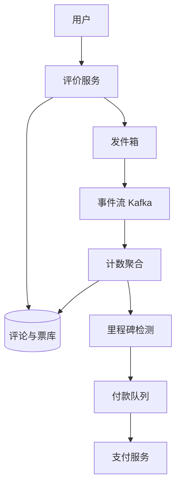

## Q
**设计带打赏的菜品评价系统（点评 + 投票 + 达标付款）**｜系统设计

设计一个外卖平台上的菜品评价功能：用户可以对自己订单里的每一道菜打分（1–5 星）并写文字评论；其他用户可以看到评论、对评论点赞或点踩；当评论的赞踩比例达到某个阈值，或者每累计 100 个赞，就向写评论的人付一笔钱（例如每 100 赞 1 美元，200 赞再付 1 美元）。常被追问：需求太宽，先把范围问清楚；重点放在数据流（支付部分可以一笔带过）；高峰时怎么扩展；热点评论的计数；重复付款怎么防；刷票怎么防；"是否需要展示菜品平均星级"由面试官决定。

给出完整解答：需求、核心实体与接口、整体设计、深入问题、取舍、不同级别的期望。

## A
**一句话。** 评价本身很普通，难点是"按票数付钱"：票是高频、可被刷的写入，钱是低频、必须恰好付一次的动作，所以要把两者拆开，中间用"里程碑账本 + 唯一约束 + 异步付款"保证每个里程碑只付一次。

**60 分钟路线。**

| 时间 | 做什么 |
|---|---|
| 0–5 分 | 澄清需求：要不要平均星级、付款规则、防不防刷；估算约 2,200 票/秒 |
| 5–10 分 | 实体（评论、票、付款里程碑）和四个接口 |
| 10–25 分 | 整体设计：写评论、投票、事件流聚合、里程碑付款、缓存读 |
| 25–50 分 | 必讲深入：付款恰好一次；热点评论计数 |
| 50–60 分 | 追问：比例阈值、抗刷票、平均星级、Wilson 排序 |

**需求。**
- 功能：
  - 只有真正收到过这道菜的用户能评价（每个订单项最多一条）；
  - 评分 + 文字；
  - 看某道菜的评论列表（按最新或最有帮助排序）；
  - 点赞/点踩，一人对一条评论只有一票，可以改票、撤票；
  - 达标后向作者付款。
- 非功能：
  - 评论和票写入高并发，最终一致即可（展示的赞数晚几秒无所谓）；
  - 付款严格恰好一次，可审计；
  - 抗刷票；
  - 读远多于写，评论页要快；
  - 用户自己的票要立刻在界面反映（读自己的写）。
- 估算（先和面试官对齐规模，这里取假设值）：每天 500 万订单 × 3 个菜品 = 1,500 万订单项，5% 被评价 → 75 万条评论/天，约 9 条/秒；每条评论平均 50 票 → 3,750 万票/天，平均约 434 票/秒，按 5 倍峰值约 2,200 票/秒。存储：评论约 1 KB × 75 万 ≈ 750 MB/天；票每条约 50 B × 3,750 万 ≈ 1.9 GB/天，一年约 700 GB。数量级不大，真正需要设计的是热点和正确性。

**核心实体与接口。**
- 实体：
  - 评论（Review：`reviewId`、`orderItemId`（唯一）、`userId`、`itemId`、评分、文本、`createdAt`、`upCount`、`downCount`、状态）；
  - 票（Vote：`(reviewId, voterId)` 为主键、值 ±1、`updatedAt`）；
  - 付款里程碑（Payout：`(reviewId, milestone)` 为主键、金额、状态、支付引用号）；
  - 菜品评分聚合（ItemRating：`itemId`、评分总和、评分条数）。
- 接口：
  - `POST /order-items/{id}/review {rating, text}`（校验订单项属于调用者且已送达）；
  - `GET /items/{id}/reviews?sort=helpful&cursor=...`；
  - `PUT /reviews/{id}/vote {value: 1 | -1 | 0}`（0 表示撤票；PUT 天然幂等）；
  - `GET /me/payouts`。

**整体设计。**

写评论：
1. 评价服务校验订单项存在、属于该用户、已送达，并且 `orderItemId` 上还没有评论（唯一约束，防重复）。
2. 写评论行；同事务里把菜品评分聚合 `sum += rating, count += 1`（或写事件由聚合器异步加）。菜品平均星级 = `sum / count`，不必每次扫描所有评论。

投票：
1. `PUT /reviews/{id}/vote` 对 `(reviewId, voterId)` 做 upsert。读出旧值，计算差值（例如从踩改成赞，赞数 +1、踩数 −1），差值非零才继续。
2. 差值写入事件流（通过发件箱保证"票已存、事件必发"）。聚合器按 `reviewId` 分区消费，批量更新评论的 `upCount/downCount`（热点评论一秒合并成一次更新）。
3. 里程碑检测器看到新的计数后，判断是否越过里程碑（见深入 1），越过则往付款队列放任务。
4. 付款工作进程调用支付服务（带幂等键），成功后把里程碑状态改为 `PAID`。

读：
1. 评论列表按 `(itemId, 排序键)` 建索引，用游标分页；每个菜品的第一页缓存 30–60 秒。
2. 用户自己的票单独查：对页面上的这批 `reviewId`，一次查询取该用户的投票，叠加在缓存页上，所以缓存页是全员共享的，个人状态是增量覆盖。
3. 最有帮助排序：用 Wilson 置信区间下界之类的分数（见深入 6），异步重算，不在读时现算。

**深入。**

1. 【必讲】付款恰好一次：规则是「每 100 个赞付 1 美元」时，里程碑编号 `k = floor(upCount / 100)`。
   - 只在 `k` 增长时触发；对每个新里程碑 `m` 执行 `INSERT INTO payout(reviewId, m) ... ON CONFLICT DO NOTHING`，插入成功的那个进程才有权发起付款。主键保证并发或重复处理下每个里程碑只有一行。
   - 支付调用用 `payout:{reviewId}:{m}` 作幂等键，超时重试不会重复付。
   - 状态机 `PENDING → PAID | FAILED`，失败的重试，卡住的由扫描任务补做。
   - 付款只依据可重算的精确值，不依据缓存里的展示数字。

2. 【必讲】热点评论的计数：一条爆款评论每秒几百票，直接 `UPDATE reviews SET up = up + 1` 会在同一行上排队加锁。
   - 方案 A：行锁自增。简单、强一致，但单行每秒约千次级别。
   - 方案 B：Redis 原子自增加定期落库。快，但 Redis 丢数据会少计，要能从票表重算。
   - 方案 C：按评论分区的事件流加批量聚合，每个评论每秒一次更新，不再受行锁限制，计数延迟几秒。
   - 选 C，并保留「以票表为准、可重算」：展示数字允许略有误差。票写入经发件箱（outbox）保证「票已存、事件必发」。

3. 【追问再讲】比例阈值规则：「赞踩比例达到阈值就付一次」时，比例会波动，先到达的比例可能随后跌破。办法是设最小票数（如至少 50 票）和成熟期（评论发布 7 天后按当时比例结算一次），付款只发生在结算时刻，同样用 `(reviewId, 'ratio')` 作唯一键。

4. 【追问再讲】抗刷票：只靠计数付钱，一定有人刷。
   - 资格：账号注册时间、已完成订单数达到门槛才有「计入付款」的投票权；不能给自己或同一设备、同一支付方式的账号投票。
   - 速率：同一账号单位时间投票数要限频；对同一作者的集中投票（互刷团伙）打标。
   - 结算延迟：付款设 24–72 小时观察期，期间被判定无效的票会被扣减，尚未付款的里程碑随之失效。
   - 额度：单条评论、单个作者每日付款设上限。

5. 【追问再讲】一致性与扩展。
   - 展示的赞数最终一致，走异步聚合；一人一票和里程碑唯一性是强约束，靠主键而不是程序逻辑。
   - 评论读走缓存；票写入走分区事件流，消费者随分区数水平扩展；数据库按 `reviewId` 哈希分片（评论和票同分片），按 `itemId` 的列表查询放二级索引或搜索引擎。2,200 票/秒的峰值，一个主库加分区聚合就够，不需要分布式事务。

6. 【加分】「最有帮助」排序：赞数除以总数会让「1 赞 0 踩 = 100%」的小样本评论排到最前面。用 Wilson 置信区间下界之类的分数，样本少时自动保守；异步重算，不在读时现算。

**取舍与追问。** 按被问到的可能性排，通常口述就够：
- 为什么付款与投票解耦：投票是高频、可丢重算的，付款是低频、不可错的。解耦后支付系统故障时仍能接收投票，付款稍后补。
- 要不要实时更新赞数：不需要，几秒延迟用户感觉不到；实时只对自己的那一票有意义。
- 菜品平均星级：存 `sum` 与 `count`，新评论增量加；改评分要减去旧值再加新值，用评论行上的版本号避免重复计算。
- 评论被删除或作者违规：状态置为 `REMOVED`，不再接受投票，未付款的里程碑作废；已付款的在撤销窗口内可扣回。
- 需求很宽时的收敛：先问三件事——要不要平均星级、付款规则是比例还是每 N 个赞、要不要防刷，并给出你的默认选择。

**级别期望。**
- 中级：评论/票两张表，一人一票的主键，评分聚合的思路，基本的缓存读。
- 高级：热点计数方案对比、里程碑账本 + 唯一约束保证付款一次、幂等支付调用、用户个人投票的叠加读。
- 资深/专家：抗刷票的资格与观察期、比例阈值的成熟结算、排序的统计学（Wilson 下界）、事件驱动的解耦与降级、分片与二级索引、付款追索与审计。

**先修概念。**
- [[hi-system-design-core-concepts-data-modeling|数据建模]]
- [[hi-system-design-patterns-scaling-writes|扩展写]]
- [[hi-system-design-patterns-dealing-with-contention|处理争用（Contention）]]
- [[hi-system-design-core-concepts-caching|缓存]]
- [[hi-system-design-deep-dives-kafka|Kafka]]

**同类题。**
- [[hi-system-design-problem-breakdowns-yelp|商户点评（Yelp）]]
- [[solution-reddit|设计题解：Reddit（投票与热度排序）]]
- [[hi-system-design-problem-breakdowns-top-k|YouTube 热门 Top K]]：高频计数与聚合
- [[hi-system-design-problem-breakdowns-payment-system|支付系统（Stripe）]]：付款的幂等与对账
