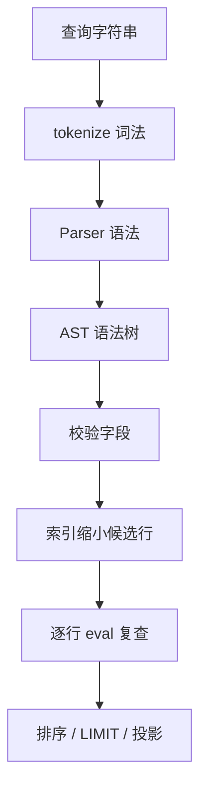

## Q
**条件解析与内存表查询：完整版**｜低层设计（参考，面试不用写这么多）

给一个查询字符串，比如 `SELECT name, age FROM users WHERE age >= 18 AND (city = 'NYC' OR NOT vip = 1) ORDER BY age DESC LIMIT 10`，或者只给 `WHERE` 后面的条件。用 Python 实现：

- 把条件解析成支持 `AND`、`OR`、`NOT`、括号的结构，优先级和 SQL 一致；
- 设计数据结构，在内存里模拟一张表（可能是有固定字段的关系表，也可能是字段不固定、可嵌套的文档）；
- 执行查询并返回结果。

面试官常常不说清楚输入格式，也不说是关系型还是 NoSQL，要先问清楚。

给出完整解答：需求、核心实体与接口、整体设计、深入问题、取舍、不同级别的期望。

## A
**一句话。** 这是三件事的组合：词法分析（Lexer）把字符串切成 token，递归下降解析（Recursive Descent Parser）按优先级建成语法树（AST），语法树在每一行上求值（Interpreter）；存储和解析完全分开，所以关系表和文档只差「怎么取字段」。

**需求。**
- 先问清楚：输入是完整 `SELECT` 还是只有条件；支持哪些运算符；字段是否固定；值有没有 `NULL`；数据量多大、要不要索引；语法错误是抛异常还是返回空。
- 功能：`= != <> < <= > >=`、`IN`、`IS [NOT] NULL`、`LIKE`、`BETWEEN`、`AND / OR / NOT`、括号；投影、`ORDER BY`、`LIMIT`；插入、删除。
- 优先级：`NOT` 高于 `AND`，`AND` 高于 `OR`，同级从左到右。
- 非功能：不用 `eval`（查询字符串不可信）；错误在碰数据之前报出；`NULL` 语义和 SQL 一致；规模先按单机内存，几万到几百万行。

**核心实体与接口。**
- `tokenize(text)`：字符串变 token 列表。
- `Parser`：`parse_condition()` 和 `parse_select()`，token 变语法树。
- **语法树节点即解释器模式：** 语法树节点 `Cmp / In / IsNull / Like / And / Or / Not`，每个节点实现 `eval(row)`，这就是解释器模式（Interpreter Pattern）：加一种运算符只加一个类，其他代码不动。
- `Table`：`insert(row)`、`delete(where)`、`select(query)`，内部管行和索引。
- `Database`：`create(name, columns, indexed)`、`query(sql)`，按表名分发。

**整体设计。**



例子 `a = 1 OR b = 2 AND NOT c = 3` 解析出来是这棵树，`AND` 比 `OR` 绑得紧，所以在更深的位置：

```text
Or
├─ Cmp(a = 1)
└─ And
   ├─ Cmp(b = 2)
   └─ Not
      └─ Cmp(c = 3)
```

文法（grammar），每一行对应 `Parser` 的一个函数，优先级低的在上面：

```text
or_expr   := and_expr (OR and_expr)*
and_expr  := not_expr (AND not_expr)*
not_expr  := NOT not_expr
           | '(' or_expr ')'
           | predicate
predicate := field op value
           | field [NOT] IN (v, ...)
           | field IS [NOT] NULL
           | field [NOT] LIKE str
           | field [NOT] BETWEEN v AND v
```

**简单解法。** 先不建索引：行放进列表，解析出条件后全表扫描。面试开场这样写就够，数据量一大或被追问性能时再加索引。

```python
def select_simple(rows: list[Row], where: str) -> list[Row]:
    cond = Parser(where).parse_condition()
    return [r for r in rows if cond.eval(r) is True]  # 未知（NULL）按不匹配处理
```

**完整实现。**
1. 词法：字符串变 token。正则按优先顺序匹配数字、字符串、运算符、单词；字符串里的 `AND` 不会被当成关键字，这正是不能用 `split` 的原因。

```python
import re
from collections import defaultdict
from dataclasses import dataclass
from typing import Any

Row = dict[str, Any]


class QueryError(ValueError):
    """语法错误或字段不存在：在碰数据之前就报错。"""


TOKEN = re.compile(r"""\s*(?:
    (?P<num>-?\d+(?:\.\d+)?)
  | (?P<str>'(?:[^']|'')*')              # SQL 写法：两个单引号表示一个单引号
  | (?P<op><=|>=|!=|<>|=|<|>|\(|\)|,|\*)
  | (?P<word>[A-Za-z_][\w.]*)            # 带点的路径用于嵌套文档：address.city
)""", re.X)
KEYWORDS = {"SELECT", "FROM", "WHERE", "ORDER", "BY", "ASC", "DESC", "LIMIT",
            "AND", "OR", "NOT", "IN", "IS", "NULL", "LIKE", "BETWEEN"}


def tokenize(text: str) -> list[tuple[str, Any]]:
    tokens, pos = [], 0
    text = text.rstrip()
    while pos < len(text):
        m = TOKEN.match(text, pos)
        if not m:
            raise QueryError(f"无法识别的字符，位置 {pos}: {text[pos:pos + 10]!r}")
        pos = m.end()
        kind, raw = m.lastgroup, m.group(m.lastgroup)
        if kind == "num":
            tokens.append(("val", float(raw) if "." in raw else int(raw)))
        elif kind == "str":
            tokens.append(("val", raw[1:-1].replace("''", "'")))
        elif kind == "word" and raw.upper() in KEYWORDS:
            tokens.append(("kw", raw.upper()))  # 关键字不分大小写，字段名区分
        elif kind == "word":
            tokens.append(("field", raw))
        else:
            tokens.append(("op", raw))
    return tokens
```

2. 语法树：每种节点只负责自己的求值，三值逻辑（`True / False / None`）在这里实现。

```python
def get_path(row: Row, path: str) -> Any:
    value: Any = row
    for part in path.split("."):  # 缺字段和 NULL 一样返回 None
        if not isinstance(value, dict):
            return None
        value = value.get(part)
    return value


@dataclass(frozen=True)
class Cmp:
    field: str
    op: str
    value: Any

    def eval(self, row: Row) -> bool | None:
        left = get_path(row, self.field)
        if left is None:
            return None  # NULL 比较的结果是「未知」，不是 False
        try:
            if self.op == "=":
                return left == self.value
            if self.op == "!=":
                return left != self.value
            if self.op == "<":
                return left < self.value
            if self.op == "<=":
                return left <= self.value
            if self.op == ">":
                return left > self.value
            return left >= self.value
        except TypeError:
            return None  # 无 schema 时可能遇到 'abc' < 3：当作不匹配，不让查询崩


@dataclass(frozen=True)
class In:
    field: str
    values: tuple[Any, ...]

    def eval(self, row: Row) -> bool | None:
        left = get_path(row, self.field)
        return None if left is None else left in self.values


@dataclass(frozen=True)
class IsNull:
    field: str

    def eval(self, row: Row) -> bool:
        return get_path(row, self.field) is None  # 唯一一个对 NULL 返回确定结果的谓词


@dataclass(frozen=True)
class Like:
    field: str
    pattern: str

    def eval(self, row: Row) -> bool | None:
        left = get_path(row, self.field)
        if left is None:
            return None
        parts = (".*" if c == "%" else "." if c == "_" else re.escape(c) for c in self.pattern)
        return re.fullmatch("".join(parts), str(left), re.S) is not None


@dataclass(frozen=True)
class And:
    left: Any
    right: Any

    def eval(self, row: Row) -> bool | None:
        a = self.left.eval(row)
        if a is False:  # 短路：False AND 未知 = False
            return False
        b = self.right.eval(row)
        if b is False:
            return False
        return None if a is None or b is None else True


@dataclass(frozen=True)
class Or:
    left: Any
    right: Any

    def eval(self, row: Row) -> bool | None:
        a = self.left.eval(row)
        if a is True:  # 短路：True OR 未知 = True
            return True
        b = self.right.eval(row)
        if b is True:
            return True
        return None if a is None or b is None else False


@dataclass(frozen=True)
class Not:
    inner: Any

    def eval(self, row: Row) -> bool | None:
        v = self.inner.eval(row)
        return None if v is None else not v  # NOT 未知 仍是未知


@dataclass(frozen=True)
class Select:
    columns: tuple[str, ...]  # 空元组表示 SELECT *
    table: str
    where: Any
    order: tuple[str, bool] | None  # (字段, 是否降序)
    limit: int | None
```

3. 语法：递归下降，一层文法一个函数，优先级靠调用层次表达。

```python
class Parser:
    def __init__(self, text: str) -> None:
        self.tokens = tokenize(text)
        self.i = 0

    def peek(self) -> tuple[str, Any]:
        return self.tokens[self.i] if self.i < len(self.tokens) else ("end", None)

    def accept(self, kind: str, value: Any = None) -> bool:
        k, v = self.peek()
        if k == kind and (value is None or v == value):
            self.i += 1
            return True
        return False

    def expect(self, kind: str, value: Any = None) -> Any:
        k, v = self.peek()
        if not self.accept(kind, value):
            raise QueryError(f"这里需要 {value or kind}，实际是 {v!r}")
        return v

    def parse_condition(self) -> Any:
        node = self.or_expr()
        if self.peek()[0] != "end":
            raise QueryError(f"条件结束后还有多余内容: {self.peek()[1]!r}")
        return node

    def or_expr(self) -> Any:  # 优先级最低，所以最先调用、最后结合
        node = self.and_expr()
        while self.accept("kw", "OR"):
            node = Or(node, self.and_expr())
        return node

    def and_expr(self) -> Any:
        node = self.not_expr()
        while self.accept("kw", "AND"):
            node = And(node, self.not_expr())
        return node

    def not_expr(self) -> Any:
        if self.accept("kw", "NOT"):
            return Not(self.not_expr())
        if self.accept("op", "("):
            node = self.or_expr()  # 括号让优先级重新从最低开始
            self.expect("op", ")")
            return node
        return self.predicate()

    def predicate(self) -> Any:
        field = self.expect("field")
        if self.accept("kw", "IS"):
            negated = self.accept("kw", "NOT")
            self.expect("kw", "NULL")
            return Not(IsNull(field)) if negated else IsNull(field)
        negated = self.accept("kw", "NOT")  # a NOT IN / NOT LIKE / NOT BETWEEN
        if self.accept("kw", "IN"):
            self.expect("op", "(")
            values = [self.expect("val")]
            while self.accept("op", ","):
                values.append(self.expect("val"))
            self.expect("op", ")")
            node: Any = In(field, tuple(values))
        elif self.accept("kw", "LIKE"):
            node = Like(field, self.expect("val"))
        elif self.accept("kw", "BETWEEN"):
            low = self.expect("val")  # 这个 AND 属于 BETWEEN，不是逻辑运算符
            self.expect("kw", "AND")
            node = And(Cmp(field, ">=", low), Cmp(field, "<=", self.expect("val")))
        elif negated:
            raise QueryError("NOT 后面需要 IN、LIKE 或 BETWEEN")
        else:
            op = self.expect("op")
            if op not in ("=", "!=", "<>", "<", "<=", ">", ">="):
                raise QueryError(f"不支持的运算符: {op}")
            node = Cmp(field, "!=" if op == "<>" else op, self.expect("val"))
        return Not(node) if negated else node

    def parse_select(self) -> Select:
        self.expect("kw", "SELECT")
        columns: list[str] = []
        if not self.accept("op", "*"):
            columns.append(self.expect("field"))
            while self.accept("op", ","):
                columns.append(self.expect("field"))
        self.expect("kw", "FROM")
        table = self.expect("field")
        where = self.or_expr() if self.accept("kw", "WHERE") else None
        order = None
        if self.accept("kw", "ORDER"):
            self.expect("kw", "BY")
            field = self.expect("field")
            desc = self.accept("kw", "DESC")
            if not desc:
                self.accept("kw", "ASC")
            order = (field, desc)
        limit = self.expect("val") if self.accept("kw", "LIMIT") else None
        if self.peek()[0] != "end":
            raise QueryError(f"语句结束后还有多余内容: {self.peek()[1]!r}")
        return Select(tuple(columns), table, where, order, limit)


def fields_of(node: Any) -> set[str]:
    if isinstance(node, (And, Or)):
        return fields_of(node.left) | fields_of(node.right)
    if isinstance(node, Not):
        return fields_of(node.inner)
    return {node.field} if node is not None else set()
```

4. 存储：行存加等值索引。索引只负责缩小范围，最后一定用条件复查。

```python
class Table:
    def __init__(self, columns: set[str] | None = None, indexed: tuple[str, ...] = ()) -> None:
        self.columns = columns  # None 表示无 schema（文档模型），有值表示关系模型
        self.rows: dict[int, Row] = {}  # rowid -> 行；dict 保持插入顺序
        self.next_id = 1
        self.indexes: dict[str, defaultdict[Any, set[int]]] = {c: defaultdict(set) for c in indexed}

    def insert(self, row: Row) -> int:
        if self.columns is not None and not set(row) <= self.columns:
            raise QueryError(f"未知字段: {set(row) - self.columns}")
        rowid, self.next_id = self.next_id, self.next_id + 1
        self.rows[rowid] = row
        for column, index in self.indexes.items():
            value = get_path(row, column)
            if value is not None:  # NULL 不进索引：= 和 IN 永远匹配不到它
                index[value].add(rowid)
        return rowid

    def delete(self, where: str) -> int:
        doomed = self._match(Parser(where).parse_condition())
        for rowid in doomed:
            row = self.rows.pop(rowid)
            for column, index in self.indexes.items():  # 主数据和索引必须一起改
                value = get_path(row, column)
                if value is not None:
                    index[value].discard(rowid)
        return len(doomed)

    def _candidates(self, node: Any) -> set[int] | None:
        """能用索引就返回候选 rowid 的超集；None 表示只能全表扫描。"""
        if isinstance(node, Cmp) and node.op == "=" and node.field in self.indexes:
            return set(self.indexes[node.field].get(node.value, ()))
        if isinstance(node, In) and node.field in self.indexes:
            return set().union(*(self.indexes[node.field].get(v, ()) for v in node.values))
        if isinstance(node, And):  # 任一边能缩小范围就够了，两边都能就取交集
            a, b = self._candidates(node.left), self._candidates(node.right)
            if a is None or b is None:
                return a if b is None else b
            return a & b
        if isinstance(node, Or):  # OR 必须两边都能用索引，否则漏行
            a, b = self._candidates(node.left), self._candidates(node.right)
            return None if a is None or b is None else a | b
        return None  # NOT、范围、LIKE：这个索引帮不上忙

    def _match(self, where: Any) -> list[int]:
        if where is None:
            return list(self.rows)
        self._validate(where)
        candidates = self._candidates(where)
        ids = self.rows if candidates is None else sorted(candidates)
        return [i for i in ids if where.eval(self.rows[i]) is True]  # 未知按不匹配处理

    def _validate(self, where: Any) -> None:
        if self.columns is not None and (unknown := fields_of(where) - self.columns):
            raise QueryError(f"未知字段: {unknown}")

    def select(self, q: Select) -> list[Row]:
        rows = [self.rows[i] for i in self._match(q.where)]
        if q.order:
            field, desc = q.order
            # NULL 排在最小的位置；元组第一位先把 NULL 和非 NULL 分开，避免 None < 3 报错
            def key(r: Row) -> tuple[bool, Any]:
                v = get_path(r, field)
                return (v is not None, 0 if v is None else v)
            rows.sort(key=key, reverse=desc)
        if q.limit is not None:
            rows = rows[:q.limit]
        if not q.columns:
            return [dict(r) for r in rows]  # 返回副本，调用方改结果不会污染表
        return [{c: get_path(r, c) for c in q.columns} for r in rows]


class Database:
    def __init__(self) -> None:
        self.tables: dict[str, Table] = {}

    def create(self, name: str, columns: set[str] | None = None, indexed: tuple[str, ...] = ()) -> Table:
        self.tables[name] = Table(columns, indexed)
        return self.tables[name]

    def query(self, sql: str) -> list[Row]:
        q = Parser(sql).parse_select()
        if q.table not in self.tables:
            raise QueryError(f"表不存在: {q.table}")
        return self.tables[q.table].select(q)
```

**运行。**

```python
db = Database()
users = db.create("users", {"id", "name", "age", "city", "vip"}, indexed=("city",))
for r in [{"id": 1, "name": "Ann", "age": 30, "city": "NYC", "vip": 1},
          {"id": 2, "name": "Bob", "age": 17, "city": "SF", "vip": 0},
          {"id": 3, "name": "Cat", "age": None, "city": "NYC", "vip": 0},
          {"id": 4, "name": "O'Neil", "age": 45, "city": "LA", "vip": None}]:
    users.insert(r)
```

- **例：括号里的 OR：** `WHERE age >= 18 AND (city = 'NYC' OR vip = 1)` → Ann。
- **例：AND 先于 OR 结合：** `WHERE city = 'NYC' OR age < 18 AND vip = 0` → Ann、Bob、Cat（`AND` 先结合）。
- `WHERE NOT age >= 18` → 只有 Bob。Cat 的 `age` 是 `NULL`，`NOT 未知` 还是未知，不返回。
- **例：IS NULL 与转义引号：** `WHERE age IS NULL OR name = 'O''Neil'` → Cat、O'Neil（两个单引号表示一个单引号）。
- **例：BETWEEN 加 LIMIT：** `WHERE age BETWEEN 18 AND 40 ORDER BY age DESC LIMIT 1` → Ann, 30。
- `WHERE salary > 1` → `QueryError: 未知字段`；`WHERE name = 'x'; DROP TABLE users` → `QueryError: 无法识别的字符`。
- **文档模型查嵌套字段：** 文档模型 `db.create("docs")` 不传字段：`WHERE address.city = 'NYC'` 能查嵌套字段；没有 `address` 的文档满足 `address.city IS NULL`。

**复杂度。**
- 解析：`O(L)`，`L` 是查询长度，每个 token 只看一次。
- 全表扫描：`O(n · k)`，`n` 是行数，`k` 是语法树节点数；有索引时 `n` 换成候选行数。
- 插入、删除一行：`O(索引数)`；空间：行数据加每个索引一份 rowid。

**深入。**
1. 优先级怎么实现：调用层次就是优先级。`or_expr` 调 `and_expr`，`and_expr` 调 `not_expr`，所以 `AND` 先把操作数收走，自然比 `OR` 绑得紧；括号回到 `or_expr`，优先级重新开始。方案对比：正则或 `split` 最快写，但处理不了括号，也分不清字符串里的 `AND`；调度场算法（Shunting-yard）不用递归，但遇到 `BETWEEN`、`IN` 这种多段语法很别扭；普拉特解析（Pratt Parser）适合运算符特别多的语言。这里选递归下降，文法和代码一一对应，最容易在面试中讲清楚和扩展。
2. 为什么不用 `eval`：查询字符串不可信，`eval` 等于让对方执行任意代码。把字符串转成 Python 表达式也处理不了 `NULL` 和 `LIKE`。语法树只有我们定义的几种节点，`; DROP TABLE` 在词法这一步就被拒绝。
3. **`NULL` 的三值逻辑**（Three-valued Logic）：和 `NULL` 比较的结果是「未知」，既不是真也不是假。`WHERE` 只保留结果为 `True` 的行。最容易错的是 `NOT`：把 `None` 当 `False` 的话，`NOT age >= 18` 会多返回 `age` 为 `NULL` 的 Cat。短路也要按三值来：`False AND 未知 = False`，`True OR 未知 = True`。
4. 索引怎么用才不漏行：不变量是「候选集必须是真实结果的超集」，所以最后一定复查。`AND` 只要一边能用索引就够，两边都能就取交集；`OR` 必须两边都能用，否则只能全表扫描，不然会漏掉另一边匹配的行。`NOT`、范围、`LIKE` 用不上哈希索引。`NULL` 不进索引，因为 `=` 和 `IN` 永远匹配不到它。删除时主数据和所有索引必须一起改。
5. 关系表和文档怎么统一：解析和求值完全一样，只差下面几处。

| 方面 | 关系型 | 文档型（NoSQL） |
|---|---|---|
| 字段 | 固定，`columns` 校验 | 不固定，`columns=None` |
| 未知字段 | 报错 | 当作缺失，等同 `NULL` |
| 嵌套 | 无 | 点路径 `address.city` |
| 类型不匹配 | 建表时可拦住 | `eval` 里当不匹配 |

**取舍与追问。**
- 范围查询要走索引：哈希索引改成有序结构。用 `bisect` 维护 `(值, rowid)` 的有序列表，插入 `O(n)`、查询 `O(log n + 结果数)`；真实数据库用 B+ 树。
- **频繁查询编译或缓存语法树：** 查询很频繁：把语法树编译成闭包，或者缓存「查询字符串 → 语法树」，避免重复解析；解析结果不可变（`frozen=True`），可以安全共享。
- 多个索引选哪个：统计每个值的行数，先用最小的候选集（基于代价的优化，Cost-based Optimizer）。这里 `AND` 直接求交集，简单但不一定最快。
- 参数化查询：支持 `age > ?`，值单独传入，同一条语法树可以复用，也从根上避免注入。
- 并发：读多写少用读写锁；写操作要把行和索引一起放在锁内，否则读到半更新的索引。
- 更新操作：`UPDATE` 就是先按 `WHERE` 找行，再改值；被改的字段如果有索引，要先删旧值再加新值。
- 嵌套太深：递归下降遇到几千层括号会 `RecursionError`，生产环境限制最大深度并报 `QueryError`。
- 多表 `JOIN`、`GROUP BY`：语法树再加节点，执行层改成算子链（扫描 → 过滤 → 连接 → 聚合 → 投影），每层一个迭代器。

**级别期望。**
- 中级：词法加语法分开，优先级和括号正确，能全表扫描返回结果。
- 高级：语法树和存储解耦，`NULL` 语义正确，错误处理清楚，索引不漏行且维护一致，能讲清楚关系表和文档的差异。
- 资深：谈查询优化（选索引、下推过滤条件）、范围索引、缓存、并发、算子链，并能说明每一步为什么先不做。

**先修概念。** [[hi-low-level-design-in-a-hurry-patterns|设计模式]]、[[hi-low-level-design-in-a-hurry-oop-concepts|面向对象概念]]、[[hi-system-design-core-concepts-data-modeling|数据建模]]、[[hi-system-design-core-concepts-db-indexing|数据库索引]]

**同类题。** [[basic-calculator|LC 224 基本计算器]]、[[tt-basic-calculator-ladder|计算器梯度题]]、[[tt-ai-assisted-order-validator|OrderValidator（规则 DAG）]]、[[tt-kv-store-snapshot-restore|内存 KV 存储：快照与恢复]]、[[kv-store-eviction|可配置淘汰策略的内存键值存储]]
