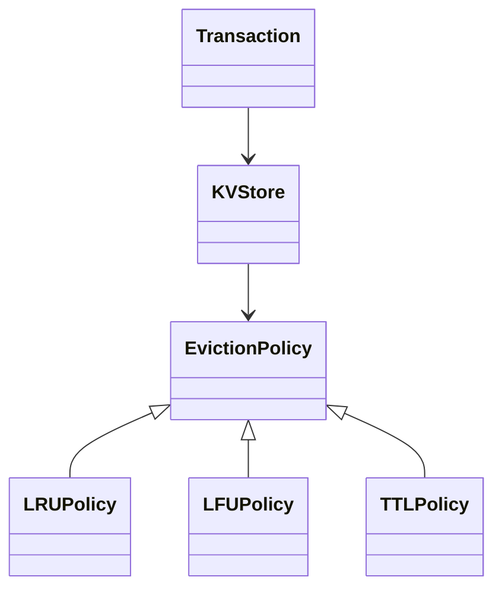

## Q
**设计可配置淘汰策略的内存键值存储（Redis-lite）**｜低层设计

设计并实现一个内存键值存储：除了最基本的字符串，还要支持多种数据结构（列表、有序集合等）；容量满了以后能按不同的淘汰策略（LRU 最近最少使用、LFU 最不经常使用、按 TTL 过期时间）清出空间，而且策略要能在配置里切换；键可以设置过期时间。进阶版本要求支持事务。面试官看重的是：存储层、数据结构层、淘汰策略三者是否解耦（接口与策略模式），以及你能不能把 LRU/LFU 做到 O(1)。

给出完整解答：需求、核心实体与接口、整体设计、深入问题、取舍、不同级别的期望。

## A
**一句话。** 把"数据放哪里"、"每种数据结构怎么操作"、"满了赶走谁"拆成三个互不知道对方内部的部件，用接口粘起来；淘汰策略只回答一个问题：谁是下一个受害者。

**60 分钟路线。**

| 时间 | 做什么 |
|---|---|
| 0–8 分 | 问清需求（数据类型、淘汰策略、事务要不要），定接口 |
| 8–15 分 | 画三个部件：存储、数据结构、淘汰策略，以及命令的统一流程 |
| 15–45 分 | 写核心实现：策略接口、LRU、`KVStore` 的惰性过期和淘汰 |
| 45–50 分 | 跑例子：淘汰顺序、过期 |
| 50–60 分 | 追问：O(1) 的 LFU、TTL 策略、数据结构层、事务 |

**需求。**
- 功能：
  - `set/get/delete`、带 TTL 的写入；
  - 列表（`lpush`）、有序集合（`zadd`、`zrange`）等数据结构命令；
  - 容量上限（按键数或字节数），超过时按配置的策略淘汰；
  - 键过期后不可读；
  - 类型检查：对字符串键执行列表命令要报错；
  - （进阶）事务：一组命令要么全部生效，要么全不生效。
- 非功能：
  - 常用操作 O(1) 或 O(log n)；
  - 线程安全；
  - 新增数据结构或新淘汰策略时，不改动已有代码（开闭原则）；
  - 可测试：时间由注入的时钟提供。

**核心实体与接口。**
- `KVStore`：对外的命令入口，持有数据字典、容量、淘汰策略、锁、时钟。
- `Entry`：一个键的值加过期时间。
- 值类型：字符串直接用 `str`，列表用 `deque`，有序集合是自己写的 `SortedSet`（成员 → 分数的字典 + 有序列表）。每种类型守住自己的不变量。
- `EvictionPolicy`（抽象类）：`on_insert`、`on_access`、`on_remove`、`victim`；具体实现 `LRUPolicy`、`LFUPolicy`、`TTLPolicy`，不接触数据本身，只维护"谁该先走"的元数据。
- `Transaction`：缓冲命令，提交时在同一把锁内顺序执行，出错则按快照回滚。
- 使用的模式：策略（淘汰）、命令（事务里缓冲的操作）、模板方法式的 `_fetch`（所有命令共用的过期检查、类型检查、通知策略）。

**整体设计。**



命令的统一流程（`_fetch`，逐步扩展 3 才写进代码；核心实现里先只有惰性过期和淘汰）：
1. 加锁。
2. 惰性过期：取出条目，若已过期就删除并当作不存在。
3. 类型检查：键已存在但类型不对，抛 `WrongType`。
4. 不存在且需要创建：先 `_make_room()`，容量满就反复询问策略 `victim()` 并删除，直到腾出空间；然后插入并通知策略 `on_insert`。
5. 已存在：通知策略 `on_access`（LRU 把它挪到队尾、LFU 把频次加一）。
6. 执行具体数据结构的操作。

**核心实现。** 约 30 分钟，下面是全部要写的代码：策略接口、LRU、带惰性过期和淘汰的 `KVStore`。

```python
import threading
import time
from abc import ABC, abstractmethod
from collections import OrderedDict
from typing import Callable, Optional


# ---------- 淘汰策略：只管"谁是下一个受害者"，不碰数据 ----------
class EvictionPolicy(ABC):
    @abstractmethod
    def on_insert(self, key: str, expire_at: Optional[float]) -> None: ...
    @abstractmethod
    def on_access(self, key: str) -> None: ...
    @abstractmethod
    def on_remove(self, key: str) -> None: ...
    @abstractmethod
    def victim(self) -> Optional[str]: ...


class LRUPolicy(EvictionPolicy):
    def __init__(self) -> None:
        self._order: OrderedDict[str, None] = OrderedDict()  # 队尾 = 最近使用

    def on_insert(self, key, expire_at): self._order[key] = None
    def on_access(self, key): self._order.move_to_end(key)
    def on_remove(self, key): self._order.pop(key, None)
    def victim(self): return next(iter(self._order), None)


class Entry:
    __slots__ = ("value", "expire_at")
    def __init__(self, value, expire_at=None): self.value, self.expire_at = value, expire_at


class KVStore:
    def __init__(self, capacity: int, policy: EvictionPolicy,
                 clock: Callable[[], float] = time.monotonic) -> None:
        self._data: dict[str, Entry] = {}
        self._cap, self._policy, self._clock = capacity, policy, clock
        self._lock = threading.RLock()  # 单锁：与 Redis 单线程命令模型同构

    def _live(self, key: str) -> Optional[Entry]:  # 惰性过期：任何读写先过这一关
        e = self._data.get(key)
        if e and e.expire_at is not None and e.expire_at <= self._clock():
            self._remove(key)
            return None
        return e

    def _remove(self, key: str) -> None:
        self._data.pop(key, None)
        self._policy.on_remove(key)

    def _make_room(self) -> None:  # 满了就反复问策略"谁走"，直到腾出空位
        while len(self._data) >= self._cap:
            v = self._policy.victim()
            if v is None:
                raise MemoryError("nothing evictable")
            self._remove(v)

    def set(self, key: str, val, ttl: Optional[float] = None) -> None:
        with self._lock:
            if self._live(key) is None:
                self._make_room()
                self._policy.on_insert(key, None)
            else:
                self._policy.on_access(key)
            exp = self._clock() + ttl if ttl else None
            self._data[key] = Entry(val, exp)

    def get(self, key: str):
        with self._lock:  # get 也要拿锁：读会改变策略的元数据
            e = self._live(key)
            if e is None:
                return None
            self._policy.on_access(key)
            return e.value

    def delete(self, key: str) -> None:
        with self._lock:
            self._remove(key)
```

**运行。** 容量 2，用可控的时钟：
- `set a`、`set b`、`get a`、`set c`：`b` 最久没用，被淘汰；`get a` 得到 `1`，`get b` 得到 `None`，`get c` 得到 `3`。
- `set d` 带 `ttl=10`，时钟走到 11：`get d` 得到 `None`，过期的键被顺手删掉，只剩 `c` 一个键。

**逐步扩展。**
1. 【追问再讲】O(1) 的 LFU：「频次 → 该频次的 key 有序集合」，再记住当前最小频次。

```python
from collections import defaultdict


class LFUPolicy(EvictionPolicy):
    """O(1) LFU：频次 -> 同频次的 key（按进入该桶的先后，平局时淘汰最老的）。"""
    def __init__(self) -> None:
        self._freq: dict[str, int] = {}
        self._buckets: defaultdict[int, OrderedDict[str, None]] = defaultdict(OrderedDict)
        self._min = 0

    def on_insert(self, key, expire_at):
        self._freq[key] = 1
        self._buckets[1][key] = None
        self._min = 1  # 新 key 频次 1，必然是当前最小

    def on_access(self, key):
        f = self._freq[key]
        del self._buckets[f][key]
        if not self._buckets[f] and self._min == f:
            self._min = f + 1
        self._freq[key] = f + 1
        self._buckets[f + 1][key] = None

    def on_remove(self, key):
        f = self._freq.pop(key, None)
        if f is not None:
            self._buckets[f].pop(key, None)

    def victim(self):
        while self._freq:
            bucket = self._buckets.get(self._min)
            if bucket:
                return next(iter(bucket))
            self._min += 1
        return None
```

2. 【追问再讲】TTL 淘汰策略：淘汰最快过期的键，小根堆加惰性删除。`set` 要在写入过期时间后通知策略，所以 `EvictionPolicy` 加一个默认空方法，`KVStore.set` 末尾加两行。

```python
import heapq


# EvictionPolicy 新增一个默认空方法，只有 TTL 策略关心
def on_expire_set(self, key: str, expire_at: float) -> None: ...


class TTLPolicy(EvictionPolicy):
    """优先淘汰最快过期的 key（Redis 的 volatile-ttl）；用惰性删除的小根堆。"""
    def __init__(self) -> None:
        self._heap: list[tuple[float, str]] = []
        self._exp: dict[str, float] = {}

    def on_insert(self, key, expire_at):
        self._exp[key] = expire_at if expire_at is not None else float("inf")
        heapq.heappush(self._heap, (self._exp[key], key))

    def on_access(self, key): pass
    def on_remove(self, key): self._exp.pop(key, None)
    def on_expire_set(self, key, expire_at): self.on_insert(key, expire_at)

    def victim(self):
        while self._heap and self._exp.get(self._heap[0][1]) != self._heap[0][0]:
            heapq.heappop(self._heap)  # 堆顶是已删除或已改过期时间的旧记录
        return self._heap[0][1] if self._heap else None
```

```python
# KVStore.set 的最后加两行：写入过期时间后通知策略
            if exp is not None:
                self._policy.on_expire_set(key, exp)
```

3. 【追问再讲】数据结构层：列表和有序集合，以及统一流程 `_fetch`（加类型检查）。新增一种结构只需新增值类型和命令，淘汰策略与过期逻辑不动，因为它们只认 key。`get` 同样可以改成 `_fetch(key, str, create=False)`。

```python
import bisect
from collections import deque


class WrongType(Exception): ...


class SortedSet:
    def __init__(self) -> None:
        self._score: dict[str, float] = {}
        self._items: list[tuple[float, str]] = []  # 有序；生产里换跳表

    def add(self, member: str, score: float) -> None:
        if member in self._score:
            self._items.remove((self._score[member], member))
        self._score[member] = score
        bisect.insort(self._items, (score, member))

    def range(self, start: int, stop: int) -> list[str]:
        return [m for _, m in self._items[start:stop + 1]]


# 以下是 KVStore 新增的方法
def _fetch(self, key: str, typ: type, create: bool) -> Optional[Entry]:
    e = self._live(key)                       # 1. 惰性过期
    if e is None:
        if not create:
            return None
        self._make_room()                     # 2. 不存在且要创建：先腾位置
        e = self._data[key] = Entry(typ())
        self._policy.on_insert(key, None)
    else:
        if not isinstance(e.value, typ):      # 3. 类型检查
            raise WrongType(key)
        self._policy.on_access(key)
    return e

def lpush(self, key: str, *vals: str) -> int:
    with self._lock:
        lst = self._fetch(key, deque, create=True).value
        for v in vals:
            lst.appendleft(v)                 # deque 两端 O(1)
        return len(lst)

def zadd(self, key: str, score: float, member: str) -> None:
    with self._lock:
        self._fetch(key, SortedSet, create=True).value.add(member, score)

def zrange(self, key: str, start: int, stop: int) -> list[str]:
    with self._lock:
        e = self._fetch(key, SortedSet, create=False)
        return e.value.range(start, stop) if e else []
```

4. 【追问再讲】主动过期：后台线程周期调用，抽样删除没人再读的过期键。

```python
def sweep_expired(self, sample: int = 20) -> int:
    """后台线程周期调用：抽样删过期 key，防止没人再读的过期 key 占内存。"""
    with self._lock:
        now, n = self._clock(), 0
        for k in list(self._data)[:sample]:
            e = self._data[k]
            if e.expire_at is not None and e.expire_at <= now:
                self._remove(k)
                n += 1
        return n
```

5. 【加分】事务：命令先缓冲，提交时在同一把锁里顺序执行，第一次碰某个 key 时留快照，任何一条抛错就还原。

```python
import copy


def _restore(self, key: str, snap: Optional[Entry]) -> None:   # KVStore 新增
    self._remove(key)
    if snap is not None:
        self._data[key] = snap
        self._policy.on_insert(key, snap.expire_at)


class Transaction:
    """MULTI/EXEC：命令先缓冲；提交时在同一把锁里顺序执行，任何一条抛错就按快照回滚。"""
    def __init__(self, store: KVStore) -> None:
        self._s, self._ops = store, []

    def queue(self, name: str, *args) -> "Transaction":
        self._ops.append((name, args))
        return self

    def commit(self) -> list:
        with self._s._lock:
            undo: dict[str, Optional[Entry]] = {}
            results = []
            try:
                for name, args in self._ops:
                    key = args[0]
                    if key not in undo:  # 第一次碰某个 key 时留一份快照
                        undo[key] = copy.deepcopy(self._s._data.get(key))
                    results.append(getattr(self._s, name)(*args))
                return results
            except Exception:
                for key, snap in undo.items():
                    self._s._restore(key, snap)
                raise
```

**深入。**
1. **【必讲】LRU/LFU 的 O(1) 做法：** 怎么做到：
   - LRU：`OrderedDict` 就是哈希表加双向链表。访问时 `move_to_end`，淘汰时取第一个，都是 O(1)；
   - LFU：天真的做法是维护频次然后每次找最小，O(n) 或 O(log n)。O(1) 的做法是"频次 → 该频次的 key 有序集合"，再记住当前最小频次：访问时把 key 从频次 f 的桶挪到 f+1 的桶，若原桶空了且它是最小频次则最小频次加一；新插入的 key 频次是 1，最小频次也就是 1。同频次的平局按进入该桶的先后，淘汰最老的；
   - 两者共用同一个接口，`KVStore` 不知道也不关心具体是哪一种。
2. 【必讲】淘汰与过期是两回事：过期是"这个键按约定到点就该消失"；淘汰是"内存不够了，主动牺牲一个"。过期的实现有两条路并用：
   - 惰性：每次访问时检查，保证读不到过期数据；
   - 主动：后台线程周期抽样（例如每次抽 20 个）删除已过期的键，防止从来没人再读的过期键一直占着内存；如果抽样中过期比例很高就立刻再抽一轮（Redis 的做法）。
   - 必须二者并用：只有惰性会泄漏内存，只有主动则读到过期数据的窗口无法避免。
3. 【追问再讲】TTL 策略（淘汰最快过期的）：小根堆按过期时间排序。键被删除或过期时间改变时，堆里会留下旧记录，用"惰性删除"：堆顶元素与当前真实过期时间不一致就丢弃。每次插入 O(log n)。
4. 【追问再讲】数据结构层的扩展：有序集合用"字典 + 有序列表"，`zadd` 是 O(n)（列表插入），生产实现用跳表（skip list）得到 O(log n)；列表用 `deque`，两端操作 O(1)。
5. 【追问再讲】并发：
   - 一把全局锁：实现简单、事务天然隔离，与 Redis 单线程命令执行模型一致，吞吐受限于单核；
   - 分段锁：按 key 哈希分成多段，每段自己的字典和策略实例，并发度高；代价是淘汰变成"每段内近似"，事务跨段要按固定顺序加锁防死锁；
   - 读写锁对 LRU 无益，因为读也要修改链表。
   - 选一把锁，面试里说明分段是下一步的优化即可。
6. 【追问再讲】容量按什么算：按键数最简单，但一个有序集合里可能有百万成员，键数不反映真实内存。更真实的做法是每个值提供 `size_of()`，存储维护总字节数，插入或修改后循环淘汰直到低于上限。代价是每次变更都要更新字节数。
7. 【加分】事务：
   - 语义：提交前命令只缓冲，不改数据；提交时在同一把锁里依次执行，其他线程看不到中间状态（隔离性）；
   - 原子性：第一次触碰某个 key 时保存快照，任何一条命令抛错就按快照还原，所以要么全部生效、要么都不生效；
   - 与淘汰的相互作用：事务里的插入可能触发淘汰其他键，这些被淘汰的键不会被回滚，这是缓存语义下可接受的行为（Redis 在内存上限下也是如此），要在文档里写明；
   - 乐观事务（WATCH）：版本号校验，提交时发现被监视的键已变就放弃，适合冲突少的场景。

**取舍与追问。** 按被问到的可能性排，通常口述就够：
- LRU 与 LFU 怎么选：LRU 对"最近热"友好，实现简单，但会被一次性的大扫描冲刷掉热数据；LFU 对"长期热"友好，抗扫描，但新数据频次低容易被立刻淘汰，且旧的高频数据不会衰减。实用的 LFU 会给频次加衰减或使用 TinyLFU 一类的准入过滤。
- 为什么 `get` 也要拿写锁：因为读会改变淘汰策略的元数据（LRU 顺序、LFU 频次）。
- 近似算法：精确 LRU 要维护链表，高并发下是热点。Redis 采用随机抽样 N 个键再淘汰其中最久未用的，换来无需全局链表的开销。
- 淘汰策略如何在运行时切换：策略只持有元数据，切换时用现有键重建一个新策略对象（重新 `on_insert` 全部键，丢失访问历史）即可。
- 多种数据结构共用一个淘汰策略是否合理：淘汰粒度是 key，不是元素。大集合中的某个元素不会被单独淘汰。
- 持久化：快照（定期序列化整个字典）或追加日志（AOF）；一般不要求，被问到时给出这两个选项的取舍。

**级别期望。**
- 中级：字典存数据，LRU（哈希表 + 双向链表）和 TTL 过期，类型检查，清晰的类划分。
- 高级：策略接口把淘汰与存储解耦，O(1) 的 LFU，惰性 + 主动过期，注入时钟的可测试性，线程安全。
- 资深/专家：事务的快照回滚及其与淘汰的相互作用，按字节计容量，分段锁与近似 LRU，抗扫描的 LFU 变体，数据结构层的可扩展性（开闭原则）。

**先修概念。**
- [[hi-low-level-design-in-a-hurry-patterns|设计模式]]
- [[hi-low-level-design-in-a-hurry-design-principles|设计原则]]
- [[hi-low-level-design-in-a-hurry-oop-concepts|面向对象概念]]
- [[hi-low-level-design-concurrency-intro|并发入门]]
- [[hi-system-design-core-concepts-caching|缓存]]

**同类题。**
- [[solution-lru-cache|设计题解：LRU 缓存]]
- [[solution-ttl-cache|设计题解：带过期时间的缓存]]
- [[solution-kv-store|设计题解：键值存储]]
- [[solution-amz-in-memory-db|设计题解：内存数据库]]
