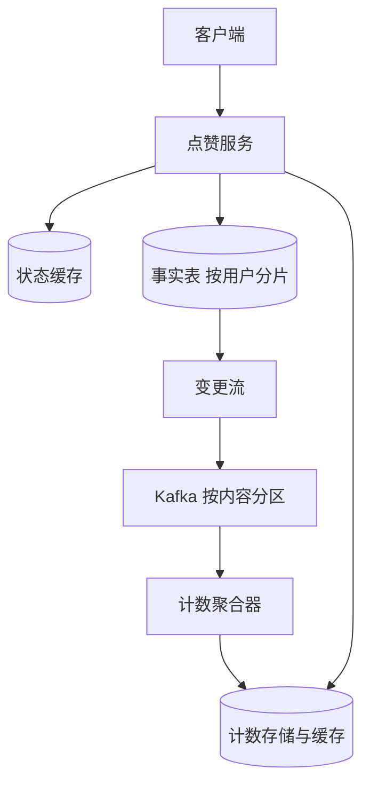

## Q
**点赞与取消点赞（收藏）系统**｜系统设计

设计一个让用户对内容（商品、游戏、帖子）点赞或取消点赞（favorite/unfavorite）的系统：用户能操作点赞与取消、查询自己是否已点赞某个内容、查看某个内容的点赞总数、查看自己点赞过的内容列表。规模按：查询"是否已点赞"约 100 万 QPS，查询点赞数约 100 万 QPS，点赞/取消的写入约 10 万 QPS，并要求数据一致、不重复计数。

给出完整解答：需求、核心实体与接口、整体设计、深入问题、取舍、不同级别的期望。

## A
**一句话。** 同一件事要同时服务四种访问模式——按（用户，内容）点查、按内容计数、按用户列表、高并发写——难点在于把"事实"（谁赞了什么）和"派生统计"（总数）分开存放，让热门内容的计数不变成热点，同时保证重复点赞不会重复计数。

**60 分钟路线。**

| 时间 | 做什么 |
|---|---|
| 0–5 分 | 问清需求，算数字：读 100 万 QPS，写 10 万 QPS，约 4TB |
| 5–10 分 | 实体（事实表、计数）和四个接口 |
| 10–25 分 | 整体设计：事实表、条件写、变更流、计数聚合器、缓存读 |
| 25–50 分 | 必讲深入：热门内容计数；百万 QPS 状态查询；计数准确性 |
| 50–60 分 | 追问：读自己的写、列表分页、反作弊 |

**需求。**
功能：
1. **点赞与取消幂等：** 点赞、取消点赞（幂等：重复点赞不改变结果）。
2. **批量查是否点赞：** 查询当前用户是否点赞了某内容（常按一页内容批量查）。
3. 查询某内容的点赞总数。
4. **点赞列表倒序分页：** 查询当前用户点赞过的内容列表（按时间倒序，分页）。

非功能：
- 读：状态查询 100 万 QPS，计数查询 100 万 QPS；延迟 p99 < 50ms（它们挂在内容展示页上，不能拖慢首屏）。
- 写：点赞与取消 10 万 QPS，热门内容可能瞬间被大量用户点赞。
- 一致性：用户自己的操作立即可见（读自己的写）；总数允许秒级延迟，但长期必须准确，不能因重试或重复请求而漂移。
- 存储：假设 10^11 条（用户，内容）关系，每条约 40 字节，约 4TB，需要分片。

**核心实体与接口。**
实体：`Favorite(userId, itemId, createdAt)`（事实表）；`ItemCounter(itemId, count)`（派生值）。
接口：
- **点赞与取消接口：** `PUT /items/{itemId}/favorite`、`DELETE /items/{itemId}/favorite`（幂等，状态变化与否都返回当前状态）。
- **批量状态接口：** `GET /favorites/status?itemIds=a,b,c`（批量，返回每个是否已点赞）。
- **点赞数接口：** `GET /items/{itemId}/favorite-count`；通常再并进内容详情里。
- **点赞列表接口：** `GET /users/me/favorites?cursor=`（按 `createdAt` 倒序分页，游标是（时间，内容 ID））。

**整体设计。**

1. 事实表：主键 `(userId, itemId)`，按 `userId` 哈希分片（DynamoDB、Cassandra 或分片 MySQL 都可以）。同一个用户的所有记录在同一个分区，所以"是否已点赞"是一次主键点查，"我的列表"是一次分区内按 `createdAt` 的范围查（二级索引或排序键）。热门内容不会让某个分区过热，因为一个内容的点赞者分散在各个用户分区里。
2. 写入：点赞用"条件写"——仅当记录不存在时插入；取消用条件删除，返回旧值。只有状态真正发生变化时，才产生一个事件 `+1` 或 `-1`。重复请求、重试因此不会改变计数，这是幂等性的来源。
3. 变更事件：不要在服务里"写库再发消息"（双写可能一个成功一个失败）。让数据库的变更流（CDC，如 DynamoDB Streams、binlog）驱动 Kafka，保证"记录变了就一定有事件"。事件按 `itemId` 分区。
4. 计数聚合器：消费者在内存里按内容累加一个短窗口（比如 1 秒）内的增减量，窗口结束时对每个内容只做一次计数存储更新。这样一个爆款每秒 5 万次点赞，也只变成每秒一次写。计数存储可以是 Redis 或键值库，并配有缓存。
5. 读状态：先读状态缓存（键 `(userId, itemId)`），未命中读事实表并回填；点赞/取消时先写库成功再更新缓存（写穿），所以用户自己的操作立即可见。
6. 读计数：从计数缓存读，延迟一两秒无所谓；全体用户看到的是同一个数，可以用进程内缓存加边缘缓存（TTL 1 到 5 秒）。

**深入。**

1. 【必讲】热门内容的计数不能是热点。
- 问题：天真的做法是每次点赞 `UPDATE items SET count = count + 1`，所有写落在同一行同一分区；10 万 QPS 里只要有一个内容分到 5 万，就崩了。
- 选项 A：计数分片（sharded counter），一个内容拆成 N 个子计数器，随机选一个加，读时求和；写分散了，读变成 N 次读（可缓存求和结果）。
- 选项 B：流式聚合（上面的方案），把同一内容的增量合并成批，一次写入。
- 选项 C：读时统计事实表，在数十亿记录的热门内容上太慢，不可行。
- 选择：B 为主，超大热点可叠加 A。B 还能削峰，写入量与点赞量脱钩。

2. 【必讲】100 万 QPS 的状态查询。
- 问题：每个内容列表页要为一页 20 到 50 个内容各问一次「我是否点赞」，全打数据库代价很高。
- 批量接口一次带一页内容的 ID；读缓存（按用户分片的 Redis，键 `(userId, itemId)`），访问局部性让命中率不低。
- 「未点赞」这种负结果也要缓存（短 TTL）：绝大多数（用户，内容）组合都是未点赞，不缓存就全穿透到数据库。
- 进一步降压（加分）：每用户一个布隆过滤器（Bloom filter）装着点赞过的内容 ID，说「没有」就一定没有，直接返回；说「有」可能是假阳性，再查库确认。取消点赞后删不掉元素，需要定期重建。

3. 【必讲】计数准确性与一致性分层。
- 事实（用户是否点赞）强一致：同一用户的记录在一个分区，条件写在分区内原子。计数最终一致：几秒延迟可接受，这是放弃强一致换吞吐的典型选择。
- 增量事件至少一次投递，消费者重启可能重复处理：事件带事件 ID（用户、内容、版本号）去重，或让聚合器用事实表的版本号校验。
- 每天用批处理按事实表重算一次对账，只修正偏差，不依赖它实时准确。
- 同一用户快速点两下：请求顺序到达同一分区，条件写保证最终状态与最后一个请求一致，事件序列 `+1, -1` 也自洽（增量可交换）。

4. 【追问再讲】读自己的写：服务端先写库成功再更新缓存（写穿）；客户端乐观更新，点击后立刻变红，再用响应确认。计数读全员看同一个数，用进程内缓存加边缘缓存（TTL 1 到 5 秒），延迟一两秒无所谓。

5. 【追问再讲】用户列表与分页：按 `(userId, createdAt desc, itemId)` 排序，游标分页（游标是时间加内容 ID），不用 offset，因为用户可能中途点赞，offset 会漏项或重复。取消点赞要同时删排序索引条目（本地二级索引由数据库维护）；只存 ID，详情读取时批量取。

**取舍与追问。** 按被问到的可能性排，通常口述就够：
- 计数是否必须精确：社交产品通常允许显示近似值（「1.2 万」），精确值只在后台用；应在需求里问清，这是降低成本的前提。
- 能否去掉事实表只存计数：不行，需要判断「是否已点赞」、列表和去重。
- 软删除还是硬删除：取消点赞直接删记录；需要审计「点过又取消」时加状态字段。
- 反作弊与限流：对同一用户的点赞频率限流；异常账号的点赞事后从计数中扣除（重算该内容）。
- 跨区域：用户归属一个主区域，写入主区域，其他区域读副本和缓存；计数最终一致。
- 规模再大 10 倍：事实表继续分片，聚合器增加分区，状态缓存按用户分片扩容，边缘缓存吸收计数读取。

**级别期望。**
- 中级：数据库表加缓存，说明如何查状态、计数、列表，知道用主键防重复点赞。
- 高级：把事实与计数分离，条件写保证幂等，缓存与批量接口压住读，说明计数写的热点与解决方案（分片计数或聚合）。
- 资深/Staff：CDC 驱动事件避免双写、窗口聚合与去重、对账、布隆过滤器降压、一致性分层的明确论证、容量与成本估算、跨区域方案。

**先修概念。** [[hi-system-design-core-concepts-caching|缓存]]、[[hi-system-design-patterns-scaling-reads|扩展读]]、[[hi-system-design-patterns-scaling-writes|扩展写]]、[[hi-system-design-core-concepts-sharding|分片（Sharding）]]、[[hi-system-design-deep-dives-dynamodb|DynamoDB]]、[[hi-system-design-deep-dives-kafka|Kafka]]

**同类题。** [[solution-news-feed|信息流]]、[[solution-leaderboard|排行榜]]、[[hi-system-design-problem-breakdowns-top-k|YouTube 热门 Top K]]、[[hi-system-design-problem-breakdowns-ad-click-aggregator|广告点击聚合]]
