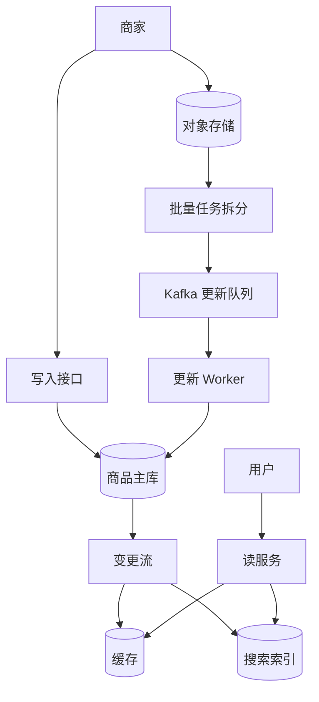

## Q
**商家商品上架与更新系统**｜系统设计

设计一个系统，让商家通过单条更新或批量更新来创建和管理商品（在图片社区的场景里，商品就是带价格和库存的"图钉"），同时让普通用户能在近实时的时间内浏览、搜索到最新的商品信息。核心张力：商家写入有突发的大批量（一次上传几万到几十万条），读侧是海量用户的低延迟浏览。

给出完整解答：需求、核心实体与接口、整体设计、深入问题、取舍、不同级别的期望。

## A
**一句话。** 写侧是"可靠、可校验、可重放的批量摄入"，读侧是"为浏览优化的派生视图"，两者之间用事件流连接；难点在于更新顺序、批量对单条更新的挤压、以及缓存与搜索索引在更新后多快、多准地跟上。

**60 分钟路线。**

| 时间 | 做什么 |
|---|---|
| 0–5 分 | 需求和数字：约 5 亿件商品，读峰值约 10 万 QPS，价格库存 10 秒内可见 |
| 5–10 分 | 实体和接口：`Product` 带 `version`；单条同步 `PUT`，批量上传 + 异步任务 |
| 10–25 分 | 画主链路：主库 → CDC 变更流 → 缓存和搜索索引；批量走对象存储 → Kafka → Worker |
| 25–50 分 | 深入：更新乱序与版本条件更新、批量挤压单条、缓存和搜索的新鲜度 |
| 50–60 分 | 追问：商家读自己的写、墓碑、分片键、部分失败 |

**需求。**
功能：
1. **商家商品增删改：** 商家创建、修改、下架商品（标题、描述、价格、库存、图片、类目）。
2. 单条更新：同步生效，商家立刻能看到结果。
3. 批量更新：上传文件（CSV、JSON Lines）或调用批量接口，异步处理，可查看进度和逐行错误。
4. 用户浏览商品详情、列表和搜索结果，看到的是近实时的最新信息。
5. 范围外：支付与下单、推荐排序（只需说明会消费更新事件）。

非功能（假设并说出来）：
- 规模：100 万商家，约 5 亿件商品；1 亿日活，读 QPS 峰值约 10 万；写入平均每秒几千，批量时峰值更高。
- 新鲜度：价格与库存变动 10 秒内对用户可见，描述、图片等其他字段 1 分钟内可见。
- 正确性：同一商品的更新按顺序生效，旧更新不能覆盖新更新；批量任务可重试而不产生重复或错乱。
- 公平：一个商家的超大批量不能拖慢其他商家的单条更新。
- 可用性：读路径高可用；写入可以排队稍晚生效。

**核心实体与接口。**
实体：`Merchant`；`Product(productId, merchantId, fields..., version, updatedAt, status)`；`BulkJob(jobId, merchantId, fileRef, status, total, succeeded, failed, errorFileRef)`；`ProductEvent(productId, version, changeType, payload)`。
接口：
- **PUT 带 If-Match 版本：** `PUT /merchants/{m}/products/{id}`（带 `If-Match: version`，同步，返回新版本）；`DELETE` 同理。
- **bulk-jobs 预签名上传：** `POST /merchants/{m}/bulk-jobs`：返回一个预签名上传地址和 `jobId`；商家把文件传到对象存储后调用 `POST /bulk-jobs/{id}/start`；`GET /bulk-jobs/{id}` 查进度和错误文件。
- **读接口：详情、搜索、后台：** 读：`GET /products/{id}`、`GET /search?q=&category=`、`GET /merchants/{m}/products`（商家后台）。

**整体设计。**

1. 单条更新：接口校验字段（价格非负、类目合法、字符串长度），带版本做乐观并发控制——`UPDATE ... WHERE id=? AND version=?`，不一致返回 `409`，商家刷新后重试。成功后版本加一，数据库提交即向商家确认。
2. 批量更新：商家用预签名 URL 把文件直接传到对象存储（不经过应用服务器，大文件也不占连接）。启动后，拆分任务按固定行数（例如 500 条）切片，每片作为一条消息放入 Kafka，键是 `productId`，同一商品的更新进入同一分区、保持顺序。Worker 消费分片，逐条校验后写主库，成功与失败分别计数，失败行连同原因追加到错误文件。任务状态由计数推出，商家随时可查。
3. 变更传播：主库提交后，由变更数据捕获（CDC）产生 `ProductEvent` 发往 Kafka。三类消费者：缓存更新者（更新商品详情缓存）、搜索索引器（批量写搜索引擎）、下游业务（推荐、订阅的价格提醒等）。写主库与发事件由 CDC 连接，避免"写库成功、发消息失败"的双写问题。
4. 读：详情先读 Redis 缓存，未命中读主库的读副本并回填；列表与搜索走搜索引擎（Elasticsearch），返回商品 ID 与摘要字段，价格与库存等易变字段可再用缓存覆盖一次，保证显示最新。图片走对象存储加 CDN。

**深入。**
1. 【必讲】更新顺序与乱序：
- 问题：同一商品先改价 10 元再改价 8 元，如果处理时乱序，最终会停在 10 元。批量任务重试、多个 Worker 并行都会引入乱序。
- 方案：(a) 同商品进同一分区，由单个消费者顺序处理；(b) 每次更新带版本号或商家侧时间戳，写入时用条件更新——仅当版本大于当前版本才生效，迟到的旧更新被丢弃；(c) 消费端（缓存、索引）同样"只接受更高版本"。(b) 加 (c) 让整个链路对乱序和重复天然免疫，不依赖投递顺序。
- 批量里同一商品出现多次：同一分片内先合并，只保留最后一条。
2. 【必讲】批量对单条的挤压（公平）：
- 问题：一个商家上传 50 万行，若与单条更新共用队列，会让别的商家的更新排在后面几分钟。
- 方案：批量和单条使用不同的队列（高优先级与低优先级）和各自的消费者池；批量任务按商家限速（令牌桶，例如每商家每秒 500 行），并设置每商家并发分片数上限。这样批量慢一点，但单条更新延迟稳定。
- 背压：队列堆积超过阈值时，批量启动接口返回"排队中"并给出预计时间，而不是无限接收。
3. 【必讲】新鲜度与缓存：
- 问题：商品被改价后，缓存里的旧价格会继续展示到过期。
- 选项：(a) 只靠 TTL，简单，但新鲜度等于 TTL；(b) 更新时直接删缓存（失效），下次读时回源，常见，但回源瞬间的并发读可能把旧值又写回；(c) 事件驱动写穿——缓存更新者消费变更事件，用版本条件更新缓存。
- 选择：(c) 加较长的保底 TTL。回源并发时用 singleflight 合并请求，并在回填时带版本，防止旧值覆盖新值。热门商品的读 QPS 远高于写，缓存命中率应当在 95% 以上。
- 搜索索引的近实时：搜索引擎的刷新有秒级延迟，批量写入索引以提高吞吐；价格与库存由于变化频繁，不放在倒排排序的关键路径里，而是从缓存读取后覆盖，避免为每次改价重建索引文档。
4. 【追问再讲】商家的读自己的写：
- 商家改完价格后刷新后台，如果读的是延迟的副本或缓存，会以为没改成功。后台读主库，或让响应带版本号、读路径要求版本不低于该值（缓存不满足则回源）。普通用户读最终一致即可。

**取舍与追问。** 按被问到的可能性排，通常口述就够：
- 同步还是异步：单条同步写主库（商家要即时反馈）；批量异步（量大、需要逐行报告）。
- 分片键：商品主库按 `productId` 哈希分片，分散热点；商家后台的列表需要 `merchantId` 的二级索引（全局索引，或单独的商家维度投影表）。
- 校验放在哪里：入口做格式校验，Worker 做业务校验（价格波动异常检测、违禁词、图片可访问），不合格行进错误文件，而不是让整个任务失败。图片拉取与缩放走独立的异步流水线，商品先以占位图上线。
- 部分失败：任务级别是"部分成功"，行级别幂等重试；死信队列保存反复失败的分片供排查。
- 下架与删除：用墓碑（tombstone）事件，同样带版本，保证删除不被迟到的旧更新"复活"。
- 规模再大一个数量级：主库继续分片，Kafka 增加分区，搜索索引按类目或哈希分片，读靠多层缓存与 CDN。

**级别期望。**
- 中级：写入接口、主库、缓存、搜索索引的基本结构；说明批量要异步和查进度。
- 高级：版本号与条件更新处理乱序，事件流解耦读写，批量与单条分队列，缓存更新策略的取舍。
- 资深/Staff：CDC 避免双写、整条链路的幂等设计、公平性与背压、新鲜度分级（价格库存 vs 描述）、对账与回放修复索引、容量估算。

**先修概念。** [[hi-system-design-core-concepts-caching|缓存]]、[[hi-system-design-patterns-scaling-reads|扩展读]]、[[hi-system-design-deep-dives-kafka|Kafka]]、[[hi-system-design-deep-dives-elasticsearch|Elasticsearch]]、[[hi-system-design-core-concepts-data-modeling|数据建模]]、[[hi-system-design-patterns-large-blobs|大文件（Blob）处理]]

**同类题。** [[solution-e-commerce|电商]]、[[hi-system-design-problem-breakdowns-dropbox|文件存储（Dropbox）]]、[[hi-system-design-problem-breakdowns-camelcamelcamel|价格追踪（CamelCamelCamel）]]、[[hi-system-design-problem-breakdowns-google-news|新闻聚合（Google News）]]
