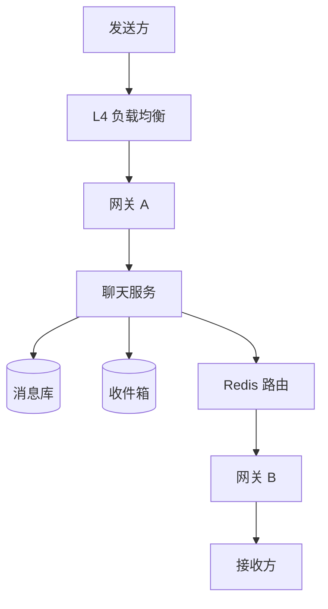

## Q
**设计聊天/即时通讯系统（WhatsApp / Messenger）**｜系统设计

设计一个类似 WhatsApp 或 Facebook Messenger 的实时聊天系统：支持 1 对 1 和群聊（群上限约 100 人），消息有"已发送 / 已送达 / 已读"状态，用户离线期间的消息上线后要补收，可以回看历史，支持图片等媒体，一个用户可以同时在多台设备上登录。常见规模是 1 亿日活、每人每天约 100 条、每条约 1 KB；延迟目标是在线用户 200–500 ms 内收到。面试官常见的变体：只做 1 对 1、不做群聊；历史要保留 5 年且可搜索；支持删除消息和删除群；"阅后即焚"；追问"100 万个客户端是不是要开 100 万条连接"；让你直接画表结构并写 SQL。

给出完整解答：需求、核心实体与接口、整体设计、深入问题、取舍、不同级别的期望。

## A
**一句话。** 聊天的难点不在"发消息"，而在"收件人此刻连在哪台机器上"：连接是有状态的，所以要解决路由（把消息送到对的网关）、可靠（离线、断线、重试都不丢不重）和有序（同一个会话里先发的先显示）三件事，而且三者要在每天上百亿条消息的规模下同时成立。

**需求。**
- 功能：创建 1 对 1 / 群聊（≤100 人）；发送和接收文本、媒体；离线消息上线后补收（保留 30 天，若要求长期历史则另存）；多设备同步；分页回看历史。
- 非功能：
  - 在线投递延迟 < 500 ms（更严的版本是 200 ms）；
  - 投递有保证（at-least-once，靠客户端确认 + 去重做到"效果上恰好一次"）；
  - 同一会话内有序，不要求全局有序；
  - 可用性优先于一致性（AP）：宁可晚到，不可丢；
  - 单个组件故障不丢消息。
- 估算（1 亿日活 × 100 条 × 1 KB）：每天 100 亿条，平均 11.6 万条/秒，按 3 倍峰值约 35 万条/秒；每天新增约 10 TB 正文，保留 5 年约 18 PB，所以长期历史必须分层存储。同时在线按日活的一半算，约 5000 万条长连接；单台网关扛 25 万条连接（每条连接内存约 20 KB，合计 5 GB，内存不是瓶颈，文件描述符和内核参数才是），约需 200 台网关。

**核心实体与接口。**
- 实体：用户（User）；设备/客户端（Client，一个用户多个）；会话（Chat，2–100 人）；会话成员（ChatParticipant）；消息（Message）；收件箱条目（Inbox，指向"某设备还没确认收到的消息"）；附件（Attachment）。
- 接口走 WebSocket（高频双向推送，REST 轮询太贵），每条指令带 `requestId`：
  - `sendMessage {chatId, clientMsgId, text, attachments[]}` → `{messageId, seq, status}`；`clientMsgId` 由客户端生成，是幂等键。
  - `ack {messageId}`：客户端确认"我收到了"，服务端才删收件箱条目。
  - `createChat {participants[], name}`；`modifyParticipants {chatId, userId, ADD|REMOVE}`。
  - `sync {cursor}`：重连后告诉服务端"我收到哪了"，服务端补发。
  - 推送方向：`newMessage`、`chatUpdate`、`receipt`、`typing`。
  - 历史分页用 HTTP：`GET /chats/{id}/messages?before=<seq>&limit=50`，用游标（seq）而不是 offset，因为新消息不断插入会让 offset 漂移。
  - 媒体：客户端先向服务端要预签名 URL（presigned URL），直传对象存储，拿到 `attachmentId` 再随消息发送，消息体里只放引用。

**整体设计。**

1. 客户端经 L4 负载均衡（WebSocket 不需要 L7 的路径/头部路由，L4 更快）连到某台网关（Gateway）。网关只做三件事：认证、维护"用户 → 连接"的内存表、转发指令。网关不存业务状态，挂了客户端重连即可。
2. 网关把 `sendMessage` 交给聊天服务（Chat Service，无状态，可水平扩）。聊天服务按顺序做：
   - 用 `(chatId, clientMsgId)` 去重，重复请求直接返回上次结果；
   - 分配会话内序号 `seq`；
   - 把消息写入消息库一次（正文只存一份）；
   - 给每个收件人的每台设备写一条收件箱指针（只含 `chatId`、`seq`，几十字节）；
   - 写成功才回给发送方 "已发送"。
3. 路由：聊天服务向 Redis 查"收件人当前连在哪些网关"（会话目录，session directory：`userId → {设备, 网关}`，连接建立时写、断开时删，带 TTL 防僵尸）；然后把消息发布到对应网关的频道，网关再从内存表里找到连接推下去。
4. 客户端收到后回 `ack`，聊天服务删除这台设备的收件箱条目，并把"已送达"回执发给发送方；用户打开会话后再发"已读"。
5. 收件人不在线：收件箱条目留着（带 30 天 TTL），同时通过通知服务发 APNs/FCM 推送唤醒。设备重连时带上 `cursor`，聊天服务按收件箱把积压消息按序补发，客户端每确认一条就删一条。
6. 存储选型：消息库用宽列/键值库（Cassandra、DynamoDB 一类），分区键 `chatId`、排序键 `seq`，天然支持"取某会话最近 N 条"；会话成员表以 `chatId` 为分区键、`userId` 为排序键，再建以 `userId` 为分区键的二级索引，用来回答"我参加了哪些会话"。写入量级：1 对 1 每条消息 1 次消息库写 + 1 次收件箱写，峰值约 70 万次写/秒，水平分片的 NoSQL 可以承受，单机关系库不行。

**深入。**
1. 跨网关路由：消息怎么找到收件人的连接？
   - 方案 A：Redis 发布订阅，网关为自己连接的每个用户订阅 `user:{id}` 频道。简单，缺点是频道数量等于在线用户数（5000 万），要把 Redis 按 userId 分片。
   - 方案 B：会话目录 + 网关专属频道。查目录得到网关列表，往 `gateway:{id}` 发布。频道数只等于网关数（200），目录是普通键值，扩展性更好。多设备时目录里一个用户对应多条记录，自然支持。
   - 方案 C：一致性哈希，让同一用户永远落到固定网关。路由不需要目录，但负载均衡器要懂哈希、网关增减要迁移连接，复杂度高。
   - 选 B。发布订阅是"尽力而为"的，丢了没关系，因为收件箱才是准绳：重连、定时补偿、下一条消息都会把没确认的补上。这就是"路由用快而不可靠的通道，可靠性由持久化兜底"的分工。
2. 有序与幂等：消息顺序怎么保证？
   - 客户端时间戳：设备时钟不准，作弊也容易，不可用。
   - 服务端时间戳/雪花 ID：简单，但同毫秒、跨机器会乱序，群聊里肉眼可见。
   - 每个会话一个单调递增的 `seq`：由会话所在分片唯一负责分配（对 `chatId` 做一致性哈希，或在消息库里用条件写/原子计数器），客户端按 `seq` 排序并发现空洞（收到 5 缺 4，就向服务端拉 4）。代价是同一会话的写串行化，但单个会话每秒消息数很低，没有问题。
   - 选每会话 `seq`。重试靠 `clientMsgId` 幂等：发送方超时后重发同一个 ID，服务端识别为同一条，不会产生两条。
3. 群聊扇出（fan-out）：100 人群里一条消息怎么投？
   - 写扩散：对每个成员写一条收件箱指针（100 条小写入）。投递路径极简单，离线补收容易。
   - 读扩散：只写会话时间线一份，成员上线后自己拉各会话"seq 大于上次游标"的部分。写便宜，但"我有哪些会话有新消息"要额外维护。
   - 选：≤100 人用写扩散指针（指针很小，正文只存一份）；万人级大群/频道改读扩散。阈值取决于写放大成本，面试里说出"按群规模切换"就是满分思路。
4. 连接规模：100 万客户端是不是要 100 万条连接？是，每个在线客户端一条长连接。办法是用大量廉价网关：单机调高文件描述符上限、用 epoll 事件驱动，轻松 10 万–百万条连接；连接数而不是 CPU 决定网关数量。发布新版本时要"排水"：先停止接新连接，再分批踢下线，客户端用指数退避加随机抖动（jitter）重连，防止 5000 万连接同时重连把系统打垮（惊群）。
5. 在线状态与输入中提示：存在 Redis，用心跳刷新 TTL（每 30 秒一次，90 秒不刷新视为离线），不进持久库。不要在上下线时通知所有联系人（扇出爆炸）；改成"只有对方打开了与你的会话页面才订阅你的状态"。"正在输入"只发给当前会话在线成员，不持久化、限频。
6. 长期历史与搜索（5 年、可搜索的变体）：热数据（近 3 个月）留在消息库；老数据按 `(chatId, 月份)` 归档成列式文件放对象存储，回看时按需读；全文搜索用 Elasticsearch，按用户分片建索引，只索引发给自己和自己发的消息；成本是索引体积，必要时只索引近一年。

**取舍与追问。**
- "为什么不用 HTTP 轮询或长轮询？" 空轮询浪费 99% 的请求，延迟取决于轮询间隔；WebSocket 一次握手后双向推送，延迟最低，但换来了"有状态连接"的路由问题。
- "只做 1 对 1" 时：不需要扇出，会话就是两个人的 `(smallerId, largerId)` 对，存储和路由都更简单，但仍然要有设计成"群聊特例"的实体，方便以后扩展。
- "Redis 挂了怎么办？" 会话目录可以重建（网关重新注册所有本机连接），发布订阅丢消息由收件箱兜底，所以 Redis 只影响延迟不影响正确性。
- "网关机器宕机" 客户端检测到断开 → 重连另一台 → 带 `cursor` 补收；该网关上的连接记录靠 TTL 过期。
- "消息要能删除/撤回/群解散/阅后即焚"：删除写墓碑（tombstone）而不是物理删；"为所有人删除"要向所有成员设备下发一条删除指令；阅后即焚用消息 TTL，加上客户端本地擦除；群解散把会话标记为关闭并停止扇出。
- "端到端加密" 服务端只存密文，无法做服务端搜索和内容审核；多设备要为每台设备单独加密（客户端侧扇出），成本在客户端。
- "让你画表并写 SQL"：`chat(chat_id, name, created_at)`、`chat_member(chat_id, user_id, joined_at, last_read_seq)`、`message(chat_id, seq, sender_id, body, created_at)`；取某用户最近会话 `SELECT chat_id FROM chat_member WHERE user_id=? ` 再取各会话最大 `seq`；未读数 = 会话最大 `seq` − `last_read_seq`。
- "Webhook 通知服务（至少一次）" 是同类变体：把收件人换成订阅 URL，用同样的"持久化队列 + 确认 + 重试退避 + 幂等键"。

**级别期望。**
- 中级（mid）：说清 WebSocket、消息库 + 收件箱、离线补收的基本流程；能解释为什么要客户端 ack；数据模型合理。
- 高级（senior）：多网关路由（会话目录 / 发布订阅）及其失败兜底；每会话有序与幂等；群聊扇出策略与阈值；给出容量估算（QPS、连接数、存储）并据此选型。
- 资深/专家（staff）：连接排水与重连风暴、热点会话/分区、多区域部署与就近接入、成本（长期历史分层、索引范围）、端到端加密与搜索的冲突、推送通道可靠性，能主动讲出"路由快而不可靠、持久层兜底"这个分层原则。

**先修概念。**
- [[hi-system-design-patterns-realtime-updates|实时更新]]
- [[hi-system-design-core-concepts-networking-essentials|网络基础]]
- [[hi-system-design-deep-dives-dynamodb|DynamoDB]]
- [[hi-system-design-deep-dives-redis|Redis]]
- [[hi-system-design-core-concepts-sharding|分片（Sharding）]]
- [[hi-system-design-core-concepts-data-modeling|数据建模]]

**同类题。**
- [[hi-system-design-problem-breakdowns-whatsapp|即时通讯（WhatsApp）]]：同一系统的标准拆解
- [[solution-chat-messaging|设计题解：聊天与即时通讯]]：本库里的完整题解
- [[hi-system-design-problem-breakdowns-fb-live-comments|Facebook 直播评论]]：同样是长连接扇出，但读者远多于写者
- [[hi-system-design-problem-breakdowns-notification-system|通知系统]]：离线唤醒与推送通道
