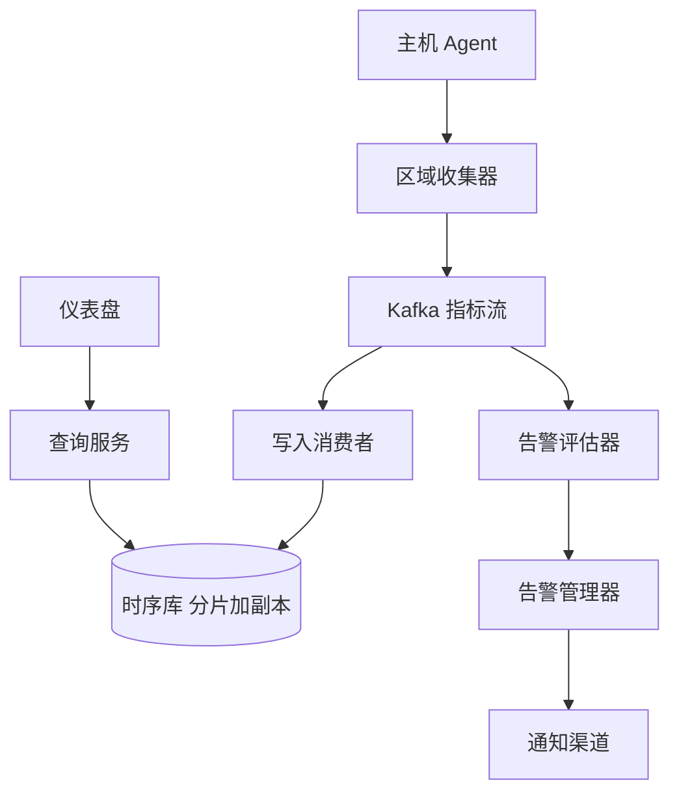

## Q
**指标监控与告警平台**｜系统设计

设计一个系统指标监控平台：从数十万台服务器（跨多个数据中心）采集 CPU、内存、吞吐、延迟、错误率等指标，存储历史数据，让工程师在仪表盘（如 Grafana）里查询，并能设置阈值告警，触发时通过邮件、IM、电话通知。常见版本：约 30 万台主机每分钟上报，只给一个小的内部团队看，不要求告警；10 万台服务器的规模；要求实时告警配置；只用 Kafka 这类基础组件、不使用现成的监控产品；给 AI 模型做指标看板。

给出完整解答：需求、核心实体与接口、整体设计、深入问题、取舍、不同级别的期望。

## A
**一句话。** 这是一个"写极多、读很少、数据只追加"的时序数据问题：难点是把每秒百万级的点写进去又不丢、让长时间范围的查询不扫全量，以及告警链路必须比被监控的系统更可靠。

**需求。**
功能：
1. 采集：每台主机的系统指标和服务指标（CPU、内存、磁盘、请求延迟、错误率）。
2. 存储：保留历史，支持按指标名、标签（主机、服务、区域）和时间范围查询，并支持聚合（平均值、p99、求和）。
3. 可视化：仪表盘按时间序列绘图，支持下钻到单机。
4. 告警：用户定义阈值规则（如某服务 5 分钟错误率 > 5%），触发后通知，并可以静默、去重、分组。
5. 范围外：界面细节、日志与链路追踪（可以说明这是三类可观测性数据里的指标）。

非功能（容量估算）：
- 规模：30 万台主机，每台约 200 个序列（指标名加标签组合），共约 6000 万个活跃序列。
- 写入：每分钟上报一次时，6000 万点/分钟，约 100 万点/秒；若每 10 秒上报，则约 600 万点/秒。下面以 1 分钟精度为基线，并说明精度提高的影响。
- 存储：每个点（时间戳加数值）原始约 16 字节，用 Gorilla 式压缩（时间戳取差的差、数值做 XOR）后约 1.4 字节。每天 86.4 亿点乘 1.5 字节约 130GB，原始精度保留 15 天约 2TB（含副本再乘以 3）。
- 读取：QPS 不高（团队规模有限、仪表盘每个面板几秒刷新一次），但单个查询可能跨很多序列、很长时间，延迟目标是仪表盘查询 < 1 秒到几秒。
- 可靠性：采集链路允许秒级到分钟级延迟，允许少量丢点，但不允许长时间静默丢数据；告警的端到端延迟目标是分钟级。

**核心实体与接口。**
实体：`Metric(name, labels{host, service, region}, timestamp, value)`；序列（series）是名称加标签集合的唯一组合；`AlertRule(id, query, condition, for, severity, routing)`；`Alert(ruleId, labels, state, since)`；`Dashboard`。
接口：
- 写入：`POST /ingest`（批量，body 是若干点），或由收集端向主机拉取。
- 查询：`GET /query?metric=cpu&host=*&agg=avg&from=&to=&step=60s`。
- 规则：`PUT /alert-rules/{id}`、`GET /alerts?state=firing`、`POST /silences`。

**整体设计。**

数据流：
1. 每台主机运行一个轻量 Agent，本地采集并按固定间隔打包，推送给本区域的收集器；或者收集器按服务发现的目标列表主动拉取（pull）。
2. 收集器无状态：做鉴权、格式校验、给每个点补上规范化的标签，再按 `hash(序列)` 写入 Kafka 的分区。Kafka 在这里充当缓冲，吸收尖峰、解耦采集与存储，并让存储、告警各自独立消费。
3. 写入消费者按批读取，写入时序库。时序库按序列哈希分片，每片三副本；写入先追加到预写日志（WAL）再进内存块（memtable），内存块定期落盘成不可变的时间块，旧块压缩并按保留期删除。
4. 查询服务把"指标加标签过滤加时间范围"翻译成对相关分片的并行查询，在服务端做聚合，把结果降采样到面板需要的点数后返回。
5. 告警评估器是另一组消费者（见深入 3），规则触发后交给告警管理器做去重、分组、静默和路由，再发到通知渠道。

**深入。**

1. 推还是拉（push vs pull）：
- 拉模式（Prometheus 式）：收集器按目标列表拉取。优点：天然得到存活信号（拉不到就是主机或进程挂了），采集频率由服务端控制，调试方便。缺点：要做服务发现，跨网络分区和防火墙麻烦，短生命周期任务可能来不及被拉到。
- 推模式（Agent 主动上报）：Agent 控制发送，适合动态扩缩、短任务和跨网络；缺点是"没有数据"有歧义——是主机挂了还是 Agent 挂了——所以要有显式心跳，并让告警评估能区分"值异常"和"数据缺失"。
- 选择：30 万台规模用 Agent 推到区域收集器更实用（连接数可控、容易批量压缩传输），收集器侧再补存活指标；面试时把两种都讲清并给出理由。

2. 写入路径与存储：
- 问题：每秒百万点的追加写，加上随时间无限增长的数据；随机写磁盘不可行。
- 选项：关系型数据库（每点一行，索引膨胀，写放大严重，不行）；通用宽表数据库（Cassandra 之类，写入扩展好，但缺少针对时间序列的压缩和聚合）；专用时序库（自研或 InfluxDB、VictoriaMetrics、M3 等）。
- 选择：专用时序存储。理由：数据只追加且几乎按时间有序，适合 LSM 式的顺序写；同一序列的相邻点差异很小，delta-of-delta 加 XOR 能压缩到约 1.4 字节/点，内存和磁盘都省一个数量级；按"序列哈希"分片让同一序列落在一处，查询局部性好。
- 倒排索引：标签到序列 ID 的索引（如 `host=a` → 序列集合）决定了查询怎么快速找到序列，要随序列数增长而分片并放内存。
- 保留与降采样：原始精度保留 15 天，之后降采样为 5 分钟精度保留 90 天，再降为 1 小时精度保留 2 年以上。降采样保留最小值、最大值、平均值和计数，而不是只留平均，否则峰值被抹掉，错误率和 p99 就没法回答。用流处理在写入时或后台任务周期性生成。
- 基数（cardinality）：一个把 `user_id` 或 `request_id` 当标签的指标会让序列数爆炸，压垮索引和内存。应当在接入时对每个指标、每个租户限制序列数上限，超限拒绝并告警；这是监控系统最常见的事故源。

3. 告警：
- 评估方式：(a) 周期性查询——每个规则每 30 到 60 秒向时序库发查询，简单，直接复用查询引擎，缺点是规则很多时给存储增加不小的读负载；(b) 流式——消费 Kafka，用 Flink 之类做窗口聚合，规则的状态在流作业里，延迟低，适合规则多、条件为简单阈值的场景。
- 选择：主体用周期性评估（规则数量级通常几万以内，按规则哈希分给多个评估器实例，各自负责一部分），对延迟敏感、条件简单的核心规则可以走流式。
- 状态机：`inactive → pending → firing → resolved`。条件首次满足进入 pending，持续满足 `for` 时长（如 5 分钟）才触发 firing，用来过滤抖动；条件消失进入 resolved 并发送恢复通知；为了防止在阈值附近反复触发，可以设置迟滞（触发线与恢复线不同）。
- 数据缺失：没有数据本身可以是告警条件（`absent`），要和"值正常"区分开，规则里显式写出缺失时的行为。
- 告警管理器：对同一告警按标签去重；按服务或集群分组，一个故障波及上千台主机时只发一条聚合通知；支持静默（维护窗口）、抑制（大故障时压制其下游告警）；路由到不同接收者，值班升级（超时无人确认就找下一个人）。通知失败要重试，至少一次送达。
- 监控的监控：告警链路不能依赖被监控的同一套存储。评估器应当区域内自治，所依赖的组件独立部署；另有一个"死人开关"（dead man's switch）规则，持续发出一个永远为真的告警，下游一旦收不到，就说明整条告警链路坏了。

4. 查询与仪表盘：
- 长范围查询不扫原始数据：根据时间范围选分辨率（1 小时的面板用原始点，30 天用 5 分钟精度，一年用 1 小时精度），点数控制在面板像素数量级（几百到一两千点）。
- 缓存：仪表盘会被很多人反复打开，对"已封口的历史时间块"的查询结果缓存，只重算最近一小段；相同查询合并。
- 保护存储：查询有序列数和时间范围的上限，超大查询排队或拒绝，防止一个拖垮整个集群的即席查询。

**取舍与追问。**
- 采集间隔：10 秒比 60 秒写入量乘 6，看板更灵敏，但成本相应上升；分层——核心指标 10 秒，其余 60 秒。
- 丢点：允许缓冲区满时 Agent 丢最老的点，并记录丢弃计数，这本身也是一个指标。
- 多区域：每个区域自带收集器、存储与告警评估，全局视图用联邦查询（查询时合并多区域结果），而不是把所有数据汇到一处。
- 为什么用 Kafka：缓冲尖峰、多消费者（存储、告警、流式降采样）、可重放（存储故障恢复后补写）。代价是多一层运维与 1 到几秒延迟。
- 不用现成产品时的取舍：自建要自己承担时序存储、压缩、索引的复杂度；面试里重点讲清选型理由与每个部件的职责，不是实现一个存储引擎。

**级别期望。**
- 中级：Agent 采集、队列缓冲、时序存储、仪表盘与基本阈值告警，知道需要时间序列专用存储。
- 高级：容量估算（点数、压缩后大小）、序列哈希分片加副本、降采样与分层保留、告警状态机和 `for` 时长、推拉取舍。
- 资深/Staff：基数治理与租户隔离、告警去重分组抑制与升级、监控的监控与死人开关、多区域联邦、查询保护、成本与精度的分层策略。

**先修概念。** [[hi-system-design-deep-dives-time-series-databases|时序数据库]]、[[hi-system-design-deep-dives-kafka|Kafka]]、[[hi-system-design-core-concepts-sharding|分片（Sharding）]]、[[hi-system-design-patterns-scaling-writes|扩展写]]、[[hi-system-design-deep-dives-flink|Flink]]、[[hi-system-design-core-concepts-data-modeling|数据建模]]

**同类题。** [[hi-system-design-problem-breakdowns-metrics-monitoring|指标监控（Datadog 拆解）]]、[[solution-metrics-monitoring|指标监控（本库解答）]]、[[hi-system-design-problem-breakdowns-ad-click-aggregator|广告点击聚合]]、[[hi-system-design-problem-breakdowns-notification-system|通知系统]]
