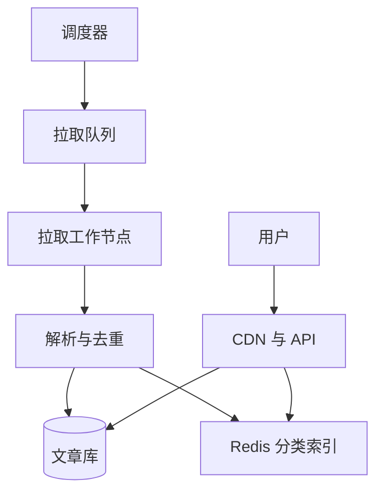

## Q
**设计新闻聚合系统（Google News）**｜系统设计

设计一个新闻聚合平台：从大量外部出版商（publisher）那里拿到文章，用户可以订阅来源、分类或主题，看到按时间倒序、近实时更新的信息流（feed），点击文章跳转到出版商原站。常见规模：约 5 万家出版商，平均每家每天 100 篇；100 万月活、峰值 10 万并发；读信息流 p95 < 1 秒（更严的版本是 250 ms），文章从发布到出现在信息流的延迟 < 5–10 分钟，最终一致即可。常见范围约定：出版商如何注册 RSS 不在范围内；个性化排序的机器学习模型当作黑盒、不展开；同一分类下所有用户看到同样的信息流（不做重度个性化）。面试官常追问：摄取层怎么扩展、热点分类写入怎么扩、出版商不可靠怎么办、同一新闻被多家报道怎么合并、突发新闻怎么推、用户离线或网络差时怎么办、按位置推送。

给出完整解答：需求、核心实体与接口、整体设计、深入问题、取舍、不同级别的期望。

## A
**一句话。** 这是一个"读远多于写、写入又被外部世界牵着走"的系统：难点在摄取（要从 5 万个不可控的源头按需拉取，既要及时又不能把自己或对方打垮），而读端因为"同一分类全员共享"，几乎可以全部靠缓存吃掉。

**60 分钟路线。**

| 时间 | 做什么 |
|---|---|
| 0–5 分 | 要求和估算：摄取是瓶颈，读是缓存问题 |
| 5–10 分 | 实体、接口、游标分页 |
| 10–25 分 | 整体设计：摄取路径和读路径 |
| 25–50 分 | 深入：拉取节奏、出版商不可靠、去重聚类 |
| 50–60 分 | 追问：热点分类、突发新闻、离线、1 分钟延迟 |

**需求。**
- 功能：用户订阅来源/分类/主题；查看信息流（最新在前，无限滚动）；点击跳转原文；系统持续从出版商摄取新文章。
- 非功能：
  - 摄取延迟 < 5–10 分钟；
  - 读延迟 p95 < 1 s；
  - 最终一致，可用性优先；
  - 对行为不一的出版商健壮（超时、改格式、突然刷屏）；
  - 文章元数据不丢，缩略图丢了可以补。
- 估算：5 万家 × 100 篇 = 500 万篇/天，平均约 58 篇/秒（峰值几百篇/秒），写入很小；元数据每篇约 2 KB → 约 10 GB/天，一年约 3.65 TB；缩略图每篇约 100 KB → 约 500 GB/天，一年约 180 TB，放对象存储。读：10 万并发、每人约 30 秒刷新一次 → 峰值约 3300 请求/秒，对缓存很轻松。轮询成本才是大头：5 万家每 5 分钟拉一次 = 167 次/秒的出站请求，每 1 分钟拉一次 = 833 次/秒。

**核心实体与接口。**
- 实体：出版商（Publisher：feed 地址、类型、轮询间隔、`etag`、`last_polled_at`、健康状态）；文章（Article：`id`、`publisher_id`、规范化 URL、标题、摘要、`published_at`、分类、缩略图地址、内容指纹、`cluster_id`）；用户（User）；订阅（Subscription：用户 → 来源/分类）。
- 接口：
  - `GET /feed?category=tech&cursor=<ts_id>&limit=20`：分类信息流；
  - `GET /feed/me?cursor=...`：我订阅的合并信息流；
  - `PUT /subscriptions`：改订阅；
  - 点击跳转直接用文章的原文 URL（可经一个记录点击的 302）。
  - 分页必须用游标（`published_at` + `articleId`），不能用 offset，因为顶部不断有新文章插入，offset 会让用户看到重复或漏掉。

**整体设计。**

摄取路径（写）：
1. 出版商注册表（publisher registry）存每家的 feed 地址和状态。调度器按"下次该拉取时间"取出到期的出版商，放进拉取队列（Kafka/SQS）；按出版商分区，保证同一家不会被并发拉取。
2. 拉取工作节点（fetcher）发起条件请求（`If-None-Match` / `If-Modified-Since`）；未变化返回 304，几乎零成本。拿到新内容后解析 RSS/Atom/JSON，规范化字段。
3. 解析后的文章先在 URL 规范化后去重（去掉 `utm_*` 等追踪参数，哈希为唯一键），再做内容指纹聚类（见深入 3）。
4. 先写文章库（以 `articleId` 为主键，DynamoDB/Cassandra 一类），写成功后再更新 Redis 分类索引（有序集合，score = `published_at`，每分类只留最新约 1000 条），最后异步任务下载并压缩缩略图（用文章 URL 哈希作对象键，重复下载是幂等的）。
5. 失败时：数据库写失败就不进入后续步骤，所以不会出现"文章没存、缩略图却上传了"的孤儿；万一缩略图多传了，用对象存储的生命周期规则清理。

读路径：
1. 分类信息流对所有人相同，把每个分类最新一页（如 20 条）在 CDN/API 层缓存 15–30 秒；缓存未命中读 Redis 的分类有序集合，取出 `articleId` 列表，再批量取文章元数据（也缓存）。
2. "我订阅的合并信息流"：用户订阅的分类/来源通常只有几个到几十个，读时对这些有序集合做 k 路归并取前 N 条（读扩散，fan-out on read），不需要为 100 万用户各存一份信息流。
3. 点击链接直接去出版商站点，系统不托管正文，也就不需要存大文件。

**深入。**
1. 【必讲】摄取：拉取节奏怎么定？
   - 固定间隔（如每家 5 分钟）：简单，但慢源浪费请求、快源（突发新闻）又不够及时。
   - 自适应轮询：记录每家的实际发文频率和上次有新内容的时间，发文勤的缩短间隔（下限 1 分钟），常年无更新的拉长（上限 1 小时），用 `etag` 减少带宽。请求总量近似跟随真实发文量。
   - 推送（WebSub/Webhook）：支持的出版商直接推给我们，延迟最低，但要提供回调地址并校验签名，只有一部分出版商支持，所以是"推送 + 轮询兜底"。
   - 选自适应轮询为主、推送为辅。出版商的"上次成功拉取时间"和连续失败次数要持久化，每次只取该时间点之后的新文章（增量），避免重复处理。
2. 【必讲】出版商不可靠：超时、返回 5xx、格式变了、突然一次吐出几千篇。每家出版商一个熔断器（circuit breaker）：连续失败就指数退避拉长间隔，恢复后逐步回到正常；每家限速（请求并发 1、每次最多处理 N 篇）防止被一家拖垮整个队列；解析失败的原始内容进死信队列留待排查；告警看"超过 X 倍间隔未成功"的出版商数量。
3. 【必讲】同一条新闻被多家报道（去重/聚类）：
   - 精确去重：规范化 URL 哈希，解决转载同一链接。
   - 近似去重：对标题 + 前几百字做 simhash（局部敏感哈希，海明距离 ≤ 3 视为同一故事）或 MinHash + LSH 分桶。新文章命中已有簇就并入 `cluster_id`，信息流只展示簇的代表文章（最早或权威度最高）并附"另有 N 家报道"。
   - 成本：每篇文章只与同分类、近 48 小时窗口内的簇比较，窗口外的不比；这样内存和计算有上界。
4. 【追问再讲】写扩展与热点分类：突发新闻时同一分类短时间内涌入大量文章，Redis 的单个有序集合成了热点。办法：摄取工作节点先在内存里按分类攒 100–500 ms 批量写；热门分类的有序集合按时间桶（每小时一个键）拆分，读取时按桶从新到旧取；数据库按 `articleId` 哈希分片，不按分类分片（分类是倾斜的）。
5. 【追问再讲】突发新闻：优先通道。已知的权威出版商或被标记为"突发"的文章走高优先级队列，跳过批量攒写，并触发推送通知（APNs/FCM）。按位置推送（用户在 X 地时推 X 地新闻）：文章在摄取时打上地理标签（geohash），用户位置变化时更新其订阅的区域，匹配后交给通知服务，并对每个用户限频。
6. 【追问再讲】离线或弱网：客户端本地（SQLite）缓存最近的信息流页；打开应用先显示缓存，同时带上 `since=<最后一条的游标>` 拉增量；用户的订阅修改先写本地队列，联网后按幂等方式重放；列表接口返回 `etag`，没有变化时只回 304。
7. 【加分】个性化（扩展）：保持"候选生成 + 排序"两阶段，候选仍来自订阅的分类索引加热门，再由独立的排序服务用点击历史打分，排序服务宕机时回退到时间序。

**取舍与追问。** 按被问到的可能性排，通常口述就够：
- 为什么不用"写扩散"（每个用户一份信息流）？100 万用户 × 几十个分类，每篇文章要写很多份，而读时归并只需合并几个有序集合，成本低得多；只有"明星用户订阅极多来源"才考虑预计算。
- Redis 索引：每分类 1000 条 × 约 40 字节（ID + score）≈ 40 KB，一万个分类也就 400 MB，不是问题；它只是加速层，丢了可以从文章库按 `published_at` 重建。
- 数据库选型：文章按主键读写、没有跨文章事务，用键值/宽列库。
- 如果延迟要求变成 1 分钟内：必须提高轮询频率或要求出版商推送，请求成本线性上升（每 1 分钟轮询 = 833 次/秒），此时需要增加拉取节点并更依赖条件请求。
- 一致性：最终一致可以接受，信息流晚几分钟没关系；但同一用户翻页时不要乱序，游标保证这一点。

**级别期望。**
- 中级：画出"调度 → 拉取 → 存储 → 缓存读"的主流程，会用游标分页，知道要缓存分类信息流。
- 高级：自适应轮询、条件请求、出版商熔断与退避、近似去重、读扩散与写扩散的选择，并给出请求量和存储的数字。
- 资深/专家：热点分类写入、孤儿对象与失败语义、突发新闻优先通道与推送、离线同步、多区域部署、个性化排序作为独立服务的接口与降级，能把"摄取是瓶颈、读是缓存问题"讲清楚。

**先修概念。**
- [[hi-system-design-core-concepts-caching|缓存]]
- [[hi-system-design-patterns-scaling-reads|扩展读]]
- [[hi-system-design-patterns-scaling-writes|扩展写]]
- [[hi-system-design-deep-dives-redis|Redis]]
- [[hi-system-design-deep-dives-kafka|Kafka]]
- [[hi-system-design-deep-dives-dynamodb|DynamoDB]]

**同类题。**
- [[hi-system-design-problem-breakdowns-google-news|新闻聚合（Google News）]]
- [[solution-news-aggregator|设计题解：新闻聚合]]
- [[hi-system-design-problem-breakdowns-fb-news-feed|Facebook 信息流]]：同样是信息流，但按好友做写扩散
- [[hi-system-design-problem-breakdowns-web-crawler|网络爬虫]]：礼貌性限速与 URL 调度的思路相通
