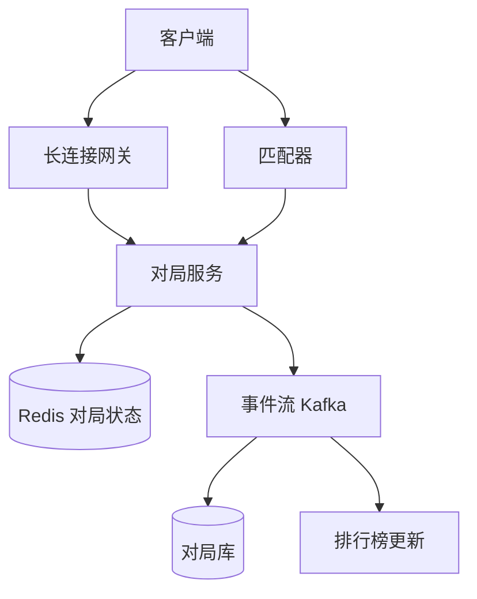

## Q
**在线国际象棋平台**｜系统设计

设计一个类似 Chess.com 的实时对弈平台：玩家跨多个设备登录、对局中走子要被校验、按等级分（Elo）匹配对手、有排行榜（top-K）、并支持"悔棋"（对手还没走下一步时，走子方可以撤回刚走的一步）。常见变体：只做匹配；只做计时（强制每方用时）；聊天软件里的好友对弈，异步走子，10 亿活跃用户；观战者可以加入并评论；对作弊（外挂引擎）的检测要深挖。

给出完整解答：需求、核心实体与接口、整体设计、深入问题、取舍、不同级别的期望。

## A
**一句话。** 一局棋是一个"小而强一致"的状态机，难点不在吞吐，而在：同一局的所有事件（走子、悔棋、超时、认输）必须由唯一的写者串行处理，同时让它能在机器宕机、玩家换设备、网络抖动时不丢状态、不判错时间。

**60 分钟路线。**

| 时间 | 做什么 |
|---|---|
| 0–5 分 | 需求和数字：峰值 100 万局、200 万长连接，走子 p99 小于 200ms |
| 5–10 分 | 实体和接口：`Game`、`Move`、`Clock`；WebSocket 消息，走子带 `moveNo` |
| 10–25 分 | 画主链路：网关 → 对局所有者（每局单线程）→ 先持久后广播 → Kafka 下游 |
| 25–50 分 | 深入：Elo 匹配、服务端时钟与超时、悔棋与走子的竞态 |
| 50–60 分 | 追问：所有者宕机恢复、观战和反作弊、排行榜 |

**需求。**
功能：
1. 匹配：选定时间制（如 3+2 闪电、10+0 快棋）后，按 Elo 接近度配对，等久了放宽范围。
2. 实时对局：走子由服务端按规则校验（位置合法、轮到该方、没超时），双方和观战者几百毫秒内看到。
3. 多设备：同一账号在手机和网页上都能看到进行中的对局并继续走（同一时刻最多 1 局进行中）。
4. 计时：每方有独立的剩余时间，超时判负，服务端为准。
5. 悔棋：走子方在对手落子之前可撤回；排行榜展示 top-K（有的场景明确不做排行榜，只看计时）。

非功能（先和面试官确认规模，下面是一组可辩护的假设）：
- 约 1000 万日活，峰值 100 万局同时进行，即约 200 万条长连接（WebSocket）。
- 每局约 80 个半步，闪电棋 10 分钟内走完，单局约 0.13 步/秒，峰值总写入约 13 万步/秒（80/600×100 万）。
- **走子 p99 小于 200ms：** 走子端到端延迟目标 p99 < 200ms；规则校验和计时必须可信，客户端不可信。
- 一局的存储约 2KB（走子序列加每步用时），1000 万局/天约 20GB/天，一年约 7TB，冷热分离即可。
- 一致性：单局内强一致（不能出现两方看到不同的棋盘）；排行榜、对局历史最终一致即可。

**核心实体与接口。**
实体：`User(id, rating, ...)`；`Game(id, white, black, timeControl, status, result, startedAt)`；`Move(gameId, moveNo, from, to, promotion, san, spentMs, serverTs)`；`Clock(gameId, whiteMs, blackMs, turn, turnStartedAt)`；`QueueTicket(userId, timeControl, rating, enqueuedAt)`。

接口：
- **匹配入队接口：** `POST /matchmaking/tickets {timeControl}` → 入队；匹配成功后经长连接推送 `game_started {gameId, color}`。
- WebSocket 消息：`move {gameId, moveNo, from, to, promotion}`、`undo_request`、`undo_reply`、`resign`、`draw_offer`；服务端推送 `move_applied`、`clock_sync`、`game_over`。
- **对局与历史接口：** `GET /games/{id}`（当前局面加走子序列，用于重连和换设备）；`GET /users/{id}/games`（历史）；`GET /leaderboard?timeControl=&limit=100`。

走子消息带 `moveNo`（期望的下一步序号）是关键：它让重复发送和乱序到达都能被幂等地拒绝或忽略。

**整体设计。**

端到端的一步棋：
1. 客户端经网关把 `move` 发给对局服务。网关只管连接，不管业务；用户到网关的映射存在会话目录里（Redis：`user → gateway`）。
2. 路由：每局由哈希（gameId）固定到一台"对局所有者"（game owner）节点，该节点内存里持有这一局的棋盘和时钟，对每局用单线程队列（actor 模型）串行处理事件。这样走子、悔棋、超时在同一局内天然有全序，不需要分布式锁。
3. 所有者校验：是否轮到该方、`moveNo` 是否等于期望值、走法是否合法（用成熟的规则库，不要自己写 en passant、王车易位、三次重复局面）、当前时钟是否已耗尽。
4. 校验通过后：先把 `(moveNo, move, 本步用时, 双方剩余时间)` 追加写入 Redis 的该局日志（也可同步写入一条 Kafka 记录作为持久化来源），再向双方（经各自网关）和观战频道广播 `move_applied`。顺序是"先持久、后广播"，所有者宕机时才不会出现观众看见了而存储里没有的步。
5. 对局结束（将死、认输、超时、和棋）：所有者写结果、发 `game_over` 事件到 Kafka；下游消费者更新双方 Elo、写对局库、刷新排行榜、触发赛后的作弊分析。

所有者宕机：用租约（lease）标记 owner，Redis 里保留全部状态；心跳丢失后，对局服务重新用哈希环把这局分给新节点，新节点从 Redis 里的走子日志重放得到局面，再让双方客户端重连。重放几十步成本极低，这是选"日志在外部、状态在内存"的原因。

多设备：用户进入的任意设备都向网关订阅自己的 `user` 频道；对局状态变化推送到该用户的所有在线连接。新设备登录时先调 `GET /games/{id}` 拿完整局面，再订阅增量。"同一时刻最多 1 局"用 Redis 的 `active_game:{userId}`（`SET NX`）在匹配成功时原子占位。

**深入。**
1. 【必讲】匹配（matchmaking）：按 Elo 接近度配对，且等待时间可控。
- 问题：全体玩家在一个池里扫描，成本高；而严格要求 Elo 完全相等，几乎永远匹配不上。
- 选项 A：每个"时间制 × 评分段"一个队列，评分段宽度 50 到 100 分，匹配器取相邻段。选项 B：每个时间制一个 Redis 有序集合（score = rating），匹配器对每个等待者做 `ZRANGEBYSCORE rating±w`，其中窗口 w 随等待时间线性放宽（例如起步 ±50，每 5 秒加 50，上限 ±400）。
- 选择 B：实现简单、可直接按窗口取近邻。并发问题：两个匹配器同时挑中同一个人。解法是按时间制分片，每个分片只有一个匹配器线程（单写者），或用 Lua 脚本在 Redis 里原子地"取出两人并删除"。配对成功后创建 `Game`，再通过会话目录通知双方；任一方在这期间已掉线，则把另一方放回队列。
- 追问：Elo 更新 `R' = R + K×(S − E)`，其中 `E = 1/(1+10^((Rb−Ra)/400))`，K 取 20 到 32；新手用更大的 K（评分不确定度高）。只做匹配的变体要把"公平性（评分差）"和"等待时间"的权衡讲清楚，并提到玩家数少的时间制会拉长等待。
2. 【必讲】计时与超时判负（clock）：必须服务端可信，且不被网络延迟误伤。
- 问题：客户端自带的倒计时只用于显示。如果信任它，作弊者可以暂停时钟；如果完全按服务端收到消息的时间计，高延迟玩家被吃掉时间。
- 方案：服务端只存"这一步开始的服务端时间 `turnStartedAt`"和双方剩余毫秒。收到走子时：`spent = now − turnStartedAt`，可补偿一个上限（如 min(网络延迟估计, 200ms)）再扣，`remaining = remaining − spent + increment`。不需要每秒扣减，所以没有"每局每秒一次写"的负载。
- 超时检测：所有者为"当前轮到的一方"设一个延迟任务（定时器轮或延迟队列），到期时先重新读时钟再判，防止走子和超时的竞态；因为每局事件串行，竞态不会产生双重结果。节点宕机时延迟任务随之消失，所以新所有者接手后必须从日志重算并重新挂定时器。
- **clock_sync 只做展示：** 客户端展示用 `clock_sync` 周期性校正（例如每 5 到 10 秒或每步后），不是权威。
3. 【必讲】悔棋（undo）：撤回己方上一步，仅当对手还没走。
- 问题：走子和悔棋并发——对手正好在此刻落子。
- 方案：因为每局事件串行，只有两种顺序。先处理悔棋：校验"最后一步是请求者走的"，弹出该步，把时钟恢复到走子前的快照（每步都存了前后的剩余时间），广播 `move_undone`；之后对手那一条 `move` 带的 `moveNo` 已过期，被拒绝，客户端回滚到最新局面。先处理对手走子：悔棋请求的前置条件不成立，直接拒绝。
- 是否需要对手同意：做成产品决策。"无条件悔棋"不需要同意，状态机最简单；"需对手同意"则多一个 `pending_undo` 状态，并规定对手在回应之前不能走子，同时给 pending 设超时。
4. 【追问再讲】作弊检测与观战：
- 作弊（引擎辅助）不能在对局中实时判定；实时只做轻量信号（每步用时的统计形态、窗口失焦事件），赛后把走子日志投到分析队列，用引擎（如 Stockfish）算每步与最优步的偏差（平均厘兵损失）和一致率，结合历史画像打分，超阈值交人工或自动封号。这是离线流水线，不占对局路径。
- 观战：观战者不进所有者节点，而是订阅一个只读的 `game:{id}:spectate` 频道（Redis Pub/Sub 或事件流），由网关扇出；热门对局可加几秒延迟防止"观战者给对局者通风报信"。

**取舍与追问。** 按被问到的可能性排，通常口述就够：
- 为什么 WebSocket 而不是轮询：走子要主动推送，且连接是双向的；轮询在 200 万局的量级下既慢又浪费。移动网络断线重连是常态，所以必须有"凭 `moveNo` 补发缺失步"的机制。
- 异步（通信软件内的好友对弈，无时限）：连接不是常驻的；走子写入后只做推送通知，对局状态落在数据库而非内存所有者上，重新打开时再拉取；用户量 10 亿时按 gameId 分片的键值存储（DynamoDB 或 Cassandra）加推送服务即可，悔棋就是"对手尚未查看或未走时可撤回"的一次条件写入（compare-and-set）。
- 分片与热点：热点是极少数观战人数巨大的对局，不是写入；广播扇出用分层网关或多级频道。
- 排行榜：Redis 有序集合（`ZADD`、`ZREVRANGE 0 99`）存全局 top-K，1 亿用户约几 GB；按时间制分多个集合；用 Elo 更新事件异步写入即可，最终一致；"我的名次"用 `ZREVRANK`。若用户量再翻几个数量级，则按评分段分片，top-K 做分片 top-K 的归并。
- 对局库：热数据在 Redis，结束后归档到按 `gameId` 或 `userId + 时间` 分区的存储；`GET /users/{id}/games` 用二级索引或把对局写两份（按用户）。
- 失败模式：网关挂 → 客户端重连后拉局面；所有者挂 → 租约过期后迁移；时钟漂移 → 只用服务端单调时钟；重复消息 → `moveNo` 幂等。

**级别期望。**
- 中级：画出匹配、对局、存储三块；用 WebSocket 推送走子；规则校验放服务端；说清 Elo 匹配的基本思路。
- 高级：单局串行化（actor/单写者）与"所有者宕机后从日志重建"；服务端时钟和延迟补偿；悔棋与走子的竞态；多设备会话目录；排行榜的有序集合实现。
- 资深/Staff：容量与分片估算、跨区域部署与就近匹配、热点对局观战扇出、反作弊流水线和误封的代价、异步版本的架构迁移、故障演练（所有者、网关、Redis 分别挂掉时的行为）。

**先修概念。** [[hi-system-design-patterns-realtime-updates|实时更新]]、[[hi-system-design-core-concepts-networking-essentials|网络基础]]、[[hi-system-design-deep-dives-redis|Redis]]、[[hi-system-design-core-concepts-consistent-hashing|一致性哈希]]、[[hi-system-design-patterns-dealing-with-contention|处理争用（Contention）]]、[[hi-system-design-deep-dives-kafka|Kafka]]

**同类题。** [[hi-system-design-problem-breakdowns-online-chess|在线国际象棋（拆解）]]、[[solution-multiplayer-game|多人在线游戏]]、[[hi-system-design-problem-breakdowns-uber|网约车（Uber，匹配与调度）]]、[[hi-system-design-problem-breakdowns-whatsapp|即时通讯（WhatsApp，会话目录与推送）]]
