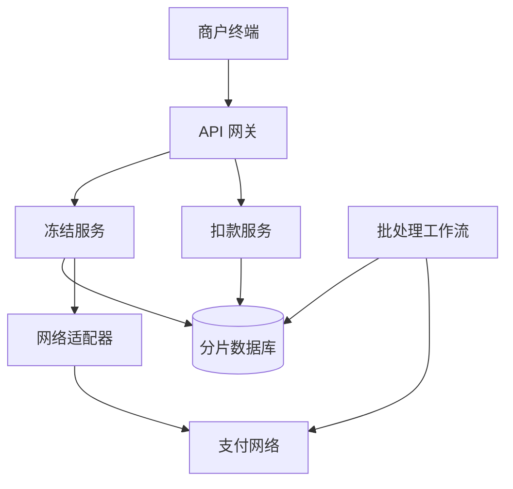

## Q
**设计支付处理系统（授权冻结 + 每日批量结算）**｜系统设计

设计一个支付处理器（payment processor）。商户的刷卡机发来"冻结"请求（hold，也叫授权）：带账号（如信用卡号）和金额，我们转发给外部支付网络（如 Visa、American Express），网络批准或拒绝；批准后这笔钱在账户上被冻结一小段时间。顾客签字（可能加小费）后商户再发"扣款"请求（charge，也叫请款）；如果一直没有扣款，冻结到期自动释放。所有扣款请求按支付网络分组，攒成大批量文件，每晚 10 点发给网络，由网络做一次批量电汇结算。目标吞吐 10,000 笔/秒。面试官常追问：幂等（重复请求不能重复扣）、超时和卡被拒时刷卡机上发生什么、每日批处理的细节与对账、认证与密钥、数据流边界情况、多区域、可观测性。

给出完整解答：需求、核心实体与接口、整体设计、深入问题、取舍、不同级别的期望。

## A
**一句话。** 这是一个"同步冻结 + 异步结算"的两阶段金融流程：真正难的是和外部网络交互时的"结果不确定"（超时了，钱到底有没有冻住？）以及"一天一次的巨型批处理"如何做到不漏、不重、可对账。

**60 分钟路线。**

| 时间 | 做什么 |
|---|---|
| 0–5 分 | 问清需求，估算：10,000 笔/秒，约 5,000 个在途请求 |
| 5–10 分 | 实体（冻结、扣款、批次）、状态和接口 |
| 10–25 分 | 整体设计：冻结同步路径；扣款异步路径；每晚批处理 |
| 25–50 分 | 必讲深入：超时不等于失败；两层幂等；批处理的归属和不可变文件 |
| 50–60 分 | 追问：单领导者与对账、保护网络调用、安全、攒批的取舍 |

**需求。**
- 功能：
  - 创建冻结（hold）：同步返回批准或拒绝；
  - 创建扣款（charge）：针对已批准的冻结，金额不超过冻结额（小费场景允许在约定比例内上浮）；
  - 冻结到期未扣款自动释放；
  - 每晚按支付网络生成并提交批量文件，处理网络返回的逐笔结果；
  - 查询交易状态。
- 非功能：
  - 10,000 笔/秒的授权吞吐；
  - 冻结请求的端到端延迟约 1–2 秒（顾客站在柜台前）；
  - 绝不重复扣款、绝不丢单（金融正确性高于一切）；
  - 数据持久、可审计、可对账；
  - 卡号等敏感数据受 PCI-DSS 约束。
- 估算：10,000 笔/秒 × 86,400 秒 ≈ 8.64 亿笔/天（按持续满载算的上界）。网络往返约 300–500 ms，按 Little 定律并发调用数 ≈ 10,000 × 0.5 = 5,000 个在途请求。每笔记录约 500 B，每天约 430 GB 热数据，只保留 90 天，更早的归档。批量文件：若 8.64 亿笔都被扣款，每行约 150 B，约 130 GB/天，要分块。

**核心实体与接口。**
- 实体：
  - 商户（Merchant）与终端；
  - 冻结（Hold：`holdId`、商户、卡令牌、金额、网络、状态、`expiresAt`、网络返回的授权码与引用号）；
  - 扣款（Charge：`chargeId`、`holdId`、金额、`batchDate`、状态）；
  - 批次（Batch：网络、日期、状态、行数、总额、文件校验和）；
  - 账本分录（LedgerEntry：借贷双方，只追加）。
  - Hold 状态：`PENDING → APPROVED | DECLINED | UNKNOWN`；`APPROVED → CAPTURED | RELEASED(过期)`。
  - Charge 状态：`RECEIVED → BATCHED → SUBMITTED → SETTLED | REJECTED`。
- **REST 接口**（商户用 API Key 认证）：
  - `POST /holds`（头 `Idempotency-Key`；体：卡令牌、金额、币种、商户引用）→ `{holdId, status}`；
  - `POST /holds/{id}/charges`（头 `Idempotency-Key`；体：金额、小费）→ `{chargeId, status: RECEIVED}`；
  - `DELETE /holds/{id}`（主动释放）；
  - `GET /holds/{id}`、`GET /charges/{id}`。
- 对外：每个支付网络一个适配器（adapter），负责协议转换（报文格式、签名）、限速、超时、熔断。

**整体设计。**

冻结路径（同步）：
1. **网关认证限流并令牌化卡号：** API 网关做认证（API Key + 请求签名）、限流、TLS 终结。卡号在最边缘就被换成令牌（tokenization）：真实卡号只存在隔离的 PCI 保险库里，我们的数据库只见令牌和末四位。
2. **先落 PENDING hold 再调网络：** 冻结服务先在数据库里落一行 `PENDING` 的 hold（同时登记 `Idempotency-Key` 的唯一约束），再去调网络。先写意图再调外部，这样无论之后进程崩在哪一步，数据库里都有这笔交易的痕迹，可以被恢复流程找到。
3. 适配器调用网络，把 `holdId` 作为网络侧的唯一引用号。返回批准/拒绝后，更新 hold 状态并写账本分录，再返回给商户。
4. 超时（网络没有在 3 秒内应答）：状态记为 `UNKNOWN`，不要自己猜。异步恢复任务按引用号向网络查询结果；查不到或网络不支持查询就发"冲正"（reversal，释放可能已经冻住的额度，冲正本身是幂等的）。商户先得到"失败，请重试"，重试会用新的 `Idempotency-Key`，不会和那笔未知交易冲突。

扣款路径（异步）：
1. **扣款服务立即返回成功：** 扣款服务校验 hold 为 `APPROVED`、未过期、金额合规，写入 Charge（`RECEIVED`）并立即返回成功给商户，不等网络。
2. `batchDate` 由扣款创建时间确定性地算出：晚上 10 点（网络的截止时间）之前归当天，之后归次日。因为它只是 `createdAt` 的函数，不需要一个"当前批次指针"，也就没有切换时刻的竞争。

每晚批处理（用工作流引擎或带领导者选举的调度器驱动）：
1. **宽限后按网络分区出文件：** 截止时间过后再等一小段宽限（如 30 秒，让在途写入落地），按 `(network, batchDate)` 分区把所有 `RECEIVED` 的扣款读出来，流式写成文件，每个文件约 100 万行，附带清单（行数、总金额、校验和）。
2. 上传到网络（SFTP 或批量接口），批次 id 和文件校验和作为幂等键：重复提交同一批次，网络会识别并拒绝重复处理。
3. 网络返回逐笔结果文件。逐行回写：接受的 → `SETTLED`，写账本；被拒的 → `REJECTED` 带原因，可重试的进下一批。
4. 对账：我们账本的应收总额、网络结算报告、银行实际到账三方比对，差异进人工队列。
5. 过期释放：一个定时任务按 `expiresAt` 索引扫描"已批准、未扣款、已过期"的 hold，向网络发释放/冲正，并把状态改为 `RELEASED`。

存储：按 `holdId` 哈希分片的关系库（一笔交易约 5 次写：冻结、状态更新、账本两条分录、扣款，合计约 5 万次写/秒；每片承担约 2–4K 次写/秒，需要 13–25 片，留余量取 16–32 片，或用 DynamoDB 一类自动分片的库）。同一笔交易的 hold、charge 在同一分片，事务不跨片；按商户查询靠异步构建的二级索引。账本只追加、不更新、不删除。

**深入。**

1. 【必讲】结果不确定与失败语义：核心原则是「未知不等于失败」。
   - 明确被拒（余额不足、卡失效）：业务结果，终态，不重试。
   - 明确失败（连接建立前就断了）：安全重试。
   - 超时（可能已冻住）：只能查询或冲正，绝不能换一条通道重新发起，否则可能冻两次。
   - 刷卡机上卡被拒或超时：显示明确状态并允许换一张卡，这笔未知交易由后台冲正。

2. 【必讲】幂等：重复请求绝不能重复扣款，有两层。
   - 商户 → 我们：`(merchantId, Idempotency-Key)` 唯一约束，行内存请求体哈希和已得到的响应。同键同体返回原响应；同键不同体返回 422；并发的同键请求，后到者看到 `IN_PROGRESS` 就返回 409。
   - 我们 → 网络：用 `holdId` / `chargeId` 作为网络侧引用号，我们自己的重试不会产生第二笔冻结。
   - 两层缺一不可：第一层防商户重发，第二层防我们重试。

3. 【必讲】批处理规模与一致性。
   - 避免一次读 8 亿行：按 `(network, batchDate)` 分区，每个分区一个任务，多个文件并行生成，每个约 100 万行，附清单（行数、总额、校验和）。
   - 批次一旦 `CLOSED`，文件内容不可变；重新提交永远发同一份，批次 id 和校验和作幂等键。
   - 按行回写结果，已 `SETTLED` 的不会再进入下一批，靠状态机的单向流转保证。

4. 【追问再讲】批处理单领导者与对账。
   - 调度器必须单领导者：租约加围栏令牌（fencing token），避免两个实例同时生成同一批，也避免旧领导者的过期写入。工作流引擎（如 Temporal）能在进程崩溃后从断点继续。
   - 对账：我们账本的应收总额、网络结算报告、银行实际到账三方比对，差异进人工队列。

5. 【追问再讲】保护外部网络调用：每个适配器有并发上限、令牌桶限速和熔断器；某个网络持续出错时快速失败并返回明确错误，不堆积请求耗尽线程。10,000 笔/秒拆到各网络后取决于商户的卡组织分布，要对最大网络单独做容量规划。

6. 【追问再讲】安全：卡号令牌化，数据库只见令牌和末四位；API Key 只存哈希，请求用 HMAC 签名并带时间戳和随机数防重放；服务与网络之间双向 TLS；日志脱敏；密钥放 HSM/KMS 并定期轮换。

7. 【加分】多区域：商户就近接入区域网关；数据按区域驻留（合规），跨区域只同步聚合后的对账数据。区域故障时商户被引到备用区域，`Idempotency-Key` 存在可复制的存储里，重试仍然安全。

**取舍与追问。** 按被问到的可能性排，通常口述就够：
- 为什么扣款不实时发网络而要攒批：网络对批量结算的费率更低、对账更简单、电汇按净额一次完成；代价是商户资金 T+1 到账，且我们承担「冻结已批准但批量被拒」的坏账风险。批量被拒进入重试批次，多次失败转人工或向商户追索。
- 数据流边界：商户重发相同的扣款请求（幂等）、扣款到来时 hold 已过期（拒绝）、同一 hold 多次部分扣款（累计不能超过冻结额）、截止时刻前后几毫秒到达的扣款（归属由 `createdAt` 确定）。
- 吞吐翻 10 倍：分片数翻倍；适配器按网络加连接池；热点商户（大型连锁）按 `holdId` 而不是商户分片，不产生单商户热点；批处理文件并行度提高。
- 可观测性：每个网络的批准率、p99 延迟、超时率、`UNKNOWN` 的数量与存活时间、批次提交成功率、对账差异金额；`UNKNOWN` 超过阈值即告警。

**级别期望。**
- 中级：画出冻结 → 扣款 → 批处理的流程，有数据库和幂等键的概念，知道网络调用会失败。
- 高级：先写意图再调外部、超时处理（查询/冲正）、两层幂等、批次的确定性归属和不可变文件、对账。
- 资深/专家：围栏令牌与单领导者批处理、按网络的容量规划与熔断、令牌化与 PCI 范围控制、多区域与数据驻留、账本设计（双分录只追加）、坏账与追索的业务流程，能讲出每种失败各自的安全重试规则。

**先修概念。**
- [[hi-system-design-patterns-multi-step-processes|多步骤流程]]
- [[hi-system-design-core-concepts-api-design|API 设计]]
- [[hi-system-design-patterns-dealing-with-contention|处理争用（Contention）]]
- [[hi-system-design-deep-dives-temporal|Temporal]]
- [[hi-system-design-core-concepts-sharding|分片（Sharding）]]
- [[hi-system-design-deep-dives-postgres|PostgreSQL]]

**同类题。**
- [[hi-system-design-problem-breakdowns-payment-system|支付系统（Stripe）]]
- [[solution-payment-system|设计题解：支付系统]]
- [[design-payment-ledger|练习：设计支付账本]]
- 限时捐款网站：同样要处理第三方支付的失败与双重扣款
- 限时众筹购股系统：对余额服务的幂等与补偿
