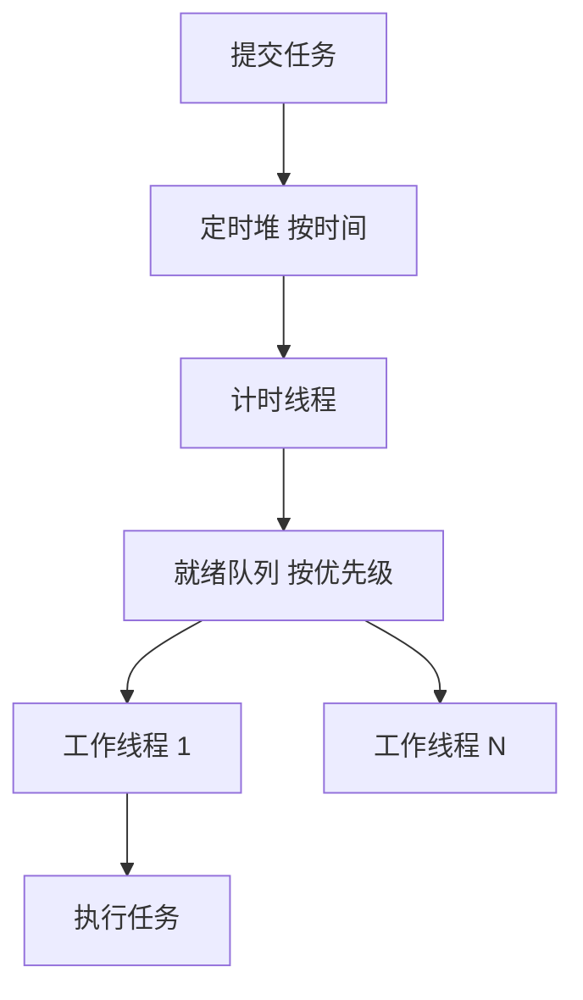

## Q
**设计任务调度器（定时、周期、带优先级）**｜低层设计

设计一个调度系统：用户可以创建、管理和取消任务，任务可以在指定时间执行一次，也可以按固定间隔反复执行（支持周期性调度），任务之间有优先级。要求写出清晰的类设计和可运行的核心代码。资深面试会往分布式方向追问：任务很多时计时怎么做、进程重启后任务怎么恢复、多实例如何避免同一个任务被执行两次、失败怎么重试、执行时间超过间隔怎么办。

给出完整解答：需求、核心实体与接口、整体设计、深入问题、取舍、不同级别的期望。

## A
**一句话。** 调度器只回答两个问题：什么时候该跑（计时）和现在谁先跑（排队）。把它们分成两级队列——按时间排序的定时堆、按优先级排序的就绪队列——再把"下一次什么时候触发"抽象成可替换的触发规则，设计就清楚了。

**60 分钟路线。**

| 时间 | 做什么 |
|---|---|
| 0–8 分 | 问清需求：一次和周期、优先级、取消、失败；定接口 `schedule` / `cancel`；口述两级队列 |
| 8–40 分 | 写 `OneShot` / `FixedRate`、`Job`、`Scheduler` 的 `schedule`、`cancel`、`_promote`、`run_pending` |
| 40–45 分 | 用假时间跑：同时到点按优先级、取消、周期 |
| 45–58 分 | 追问：计时线程怎么睡又被叫醒、慢任务重叠、失败重试 |
| 58–60 分 | 口述持久化恢复和多实例防重复 |

**需求。**
- 功能：
  - 提交任务（可调用对象）并指定触发规则：某个时间点执行一次、固定频率重复；
  - 取消任务；
  - 每个任务有优先级，同时到点的任务高优先级先执行；
  - 工作线程数量有上限；
  - 一个任务抛异常不能影响其他任务和调度器本身。
- 非功能：
  - 到点后尽快执行，空闲时不空转消耗 CPU；
  - 提交和取消在线程安全前提下足够快；
  - 触发规则可扩展（后续加 cron 表达式不改调度器）；
  - 可测试：时间来自可注入的时钟。

**核心实体与接口。**
- `Trigger`（约定两个方法）：`first(now)` 返回第一次触发时间，`after(fired_at, now)` 返回下一次触发时间或 `None`。实现：`OneShot`、`FixedRate`；扩展点：`CronTrigger`、`FixedDelay`。
- `Job`：任务编号、要执行的函数、触发规则、优先级，以及 `cancelled` 标志（`running` 见逐步扩展 2）。
- `Scheduler`：对外接口 `schedule(job_id, fn, trigger, priority)`、`cancel(job_id)`、`run_pending(now)`、`start()`（逐步扩展 1）；内部有定时堆（按触发时间排序的小根堆）、就绪队列（按优先级排序的优先队列）、任务表、一把条件变量。
- 模式：策略（`Trigger`）、命令（`Job.fn`）、生产者-消费者（计时线程是生产者，工作线程是消费者）。

**整体设计。**



1. `schedule`：用触发规则算出第一次触发时间，放入定时堆，并通知计时线程——新任务可能比当前堆顶更早，它需要醒来重新计算睡眠时长。
2. 计时线程：加锁后把"已经到点"的任务从定时堆弹出，放进就绪队列，并立刻用触发规则算下一次时间、重新入堆（周期任务）；然后睡到新的堆顶时间（条件变量的带超时等待），有人提交了更早的任务会被提前唤醒。
3. 工作线程：阻塞等待就绪队列，取出最高优先级的任务执行；捕获异常，不让线程退出。
4. `cancel`：只打一个标记，不从堆里删除（惰性删除）；堆里的旧记录在弹出时发现已取消就丢弃。

两级队列的原因：优先级只应该在"已经到点、正在排队等线程"的任务之间起作用。如果把优先级直接塞进定时堆，一个高优先级但还有一小时才到点的任务就会错误地排在前面，或者破坏按时间排序。

**核心实现。** 约 90 行，先不接线程：`run_pending(now)` 用假时间同步推进，两级队列和优先级能直接验证。

```python
import heapq
import itertools
import math
import threading
import time
from dataclasses import dataclass
from queue import Empty, PriorityQueue
from typing import Callable


# ---------- 触发规则：回答"下一次什么时候跑"，与"跑什么"完全分开 ----------
# 约定两个方法：first(now) 第一次触发时间；after(fired_at, now) 下一次触发时间，None 表示不再触发
class OneShot:
    def __init__(self, at: float) -> None: self.at = at
    def first(self, now): return self.at
    def after(self, fired_at, now): return None


class FixedRate:
    """按固定网格触发 start, start+T, start+2T...；落后太多时直接跳到下一个网格点，不补跑。"""
    def __init__(self, interval: float, start: float) -> None:
        self.interval, self.start = interval, start

    def first(self, now): return self.start
    def after(self, fired_at, now):
        k = math.floor((max(fired_at, now) - self.start) / self.interval) + 1
        return self.start + k * self.interval


@dataclass
class Job:
    id: str
    fn: Callable[[], None]
    trigger: OneShot | FixedRate
    priority: int = 0
    cancelled: bool = False


class Scheduler:
    """两级队列：定时堆（按时间）-> 就绪队列（按优先级）-> 执行。
    优先级只在"已经到点、在排队等执行"的任务之间起作用；没到点的任务不该插队。"""
    def __init__(self, clock: Callable[[], float] = time.time) -> None:
        self._clock, self._seq = clock, itertools.count()
        self._timed: list[tuple[float, int, str]] = []          # (fire_at, seq, job_id)
        self._ready: PriorityQueue = PriorityQueue()            # (-priority, seq, job_id)
        self._jobs: dict[str, Job] = {}
        self._cv = threading.Condition()                         # 保护堆和任务表

    def schedule(self, job_id: str, fn: Callable[[], None], trigger, priority: int = 0) -> None:
        with self._cv:
            self._jobs[job_id] = Job(job_id, fn, trigger, priority)
            at = trigger.first(self._clock())
            if at is not None:
                heapq.heappush(self._timed, (at, next(self._seq), job_id))

    def cancel(self, job_id: str) -> None:
        with self._cv:
            if job_id in self._jobs:
                self._jobs[job_id].cancelled = True              # 惰性删除：堆里的旧记录弹出时再丢

    def _promote(self, now: float) -> None:
        """把已到点的任务从定时堆移到就绪队列，并立刻排好下一次触发。"""
        while self._timed and self._timed[0][0] <= now:
            fire_at, _, jid = heapq.heappop(self._timed)
            job = self._jobs[jid]
            if job.cancelled:
                continue
            self._ready.put((-job.priority, next(self._seq), jid))
            nxt = job.trigger.after(fire_at, now)
            if nxt is not None:
                heapq.heappush(self._timed, (nxt, next(self._seq), jid))

    def _run(self, jid: str) -> None:
        try:
            self._jobs[jid].fn()
        except Exception:
            pass                                                 # 一个任务失败不能带倒调度器

    def run_pending(self, now: float) -> None:
        """把到点的任务搬进就绪队列，再按优先级逐个执行。测试里用假时间调用，不需要睡眠和线程。"""
        with self._cv:
            self._promote(now)
        while True:
            try:
                self._run(self._ready.get_nowait()[2])
            except Empty:
                return
```

要点：
- `FixedRate` 在落后时（例如进程卡了好几个周期）直接跳到下一个网格点，只补跑一次而不是连跑好几次，这叫错过触发的合并（misfire 策略）；不想合并的话，可以让 `after` 返回错过的每一个时间点。
- `cancel` 只打标记，堆里的旧记录弹出时再丢。
- 执行任务时不持锁，否则慢任务会阻塞调度。

**运行。**

```python
out = []
s = Scheduler()
s.schedule("low", lambda: out.append("low"), OneShot(10), priority=1)
s.schedule("high", lambda: out.append("high"), OneShot(10), priority=9)
s.schedule("later", lambda: out.append("later"), OneShot(100))
s.schedule("tick", lambda: out.append("tick"), FixedRate(5, start=10))
s.run_pending(10); print(out)                      # ['high', 'low', 'tick']，同时到点，优先级高的先跑
out.clear(); s.cancel("tick")
s.run_pending(30); print(out)                      # []，tick 已取消，later 还没到点
s.run_pending(100); print(out)                     # ['later']
```

**复杂度。** 提交和每次触发 `O(log n)`，取最早的任务 `O(1)`。

**逐步扩展。**
1. 【追问再讲】计时线程和工作线程：计时线程睡到堆顶的时间，用条件变量的带超时等待；`schedule` 提交了更早的任务就 `notify` 叫醒它重算睡眠时间。工作线程阻塞等就绪队列。核心里的 `_promote` 和 `_run` 原样复用。

```python
# __init__ 新增参数 workers: int = 4，并保存：self._workers, self._stop = workers, False
# schedule 里 heappush 之后新增：
                self._cv.notify()                                # 新任务可能比堆顶更早：叫醒计时线程重算睡眠时间
# Scheduler 新增三个方法：
    def start(self) -> None:
        for target in [self._timer] + [self._worker] * self._workers:
            threading.Thread(target=target, daemon=True).start()

    def _timer(self) -> None:
        with self._cv:
            while not self._stop:
                now = self._clock()
                self._promote(now)
                wait = (self._timed[0][0] - now) if self._timed else None
                self._cv.wait(timeout=wait)                      # 睡到最近一个任务的点；schedule() 会提前叫醒

    def _worker(self) -> None:
        while not self._stop:
            try:
                self._run(self._ready.get(timeout=0.2)[2])
            except Empty:
                continue
```

2. 【追问再讲】慢任务重叠：有多个工作线程时，上一轮没跑完下一轮又到点，会同时跑两份。默认跳过本轮，防止慢任务把线程堆满；需要重叠的任务把 `allow_overlap` 设为真。

```python
# Job 新增字段：running: bool = False；allow_overlap: bool = False。_run 改成：
    def _run(self, jid: str) -> None:
        job = self._jobs[jid]
        if job.running and not job.allow_overlap:
            return                                               # 上一轮还没跑完：跳过本轮
        job.running = True
        try:
            job.fn()
        except Exception:
            pass
        finally:
            job.running = False
```

3. 【追问再讲】失败重试：失败后按指数退避加抖动重新入定时堆，设最大次数。重试要求任务幂等，因为「执行了一半失败」和「没执行」在调度器看来无法区分。

```python
# 顶部 import random；Job 新增字段 attempts: int = 0。_run 改成：
    def _run(self, jid: str) -> None:
        job = self._jobs[jid]
        try:
            job.fn()
            job.attempts = 0
        except Exception:
            job.attempts += 1
            if job.attempts <= 3:                                # 最多重试 3 次；任务必须幂等
                delay = 2 ** job.attempts + random.random()      # 指数退避加抖动
                with self._cv:
                    heapq.heappush(self._timed, (self._clock() + delay, next(self._seq), jid))
```

**深入。**
1. 【必讲】计时用什么数据结构：
   - 小根堆：插入 O(log n)，取最早 O(1)，简单；到几十万个任务也够用；
   - 时间轮（timing wheel）：把时间切成格子，任务挂在对应格子上，插入和触发都是 O(1)，适合百万级定时器且精度要求固定（如 Netty、Kafka 的延迟队列）；层级时间轮处理很远的未来；
   - 选堆；任务量到百万以上或者都是短延迟时再换时间轮。
2. 【必讲】周期任务怎么算"下一次"：
   - 固定频率（fixed rate）：下一次 = 起点 + k × 间隔，不受执行耗时影响，长期不漂移；
   - 固定延迟（fixed delay）：上一次执行结束后再等一个间隔，保证两次执行不会重叠，但会逐渐漂移；
   - cron 表达式：根据日历字段找下一个匹配时刻，要处理时区和夏令时。
   - 全部封装在 `Trigger.after` 里，调度器不关心。落后太多时合并成一次触发（misfire 策略），上一轮没跑完时跳过本轮（逐步扩展 2）。
3. 【必讲】并发细节：`schedule` 与计时线程共用同一把锁和条件变量；执行任务时不能持锁，否则慢任务会阻塞调度；任务表读写与堆操作要在同一把锁下，避免"取消"与"弹出"的竞争。
4. 【追问再讲】失败与重试（逐步扩展 3）：失败后按指数退避加随机抖动重新入定时堆，设置最大次数，超过进入死信记录。重试要求任务幂等，因为"执行了一半失败"和"没执行"在调度器看来无法区分。
5. 【追问再讲】持久化与恢复：把任务定义和下次触发时间存入数据库。重启后读取所有启用的任务重建定时堆；周期任务按触发规则重新计算下一次，错过的按 misfire 策略处理。
6. 【追问再讲】分布式扩展（资深追问）：
   - 单实例是单点：把任务存数据库，多个调度实例各自扫描"到点且未被领取"的任务；
   - 防止重复执行：领取时用 `SELECT ... FOR UPDATE SKIP LOCKED` 或带版本号的条件更新，把任务标记为"被某实例在某时刻领取"，并带租约过期时间；实例崩溃后租约到期，别的实例接管；
   - 租约过期后原实例可能还在跑（假死），所以执行结果提交要带围栏令牌（fencing token），旧令牌的结果被拒绝；
   - 语义是至少一次（at-least-once），任务本身要幂等；
   - 分片：任务按编号哈希分到不同实例，减少扫描竞争。
7. 【加分】优先级饥饿：低优先级任务可能被源源不断的高优先级任务挤住。办法是老化（aging）：就绪队列里的任务等待越久，有效优先级越高；或者给每个优先级保留最低份额的工作线程。

**取舍与追问。** 按被问到的可能性排，通常口述就够：
- 用现成的线程池定时执行器（如 Java 的 `ScheduledThreadPoolExecutor`）不就行了吗？它解决了单机计时，但不支持优先级就绪队列、自定义 misfire、持久化、分布式领取；面试是要看你理解它内部的模型（延迟队列 + 工作线程）。
- 精度：条件变量等待的精度受操作系统调度影响，毫秒级足够；需要微秒级精度时要用专用的实时机制，一般业务调度不需要。
- 任务很多时 `cancel` 惰性删除会让堆里积累垃圾：当已取消条目超过堆大小的一半时重建堆。
- 时区与夏令时：绝对时间点用 UTC 存储；cron 类触发规则带时区计算本地时间，夏令时跳变日要定义"缺失的那个小时"和"重复的那个小时"如何处理。
- 观测：每个任务的计划时间与实际开始时间之差（调度延迟）、执行时长、失败次数、队列长度。

**级别期望。**
- 中级：任务类、堆按时间排序、一个计时线程加工作线程、取消、基本周期任务。
- 高级：触发规则抽象、两级队列把优先级与时间分开、条件变量精确唤醒、misfire 与重叠策略、测试用假时钟。
- 资深/专家：时间轮、重试与退避、优先级老化、持久化恢复，以及分布式下的租约领取、围栏令牌、至少一次语义与幂等。

**先修概念。**
- [[hi-low-level-design-in-a-hurry-patterns|设计模式]]
- [[hi-low-level-design-concurrency-intro|并发入门]]
- [[hi-low-level-design-concurrency-coordination|线程协调]]
- [[hi-low-level-design-in-a-hurry-delivery|答题框架（Delivery Framework）]]
- [[hi-system-design-deep-dives-temporal|Temporal]]

**同类题。**
- [[solution-task-scheduler|设计题解：任务调度器（低层设计）]]
- [[solution-job-scheduler|设计题解：分布式任务调度（系统设计）]]
- [[hi-system-design-problem-breakdowns-job-scheduler|分布式任务调度（Airflow）]]
- [[solution-meeting-scheduler|设计题解：会议安排]]
