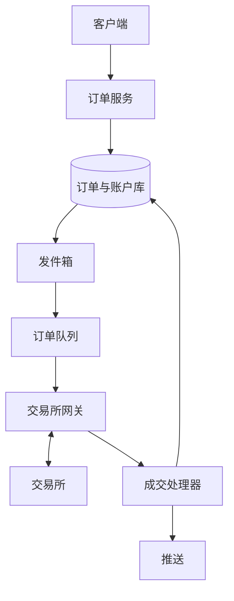

## Q
**设计简化版股票交易平台（券商端，限价单）**｜系统设计

设计一个类似 Robinhood 的股票交易平台的简化版：用户可以对股票下限价单（limit order，指定"最高愿付价/最低愿收价"）买入或卖出，查看订单状态，查看自己的持仓和组合市值。规模很小：约 100 次写入/秒。真实撮合发生在外部交易所，我们是把订单送过去的券商，不需要自己写撮合引擎。面试官常强调的点：只设计"下单"这条写路径；开盘瞬间请求激增；交易所可能暂时不处理（挂住）订单；订单与资金/持仓的一致性；部分成交；取消订单与成交的竞争。

给出完整解答：需求、核心实体与接口、整体设计、深入问题、取舍、不同级别的期望。

## A
**一句话。** 业务量很小，但每个订单都牵涉钱和股票：难点是在"我们的数据库"和"外部交易所"这两个互不共享事务的系统之间，保证资金不被重复占用、订单不被重复发送、成交结果不丢失。

**需求。**
- 功能：
  - 下限价单（买/卖，数量，限价，有效期：当日有效或撤销前有效）；
  - 取消订单；
  - 查询订单与成交明细；
  - 查询持仓和组合市值。
- 非功能：
  - 约 100 次写入/秒，开盘前几分钟可能是平时的 10–50 倍；
  - 正确性优先：买入不能超过购买力，卖出不能超过持有股数；
  - 订单状态持久，崩溃后能与交易所对齐；
  - 下单确认延迟百毫秒级；
  - 行情展示允许最终一致，持仓与资金必须强一致。
- 估算：100 次/秒 × 86,400 ≈ 860 万次/天，一台带副本的关系库足够；开盘 50 倍即 5,000 次/秒，持续几分钟，用队列削峰，不需要为它常年扩容。

**核心实体与接口。**
- 实体：
  - 账户（Account：现金余额、已占用金额，由此得出购买力）；
  - 订单（Order：`orderId`、账户、代码（symbol）、方向、数量、限价、有效期、状态、已成交数量、均价、`clientRequestId`）；
  - 成交（Execution：`execId`、`orderId`、数量、价格、时间）；
  - 持仓（Position：账户、代码、总数量、已冻结数量、成本）；
  - 资金流水（LedgerEntry）。
  - 订单状态：`NEW → SENT → ACKED → PARTIALLY_FILLED → FILLED`；或 `→ CANCEL_REQUESTED → CANCELED`；或 `→ REJECTED / EXPIRED`。
- 接口：
  - `POST /orders`（头 `Idempotency-Key`；体：symbol、side、qty、limitPrice、timeInForce）→ `{orderId, status}`；
  - `DELETE /orders/{id}`（返回"已请求取消"，最终结果异步）；
  - `GET /orders/{id}`、`GET /orders?status=open`；
  - `GET /portfolio`（持仓列表 + 市值）；
  - 订单与行情的实时更新用 WebSocket/SSE 推给客户端。

**整体设计。**

下单（写路径）：
1. 订单服务校验：市场状态、代码是否存在、价格是否合理（相对最新价的偏离、最小价格档位）、数量是否正整数，以及幂等键。
2. 在一个数据库事务里完成三件事：
   - 冻结资金或股票：买单冻结 `数量 × 限价`（再加预估费用），写成条件更新 `UPDATE account SET reserved = reserved + :x WHERE id = :id AND cash - reserved >= :x`，行数为 0 就拒单，所以并发下单也不可能超额；卖单同样条件更新持仓的 `frozen`，要求 `qty - frozen >= :n`；
   - 插入订单行，状态 `NEW`，`clientRequestId` 带唯一约束；
   - 插入一条发件箱记录。
   事务提交后才向客户端返回"已接收"。
3. 发件箱投递器把订单推到订单队列（按代码或账户分区，保证同一账户的下单与撤单顺序）。
4. 交易所网关（每个交易所一个，使用 FIX 协议的长会话）取出订单，发送给交易所，用 `orderId` 作为订单的客户端引用号（ClOrdID）；发出后把状态改为 `SENT`。交易所对同一引用号不会重复接受，所以网关重试是安全的。
5. 交易所通过同一会话异步返回执行报告：确认、部分成交、全部成交、拒绝、取消结果。成交处理器逐条处理：按 `execId` 去重，更新订单的已成交数量和均价，更新持仓和现金（买入成交：持仓增加，实际花费从冻结中扣除，限价与成交价的差额释放回购买力），写成交明细和流水，全部在一个事务里。
6. 处理完成后向客户端推送订单状态变化。

读路径：
- 订单状态读订单库（读自己的写，走主库或同步副本）；
- 持仓市值 = 持仓数量 × 最新价。持仓来自数据库，最新价来自行情服务（外部数据源经行情订阅进入 Redis，按代码缓存最新价），在服务端或客户端相乘即可，不需要把行情写进数据库。

**深入。**
1. 防止超额占用资金（并发下单）：
   - 先读余额再判断再扣：两个并发请求都读到够用，都通过，超卖；
   - 悲观锁（`SELECT ... FOR UPDATE`）：正确，同一账户串行，单账户 QPS 很低所以没问题；
   - 条件更新（`UPDATE ... WHERE cash - reserved >= x`）：一条语句原子完成检查和占用，无需显式锁，是首选；
   - 因为只有一个账户行被争用，且单账户下单频率有限，规模上没有瓶颈。
2. 两个系统之间不可靠的边界：我们的数据库与交易所没有共同事务，因此用"发件箱 + 唯一引用号 + 执行报告对账"。
   - 订单提交到数据库但进程在发出前崩溃：发件箱记录还在，重启后继续发；
   - 订单发出但没来得及记录 `SENT`：重启后重发，交易所按引用号去重，或者先发"订单状态查询"，再决定是否重发；
   - 执行报告丢失：FIX 会话有序列号，断线重连后可请求重传缺失的消息；每日收盘后再做一次与交易所/清算的对账，差异进人工处理。
3. 取消与成交的竞争：用户点撤单的同时订单可能正在成交。不能立刻释放冻结的资金，必须等交易所的最终回执：`CANCELED` 才释放；如果回执是"已成交，来不及取消"，就按成交处理。订单状态机只允许合法的转换（例如 `FILLED` 不能再变成 `CANCELED`），非法转换被丢弃并记日志。
4. 开盘激增："交易所可能暂时不处理订单"的两个层面。
   - 我们这边：订单服务无状态，水平扩展；数据库写入是瓶颈，但 5,000 次/秒的短时峰值通过队列整形，网关按交易所允许的消息速率发送，积压的订单按顺序排队，不丢；
   - 交易所这边：开盘前可挂单，等待开盘集合竞价；开盘瞬间交易所有自己的限速，网关优先发撤单（降低风险），再发新单；
   - 客户端要看到"已接收，等待发送"的明确状态，而不是转圈。
5. 有效期与过期：当日有效单收盘后由交易所返回过期回执；撤销前有效单则次日继续。系统自己也每日对仍处于 `SENT/ACKED` 的订单做状态核对。
6. 数据与合规：所有订单、成交、资金流水只追加，不更新历史；保存期限满足监管要求；美国股票现在是 T+1 交收（成交后下一个交易日结算），券商后台要处理与清算机构的对账。

**取舍与追问。**
- "为什么用关系库？" 订单、持仓、资金需要多行事务和约束，写入量只有 100/秒，没有理由放弃事务；规模涨到几万/秒时再按账户分片，因为所有关键事务都只涉及单个账户，天然适合分片。
- "要不要自己写撮合引擎？" 范围已限定为券商；如果被问到，另见交易所题：订单簿（价格档位 + 同价队列）、单线程撮合、日志先行、序列号，核心是确定性和重放。
- "市价单/止损单怎么办？" 市价单没有限价，冻结金额要用保守估价（如最新卖一价的上浮）；止损单由我们的后台监控价格触发，触发后转成限价单或市价单发出。
- "部分成交怎么展示？" 订单行保存累计数量和均价，成交明细单独一张表；用户看到的是"已成交 30/100"。
- "行情怎么扩展到百万用户？" 行情通过 WebSocket 推送，按代码做发布订阅，服务端对同一代码聚合后广播，更新频率限制到每秒一两次（合并，conflation），否则推送量和带宽过大。
- "下单失败如何告知用户？" 同步失败（余额不足、参数错误）立即返回错误；异步失败（交易所拒绝）通过订单状态与推送告知，并释放冻结。

**级别期望。**
- 中级：订单、持仓、成交的表设计，下单检查余额，订单状态流转，与交易所的异步交互。
- 高级：条件更新防超额、发件箱保证不丢单、唯一引用号保证不重发、执行报告幂等处理、取消与成交的竞争。
- 资深/专家：与交易所对账与 FIX 序列恢复、开盘峰值整形与优先级、按账户分片的演进、合规与审计、市价单/止损单的扩展，能说清哪些步骤在事务里、哪些靠幂等和对账兜底。

**先修概念。**
- [[hi-system-design-patterns-dealing-with-contention|处理争用（Contention）]]
- [[hi-system-design-patterns-multi-step-processes|多步骤流程]]
- [[hi-system-design-core-concepts-data-modeling|数据建模]]
- [[hi-system-design-core-concepts-api-design|API 设计]]
- [[hi-system-design-patterns-realtime-updates|实时更新]]

**同类题。**
- [[hi-system-design-problem-breakdowns-robinhood|股票交易（Robinhood）]]
- [[solution-stock-exchange|设计题解：股票交易所（撮合引擎）]]
- [[hi-system-design-problem-breakdowns-payment-system|支付系统（Stripe）]]：同样是与外部系统对账
- [[solution-stock-brokerage|设计题解：证券经纪（低层设计）]]
