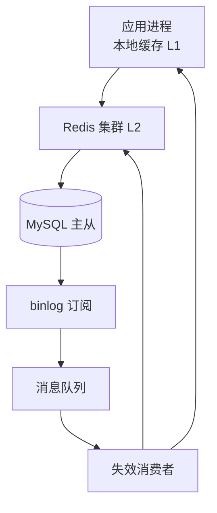

## Q
**缓存一致性与热点 Key**｜系统设计

在系统设计面试里，给你一个读多写少的服务（商品详情、用户资料、视频元数据），要求设计它的缓存层：读峰值每秒 100 万次，数据库只能稳定承受每秒 2 万次读；数据会被修改，缓存和数据库之间的不一致必须被控制在可说明的范围内；还要扛住热点（一个爆款商品或一个明星账号占掉整个流量的很大一部分）。面试官会连续追问：先更新库还是先删缓存、删除失败怎么办、缓存击穿 / 穿透 / 雪崩各怎么防、分布式锁怎么用才对、热 key 怎么发现和处理。

给出完整解答：需求、核心实体与接口、整体设计、深入问题、取舍、不同级别的期望。

## A
**一句话。** 缓存把"一个正确的数据库"变成"两份会分叉的副本"，所以核心是把不一致窗口压到最小且有兜底、保证缓存失效时不把数据库压垮，并让单个热点 key 的流量落不到某一个节点上。

**需求。**
功能：
1. 读路径：按主键读取数据，命中缓存直接返回，未命中回源数据库并回填。
2. 写路径：数据被修改后，读者最终看到新值，不会长期读到旧值。
3. 热点：突发的单 key 流量（一个爆款）不会压垮任何单个缓存节点或数据库。
4. 缓存整体或局部失效时，数据库有保护。
5. 对少数要求强一致的读（例如下单前校验价格、库存）可以绕过缓存。

非功能：
- 读峰值 100 万 QPS；数据库承受上限约 2 万 QPS，也就是缓存命中率至少 98%。数据库压力 = 总 QPS × (1 − 命中率)：命中率 99% 时是 1 万 QPS，降到 95% 就是 5 万 QPS，超过数据库上限，所以命中率的细微下滑也是事故。
- 单个 Redis 节点大约承受 10 万 QPS 量级；一个热 key 的 20 万 QPS 就会占满它所在的节点。
- 延迟：缓存命中 p99 < 5ms；回源 p99 < 50ms。
- 不一致的容忍度：普通数据允许秒级最终一致；价格、库存、权限等要有更严格的路径。

**核心实体与接口。**
实体：缓存条目 `Entry(key, value, version, expire_at)`，其中 `version` 取自数据库行的版本号或更新时间戳；数据库行带递增的 `version`；失效消息 `Invalidation(key, version)`。
接口（缓存 SDK 对业务暴露）：
- `get(key, loader)`：读缓存，未命中调用 `loader` 回源并回填，内部做并发合并。
- `invalidate(key)`：删除缓存，写路径和失效消息消费者调用。
- `get_strong(key)`：绕过缓存直接读主库，给下单校验这类场景。

**整体设计。**



1. 读：先查进程内本地缓存（L1，容量小、TTL 很短），再查 Redis（L2），都未命中才回源数据库，回填 L2（和 L1）。回源时做并发合并，避免同一个 key 同时被多个请求回源。
2. 写：业务只更新数据库，并立刻删除对应的 Redis key。
3. 兜底：数据库的变更日志（binlog）被订阅（Canal / Debezium 这类组件），解析出被修改的主键，发消息给失效消费者，消费者再删 Redis 和通知各应用实例清掉本地缓存。这条链路覆盖了所有写入路径，包括绕过业务代码的人工修改，也能弥补第 2 步删除失败的情况。
4. 所有缓存条目都带 TTL（加随机抖动），作为最后一道兜底：哪怕前面全部失败，错误最多持续一个 TTL。

**深入。**

1. 旁路缓存的一致性：先更新库再删缓存，为什么这样排，仍然会出什么错。
- 读写模式：读时未命中就回填；写时更新数据库后**删除**缓存而不是更新缓存。删除是惰性的，下次读才重建；而"更新缓存"在并发写时，缓存上的执行顺序可能与数据库不同，留下旧值。
- 先删缓存再更新库：线程 A 删缓存，线程 B 此时读缓存未命中、读库得到旧值并回填，A 才更新库。缓存里留下旧值直到 TTL。窗口是整个数据库更新的耗时，概率高。
- 先更新库再删缓存：出错需要线程 B 在缓存刚好过期时读到旧值，而且 B 把旧值写回缓存的时刻晚于 A 的删除。要求读库加回填比写库加删除还慢，概率低得多。因此选这个顺序。它不是强一致。
- 有一个很隐蔽的情形：从库延迟。回填如果读的是从库，而从库还没有同步最新的数据，那么即使 A 已经删除缓存，B 也会从落后的从库读到旧值回填，缓存里的旧值会一直留到 TTL。处理办法：对刚被失效的 key，回填读主库；或者失效消息延迟一个"主从延迟上界"再执行第二次删除（延迟双删，用延迟消息实现，而不是线程睡眠）；或者给缓存值带版本号，回填时用脚本比较版本，旧版本不覆盖新版本：

```lua
-- KEYS[1]=缓存键, ARGV[1]=新版本号, ARGV[2]=序列化的值, ARGV[3]=TTL 毫秒
local cur = redis.call('HGET', KEYS[1], 'v')
if (not cur) or tonumber(cur) < tonumber(ARGV[1]) then
  redis.call('HSET', KEYS[1], 'v', ARGV[1], 'val', ARGV[2])
  redis.call('PEXPIRE', KEYS[1], ARGV[3])
  return 1
end
return 0
```

- 删除失败：应用内重试几次，仍失败就把失效任务丢进消息队列重试，消费者的删除天然幂等；同时 binlog 订阅链路独立再删一次；最后 TTL 兜底。三层叠加后，不一致的上限就是消息延迟加一个 TTL。
- 选择：对普通数据用"先更库再删缓存 + binlog 兜底失效 + TTL"；对价格、库存、权限这类数据，关键路径（下单校验）直接读主库，缓存只用来展示。

2. 缓存击穿、穿透、雪崩：缓存失效时怎么保护数据库。
- 击穿（breakdown）：一个热 key 过期的瞬间，成千上万个请求同时未命中并一起回源。
  - 进程内合并：同一个进程里对同一个 key 的并发回源只放一个（Go 的 singleflight，Java 的 Caffeine `get(key, loader)` 都是这个思路），其他请求等待同一个结果。
  - 跨进程互斥：`SET lock:key token NX PX 3000` 抢重建权，抢到的回源，没抢到的休眠几十毫秒后重读缓存。锁必须有 TTL，防止持有者崩溃；抢到锁后要再检查一次缓存（别人可能刚重建完）；等待者设最大等待次数，不能无限等。
  - 逻辑过期：缓存值里存过期时间戳，不设物理 TTL。读到过期数据时立即返回旧值，同时由抢到锁的一个线程异步重建。没有请求会被阻塞，代价是短暂返回旧数据。适合热点和对新鲜度要求不极端的数据。
- 穿透（penetration）：请求的数据在数据库里根本不存在，缓存永远建不起来，每次都打库。方案：入口参数校验；缓存空结果（TTL 短，30 到 60 秒）；用布隆过滤器放存在的 ID，不存在的直接拒绝。布隆过滤器说"不存在"一定对，说"存在"可能误判；1 亿个 ID、误判率 1% 约需要 120MB。新增数据必须同步加入过滤器，否则会被误拒。
- 雪崩（avalanche）：大批 key 同时过期，或者 Redis 整体不可用，流量一起压向数据库。方案：TTL 加随机抖动（例如基础值加 0 到 20% 的随机值）打散过期；多级缓存（本地缓存在 Redis 故障时还能顶一阵）；Redis 做主从加哨兵或集群保证高可用；最后一道是对数据库的限流与降级（返回兜底数据或拒绝部分请求），宁可部分失败，不让数据库被打死。
- 选择：三种问题各有对应的主方案，上线必须同时具备：合并回源 + 空值 / 布隆过滤 + TTL 抖动 + 限流降级。

3. 热 key：发现和处理。
- 问题：100 万 QPS 的流量里，一个爆款可能占 20%（20 万 QPS）。缓存集群按 key 哈希分片，这个 key 永远落在同一个节点上，该节点的网卡或 CPU 被打满，其上的其他 key 也受牵连；加机器没有用，因为热点不会被分散。
- 发现：在客户端 SDK 或代理层对每个 key 做滑动窗口计数，用近似算法（计数最小草图 count-min sketch 加小顶堆）维护 Top-K，超过阈值（例如单实例每秒 1,000 次）上报为热 key；也可以用 Redis 的 LFU 统计和采样工具作为补充；对已知的大促商品提前人工标记。
- 处理方案：
  - 本地缓存：热 key 在每个应用实例的内存里缓存很短的时间（例如 1 秒）。如果有 1,000 个应用实例，最多每秒 1,000 次回到 Redis，而不是 20 万次。代价：数据最多滞后 1 秒加失效消息的传播时间；通过失效广播缩小。
  - key 复制：把 `item:123` 复制成 `item:123#0` 到 `item:123#N-1`，读时随机选一个副本，把流量分散到 N 个节点；写时要删除全部副本，所以只适合读极多写极少的 key。
  - 从节点读：热 key 的读流量转给只读副本。
  - 热点写（例如一个爆款的库存计数、点赞数）：读缓存解决不了写，需要分片计数（把一个计数拆成 N 个子计数，读时求和）或者在内存里聚合后批量写。
- 选择：先靠本地缓存吃掉绝大多数热点读（成本最低、效果最大），key 复制作为本地缓存扛不住时的补充；热点写走分片计数。

4. 分布式锁：怎么用才对，什么时候不该用。
- 单实例 Redis 锁：`SET lock token NX PX ttl` 加唯一 token，释放时用脚本比较 token 再删除（避免删掉别人的锁）。风险有两个：锁过期了而持有者还在运行（GC 暂停、网络停顿），此时两个持有者同时认为自己拿到了锁；Redis 主从切换时锁丢失。
- 防护：给被保护的资源加围栏令牌（fencing token）。锁服务每次授予锁时返回一个单调递增的号，写入资源时带上，资源方拒绝比已见过的号更小的写入，这样旧持有者的迟到写入被拦住。Redis 的 Redlock 在时钟漂移和暂停下的安全性有争议，需要围栏令牌的场景更适合用 ZooKeeper 或 etcd 这类基于共识的锁服务。
- 什么时候不该用锁：缓存重建这种"重复执行也不会错"的场景，锁只是节省资源的优化，丢了也没有问题，用简单的 Redis 锁足够。真正保护正确性的互斥（库存扣减、转账），不要依赖外部锁，而用数据库唯一约束、条件更新或版本号，让数据库做最终仲裁。
- 选择：重建缓存用带 TTL 的 Redis 锁；需要正确性的互斥用数据库的条件写入；必须有锁服务时带围栏令牌。

**取舍与追问。**
- 为什么选择删除而不是更新缓存：更新缓存会因并发写乱序留下旧值，且很多写入之后无人读取，更新是浪费；删除是惰性重建。
- 强一致怎么办：缓存做不到强一致。需要强一致的读直接读主库，或在写事务里同步失效且读请求加版本检查；本质是用延迟和吞吐换一致性。
- 多级缓存的一致性：本地缓存更难失效，所以 TTL 很短（秒级），并依靠失效广播（Redis 发布订阅或消息队列）缩短窗口；选"可接受的短暂旧值"而不是追求零窗口。
- 命中率下降怎么办：先看是不是被击穿、穿透或大批 key 过期；看淘汰策略是否合适（LRU 与 LFU 对热点数据的表现不同）；看缓存容量是否小于热数据集；数据库压力公式能直接算出能容忍的命中率下限。
- 大 key：单个 value 过大（几 MB）会阻塞单线程的 Redis；拆分、压缩、用异步删除（UNLINK）。
- 如何验证：压测时故意让热 key 过期、关掉一台 Redis、延迟从库，观察数据库 QPS 是否保持在上限之下；一致性用"写后立即读"的探测请求持续测量旧值存在的时长分布。
- 为什么不用写穿或写回：写穿让所有写变慢、仍要处理失败；写回有丢数据风险。互联网的读多写少服务以旁路缓存为主。

**级别期望。**
- 中级：说出旁路缓存读写流程、三种缓存问题的名称和基本解法，知道加 TTL。
- 高级：解释先更库再删缓存的原因和仍会出的错，binlog 订阅兜底，击穿 / 穿透 / 雪崩的具体方案，本地缓存处理热 key，Redis 锁的基本用法。
- 资深/Staff：从库延迟导致的回填旧值与版本号保护，热 key 的发现机制与副本方案，围栏令牌与锁的适用边界，基于命中率的数据库容量推算，故障演练与一致性度量。

**先修概念。** [[hi-system-design-core-concepts-caching|缓存]]、[[hi-system-design-patterns-scaling-reads|扩展读]]、[[hi-system-design-deep-dives-redis|Redis]]、[[hi-system-design-core-concepts-consistent-hashing|一致性哈希]]、[[hi-system-design-deep-dives-change-data-capture|变更数据捕获（CDC）]]、[[hi-system-design-deep-dives-zookeeper|ZooKeeper]]

**同类题。** [[hi-system-design-problem-breakdowns-distributed-cache|分布式缓存（Redis）]]、[[solution-distributed-cache|分布式缓存]]、[[tiktok-cache-problems|缓存八股：穿透、击穿、雪崩、一致性]]、[[tt-lru-cache-ttl|带 TTL 的 LRU]]、[[tt-kv-store-snapshot-restore|KV 快照]]
