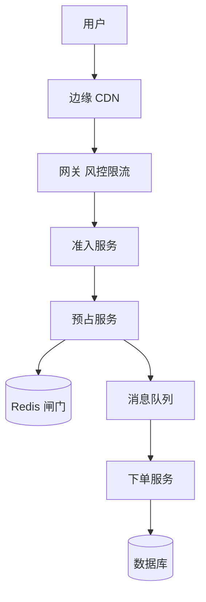
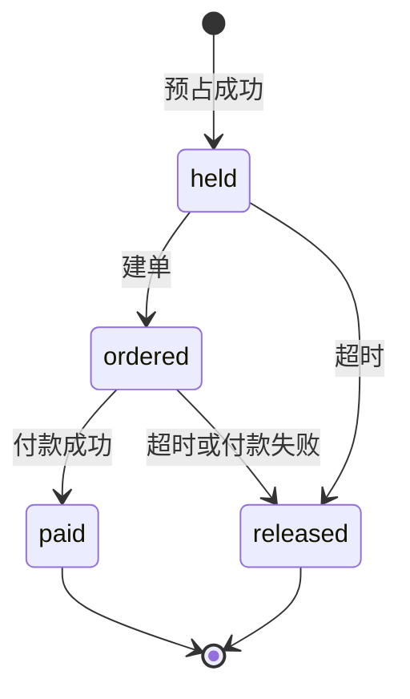

## Q
**秒杀抢票（排队、限流、防超卖）**｜系统设计

设计一个抢票系统：演唱会（或限量商品）在固定时刻开售，开售前几百万人守在页面，倒计时归零那一秒，请求量是平时的上千倍，而票只有 1,000 张，几秒内就卖完。要同时做到：扛住突发流量而不崩、绝不超卖、每人限购、付款失败或超时后票回到可售。练习用的规模假设：100 万人在线，每人 5 次请求集中在 10 秒内。面试官的提法一般有两层：第一层是流量浪涌，用负载均衡、排队室（waiting room）或队列、限流，别让突发流量直接打到后端和数据库；第二层是库存，如何保证不超卖，缓存和数据库怎么配合。常见变体是"10 个库存、1 万 QPS"，或"10 万人抢 1,000 个座位、长途乘客优先"。

给出完整解答：需求、核心实体与接口、整体设计、深入问题、取舍、不同级别的期望。

## A
**一句话。** 50 万请求/s 对 1,000 张票，99.6% 的请求注定失败，所以设计的主线不是"怎么处理这么多请求"，而是"逐层便宜地拒绝，只让极少数请求碰到库存"，并让库存的真相落在数据库而不是缓存。

**需求。**
- 功能：
  - 开售前展示倒计时与状态，开售后准入、预占、下单、付款；
  - 每人限购（如 1 张）；
  - 预占（hold）有时限，付款失败或超时自动释放，释放的票可再被抢；
  - 售罄后快速拒绝，用户明确知道结果，不是转圈；
  - 变体：选座（逐座位占位）。
- 非功能：
  - 绝不超卖（卖出数不超过库存）；一人限购不可绕过；
  - 秒杀的失败不能拖垮主站；
  - 预占接口响应一次缓存往返即可；已确认的订单不丢。
- 估算（假设，逐个可重算）：
  - 请求：100 万 × 5 = 500 万次，集中在 10 秒，约 50 万次/s；
  - 带宽：每个请求约 500 B，响应约 1 KB，50 万 × 1.5 KB × 8 = 6 Gbps，必须在边缘消化，不可能打进源站；
  - 直接打单个 Redis：简单脚本约 5 万次/s（量级假设），50 万 ÷ 5 万 = 10 倍超载；
  - 直接打数据库单行：持锁 2 ms，上限 1 ÷ 0.002 = 500/s；失败的请求排队会耗尽连接池；
  - 占位需求：付款转化率 70%，要卖光 1,000 张，同时持有的占位约 1,000 ÷ 0.7 ≈ 1,429；准入 2,000 人（100 万的 0.2%）略多于所需；
  - 排队页轮询：100 万人每 2 秒查一次 = 50 万次/s，响应是所有人相同的约 200 B JSON，即约 100 MB/s，全部由 CDN 缓存吸收，源站几乎为零；
  - 占位 10 分钟过期，清扫速率只有 2,000 ÷ 600 ≈ 3.3/s；付款转化率 70% 意味着约 30% 的占位（以 1,000 张计 300 张）会回到可售。

驱动设计的数字是 50 万 ÷ 2,000：设计就是把 50 万请求/s 变成 2,000 次预占，剩下的都是便宜的拒绝。

**核心实体与接口。**
- 实体：
  - Sale（`sale_id`、`sku_id`、`open_at`、`total`、`per_user_limit`、状态）；
  - Inventory（数据库，`sku_id`；`total`、`sold`，约束 `sold <= total`）；
  - Redis 闸门：`stock:{sku}`（可售数量）、`bought:{sku}`（已占位用户集合，做限购）、`holds:{sku}`（有序集合，成员 `hold_id:user`，分数是过期时间）；
  - Hold（数据库：`hold_id`、`user_id`、状态 held / ordered / paid / released、`expires_at`）；
  - Order（`order_id`；`hold_id` 唯一，`(sku_id, user_id)` 唯一，状态）。
- 接口：
  - `GET /sales/{id}/status`：所有人返回同一份内容（upcoming / open / sold_out、服务端时间、开售时间），CDN 缓存 1 秒；
  - `POST /sales/{id}/ticket`：申请准入令牌，服务端签名、绑定用户和商品、10 分钟过期；
  - `POST /sales/{id}/reserve`：头带令牌与幂等键，200 返回 `hold_id`，409 已抢过，410 售罄，429 限速；
  - `POST /orders`：用 `hold_id` 建单并去付款。
- 两个唯一索引是最后的防线：`(sku_id, user_id)` 保证限购，`hold_id` 保证同一个占位只产生一张订单。缓存里无论出什么差错，这两个索引都能挡住违例。

**整体设计。** 两条路径：用户抢的路径把 50 万请求逐层过滤成 2,000 次预占；占位的生命周期管付款、过期和回补。



抢购步骤：
1. 页面与脚本在开售前预加载到边缘；倒计时用服务端时间校准；按钮在开售前不可点，开售时加几十毫秒随机抖动，避免所有请求落在同一毫秒。
2. 网关要求登录、实名或有付款历史，做人机验证，按账号、设备、IP 限速，挡住机器人。
3. 准入服务决定谁拿到令牌（见深入 1），只有约 2,000 人通过，其余立刻得到明确的"未抽中"或"请排队"。
4. 带令牌的请求到预占服务，在 Redis 里执行一个原子脚本：查限购、查库存、扣减、登记占位（见深入 2）。成功立刻返回 `hold_id`，用户进入付款页，响应只有一次 Redis 往返。
5. 同时把"建订单"消息放进队列（削峰，至少一次）。下单服务消费，在数据库里条件扣库存并建单；条件更新影响行数为 0 就回滚并释放占位。
6. 库存归零的那一刻，把 `sold_out` 写入状态接口并推到网关本地内存，之后绝大多数请求在网关被拒，不再进 Redis。



**深入。**
1. 浪涌防护：排队室与限流，逐层便宜地拒绝。
   - 问题：50 万请求/s 要变成 2,000 次预占，每一层只拒绝，不增加状态。
   - 选项：
     - 先到先得的全局队列：100 万人入队是 10 秒内 10 万次/s 的写入加 100 万条排队状态，还奖励网络最快的人和脚本；
     - 排队室（虚拟队列）：给每人一个排队号，按下游能承受的速率分批放行，用户看到"前面还有多少人"；体验好，但需要有状态的队列，且放行速率要与库存路径容量匹配；
     - 无状态抽签：令牌结果是 `H(密钥, user_id, sale_id)` 对 100 万取模是否小于阈值 2,000，概率 0.2%。每个用户一个确定的结果，不存任何状态，重复请求得到同样答案，换 IP 也没用，因为按账号抽；代价是不严格先到先得，要在产品上说明是抽签，并依赖实名和风控防多账号。
   - 选择：抽签做首轮准入（实现最便宜、不奖励机器人）；开售窗口之后释放出来的票（付款失败、占位过期的约 300 张）让已有令牌但没抢到的人重试（每令牌每秒一次，约 1,000 次/s，承受得住），或开一个小的先到先得补充队列用 Redis 即可。若产品要求"排队号"的体验，就改用排队室，按每秒放行 N 人的节拍调速，N 取预占服务和下游能承受的值。
   - 限流：按账号、设备、IP 三个维度，边缘做粗限，网关做细限；客户端遇 429 要指数退避并加抖动，否则一个失败请求会放大成十个。
   - 否决：只做限流不分层（限流器自己要扛 50 万/s，放行的是随机一批，没有减少对库存的压力）；全部请求排队等一个单线程消费者（100 万请求堆积，延迟不可控，内存撑不住）。
2. 不超卖：Redis 做闸门，数据库做真相。
   - 问题：库存是单个热点，要同时做到原子、快、不超卖、限购、崩溃后不丢。
   - 选项：数据库行锁 `UPDATE ... SET stock = stock - 1 WHERE stock > 0`（正确，但单行 500/s 上限，排队的连接耗尽连接池）；只用 Redis `DECR`（快，但故障转移丢最近的扣减，没有持久真相，会超卖或少卖）；每个商品一个队列单消费者串行（正确，延迟高）；Redis 闸门加数据库真相。
   - 选择最后一种。Redis 脚本一次执行完成"限购检查、库存检查、扣减、登记占位"，中间不会被别的命令打断：

```lua
-- KEYS: stock, bought, holds   ARGV: user, hold_id, expire_ts
if redis.call('SISMEMBER', KEYS[2], ARGV[1]) == 1 then return 2 end
local s = tonumber(redis.call('GET', KEYS[1]))
if s == nil or s <= 0 then return 0 end
redis.call('DECR', KEYS[1])
redis.call('SADD', KEYS[2], ARGV[1])
redis.call('ZADD', KEYS[3], ARGV[3], ARGV[2] .. ':' .. ARGV[1])
return 1
```

   - 数据库做最后一道：`UPDATE inventory SET sold = sold + 1 WHERE sku_id = ? AND sold < total`，影响行数为 0 就拒绝并释放 Redis 占位；订单表的两个唯一索引兜底。`sold <= total` 由数据库保证，与 Redis 的状态无关。
   - Redis 出错的两个方向：显示比真实多（故障转移丢了扣减）会多放进几个人，他们拿到预占后被数据库拒绝，用户看到"已售罄"，体验差但不会超卖；显示比真实少（占位泄漏没释放）会少卖，用"库存 = 总数 − 已售 − 有效占位数"定期重建。
   - 热点：准入把预占压到每秒几千次，远低于单实例约 5 万次/s，单个库存键够用；库存特别大（如 100 万件、预占超过 5 万次/s）才把库存拆成 16 个子键放不同分片，用户按哈希路由，空桶换相邻桶，代价是尾部库存散落各桶，需要兜底合并。
3. 占位的生命周期：回补必须幂等，过期不能依赖通知。
   - 状态转移：每个转移是数据库里的一次比较并交换，`UPDATE hold SET state='paid' WHERE hold_id=? AND state IN ('held','ordered')`，影响行数决定谁赢。
   - 释放幂等：只有 `ZREM` 真的删掉了成员，才 `INCR stock` 并 `SREM bought`，所以重复释放、并发释放只回补一次；回补两次会让库存虚增，随后超卖。
   - 过期：有序集合按过期时间排序，清扫任务每秒取 `score <= now` 的成员逐个释放，同时把数据库里的占位置为 released。不依赖 Redis 键的过期通知，那是尽力而为，可能丢。
   - 付款与过期竞争：第 9 分 59 秒付款成功，第 10 分整清扫也在释放，两者都是对同一行的比较并交换，只有一个成功。付款先赢则占位变 paid，清扫什么也不做；清扫先赢后迟到的付款回调发现已 released，此时钱已收：票还在就恢复订单，不在就自动退款。
   - 双写问题：预占成功后要把消息放进队列，Redis 成功而队列失败（或中间崩溃）就有占位却没有订单消息。占位本身就是意图记录：清扫任务发现创建超过 60 秒而数据库里无对应订单的占位，补发消息或直接释放；消费者按 `hold_id` 幂等。最坏结果是票被占用最多 10 分钟，之后回补，不会永久丢失。
4. 隔离、预热与降级：秒杀失败不能拖垮主站。
   - 隔离：独立的网关集群、服务实例、Redis、数据库连接池（舱壁模式），全部打满也不影响主站的浏览和登录。
   - 预热：开售前半小时扩容到目标容量（自动伸缩跟不上秒级浪涌），预先把库存写进 Redis，预建数据库连接，CDN 预加载静态资源，上线前用压测流量演练。
   - 降级与熔断：浪涌期间关闭推荐、评论、优惠券叠加，页面返回精简静态版；下游（订单、支付）变慢时预占服务对新请求快速失败，返回"系统繁忙"，不让线程堆积；每个商品的预占速率设上限，防爆款拖垮其他商品。
   - 机器人与公平：实名、人机验证、设备指纹、限购；占位不付款自动释放，所以抢了不付的账号的代价只是占 10 分钟。
   - 付款回调延迟、消息积压、Redis 宕机都要演练：Redis 宕机失败关闭展示"繁忙"，副本接管后按公式重建库存再放行。

**取舍与追问。**
- 只有 10 个库存、1 万 QPS？设计不变，准入缩到约 20 人；准入之后只剩几十个请求，甚至只用数据库的条件更新就够。先问清库存量和准入量，再决定要不要引入 Redis。
- 为什么不直接用数据库行锁扣库存？没有准入时 500/s 的上限会把连接池打满；放在准入之后，行锁其实可用。
- 抽签和先到先得怎么选？抽签无状态、不依赖网络快慢、不奖励机器人，代价是产品要说明规则并依赖账号风控；先到先得更直观，但需要全局队列且鼓励抢跑。要排队号的体验就用排队室，按下游容量调速放行。
- 选座（10 万人抢 1,000 个座位，长途乘客优先）？库存变成逐座位的占位，每个座位一个键，用脚本在一个区域内一次占多个相邻座位，要么全占要么全不占；优先级通过分层准入实现，先发优先档令牌；座位图是只读缓存，只有占位才走脚本。更通用的预订型设计见同类题。
- 消息队列积压？预占已返回 `hold_id`，积压只延迟建单，占位 10 分钟内有效；消费者水平扩展并按 `hold_id` 幂等，清扫任务补发丢失的消息。
- 付款怎么接？预占后进入付款，支付状态由回调加轮询确认；付款成功回调要幂等，迟到的成功走恢复或退款，支付侧的幂等键与 unknown 处理见支付系统题。
- 怎么验证？压测到预期的 1.5 倍（约 75 万请求/s），做 Redis 故障、队列积压、付款回调延迟三种演练；监控预占成功率、占位泄漏数、`sold` 与 Redis 库存之差。
- 最弱的一环主动说：抽签依赖账号风控；Redis 丢扣减后用户先收到成功又被告知售罄。

**级别期望。**
- 中级：知道要限流和排队，库存用数据库事务或 Redis 扣减，防止重复下单。
- 高级：算出 50 万对 2,000 并据此分层；Redis 脚本原子预占加数据库条件更新；占位带过期，释放幂等；售罄标志推到边缘。
- 资深/专家：无状态抽签对排队室的取舍，Redis 出错两个方向的后果与重建公式，付款与过期的竞争和迟到成功的恢复或退款，占位作为意图记录解决双写，隔离、预热、降级与客户端退避，选座变体。

**先修概念。**
- [[hi-system-design-patterns-dealing-with-contention|处理争用（Contention）]]
- [[hi-system-design-deep-dives-redis|Redis]]
- [[hi-system-design-core-concepts-caching|缓存]]
- [[hi-system-design-problem-breakdowns-flash-sale|秒杀系统]]
- [[hi-system-design-problem-breakdowns-ticketmaster|票务预订（Ticketmaster）]]
- [[hi-system-design-patterns-scaling-reads|扩展读]]

**同类题。**
- [[event-ticket-booking|活动票务预订]]：选座与占位的另一个完整解答。
- [[distributed-rate-limiter|分布式限流器]]、[[rate-limiter-system|限流系统]]：准入和限流层的机制。
- [[sd04-flash-sale|秒杀与抢票（Chi 的长篇题解）]]
- [[tt-wallet-ledger-service|钱包与复式账本服务]]：冻结（hold）、确认、释放与超时的同一套状态机。
- [[05-payment-domain|支付领域知识]]：付款回调的幂等与迟到成功后的退款。
- 编码变体：[[tt-rate-limiter-implementation|手写限流器]]、[[tt-lru-cache-ttl|带 TTL 的 LRU]]（占位过期的手感）
