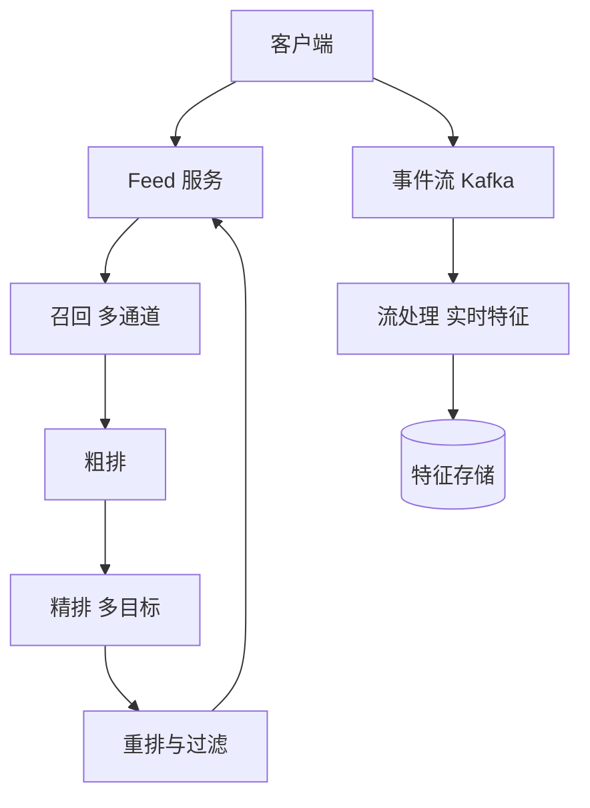

## Q
**短视频推荐信息流（For You）**｜系统设计

设计短视频应用首页的个性化推荐信息流：用户上滑一次就看到下一个视频，系统要从十亿量级的视频库里，按每个用户的兴趣实时挑出接下来要播的内容。参考规模：日活 5 亿，人均每天看约 100 个视频，视频库超过 10 亿条且每天新增数千万条。面试官关心的是推荐链路的分层（候选生成、排序、重排、服务）、新用户和新视频的冷启动（cold start）、训练样本里的特征泄漏（feature leakage）、多目标排序的权重怎么定，以及检索阶段取多少个候选（K）才合适，整个请求的延迟预算怎么分。

给出完整解答：需求、核心实体与接口、整体设计、深入问题、取舍、不同级别的期望。

## A
**一句话。** 这是一道漏斗问题：用毫秒级预算把 10 亿个视频逐层缩减到几个，每一层用越来越贵、越来越准的模型，同时让从未见过的新用户和新视频也能被公平地试出价值，并保证训练时看到的特征和线上推理时完全一致。

**60 分钟路线。**

| 时间 | 做什么 |
|---|---|
| 0–5 分 | 需求和数字：日活 5 亿，平均约 7.2 万 QPS，峰值约 22 万，请求 p99 约 300ms |
| 5–10 分 | 实体和接口：`GET /feed`、`POST /events`；曝光与后续行为靠请求 ID 关联 |
| 10–25 分 | 画漏斗：多通道召回 → 粗排 → 精排多目标 → 重排与过滤，事件流回流实时特征 |
| 25–50 分 | 深入：多通道召回与动态 K、多目标融合与延迟、新视频和新用户的冷启动 |
| 50–60 分 | 追问：特征泄漏与训练推理一致、已看过滤、降级、上线新模型 |

**需求。**
功能：
1. 用户请求下一批视频，每批约 6 到 10 个，持续刷也不重复。
2. 个性化：综合观看时长、完播、点赞、评论、分享、关注、不感兴趣等行为排序。
3. 新用户、新视频都能得到合理曝光。
4. 过滤：已看过的、被屏蔽的创作者、违规或未过审的视频、地区与年龄不允许的内容。
5. 用户行为（观看时长、点赞等）实时回流，几分钟内影响后面的推荐。
暂不做：搜索、广告插入的竞价细节、直播推荐。

非功能：
- 规模估算：日活 5 亿，人均 100 个视频，每次请求返回约 8 个，每天约 62.5 亿次请求，平均约 7.2 万 QPS，按 3 倍峰值约 22 万 QPS。
- 延迟：一次请求 p99 在 300ms 以内（客户端预取下一批，用户感知更低）；线上排序阶段拿到特征、跑模型的预算大约 100 到 150ms。
- 可用性：推荐服务不可用就是首页白屏，必须有降级路径。
- 新鲜度：新视频发布后几分钟内就能进入候选；用户刚做出的行为在几十秒到几分钟内影响推荐。
- 数据量：每天百亿级的曝光与行为事件，要进入流处理、特征存储和训练数据。

**核心实体与接口。**
实体：
- **User 与用户画像：** `User(user_id, 语言, 地区, 设备, 注册时间)` 及用户画像（长期兴趣向量、短期兴趣向量、统计特征）。
- **Video 实体：** `Video(video_id, 创作者, 发布时间, 时长, 话题标签, 内容向量, 审核状态, 实时统计)`。
- **Event 事件实体：** `Event(user_id, video_id, 类型, 观看时长, 时间, 请求 ID)`：曝光、播放进度、点赞、评论、分享、关注、跳过。
- `FeedRequest/Response`：带会话游标，响应里附带每个视频的来源通道和打分快照，用于日志与离线训练。

接口：
- **推荐流接口：** `GET /feed?count=8&cursor=...` → `{videos: [...], next_cursor}`。
- `POST /events`（批量上报）：客户端攒一批事件一起发，包含请求 ID，让曝光与后续行为能关联回当时的候选和特征。

**整体设计。**

1. 请求到达 Feed 服务，服务先读取用户实时特征（最近观看序列、短期兴趣、已看集合）。
2. **召回多通道并行：** 召回（candidate generation）并行跑多个通道，各取若干个：双塔向量检索（用户向量在视频向量库里做近似最近邻）、协同过滤（看过 A 的人也看 B）、关注的创作者的新作品、热门与地区趋势、新视频试探池。合并去重后得到约 1,000 到 3,000 个候选。
3. **粗排留几百个：** 粗排（pre-ranking）用轻量模型给全部候选打分，留下几百个。
4. **精排预测多个目标：** 精排（ranking）用大模型对几百个候选预测多个目标：完播概率、预期观看时长、点赞、评论、分享、关注、负反馈（跳过、不感兴趣）。
5. 融合：把多个预测值按权重合成一个分数。
6. 重排（re-ranking）：做多样性控制（同一创作者、同一话题不连续出现）、探索配额（插入新视频与新兴趣）、业务规则与合规过滤，输出最终 8 个。
7. 响应返回，同时把这次请求的候选、特征快照、打分写入日志；客户端播放行为回流到 Kafka，流处理更新用户实时特征，并生成训练样本。

**深入。**
1. 【必讲】召回与动态 K：为什么是多通道，每个通道取多少。
- 问题：精排模型贵，不可能给 10 亿视频打分；召回要在几十毫秒内找出"可能喜欢"的一小批，召回率比精度重要，漏掉的好视频后面没有机会补救。
- 通道：单一通道必然偏。向量检索擅长挖兴趣但对新视频不友好（新视频内容向量可用，行为向量缺失）；协同过滤依赖历史行为；关注与热门保底。多通道并行再合并，各取一部分，使候选集合覆盖不同来源。
- K 的取舍：K 越大召回越全、精排越慢、成本越高；K 太小则排序没有选择空间。固定 K 对所有用户一样是浪费：行为丰富的老用户少量候选就够准，行为稀少的用户需要更多候选来探索。做法是动态 K：按用户活跃度、通道历史命中率（该通道的候选最终被精排选中和被观看的比例）、剩余延迟预算分配各通道配额；通道设超时，到点就用已返回的部分，不等慢的那一个。
- 向量检索：十亿向量放不进单机内存，用分片的近似最近邻索引（图索引或倒排加量化），增量更新新视频；召回率与延迟互相牵制，用离线评估召回率，线上监控 p99。
2. 【必讲】排序：多目标融合与延迟。
- 问题：用户一次观看产生多种信号，"完播高"不等于"会点赞"，只优化一个目标会导致标题党或单一内容泛滥。
- 做法：一个多任务模型共享底层表示，输出多个目标的概率；融合公式常见是加权和或带指数的连乘，例如 `score = Σ w_i × p_i`，其中 `w_i` 对应各目标的业务价值。负反馈目标取负权重。
- 权重怎么定：从业务目标（长期留存、时长、互动、创作者生态）出发，用线上 A/B 实验调整，再用贝叶斯优化等方法自动搜索；权重放进配置，可以热更新，不用发版。有护栏指标（例如留存、投诉率、创作者覆盖），任何一个恶化就回滚。
- 校准：各目标的预测概率要校准（预测 0.1 的事件真实发生率应当约为 0.1），否则加权和没有意义。
- 延迟：特征读取是大头。用户特征与视频特征预先放在低延迟的键值存储里，批量获取；模型用批推理，GPU 或量化加速；粗排排除掉绝大多数候选后，精排才有预算跑大模型。精排超时就降级为粗排分数的排序。
3. 【必讲】冷启动：新用户和新视频。
- 新视频：它没有任何行为数据，排序模型对它没有信心。做法是试探池（流量分级）：新视频发布并通过审核后，先推给一小群（几百个）按内容标签和创作者粉丝匹配的用户，收集完播率、点赞率等指标；指标高于同类基线就扩大到下一级流量池（几千、几万……），低于就停止放量。这本质是多臂老虎机的探索：可用汤普森采样或置信上界的思想，让不确定的视频获得更多试探。试探池占用一个固定配额（例如 5% 到 10% 的位置），避免新视频挤占太多体验，也避免成熟视频垄断。创作者的历史表现和视频的内容向量用作先验。
- 新用户：没有行为，先用地区、语言、设备、注册时的兴趣选择给出热门与分类内容，然后快速自适应：前几十个视频内，每一次完播和跳过都立刻更新短期兴趣，探索配额适当提高。关键是把"每个视频的反馈"尽快写进实时特征，让第 10 个视频已经比第 1 个更准。
- 评估：冷启动的效果看新用户第 1 天和第 7 天留存、新视频进入下一级流量池的比例，而不是整体点击率。
4. 【追问再讲】特征泄漏与训练、推理一致。
- 问题：离线训练时，如果用"事后"的信息构造特征，模型指标很好看，上线却大幅下滑。典型例子：用视频的最终点赞数（包含了样本发生之后的点赞）当特征；用"标签发生之后才产生"的用户行为做特征；训练时重新计算的特征和线上实际使用的不同。
- 做法一：时间点正确的特征（point-in-time correct）。每个训练样本只能用该曝光发生时刻之前已经可得的特征；特征存储保留带时间戳的历史版本。
- 做法二：线上记录当时的特征快照。线上打分时把用到的特征值直接写进日志，训练直接用这份日志，而不是事后重新计算，这样训练与推理看到的是同一份数据，消除"训练-服务偏差"（training-serving skew）。
- 做法三：同一份特征定义同时用于离线和在线（一处代码，两处执行），防止实现分叉。
- 做法四：标签延迟。完播和点赞要等用户看完才知道；负样本（曝光后没有点赞）有被"晚到的正反馈"污染的风险，所以要设定标签窗口，窗口关闭后才生成样本，对晚到的数据做修正。
- 做法五：评估时按时间切分训练与验证（用过去训练，用未来验证），不能随机切分，否则同一用户的未来行为泄漏到训练集。
5. 【追问再讲】去重与已看过滤。
- 问题：每个用户几个月内看过成千上万个视频，不能重复推荐，也不能每次请求都扫描全部历史。
- 做法：每个用户在内存数据库里保存最近观看集合（例如最近 1 万条）加布隆过滤器（Bloom filter）覆盖更久远的历史；召回后用过滤器剔除。布隆过滤器可能把没看过的误判为看过，即少量漏推，但绝不会把看过的当成没看过，符合"宁漏勿重"。曝光事件异步写入，客户端在请求里带上本地已展示的 ID 弥补延迟。

**取舍与追问。** 按被问到的可能性排，通常口述就够：
- 为什么要预取：一次请求返回 8 个，用户看到第 5 个时客户端就请求下一批，把 300ms 的延迟藏在播放里。代价是预取的内容可能因用户行为变化而略显过时。
- 实时性与成本：用户短期兴趣用流处理在秒级更新；视频向量与大模型每天甚至每小时才训练和发布一次。把"快变化"的东西放进特征，把"慢变化"的东西放进模型参数。
- 过度个性化（信息茧房）：探索配额、多样性重排、对多个长期目标（留存、多样性）而不只是点击优化。
- 排序服务超时：降级路径有三层：精排超时用粗排结果，粗排也超时用缓存的热门与关注内容，全部失败返回按地区预生成的兜底列表，保证首页不白屏。
- 如何上线新模型：影子流量（只打分不展示）对比 → 小流量 A/B → 逐步放量，每步看护栏指标；离线指标提升不等于线上提升。
- 内容安全：审核状态是召回前的硬过滤条件，未通过的视频不会进入任何候选；举报与下架通过事件流实时传播到索引。
- 创作者生态：避免马太效应，新创作者的视频通过试探池也能获得第一批观众，这是平台增长的关键。

**级别期望。**
- 中级：画出召回、排序、返回三层，说明为什么不能对全量视频打分，处理已看过滤。
- 高级：多通道召回与向量检索，多目标融合和权重调节，冷启动的试探池，实时特征与行为回流，降级策略。
- 资深/Staff：动态 K 与延迟预算分配，训练推理一致与特征泄漏防范，探索与利用的度量，A/B 实验与护栏指标，十亿级向量索引的分片与更新，容量与成本模型。

**先修概念。** [[hi-system-design-core-concepts-caching|缓存]]、[[hi-system-design-deep-dives-vector-databases|向量数据库]]、[[hi-system-design-deep-dives-kafka|Kafka]]、[[hi-system-design-core-concepts-sharding|分片（Sharding）]]、[[hi-system-design-deep-dives-redis|Redis]]、[[hi-system-design-patterns-scaling-reads|扩展读]]

**同类题。** [[hi-system-design-problem-breakdowns-fb-news-feed|Facebook 信息流]]、[[twitter-clone-feed|推特式信息流]]、[[social-feed-generation|社交信息流生成]]、[[hi-system-design-problem-breakdowns-youtube|视频平台（YouTube）]]
