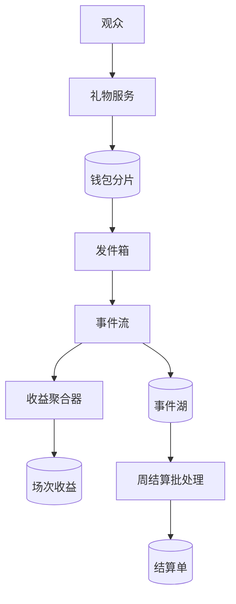

## Q
**直播虚拟礼物：金币记账与主播结算**｜系统设计

设计一个全球分布、高度精确的金币追踪与结算系统。观众先用真钱买金币（coin，预付的虚拟货币），再在直播间用金币送礼物；系统要实时处理来自世界各地的礼物，保证幂等（同一份礼物只扣一次币），给出每场直播（session）主播的精确收益，并支持可靠的每周财务结算。练习用的规模假设：每天 2 亿份礼物，峰值是均值的 10 倍，最热的房间每秒 5,000 份，主播 500 万人。面试官的重点通常落在三处：重试和重复通知下如何恰好一次、热门主播的写入热点、实时数字与最终结算数字如何对上。

给出完整解答：需求、核心实体与接口、整体设计、深入问题、取舍、不同级别的期望。

## A
**一句话。** 观众的钱包必须强一致、恰好一次地扣币，而主播这一侧的收益只是事件的汇总；难点是把"同步的钱"和"异步的账"分开，让实时展示可以是估计值，周结算能由事件重算并且对得上每一分钱。

**60 分钟路线。**

| 时间 | 做什么 |
|---|---|
| 0–5 分 | 需求和数字：峰值约 23,148 份/秒，最热房间 5,000 份/秒对行锁上限 500/秒 |
| 5–10 分 | 实体和接口：钱包、币流水、礼物事件、发件箱、结算单；`POST /v1/gifts` 带 `gift_id` |
| 10–25 分 | 画两条路径：同步送礼（钱包分片本地事务）和异步收益（发件箱 → 事件流 → 聚合与事件湖 → 周结算） |
| 25–50 分 | 深入：恰好一次、热门主播不做同步更新、每场精确收益与周结算 |
| 50–60 分 | 追问：全球钱包的归属区域、退款与负余额、为何不用 Redis 记余额、风控 |

**需求。**
- 功能：
  - 送礼扣币：带客户端生成的 `gift_id`，重试安全，余额不足明确拒绝；
  - 金币充值入账：应用商店或支付渠道的通知重复、乱序，也只入账一次；
  - 每场直播的主播收益：直播中实时展示，结束后精确；
  - 每周结算：按周期汇总，生成不可变的结算单，交给打款；
  - 充值退款与礼物撤销：只追加冲销，不改历史。
- 非功能：
  - 扣币正确性：同一个 `gift_id` 至多扣一次，余额永不为负；
  - 送礼延迟 p99 小于 200 ms，可用性 99.99%，钱包不可用时失败关闭（fail closed，拒绝而不是放行）；
  - 已确认的扣币和事件零丢失；
  - 主播收益展示几秒内可见，允许误差；结算时每个整数单位都能追溯到具体事件；
  - 事件与分录保留 7 年。
- 估算（假设，逐个可重算）：
  - 2 亿 ÷ 86,400 = 2,315/s 平均，峰值取 10 倍，约 23,148/s；
  - 每份礼物同步写 4 行（礼物事件、钱包余额、币流水、发件箱），峰值约 92,592 行/s，分 32 个钱包分片，每片约 2,894 行/s，单片关系库承受得住；
  - 热点：最热房间 5,000/s 都要加到同一个主播上，行锁每次持有 2 ms 则单行上限 1 ÷ 0.002 = 500/s，差 10 倍；
  - 事件存储：2 亿 × 200 B = 40 GB/天；一周 14 亿条 = 280 GB，按 2 GB/s 扫描只要 140 秒，所以结算是夜间批处理，难点在口径不在算力；
  - 跨区域事件流量：23,148 × 200 B ≈ 4.6 MB/s，约 37 Mbps，不是约束，事件可以异步跨区复制。

驱动设计的数字是 5,000/s 对 500/s：主播的收益不能放在送礼的同步路径上更新。

**核心实体与接口。**
- 实体：
  - Wallet（`user_id` 分片键：`coins`、`version`、`home_region`）；CoinLedger（`user_id, seq`：`delta`、`reason`、`ref_id`，只追加）；
  - TopUp（`platform, transaction_id` 为主键，主键本身就是去重）；
  - GiftEvent（`gift_id` 主键：发送者、主播、`session_id`、价格版本、`share_bps`、`share_micro`、`status`）；
  - Outbox（与扣币同事务写入的待投递消息）；SessionEarnings（`session_id, shard`：展示用的子计数器）；
  - SettlementPeriod（open / frozen / closed）；Statement（`creator_id, period_id` 唯一，生成后不可变）；Payout。
- 接口：
  - `POST /v1/gifts`：`{gift_id, room_id, gift_type, count}`，200 返回新余额，402 余额不足，409 同一个 `gift_id` 内容不同；
  - `POST /v1/coins/topups/notify`：渠道通知入口，服务端先校验收据，重复通知返回与第一次相同的结果；
  - `GET /v1/rooms/{id}/earnings`：展示用的近似值；`GET /v1/creators/{id}/statements?period=`：不可变的结算单。
- 要说的两个细节：价格由服务端按当时的价格版本决定，客户端传来的价格一概忽略；金额全部是整数，分成用 `share_micro`（万分之一金币）存。

**整体设计。** 拆成两条路径，一致性要求完全不同：同步的送礼路径只碰观众的钱包；异步的收益路径把事件汇总成展示和结算。

送礼路径（同步）：
1. 客户端点击时生成 `gift_id`，网络不好重试时复用同一个；礼物服务校验房间正在直播，取当前价格版本。
2. 礼物服务向观众归属区域的钱包分片发起一个本地事务，里面做四件事：插入 GiftEvent（`gift_id` 主键冲突说明已处理过，直接读出第一次的结果）；条件扣币 `UPDATE wallet SET coins = coins - :p WHERE user_id = ? AND coins >= :p`；写币流水；写发件箱。
3. 影响行数为 0 表示余额不足，事务回滚，没有任何副作用。成功则返回最新余额，客户端此刻才确认这次送礼生效。
4. 房间动画走另一条尽力而为（best effort）的广播通道，丢了不影响钱。

收益路径（异步）：发件箱进程把事件投递到事件流（至少一次）。聚合器按 `gift_id` 去重，做 1 秒本地预聚合后写入子计数器，供房间和主播看板展示；事件同时落到事件湖（对象存储上的列存文件）。每周的批处理从事件湖读出该周期的全部有效事件，按主播汇总，生成结算单交给打款服务。展示的计数器是批处理结果的实时近似，批处理才是真相。

每份礼物的复式分录（7 个金币 = 70,000 micro，主播分成 35%）：借 `user_coin_liability` 70,000；贷 `creator_earnings_payable` 24,500；贷 `platform_gift_revenue` 45,500。三行相加为 0。币是平台的预付负债，花出去的那一刻才变成平台收入。

**深入。**
1. 【必讲】恰好一次：每个入口一个去重键，每个出口一个幂等消费。
   - 问题：充值通知会重复、乱序；送礼会重试；事件流是至少一次。
   - 选项：端到端事务（Kafka 事务只覆盖 Kafka 内部，钱包库不在里面）；钱包和主播账户做两阶段提交（把可用性耦合起来，主播账户还是热点）；扣币后直接更新主播余额再发消息（崩溃时两边对不上）。
   - 选择：充值用 `(platform, transaction_id)` 做主键，同事务里入账、写流水；送礼用 `gift_id` 主键加条件扣币，检查和扣减合成一条原子语句，并发的两次扣币不会同时看到旧余额；发件箱到事件流至少一次，消费者按 `gift_id` 去重。
   - 崩溃点逐个收敛：事务提交前崩溃什么都没发生，客户端重试；提交后、回复前崩溃，重试时读到已保存的结果；发件箱投递前崩溃，进程重启继续投递，下游靠去重吸收重复。
2. 【必讲】热门主播：主播侧一律不做同步更新。
   - 选项：同步更新主播余额（上限 500/s，且把送礼延迟绑在最热的一行，否决）；Redis 自增（故障转移丢最后一批自增，只能做展示）；把一场收益拆成 16 个子计数器（每个约 312/s，读时求和）；只写事件，收益是事件的汇总。
   - 选择：最后一种，再叠加子计数器做展示。事件流按 `gift_id` 哈希分区，64 个分区每个约 362/s，均匀；绝不按主播分区，否则最热主播的 5,000/s 压在一个分区上。聚合器先做 1 秒预聚合，一个子计数器每秒只写一次。求和满足交换律，所以事件乱序、重试顺序不同都不影响结果，不需要保序。
3. 【必讲】每场精确收益与每周结算：实时是估计，批处理是真相。
   - 归属：`session_id` 由礼物服务扣币时按房间当前场次盖章，客户端不能选，也不能事后改。
   - 实时：子计数器求和，页面标注"预估"。
   - 真相：场次结束并过水位线（watermark，等待晚到数据的时间，如 30 分钟）后，批处理从事件湖按 `session_id` 重算：按 `gift_id` 去重、排除已撤销、累加 `share_micro`，覆盖流式结果，并比较两者，差异超阈值就报警。
   - 取整：7 个币 35% 是 2.45 个币当量，若每份向下取整成 2，每份损失 0.45，占 18.4%，14 亿份会累成系统性误差。全程用 micro 整数累加，只在周期汇总值上取整一次，余数记入下一周期。
   - 结算：切分、冻结、不可变结算单、对账不变量。
      - 周期按事件时间（UTC）切分，分成表和汇率在周期开始时锁定；事件里已固化 `share_bps` 和价格版本，中途改比例不影响历史。
      - 周期结束后等待水位线（如 6 小时）再冻结。冻结之后才到的属于该周期的事件不改这个周期，作为下一周期的调整项并写明原因。
      - 批处理先写临时表，校验通过后原子切换，所以重跑结果完全相同；低于最低打款额的结转；结算单交给打款服务，后者的状态机和键保证不会重复打款。
      - 三条对账不变量，每个周期、每个区域检查：观众被扣的币 = 主播份额 + 平台份额 + 已冲销部分；币总量守恒（累计充值 − 累计消费 − 退款 = 全部钱包余额之和）；结算单汇总 = 事件汇总。任何一条不成立，这个周期不进入打款。
4. 【追问再讲】全球钱包：为什么是归属区域单点写入。
   - 问题：用户遍布全球，"余额不为负"是一个全局约束。
   - 选项：多主复制加合并（只保证最终收敛，两个区域可以同时花光同一笔余额，否决）；全球强一致数据库（每次扣币多一次跨区共识，p99 轻松破 200 ms，否决）；区域额度切片（用完要回源协调，退款和回收额度的规则繁多，暂不选）；归属区域单点写入。
   - 选择最后一种：每个钱包有唯一的归属区域，所有扣币路由到那里。多数送礼发生在用户自己的区域，跨区的少数多出 100 到 200 ms 可以接受；主播所在区域不同步参与，礼物事件异步复制过去。
   - 区域整体故障时失败关闭。要恢复就得把异步备份提升为主库，此时 RPO（允许丢失的数据窗口）内的扣币会丢，相当于用户多得几份免费礼物；敞口有界：每片约 723 份/s（23,148 ÷ 32）乘以 RPO，RPO 5 秒时一片最多约 3,600 份。提升前必须先隔离旧主库（fencing），提升后用事件湖的事件和钱包流水对账补记。

**取舍与追问。** 按被问到的可能性排，通常口述就够：
- 用户点了两次，会扣两次吗？不会，两次共用一个 `gift_id`，第二次读出第一次的结果。
- 为什么不用 Redis 记余额？Redis 主从异步复制，故障转移丢最近的扣减，用户平白多出币；Redis 只能缓存读取，扣减落在有同步副本的关系库。
- 应用商店在币花光后才发来退款通知？写负的冲销流水，余额可以为负，钱包进入负债状态并禁止送礼；主播收益设保留期（如 7 天），期内币被追回则对应收益冲销，期外由平台承担坏账。这是产品和风控的取舍，要明说。
- 展示数字和结算对不上？展示标明预估；结算由批处理重算；差异超阈值报警，说明流式路径有 bug 或丢事件。
- 每秒 5,000 份礼物冲一个主播怎么办？见深入 2：主播侧零同步写，事件按 `gift_id` 分区。
- 风控：同一用户每秒送礼次数设上限，新账号设额度，集中的"甲送乙"关系对进入人工复核，因为刷礼物洗钱是真实风险。
- 面试最后主动说出最弱的一环：区域故障后的丢失窗口，或主播收益保留期的长度。

**级别期望。**
- 中级：画出钱包、事件流、结算批处理，知道用幂等键防重复扣币，余额更新用条件语句。
- 高级：主播侧不做同步更新并算出 5,000 对 500，发件箱加消费者去重，整数 micro 只取整一次，实时与批处理分离，周期冻结加调整项。
- 资深/专家：归属区域单点写入及多主为何不行，区域故障的 RPO 敞口与 fencing，三条守恒不变量，退款后的负余额与保留期，分区键选择和热点的全链路论证。

**先修概念。**
- [[hi-system-design-core-concepts-api-design|API 设计]]
- [[hi-system-design-deep-dives-kafka|Kafka]]
- [[hi-system-design-deep-dives-redis|Redis]]
- [[hi-system-design-core-concepts-sharding|分片（Sharding）]]
- [[hi-system-design-core-concepts-cap-theorem|CAP 定理]]
- [[hi-system-design-patterns-dealing-with-contention|处理争用（Contention）]]

**同类题。**
- [[tt-wallet-ledger-service|钱包与复式账本服务]]：钱包那一层的展开。
- [[tt-payment-reconciliation|支付对账系统]]：结算批处理之后的资金核对。
- [[sd02-live-gift-coin-settlement|直播礼物与金币结算（Chi 的长篇题解）]]
- [[05-payment-domain|支付领域知识]]：账本、幂等、对账、整数最小单位的背景。
- 编码变体：[[tt-idempotent-versioned-update|幂等的版本化更新]]、[[tt-rate-limiter-implementation|手写限流器]]
- [[like-unlike-system|点赞系统]]：同样有热点计数与展示近似的问题。
