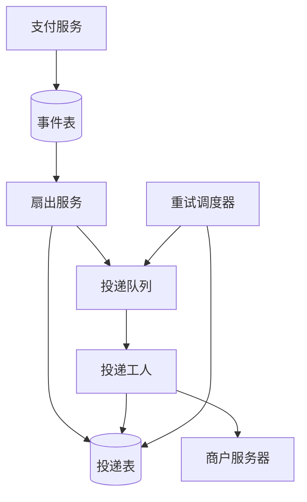
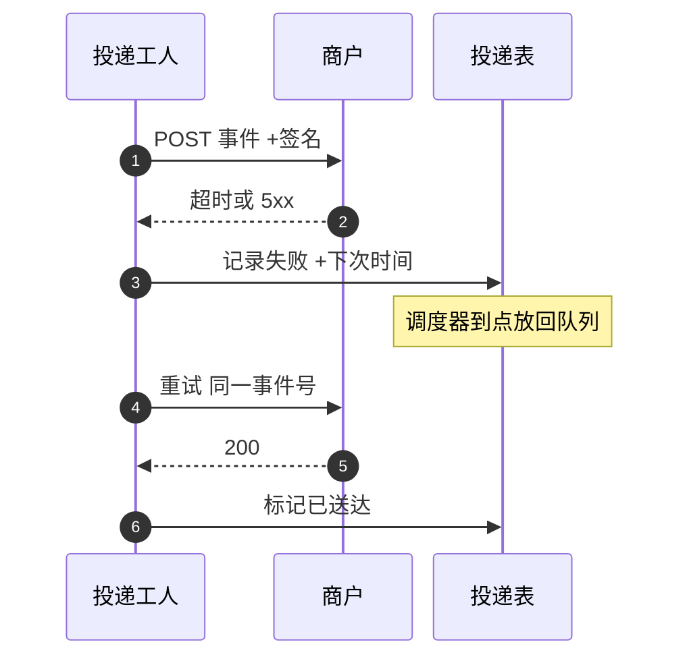

## Q
**商户回调（Webhook）投递系统（至少一次、重试、顺序、签名）**｜系统设计

支付平台在支付状态变化（已授权、已扣款、已退款、拒付）时，要主动调用商户配置的 HTTP 地址通知它，这就是 webhook。设计这个投递系统：商户的服务器会慢、会宕机、会返回错误、会重复收到同一条通知；平台要保证事件不丢，商户能验证通知确实来自平台，一个商户出问题不能拖慢别的商户。练习用的规模假设：每天 1,000 万笔支付、每笔 2 个事件，峰值是均值的 10 倍，首次投递 p99 在 5 秒内，失败重试约 3 天。面试官常追问：能做到恰好一次吗；顺序怎么保证；商户宕机一小时后怎么办；怎么防伪造和重放；通知丢了商户怎么补。

给出完整解答：需求、核心实体与接口、整体设计、深入问题、取舍、不同级别的期望。

## A
**一句话。** 对外部服务器没有"恰好一次"，只能做"至少一次投递加商户按事件号去重"；难点是对一个慢的、坏的、恶意的接收方保持不丢事件、不被拖垮，并且别家商户不受影响。

**需求。**
- 功能：
  - 商户注册一个或多个回调地址，按事件类型订阅，拿到每个地址独立的签名密钥；
  - 事件发生后尽快投递，非 2xx 或超时按退避策略重试，用尽后进死信并通知商户；
  - 每次投递带签名和事件 ID，商户可校验来源、可去重；
  - 控制台能看到每次尝试的状态码、耗时，可手动重发；事件日志可按游标拉取，作为通知丢失的兜底；
  - 商户端点长期失败时自动停用并通知。
- 非功能：
  - 事件不丢：事件与产生它的业务变更同事务落库；
  - 首次投递 p99 小于 5 秒；重试窗口约 3 天；
  - 隔离：单个商户的慢或宕机不能拖累其他商户的吞吐；
  - 安全：防伪造、防重放、防平台被利用去访问内网（SSRF）。
- 估算（假设，逐个可重算）：
  - 1,000 万笔 × 2 事件 = 2,000 万事件/天，平均 231/s，峰值约 2,315/s；
  - 加 20% 重试，约 2,400 万次投递/天，平均 278/s，峰值约 2,778/s；
  - 按平均 300 ms 的往返，Little 定律给出在途请求约 2,778 × 0.3 ≈ 833 个，再加超时慢请求，整体一两千个连接，一个小集群就够；
  - 存储：事件约 1 KB，2,000 万 ≈ 20 GB/天；投递尝试记录约 300 B，2,400 万 ≈ 7.2 GB/天，保留 30 天；
  - 积压：某商户每秒 100 个事件，宕机一小时就是 360,000 条、约 360 MB，必须只堵它自己，且积压放在存储里，不放在内存和队列的头部。

驱动设计的数字是 360,000 条积压：这是"一个商户宕机"就能产生的量，所以隔离和积压存储是主问题，吞吐不是。

**核心实体与接口。**
- 实体：
  - Endpoint（`endpoint_id`、`merchant_id`、URL、订阅的事件类型、状态 active / degraded / disabled、当前密钥与上一个密钥）；
  - Event（`event_id`、`merchant_id`、类型、资源 ID、资源版本、创建时间、负载；只追加，保留 30 天）；
  - Delivery（`(event_id, endpoint_id)` 唯一；状态 pending / delivered / failed / dead；`attempt`、`next_attempt_at`、`ordering_key`）；
  - Attempt（每次尝试的时间、状态码、耗时、响应前 1 KB，用于控制台）。
- 接口：
  - 管理：`POST /endpoints`（URL、事件类型），`POST /endpoints/{id}/rotate_secret`，`POST /endpoints/{id}/test`；
  - 兜底：`GET /events?after=<cursor>&type=` 按游标拉事件，`GET /events/{id}` 查单个，`POST /deliveries/{id}/redeliver` 重发；
  - 投递（平台到商户）：`POST <merchant url>`，头 `X-Event-Id`、`X-Signature: t=<unix>,v1=<hex>`，体是 JSON；商户返回 2xx 表示收到。
- 事件负载取"瘦事件"：只带事件类型、事件 ID、资源 ID、资源版本、创建时间，商户收到后再调查询接口取最新状态。

**整体设计。** 业务服务把事件和业务变更放进同一个事务（发件箱），后面的流水线都是异步、可重放的。

一次事件的生命周期：
1. 支付服务在更新支付状态的同一个数据库事务里写 Event（发件箱），所以"状态变了而事件没发"不可能出现。
2. 扇出服务读取新事件，查订阅了该类型的 Endpoint，为每个端点写一行 Delivery。`(event_id, endpoint_id)` 唯一，扇出服务崩溃重放时不会产生重复投递行。写完后把投递任务放进队列（按 `endpoint_id` 哈希分区，同一端点的任务落在同一分区，便于限制并发）。
3. 投递工人取任务，先看该端点的熔断状态和并发额度；通过后签名、发 HTTPS POST，连接超时 3 秒、总超时 10 秒，不跟随重定向，只记录响应前 1 KB。
4. 返回 2xx：Delivery 置为 delivered，写 Attempt。其他结果（非 2xx、超时、连接失败）：写 Attempt，Delivery 置为 failed，算出 `next_attempt_at`（见深入 1）。
5. 重试调度器每秒扫描 `next_attempt_at <= now` 的 failed 投递，重新放进队列。工人不睡眠等待，所有等待都在投递表里，这样慢商户不会占住分区。
6. 用尽重试窗口：置为 dead，通知商户，事件仍留在事件日志里，可手动重发或拉取。

**深入。**
1. 可靠投递与重试：为什么只能"至少一次"。
   - 问题：工人收到商户的 200 之后、写库之前崩溃，系统不知道成功了，只能再发一次；反过来商户处理了请求但响应在网络上丢了，也是一样。无论怎么做，都存在"商户处理了而平台不知道"的窗口，这是外部系统的本质，不是实现缺陷。
   - 选项：声称恰好一次（做不到）；只发一次不重试（丢事件）；至少一次加事件号去重。
   - 选择：至少一次，同一个事件的每次重试使用同一个 `X-Event-Id`，文档明确要求商户按事件号去重并先落库后响应。商户端的"幂等处理"才是恰好一次的效果来源，平台一侧的 `(event_id, endpoint_id)` 唯一键只保证扇出不重复。
   - 退避：首次失败后依次等 1 分钟、5 分钟、30 分钟、2 小时、6 小时、12 小时，之后每 24 小时一次，到 72 小时窗口截止；累计第 9 次尝试发生在约 68.6 小时，下一次会超过 72 小时所以停止。每个间隔加正负 20% 的随机抖动。
   - 响应语义：2xx 成功；3xx 视为失败（不跟随重定向，防被引到别处）；4xx 与 5xx 都重试，429 和 503 遵守 `Retry-After`；410 表示端点已废弃，直接停用。
   - 重试计时器用数据库表加调度器，不用队列的延迟消息：2,400 万次/天的量很小，投递表本来就要存状态，带索引 `(status, next_attempt_at)` 扫描即可，而且停用、手动重发、改期都是改一行。
   - 兜底：事件日志保留 30 天，商户可以按游标拉取自己漏掉的事件，控制台可对单个或一段时间内的失败投递批量重发。webhook 是加速器，不是商户状态的唯一依据；商户收到事件后还应调查询接口确认最新状态，与支付系统里"回调只是提示"同一个原则。
2. 隔离与公平：一个商户宕机不能拖累别人。
   - 问题：同一个队列里，某个端点每次都超时 10 秒，工人线程被它占满，其他商户的首次投递跟着变慢。
   - 选项：全局共享线程池（会被慢端点占满）；每个商户一个队列（商户数十万，队列太多）；共享队列加每端点并发额度加熔断。
   - 选择第三种：每个端点同时在途请求不超过 5 个，并有令牌桶限速；连续失败 N 次（如 10 次）端点转 degraded，熔断：此后不再按队列任务逐个尝试，而是每隔一段时间只发一个探测请求，探测成功才恢复。熔断期间到来的事件只写投递表，不占工人。
   - 积压留在投递表：宕机一小时的 360,000 条、约 360 MB 在存储里毫无压力；如果放在队列里，会把同一分区里别的端点挡在后面。
   - 恢复时防止"自己打垮刚恢复的商户"：端点恢复后的投递用慢启动，并发额度从 1 逐步升到上限，重试时间加抖动打散；积压按创建时间从旧到新放出。
   - 长期失败：连续失败超过重试窗口（3 天）则自动停用端点并通知商户，事件仍留在日志里供其修好后补拉。
   - 公平：再给每个商户一个总的投递速率上限，防止一个超大商户的突发把共享工人占满。
3. 顺序：不保证全局顺序，给商户足够的信息去排序。
   - 问题：同一笔支付的"已授权、已扣款、已退款"三个事件，如果第一个失败重试，会在第二个之后到达。
   - 选项：不保证顺序，事件带资源版本和创建时间，商户忽略旧版本，或收到后调查询接口；按 `(端点, 资源)` 串行，同一资源的后一个事件等前一个送达或进死信才放出，队头阻塞只发生在这个资源上；整个端点严格 FIFO，一个失败卡住该商户所有事件，吞吐掉到最慢的那一个。
   - 选择：默认第一种，实现简单、吞吐最高；对明确要求顺序的端点提供第二种，用 `ordering_key = 资源 ID`，调度器只放出该 key 下编号最小的未完成投递。第三种否决，因为单个失败会让所有事件延迟 3 天。
   - 文档里直说：不要依赖到达顺序，用 `resource_version` 做乐观比较，收到后以查询接口为准。
4. 签名、重放与平台自身的安全。
   - 签名：每个端点有自己的密钥，平台对 `t + "." + 原始请求体` 计算 HMAC-SHA256，放进 `X-Signature`。商户用常量时间比较校验，并拒绝时间戳与当前时间相差超过 5 分钟的请求，这样截获的请求不能被长期重放。必须对原始字节签名，商户不能先解析再重新序列化。
   - 密钥轮换：轮换后一段时间内同时有新旧两个密钥，请求头里放两个签名，商户用任一个校验通过即可，旧密钥到期后作废。密钥加密存放在密钥管理服务，控制台只在创建时显示一次。想让商户无法伪造平台签名，可以改用非对称签名并发布公钥。
   - SSRF：商户可以填任意 URL，平台的服务器等于被它指挥发请求。要求 HTTPS；每次发送前解析域名，拒绝私网、回环、链路本地和云元数据地址（如 169.254.169.254），并用解析出的那个 IP 去连，防止校验与连接之间被改解析；出站流量经专用出口代理；不跟随重定向；限制响应体大小，只读前 1 KB。
   - 事件负载不带敏感数据（卡号、完整个人信息），只带标识，商户登录后用 API 取。
   - 这个设计的最弱处要主动说：重试期间商户的处理是否幂等完全取决于商户，平台能做的只是给足事件号、版本号和查询接口。

**取舍与追问。**
- 能做到恰好一次吗？不能，做到至少一次加商户去重；这是外部系统边界上的通用结论。
- 商户端点宕机一小时，恢复后？积压在投递表，按熔断探测、慢启动逐步放出，抖动打散，旧事件先发；平台自己的重试不应变成对商户的攻击。
- 商户说"我没收到这条通知"？控制台查 Attempt 的状态码和耗时；事件日志按游标补拉；手动重发。这是兜底而不是常态。
- 吞吐翻 10 倍？扇出和工人水平扩展，队列按端点哈希多分区，投递表按 `endpoint_id` 分片；真正的限制是每个商户端点自己的容量，不是平台。
- 同步等待商户处理完再回支付结果？否决：商户慢会让支付接口一起变慢，应当"先返回支付结果，异步通知"。
- 多地区：事件和投递表按商户所在地区驻留，工人就近出口，避免跨洋延迟拉长首次投递。
- 可观测性：首次投递延迟 p99、按端点的成功率与熔断数、投递表积压深度与最老积压的年龄、死信数、签名校验失败的商户反馈。
- 与对账的关系：回调丢失是对账里"账本缺失"差异的主要成因之一，所以收款侧要有轮询兜底，webhook 只是让大多数支付更快收敛。

**级别期望。**
- 中级：事件入库、工人发 HTTP、失败重试、带签名，知道需要幂等和事件号。
- 高级：发件箱同事务，扇出与投递表，指数退避加抖动，死信与重发，按端点隔离的并发额度和熔断，签名加时间戳防重放，说清为什么只能至少一次。
- 资深/专家：积压放存储而不是队列，探测与慢启动恢复，按资源的有序投递与队头阻塞的范围，密钥轮换与双签名，SSRF 防护细节，事件日志拉取兜底，容量算到商户而不是平台。

**先修概念。**
- [[hi-system-design-core-concepts-api-design|API 设计]]
- [[hi-system-design-deep-dives-kafka|Kafka]]
- [[hi-system-design-patterns-multi-step-processes|多步骤流程]]
- [[hi-system-design-deep-dives-change-data-capture|变更数据捕获（CDC）]]
- [[hi-system-design-core-concepts-networking-essentials|网络基础]]

**同类题。**
- [[tt-payment-reconciliation|支付对账系统]]：回调丢失、重复最终由对账发现。
- [[tt-wallet-ledger-service|钱包与复式账本服务]]：入站通知的去重与同事务入账。
- [[sd01-payment-system|支付系统（Chi 的长篇题解）]]：异步结算与 webhook 在支付全链路里的位置。
- [[notification-system-scale|大规模通知系统]]：同样的多通道投递、重试与隔离问题。
- [[05-payment-domain|支付领域知识]]：幂等键与"超时是 unknown"的背景。
- 编码变体：[[tt-idempotent-versioned-update|幂等的版本化更新]]（按版本号丢弃旧事件）、[[tt-rate-limiter-implementation|手写限流器]]（每端点令牌桶）
