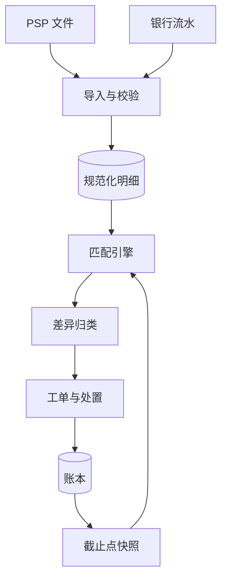

## Q
**支付对账系统（内部账本、PSP 结算文件、银行流水三方对账）**｜系统设计

设计一个对账（reconciliation）系统：平台有自己的内部账本，支付服务商（PSP）每天发来交易和结算报告，银行给出实际到账的流水，三份记录由不同系统独立产生，要核对它们是否一致、差在哪里、怎么处理。练习用的规模假设：每天约 3,000 万笔收款、3% 退款、0.1% 拒付、约 180 万笔打款，接 8 家 PSP、15 种币种；财务要求 T+1（交易日后一天）出结果。面试官常追问：一条支付渠道已扣款但订单仍是未支付怎么办；每天千万级订单如何比对；一对多、多对一怎么匹配；退款、部分退款如何不破坏对账；文件迟到或被更正怎么办。

给出完整解答：需求、核心实体与接口、整体设计、深入问题、取舍、不同级别的期望。

## A
**一句话。** 对账本质是拿独立来源的记录互相印证，难点不在算力（量只有几 GB），而在三方口径不齐、银行只给汇总而不给明细、时间差与真差异混在一起，以及一次上游故障可能一下产生百万条差异。

**60 分钟路线。**

| 时间 | 做什么 |
|---|---|
| 0–5 分 | 问清需求，估算：每天约 3,273 万项，120 个分区，真差异约 6,546 项 |
| 5–10 分 | 实体（文件、匹配、差异）和接口，说明为什么要三方 |
| 10–25 分 | 整体设计：导入与规范化、账本快照、多轮匹配、差异归类、调整分录 |
| 25–50 分 | 必讲深入：分层匹配和不做子集和；差异分类与案例聚合；口径统一、文件幂等、截止点 |
| 50–60 分 | 追问：渠道已扣款订单未支付、退款、现金层、自动化率 |

**需求。**
- 功能：
  - 导入 PSP 报告和银行流水，幂等，能发现缺失、重复、被更正的文件；规范化成统一格式（整数最小单位、UTC 时间、统一类型和参考号）。
  - 内部账本对 PSP 报告逐笔匹配，PSP 结算批次对银行流水按批匹配。
  - 差异分类、归因、自动处置，剩下的进工单，带账龄和负责人；处置动作是追加的调整分录，可追溯到原差异。
  - 对外开放「某个 PSP 某天是否已对账完成」，作为打款的放行条件之一。
- 非功能：
  - 时限：T+1 当天 UTC 12:00 前，已到文件的 PSP 全部完成匹配；迟到的文件单独计，不拖累别家。
  - 按笔数自动匹配率 99.95% 以上；错配比漏配更危险，每个文件行至多匹配一次。
  - 重跑幂等：匹配结果是可重算的派生数据；每个匹配和处置记录规则版本和操作者，保留 7 年。
- 估算（假设，逐个可重算）：
  - 每天对账项 3,000 万 + 90 万退款 + 3 万拒付 + 180 万打款 = 3,273 万；全部放进内存做哈希连接约 3,273 万 × 120 B = 3.9 GB，一台机器放得下。
  - 按 `(PSP, 币种, 业务日)` 分区共 8 × 15 = 120 个，每个平均约 27 万行，独立匹配、并行、可单独重跑。
  - 银行流水每天约 1,000 行：每个 PSP 每个币种一天一条汇总入账，难点是把一条汇总拆回明细。
  - 匹配漏斗：第一轮精确键命中 99.80%，未匹配 65,460 项；再经三轮降到 16,365 项（99.95%）；其中约 60% 是时间差（对方明天会到），其余 40% 即 6,546 项是真差异。

驱动设计的数字是 6,546，不是算力：重心在把真差异压到几百个人工项，以及一次故障不能淹没工单系统，所以投入在分类、聚合和自动处置上。

**核心实体与接口。**
- 实体：
  - SourceFile：来源、账户、业务日、`file_hash`、行数、控制总额；更正文件用 `supersedes_id` 指向旧文件。
  - ExternalLine（PSP 或银行的一行）、InternalItem（账本侧的应收项）、SettlementBatch（`batch_ref`：毛额、手续费、退款、保证金、净额）、BankLine。
  - Run（一次对账运行，截止点固定）；Match 与 MatchLeg（每条腿记录分配金额，所以一对多、多对一不需要特殊处理）；Break（差异：类型、金额、状态、负责人、`due_at`、调整分录）与 Case（同一根因聚合）。
- 接口（多为内部和运营工具）：
  - `POST /recon/files`：文件到达通知，相同内容重复提交返回同一个 `file_id`；`POST /recon/runs`：触发运行，`(日期, 来源, 截止点)` 幂等。
  - `GET /recon/status?source=&date=`：是否完成、匹配率、未结差异数，给打款服务查询。
  - `GET /recon/breaks`，`POST /recon/breaks/{id}/resolve`（选调整模板和原因），`POST /recon/matches/{id}/unmatch`（人工拆除错配，必须写原因）。

**整体设计。** 对账不是实时系统，而是每天跑的流水线。三方的关系：内部账本与 PSP 报告逐笔核对，证明每笔交易两边都有且金额一致；PSP 结算批次与银行流水按批核对，证明 PSP 说要付的钱真的到了；两层叠加，账本上的「应收 PSP 款」才变成银行里的现金。只对银行不行（银行只有汇总，差异无从定位），只对 PSP 也不行（发现不了「报告说付了但钱没到」）。

一次 T+1 对账的步骤：
1. 文件到达：按文件哈希去重，核对行数和控制总额，不符就标失败并告警，不进入匹配。
2. 规范化：金额转整数最小单位，时间转 UTC，类型映射到统一枚举，参考号去空格和前导零。
3. 账本快照：取业务日截止点之前入账的项，之后的算下一天，重跑可复现。
4. 匹配引擎按分区多轮运行，每轮只处理上一轮没匹配上的。
5. 未匹配项先判断是否时间差（进等待队列），再分类；能自动处置的生成调整分录，其余成为工单，同一根因的聚合成案例。
6. PSP 结算批次与银行流水匹配（现金层），发布按 `(source, business_date)` 的对账状态，下游据此放行。
7. 调整分录写回账本，次日快照自然包含，收敛。

**深入。**
1. 【必讲】匹配引擎：分层规则、每行只匹配一次、不做子集和。
   - 逐轮放宽，每个匹配记录规则：第 1 轮 `psp_reference` 加类型加币种加金额全部相等（约 99.80%）；第 2 轮商户参考号加金额加币种加业务日前后一天；第 3 轮容差（金额差不超过一个最小单位，或已知的手续费口径差异；容差是配置，每次使用都记录）；第 4 轮分组，靠 `batch_ref` 或原交易号搭桥，不靠猜。
   - 消耗式匹配：一条 PSP 行匹配了一个内部项就从候选集拿走。文件里同一笔交易出现两次，第二条成为「重复」差异，而不是与另一项错配。
   - 不要做子集和：银行一条入账等于几万笔明细之和，没有批次号时找「哪些交易加起来等于这个数」是 NP 难问题且有多个解。用 PSP 报告中的批次号，把明细先按批汇总，再拿汇总额匹配银行入账。
   - 扩展到千万级：两边按交易号哈希分片、每片排序，像归并那样双指针流式比对，内存只放一个分片。上面的 120 个分区就是这个思路，失败只重跑自己；重跑写新 `run_id`，完成后原子切换，人工匹配在重算时保留并优先。
   - 自身的正确性：每次运行做守恒检查（匹配项 + 未匹配项 = 输入项；文件控制总额 = 规范化后金额之和），不满足整次运行失败不发布。前三轮自动接受，第 4 轮里差额大或候选多于一个的只标「建议」，人工确认才生效。

2. 【必讲】差异分类与案例聚合。
   - 分类和处置：账本缺失（PSP 有我们没有）多半是回调丢了，向 PSP 查询状态后补单；PSP 缺失（我们有它没有）风险最高，转人工并检查订单是否要撤销；金额或手续费不符，口径差异按剧本追加调整，本金差异转人工；重复，判断哪一侧重复后冲销或要求 PSP 更正；状态不符（如我们记退款它记拒付）核对事件序列；汇率或舍入超出容差的记汇兑差异科目批量核销。
   - 处置只追加：每个动作是带原因码的调整分录模板，由差异记录指回；小额自动执行，超阈值需制单加复核，核销有单笔与月度上限。
   - 按根因聚合成案例，而不是按行：聚合键由类型、来源、业务日、错误特征组成。回调中断一小时造成的百万条「账本缺失」聚成一个案例，一次批量查询补单即关闭。分析员处理案例，不处理行。

3. 【必讲】口径统一、文件幂等与 T+1 截止点。
   - 三份记录各自证明的东西不同：账本证明「记着发生了什么」，PSP 报告证明「对方承认处理了什么」，银行流水证明「钱实际到了多少」。
   - 规范化：金额用精确解析的整数最小单位，币种带小数位数（日元 0、美元 2、科威特第纳尔 3），永不用浮点；退款、拒付、手续费在不同 PSP 文件里符号约定不同，统一成「对我们现金的影响」；业务日以 PSP 的处理时间为准。
   - 文件：更正文件的哈希不同，用 `supersedes_id` 取代旧文件，旧文件的匹配结果作废重算；预期到达日历到点没来就告警。
   - 截止点最容易出错：账本按系统时间入账，PSP 按自己的时区切业务日，截止点前后一两小时的交易会形成大批时间差。解法是快照的截止点与 PSP 对齐，并让第 2 轮匹配容许前后一天。
   - 各 PSP 独立完成，一家迟到不拖累其他家。对账状态是打款的放行条件，所以对账延迟会直接延迟打款：对账是控制，不是报表。

4. 【追问再讲】渠道已扣款但订单仍是未支付：这是「账本缺失」里最危险的一种。对账发现后先向 PSP 查询确认，再补入账并通知订单继续履约，或在订单已取消时自动退款。能安全自动修复的才自动，涉及退款的人工复核。账本缺失增多要回流上游，说明回调或轮询出了问题。

5. 【追问再讲】退款和部分退款不破坏对账：退款有自己的参考号，匹配键用退款自己的号，不与原交易混淆；原交易几个月前也一样。一笔授权多次请款、一笔交易多次退款，按原交易号分组，整组核对「原交易 + 若干退款」，并检查累计退款不超过已请款额。

6. 【追问再讲】现金层：一条银行入账如何拆成明细。
   - 以某 PSP 一天一个币种的批次为例（美分）：收款 12,000,000，退款 −360,000，拒付 −15,000，手续费 −276,000，滚动保证金 −600,000，期望到账 10,749,000。
   - 先核 PSP 批次头的净额等于这个计算（PSP 自洽），再核银行入账等于批次净额（PSP 守信）。银行若少了，先看报告中有没有一行期望值没计入的手续费调整。
   - 账本收敛：每个 PSP 每个币种的「应收 PSP 款」账户，对账完成后应当清零，余下的数字就是还没解释的差异，这是最简单的整体检验。
   - 常见问题：一条入账含多天批次（周末、节假日）按 `value_date` 分配；PSP 换汇的差异记汇兑差异科目；保证金到期释放是单独一行类型。

7. 【加分】自动化率与账龄。
   - 假设每个分析员一天处理 40 项，6,546 项真差异 90% 自动处置时，每天人工约 655 项，约需 16.4 人；提到 95% 则约 327 项、约 8.2 人。反复出现的差异沉淀为新剧本。
   - 每个差异有 `due_at`，按 1、3、7、30 天分档，超档自动升级，超 7 天不允许没有负责人；账龄分布本身就是核心指标。

**取舍与追问。** 按被问到的可能性排，通常口述就够：
- 为什么要三方：账本对 PSP 证明交易两边一致，证明不了钱到了；银行流水是唯一能证明现金的，却只有汇总；PSP 批次是把明细和入账连起来的桥。
- 文件被截断或损坏：控制总额和行数校验，不符拒绝进入匹配。PSP 重发更正文件：`supersedes` 取代，受影响分区重算，已处置的差异重新评估。
- 匹配引擎 bug 造成大量错配：守恒检查、每月抽样 0.1% 人工复核、规则变更先影子运行。上游故障造成百万级差异：案例聚合一次处置。
- 为什么对账结果是派生数据：随时可删可重算，人工匹配单独存储并优先，规则升级和文件更正都不破坏历史。
- 月末结账更严：所有差异必须有结论，核销要批准。

**级别期望。**
- 中级：知道对账是拿渠道报告与内部账比对，按交易号匹配，差异分成「少了、多了、金额不同」，隔天重试。
- 高级：三方模型与现金层，规范化清单，分层匹配与每行只匹配一次，分区流式比对，时间差缓冲，调整分录只追加，T+1 时限与各 PSP 独立完成。
- 资深/专家：批次号桥接而非子集和，案例聚合与自动化率的量化，截止点对齐，更正文件取代，对账状态作为打款放行条件，应收账户清零作为整体不变量，影子运行与抽样复核。

**先修概念。**
- [[hi-system-design-core-concepts-data-modeling|数据建模]]
- [[hi-system-design-core-concepts-sharding|分片（Sharding）]]
- [[hi-system-design-deep-dives-kafka|Kafka]]
- [[hi-system-design-patterns-multi-step-processes|多步骤流程]]
- [[hi-system-design-patterns-long-running-tasks|长时间运行的任务]]

**同类题。**
- [[tt-wallet-ledger-service|钱包与复式账本服务]]：被核对的内部账本。
- [[tt-merchant-webhook-delivery|商户回调投递系统]]：回调丢失和重复正是账本缺失差异的主要成因。
- [[sd11-reconciliation-system|三方对账系统（Chi 的长篇题解）]]
- [[05-payment-domain|支付领域知识]]：三方对账、应收账户清零、退款与拒付的背景。
- [[payment-batch-processing|支付处理（授权冻结加每日批量结算）]]：批量结算与对账的上游。
- 编码变体：[[tt-idempotent-versioned-update|幂等的版本化更新]]、[[tt-currency-conversion-queries|汇率换算]]（容差与舍入）
