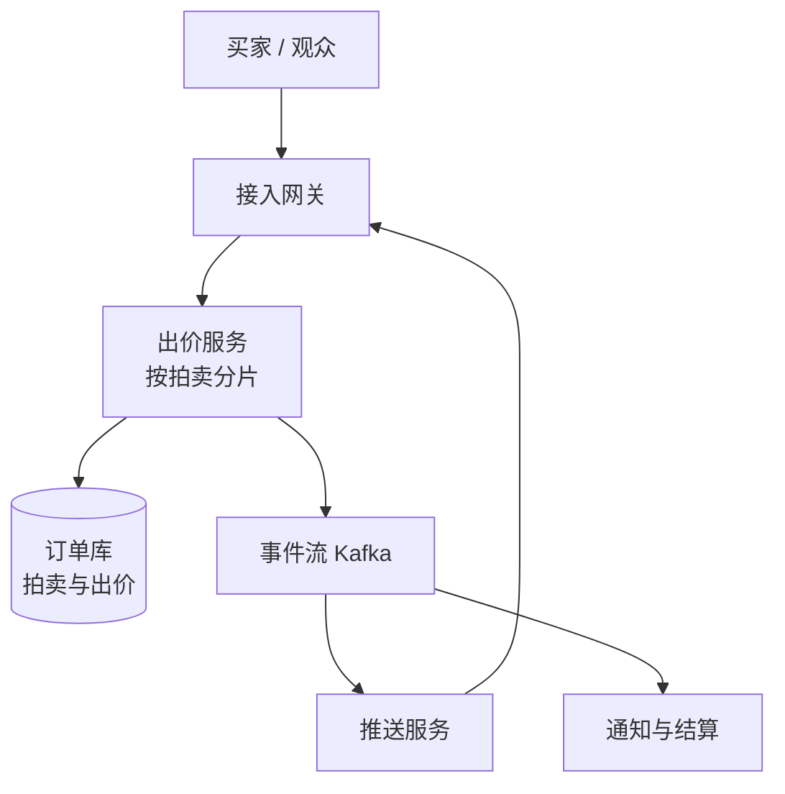

## Q
**实时竞价拍卖**｜系统设计

设计一个实时竞价拍卖系统（直播间拍卖、商品限时拍卖都属于这一类）：卖家发布拍品并设定起拍价、最小加价幅度和结束时间；买家在拍卖期间出价；所有在线参与者都要以尽可能低的延迟看到当前最高价；拍卖结束时最高出价者获胜。参考规模：同时进行 10 万场拍卖，全站出价峰值约每秒 5,000 次；一件热门拍品有 5 万人同时观看，临近结束的最后几秒里每秒有上千次出价。面试官的追问集中在四件事：出价的原子更新与竞态（常被引向消息队列加缓存的方案）、每次出价只能生效一次（exactly-once）、实时推送给所有观众、断线重连后状态怎么追上。

给出完整解答：需求、核心实体与接口、整体设计、深入问题、取舍、不同级别的期望。

## A
**一句话。** 难点是热门拍品最后几秒里"同一个计数器上的高并发读改写"：必须给同一场拍卖的所有出价一个唯一的先后顺序，每次出价只生效一次，同时把最新价格以几百毫秒内的延迟推给几万个连接，而且崩溃或重试不能让价格倒退、让同一次出价生效两次。

**60 分钟路线。**

| 时间 | 做什么 |
|---|---|
| 0–5 分 | 要求和数字：单场峰值 1000 次出价每秒，5 万观众 |
| 5–10 分 | 实体（`Auction.version`、`Bid.seq`）和接口，幂等键 |
| 10–25 分 | 整体设计：按拍卖路由的拥有者、条件事务、outbox、推送 |
| 25–50 分 | 深入：出价竞态、幂等、扇出与合并、断线重连 |
| 50–60 分 | 追问：世代号、结束时刻与防狙击、多区域 |

**需求。**
功能：
1. 卖家创建拍卖：拍品、起拍价、最小加价幅度、开始与结束时间。
2. 买家出价：金额必须不低于"当前最高价 + 最小加价幅度"（没人出价时不低于起拍价），且拍卖正在进行中。
3. 所有观众实时看到当前最高价、出价次数、剩余时间；被超过的出价者收到被超越的通知。
4. 到点结束，确定唯一赢家，触发付款流程。
5. 断线重连后，客户端能拿到当前真实状态。
暂不做：反作弊的深度风控、拍品的搜索与推荐、物流。

非功能：
- 正确性：同一场拍卖的出价全局有序；接受的最高价单调不降；一次出价最多生效一次；结束后绝不接受新出价。
- 延迟：出价请求 p99 < 200ms 给出明确结果；价格变化到观众屏幕 < 1 秒。
- 规模：全站出价峰值 5,000 次/秒，单场热门拍卖峰值约 1,000 次/秒；单场热门拍卖 5 万观众。
- 存储估算：平均每秒 1,000 次出价、每条约 200 字节，一天 8,640 万条，约 17GB，一年约 6TB，属于普通分库分表能承受的规模。
- 可用性：拍卖进行中服务不能整体不可用，但可以接受极短时间内"出价被拒或排队"，不可以接受"价格错了"。

**核心实体与接口。**
实体：
- **Auction 状态加 version：** `Auction(id, seller_id, item_id, start_price, min_increment, start_at, end_at, status, highest_amount, highest_bidder, version)`。金额用整数最小货币单位（分），避免浮点。`version` 每接受一次出价加 1，同时是"当前状态序号"，推送和重连都靠它。
- **Bid 只记被接受的出价：** `Bid(auction_id, seq, bidder_id, amount, idempotency_key, accepted_at)`。`seq` 是该拍卖内从 1 开始的接受序号，`(auction_id, seq)` 唯一；`(auction_id, bidder_id, idempotency_key)` 也唯一。只有被接受的出价才写入，被拒绝的出价只记日志。
- `Winner`/`Order`：拍卖结束后生成的订单，键为 `auction_id`，保证一场拍卖只产生一张订单。

接口：
- `POST /auctions/{id}/bids`，请求体 `{amount, idempotency_key}`，返回 `{result: accepted|outbid|too_low|closed, current_highest, version}`。幂等键由客户端在用户点击"出价"时生成一次，重试沿用同一个。
- `GET /auctions/{id}`：当前快照（最高价、版本号、剩余时间、最近若干出价）。
- `GET /auctions/{id}/live`：WebSocket（或 SSE）长连接，服务端推送 `{version, highest_amount, bid_count, ends_at}`。
- 内部：`closeAuction(id)`（定时触发，幂等）。

**整体设计。**

1. 买家点击出价，客户端生成幂等键，请求经网关按 `auction_id` 一致性哈希路由到出价服务的某个分片。同一场拍卖在同一时刻只有一个"拥有者"实例处理出价（拥有关系靠租约加世代号 epoch 保证，旧拥有者的写入会被数据库拒绝）。
2. **拥有者内存校验后条件事务：** 拥有者实例在内存里持有这场拍卖的状态（最高价、增幅、结束时间、版本号）。校验是纯内存操作：拍卖进行中、金额达标。通过后在数据库里执行一个带条件的事务：插入 `Bid`、更新 `Auction` 的最高价和版本号，条件是 `version` 等于它内存里的版本。事务提交后才算接受，然后回复买家。
3. **outbox 保证事件必发：** 提交成功后写一条"出价已接受"事件到 Kafka（分区键为 `auction_id`，保证同一场内有序）；采用事务外盒（outbox）：事件和出价在同一事务里写入 outbox 表，由后台进程投递，保证"数据库里有就一定会发出事件"。
4. 推送服务消费事件，按 `auction_id` 找到订阅这场拍卖的网关节点，合并后推送给观众；被超越的前任最高出价者收到单独的通知。
5. 拍卖到点：拥有者实例按数据库里的 `end_at` 设置定时器；时间到后先把状态置为 `closed`（带条件更新），再生成订单事件。结算服务消费事件，向赢家收款。

**深入。**
1. 【必讲】出价的原子性与竞态：怎么给同一场拍卖的出价排出唯一顺序。
- 问题：最朴素的做法是"读最高价、比较、写入"三步。两个出价同时读到 100，各自出 110 和 120，两个都通过校验，后写的可能把价格改回 110。
- 选项一：数据库行锁（`SELECT ... FOR UPDATE`，或直接用条件更新 `UPDATE auction SET highest = ?, version = version + 1 WHERE id = ? AND status = 'open' AND ? >= highest + increment`）。正确性最容易论证，数据库就是仲裁者。代价：热门拍卖所有出价排队抢同一行，单行写入吞吐大约一两千次/秒，且延迟随队列长度上升，失败者要重试。
- 选项二：Redis 里用 Lua 脚本做比较并设置，单线程执行保证原子。延迟最低、吞吐高。代价：Redis 主从切换或崩溃可能丢掉最近的写入，价格会倒退；若以 Redis 为准，必须同时有持久化和恢复手段，复杂度并不低。
- 选项三：消息队列加单写者。出价先进 Kafka（分区键为拍卖 ID），每个分区由一个消费者串行处理，消费者既是唯一的决策者也是唯一的写入者。顺序天然唯一，没有锁竞争。代价：多一跳队列，出价结果要异步返回（用回复通道或让客户端等推送），延迟增加几十毫秒；消费者崩溃后要从位点恢复，处理必须幂等。
- 选择：以数据库的条件事务作为最终仲裁（正确性靠约束，不靠"我们保证只有一个写者"这句话），同时用按拍卖路由到单一拥有者的方式消除绝大多数冲突，使条件更新几乎不会失败，热门拍卖也不会在行锁上排长队。拥有者实例内存里的状态只是加速，丢了可以从数据库重建。这样既拿到队列方案的"同一场拍卖串行处理"，又不依赖易失存储。若面试官明确要求队列加缓存的方案，选项三加 Redis 做读缓存是同样的思路：串行化点在队列分区，缓存只负责读。
2. 【必讲】每次出价只生效一次，且顺序明确。
- 问题：手机网络不稳，客户端超时后重试同一个出价，服务端可能其实已经处理了第一次。重复执行的后果轻则重复通知，重则同一个人的出价被记两次。还有一个微妙情形：同一个出价重试时，第一次已经让它成为最高价，第二次到达时它"不再高于最高价加增幅"，会被当作"金额太低"拒绝，用户看到的却是"失败"，实际上已经领先。
- 方案：幂等键。`(auction_id, bidder_id, idempotency_key)` 唯一约束，写入出价的同一个事务里插入。收到重复请求时先按键查询，查到就原样返回第一次的结果，不再执行校验。键保存到拍卖结束后一段时间。
- 同价并发：两个人几乎同时出同一个金额，先被拥有者处理的获得更小的 `seq`，成为最高价，后到者因"未超过最高价加增幅"被拒绝。以服务端分配的序号为准，不使用客户端上报的时间戳，因为客户端时钟不可信。
- 扩展：代理出价（用户设一个封顶价，系统在别人出价时自动替他加价到封顶）也放在拥有者内部处理，一次外部出价可能产生多条内部接受记录，序号照常递增。
3. 【必讲】向几万个观众实时推送，以及断线重连。
- 协议选择：WebSocket 是双向长连接，出价与推送可以复用同一条；SSE 是单向，实现简单、自动重连、穿透代理更友好，观众只读时足够用；轮询简单但延迟和无效请求都高。选择：观众端 SSE 或 WebSocket 长连接，出价走普通的 HTTP 请求（拿到明确的结果和幂等语义）。
- 扇出：热门拍卖一次出价要送达 5 万个连接。推送服务不逐个观众发消息，而是让每个网关节点只订阅它上面有观众的拍卖主题，一条事件到每个网关一次，再由网关写入各自的连接。单个网关能承载的长连接大约在几万量级，所以 5 万观众只需要几个网关节点。
- 合并（conflation）：最后一刻每秒上千次出价，如果每次都推，5 万连接每秒要收 1,000 条，约 5,000 万条消息/秒，不可行也没必要。观众只关心"最新价"：网关对每场拍卖每 100 到 200 毫秒最多推一次最新快照，中间的状态被合并掉，每个连接每秒最多收 5 到 10 条。个人相关的事件（"你被超越了"、"你的出价被接受"）不合并，单独推送。
- 版本号：每条推送带 `version`，客户端丢弃版本号不大于已展示版本的消息，乱序和重复都无害。
- 重连：客户端断线后先调用 `GET /auctions/{id}` 拿当前快照和版本号，再重新订阅；不需要补发中间的每一次出价，因为价格是状态而不是事件流。需要展示出价历史时，用快照里的最近若干条加分页接口。服务端为每个连接发心跳，客户端超过几个心跳周期没收到消息就主动重连。
- 剩余时间：服务端推送的是结束时间戳和服务端当前时间的偏移，由客户端本地倒计时，避免为倒计时推送大量消息。
4. 【追问再讲】拥有者租约与世代号：
- 拥有者因网络分区被判定失联，新拥有者接手，旧拥有者仍可能在途中提交写入。写入条件里带 `epoch`，数据库只接受当前世代，旧世代的写入被拒绝，这样即使"两个人都认为自己是拥有者"，也只有一个能成功。
5. 【追问再讲】结束时刻与最后一秒的公平性。
- 问题：结束时间前后几百毫秒里出价最密集，"到底算不算数"必须有唯一的裁决者。
- 方案：以拥有者实例接收到出价时的服务端时间与 `end_at` 比较，晚于结束的一律拒绝；关闭动作与出价在同一个串行化点上执行，关闭完成之后到达的出价看到的状态已经是 `closed`。数据库条件更新里也带 `status = 'open'` 与 `now() < end_at`（以数据库时间或统一时间源为准），所以即使实例时钟有偏差，数据库也会拦住。
- 防狙击（anti-sniping）：如果最后 30 秒内有新出价，就把结束时间顺延 30 秒，最多顺延若干次。顺延也是拥有者内部写入 `end_at` 的事务，同时推送新的结束时间。
- 付款失败：赢家付款失败时，订单进入重试，必要时按顺位转给第二高出价者；付款动作用 `auction_id` 做幂等键，避免重复扣款。出价时可以预授权（冻结）保证金，降低违约。

**取舍与追问。** 按被问到的可能性排，通常口述就够：
- 为什么不全部放 Redis：出价是金钱相关的承诺，价格倒退或丢失出价比慢几毫秒严重得多。Redis 适合做读缓存和订阅状态，不适合当唯一的账本。
- 为什么不用全局分布式锁：每次出价抢一把锁，锁服务成为瓶颈和单点，锁租约过期后还可能出现"两个持有者"。按拍卖路由加数据库条件写入，把争用缩小到一场拍卖内部，而且最终仲裁在数据库。
- 价格要被谁看见多快：观众允许 200 毫秒的滞后，出价者本人必须拿到明确结果。这就是出价同步返回、观众异步合并推送的原因。
- 一场拍卖突然特别热（超过单实例能力）：单场拍卖本质上是串行的，单实例每秒处理几千次内存校验没有问题，真正的上限在数据库写入；可以对热门拍卖批量提交（把同一毫秒内到达的出价按顺序在一个事务里评估，只写入最终接受的若干条），把提交频率压下来。
- 通知失败怎么办：被超越的通知可以丢，状态页面以快照为准；赢家和付款相关的消息必须经 outbox 保证送达并幂等处理。
- 如何测试正确性：对同一场拍卖并发打几万次随机金额，断言最终最高价等于所有被接受出价中的最大值，接受序列严格递增，没有两条记录具有相同 `seq`；故意杀掉拥有者进程，验证新拥有者接手后序号连续。
- 多区域：一场拍卖只在一个区域有拥有者（按卖家或拍品所在区域），其他区域的出价请求转发过去，接受跨区域延迟，换取单一顺序；观众端推送可以由各区域从事件流各自扇出。

**级别期望。**
- 中级：写出出价校验规则，用数据库事务或条件更新避免竞态，用 WebSocket 或轮询刷新价格。
- 高级：说清并发出价的几种方案及代价，给出幂等键和重试语义，设计扇出与合并推送，处理断线重连与结束时刻。
- 资深/Staff：拥有者租约与世代号防双主，outbox 与事件顺序，热门拍卖的批量提交与容量估算，防狙击与付款失败的回退，跨区域的取舍，以及验证正确性的测试方法。

**先修概念。** [[hi-system-design-patterns-dealing-with-contention|处理争用（Contention）]]、[[hi-system-design-patterns-realtime-updates|实时更新]]、[[hi-system-design-deep-dives-kafka|Kafka]]、[[hi-system-design-deep-dives-redis|Redis]]、[[hi-system-design-core-concepts-consistent-hashing|一致性哈希]]、[[hi-system-design-core-concepts-api-design|API 设计]]

**同类题。** [[hi-system-design-problem-breakdowns-online-auction|在线拍卖（eBay）]]、[[solution-auction|拍卖系统（系统设计）]]、[[solution-online-auction|在线拍卖（类设计）]]、[[tt-idempotent-versioned-update|幂等的版本化更新]]、[[sd04-flash-sale|秒杀（TikTok 系统设计）]]
