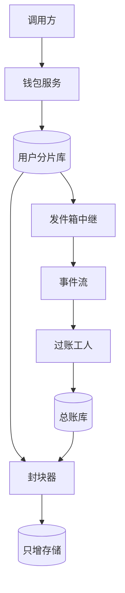

## Q
**钱包与复式账本服务（余额、冻结、转账、多币种）**｜系统设计

设计一个钱包（wallet）服务和它背后的复式账本（double-entry ledger）：用户可以充值、消费、冻结一部分余额、在用户之间转账，余额可以有多个币种（美元、林吉特、平台金币），币种之间可以换汇。要求：同一笔业务无论通知重复多少次只入账一次，余额永不为负，任何时点都能证明账是平的、历史没被改过。练习用的规模假设：3 亿个钱包，每天 2 亿笔消费、500 万次充值、2,000 万次冻结，峰值是均值的 10 倍，账本保留 7 年。面试官通常盯一条流程连问：重复通知怎么办、崩溃在哪一步、热点账户怎么扛、怎么证明账是对的。

给出完整解答：需求、核心实体与接口、整体设计、深入问题、取舍、不同级别的期望。

## A
**一句话。** 钱包余额只是账本的一个投影：真相是只追加、借贷相等的分录，难点是在"恰好一次、余额不为负、热点账户不卡死"三个约束下，让同步路径只做最少的事，其余全部用追加和异步汇总完成。

**60 分钟路线。**

| 时间 | 做什么 |
|---|---|
| 0–5 分 | 问清需求，估算：峰值约 23,148 笔/s，每片 723/s 对单行 500/s |
| 5–10 分 | 实体（钱包、分录、冻结）和带业务键的接口 |
| 10–25 分 | 整体设计：一次消费在分片库里的本地事务，发件箱，异步过账 |
| 25–50 分 | 必讲深入：充值恰好一次；热点账户只追加加快照；冻结确认释放 |
| 50–60 分 | 追问：跨分片转账、怎么证明账是对的、多币种、退款后负余额 |

**需求。**
- 功能：
  - 入账（充值、退款）：外部通知重复、乱序、延迟几天，也只入账一次。
  - 扣款：带业务键，重试安全，可用余额不足明确拒绝。
  - 冻结、确认、释放：冻结后可用额立即减少，确认时可只确认一部分，超时自动释放。
  - 转账（用户之间、同币种）；换汇（按带编号和有效期的报价成交）。
  - 查询余额（总额、冻结额、可用额）、流水分页；冲销与调整只追加，人工调整要制单人和复核人两个不同的人。
- 非功能：
  - 同一业务键至多入账一次，余额永不为负，这是硬约束，不为延迟让步。
  - 扣款 p99 小于 100 ms（用户归属区域内），展示余额允许晚几秒；已确认的写入零丢失，账本只追加，保留 7 年。
- 估算（逐个可重算）：
  - 峰值 2 亿 ÷ 86,400 × 10 ≈ 23,148 笔/s，分 32 个分片，每片约 723/s。
  - 每笔同步写 5 行（钱包行 1、业务事件 1、分录 2、发件箱 1），每片约 3,617 行/s，单个关系库主库承受得住。
  - 账本每天约 6.6 亿行，每行 100 B，约 66 GB/天；7 年约 169 TB。钱包本身很小：3 亿 × 100 B = 30 GB。大的是账本，不是余额。
  - 热点：单行持锁 2 ms，上限 500/s。每片的平台清算账户峰值 723/s，已经超过；全平台只有一个收入账户则是 23,148/s，差 46 倍。

驱动设计的数字是 723/s 对 500/s：同步路径上不能更新任何共享的系统账户余额。

**核心实体与接口。**
- 实体：
  - Wallet：`user_id` 分片键；`balance`、`held`、`version`；可用额 = `balance` − `held`。
  - Account（资产、负债、收入、费用；系统账户每个分片一份，如 `clearing@07`）；Journal（一次业务，`business_key` 唯一，`reverses_id` 指向被冲销的那条）与 LedgerLine（借或贷、正整数最小单位、币种；只追加）。
  - Hold（状态 held / captured / released / expired，`expires_at`）；Transfer（状态机）；FxQuote（编号、汇率、有效期）。
- **写接口都带业务键：** 接口（所有写接口都带业务键，键加请求内容哈希一起保存：同键同内容返回第一次的结果，同键不同内容返回 409）：
  - `POST /wallets/{id}/credits`：`{source, source_txn_id, amount, currency}`，重复时返回第一次的结果并标 `duplicate`。
  - `POST /wallets/{id}/debits`：`{spend_id, amount, currency}`，402 余额不足。
  - `POST /holds`，`POST /holds/{id}/capture`（可只确认一部分），`POST /holds/{id}/release`；`POST /transfers`；`POST /fx/convert`。
  - `GET /wallets/{id}`：`{balance, held, available, as_of_seq}`。
- 金额一律是整数的最小货币单位加币种，永远不用浮点数。

**整体设计。** 同步写路径要强一致，过账可以晚几秒，审计可以晚几小时但不能缺，三者拆开。

一次消费（以送出 7 个金币为例）：
1. 调用方带 `spend_id` 请求，网关按用户归属区域路由到钱包服务。
2. 在用户所在分片开一个本地事务。先插入 Journal，`business_key` 唯一，冲突说明处理过，直接返回第一次的结果。
3. 条件扣减：`UPDATE wallet SET balance = balance - :p WHERE user_id = ? AND balance - held >= :p`。影响行数为 0 就回滚并返回 402。
4. 插入两行分录：借用户的 `user_coin`，贷本分片的 `clearing@07`；再写发件箱，提交。系统账户每个分片一份，一次业务的所有分录都在本片，一个本地事务写完，不需要分布式事务。
5. 中继把事件投递到事件流（至少一次）。过账工人按 1 秒窗口把同一分片的净额合并写总账，窗口里每个账户只写一行。
6. 封块器每分钟对各片新分录按序计算哈希，汇成块，块里含上一个块的哈希，写入只能追加的对象存储。

**深入。**
1. 【必讲】恰好一次入账。
   - 问题：商店通知会重发、乱序，甚至购买几天后才到；事件流至少一次。
   - 做法：充值的键是 `(source, source_txn_id)`，TopUp 以它为主键，`journal_id` 由同一个键确定性地生成，两个实例同时处理同一条通知也只有一个能插入成功。校验收据通过后在一个事务里写 TopUp、Journal 与分录、钱包加余额、发件箱，要么全成要么全败。
   - 去重表永久保留，不能像请求级幂等键那样 24 小时过期，因为退款和补发通知可以晚到数周；约 1.0 TB，分片后很小。
   - 否决：先查后写（并发时最后还是靠唯一约束，不如直接把它当主路径）；与支付系统做两阶段提交；Redis 去重（异步复制，故障转移后丢键会重复入账）。
   - 崩溃点：提交前崩溃什么都没发生；提交后回复前崩溃，重发时主键冲突，返回第一次的结果；发件箱投递前崩溃，中继重启后继续。兜底是每天两侧计数核对：每条成功的购买必须恰好对应一条 TopUp，缺的自动补，多的告警。

2. 【必讲】热点账户：只追加分录加快照，再做窗口净额合并。
   - 直接更新余额行：上限 500/s，否决。拆成 16 个子账户：每个 45/s，但读余额要读 16 行。
   - 选只追加：同步路径只 `INSERT` 分录，余额 = 最近快照 + 快照之后的增量；过账工人按 1 秒窗口合并净额，每个账户每秒只写一行，把每片 723 行/s 压到 1 行/s。
   - 原始明细留在子账（业务事件表），总账里的净额分录引用它覆盖的事件范围，总账行少却可逐笔追溯。
   - 精确余额（如打款前检查）读快照加增量；展示用的余额可以走缓存，带 `as_of_seq`。

3. 【必讲】冻结、确认、释放。
   - 冻结：`held = held + :c WHERE balance - held >= :c` 加插入 Hold。确认：`UPDATE hold ... WHERE state='held'` 影响行数为 1 才继续，同事务 `balance` 减确认额、`held` 减冻结额；冻结 100 确认 80，余下 20 自动回到可用额。
   - 释放和超时用同一个条件，所以确认与超时同时发生只有一个成功。
   - 冻结要不要写分录：只改钱包的 `held` 列。冻结没有改变谁拥有这笔钱，量大且约 20% 最终不被确认，写成来回抵消的分录是噪声。代价是任意时点的冻结额要靠 Hold 表还原，由校验任务保证 `held` 等于有效冻结额之和。超时释放必不可少，客户端崩溃留下的冻结最多锁住余额 10 分钟。

4. 【追问再讲】跨分片转账，不用分布式事务。
   - 同分片就是一个本地事务两条腿。跨分片时，在转出方分片的事务里借转出方、贷「转账在途」账户，以 `transfer_id` 为业务键，发件箱投递事件；转入方分片用同一个 `transfer_id` 幂等入账。
   - 状态机 `PENDING → DEBITED → CREDITED`，或 `DEBITED → REFUNDED`。转入失败（账户已冻结或关闭）则回到转出方做反向分录补偿；任何一步用同一个键重放。

5. **【追问再讲】账对且历史未改：** 怎么证明账是对的、历史没被改。
   - 持续检查的不变量：每个 Journal 每个币种借贷相等（写入时检查）；钱包 `balance` 等于该用户账户流水之和（一周滚动校验全部 3 亿个钱包，每天约 4,286 万个）；发行账户借方余额等于所有金币账户贷方余额之和；`held` 等于有效冻结额之和；清算账户余额接近 0。
   - 防篡改：数据库账号对账本表只有 `INSERT` 和 `SELECT` 权限。再加封块：每分钟对每片新分录算哈希汇成块，块含上一块哈希形成链，写入开启保留锁定的对象存储。哈希链放在异步封块器里，而不是写入时更新，否则所有写入会串行化到同一个「上一个哈希」上。
   - 余额和快照都可以从分录重放重建；在线保留 90 天，更老的按月转列式文件归档。

6. 【追问再讲】多币种与换汇。
   - 借贷相等是每个币种分别成立，不同币种的分录不能放进同一个守恒集合；换汇通过 FX 中间账户写成两组各自平衡的分录。
   - 例：把 100.00 USD 按报价 4.2135 换成林吉特。USD 一侧：借 `user:USD` 10,000 美分，贷 `fx_position:USD` 10,000。MYR 一侧：借 `fx_position:MYR` 42,135 仙，贷 `user:MYR` 42,135。
   - 报价编号、原币金额、目标币金额、汇率一起落账，事后不能用「当天汇率」反算，否则就是对账差异的来源。若市场中间价是 4.2300，平台留下 (4.2300 − 4.2135) × 100 = 1.65 林吉特的点差，进收入账户。
   - 取整规则全系统一致，分摊要守恒：100.00 分三份是 33.34 + 33.33 + 33.33，不是三个 33.33。

**取舍与追问。** 按被问到的可能性排，通常口述就够：
- 为什么不在钱包里存余额列再加一张流水表就完事：两者各自能被改而不被发现；这里分录是真相、余额是投影，同事务写并持续校验，不一致以分录为准重建。
- 同一用户同时发两笔消费，余额只够一笔：条件更新是原子的，一个成功，另一个影响行数为 0。同一用户的写入只落在他自己的一行，每秒最多几十次，不是热点。
- 充值退款在币已经花掉之后到达：写冲销分录（`reverses_id` 指向原条），余额可以变负（只有退款路径可以，消费路径的条件更新永不允许），钱包进入负债状态并禁止消费，下次充值先抵扣；已提现的部分由平台记坏账，这是业务决定。
- 从只有余额列的老系统迁移：先为每个钱包写一条来源为迁移的期初分录，双写一段时间，每天比对新账本推出的余额与老余额，差异清零后切读路径，最后下线老列。
- 分片从 32 扩到 64：钱包按 `user_id` 一致性哈希，迁移时该用户只读；系统账户本来就按片存放，不涉及全局账户拆分。
- 最弱的一环要主动说：冻结只改钱包列，使得任意时点冻结额要靠 Hold 表还原；系统账户按片存放，使全局报表要汇总 32 个账户。

**级别期望。**
- 中级：钱包表加流水表，条件更新防负，幂等键防重复，知道金额用整数。
- 高级：复式分录与清算账户，同事务写余额和分录，冻结/确认/释放的状态机，热点账户算出 723 对 500 并改为只追加加快照，充值去重键永久保留。
- 资深/专家：多币种按币种守恒和 FX 报价落账，跨分片转账用在途账户加幂等补偿，哈希链封块与权限只追加，投影可重建与滚动校验，迁移和扩容的做法，退款后负余额的业务取舍。

**先修概念。**
- [[hi-system-design-core-concepts-data-modeling|数据建模]]
- [[hi-system-design-core-concepts-sharding|分片（Sharding）]]
- [[hi-system-design-core-concepts-api-design|API 设计]]
- [[hi-system-design-patterns-dealing-with-contention|处理争用（Contention）]]
- [[hi-system-design-deep-dives-postgres|PostgreSQL]]
- [[hi-system-design-core-concepts-caching|缓存]]

**同类题。**
- [[tt-live-gift-coin-settlement|直播虚拟礼物：金币记账与主播结算]]：在钱包之上的热点与周结算。
- [[tt-payment-reconciliation|支付对账系统]]：账本对渠道对银行。
- [[sd09-wallet-ledger|金币钱包与复式账本（Chi 的长篇题解）]]
- [[05-payment-domain|支付领域知识]]：复式记账、整数最小单位、换汇与取整的背景。
- 编码变体：[[tt-idempotent-versioned-update|幂等的版本化更新]]、[[tt-currency-conversion-queries|汇率换算]]、[[tt-kv-store-snapshot-restore|KV 快照]]
- [[payment-batch-processing|支付处理（授权冻结加每日批量结算）]]：冻结与扣款的另一种形态。
