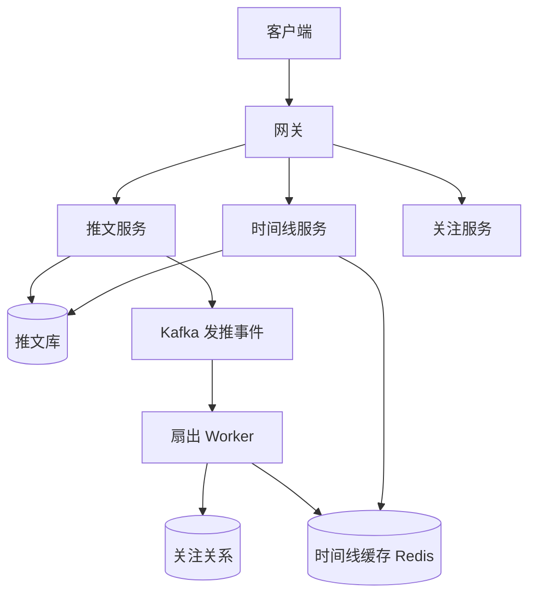

## Q
**微博客与个性化信息流（Twitter）**｜系统设计

设计一个类似 Twitter 的社交平台：用户可以关注和取消关注其他用户、发布推文（tweet），并查看由所关注的人的推文组成的个性化主页时间线（home timeline）。需要给出关注关系、发推、读时间线三条主链路的设计，并回答明星用户（粉丝上千万）发推时怎么办、时间线怎么分页、读写负载怎么扩展。

给出完整解答：需求、核心实体与接口、整体设计、深入问题、取舍、不同级别的期望。

## A
**一句话。** 这是读远多于写、且存在"一个人对应千万读者"的扇出问题：难点是选择"写时扇出"还是"读时聚合"，并为粉丝数极大的账号单独处理，使发推延迟、时间线读延迟和存储成本三者都可控。

**60 分钟路线。**

| 时间 | 做什么 |
|---|---|
| 0–5 分 | 需求和数字：峰值读约 23 万次/秒，写时扇出约 200 亿条投递/天，读写比约 40 比 1 |
| 5–10 分 | 实体和接口：推文、关注、时间线；游标用推文 ID 而不是页码 |
| 10–25 分 | 画三条主链路：发推 → Kafka → 扇出 Worker → 时间线缓存；读时间线；关注存两份 |
| 25–50 分 | 深入：写时扇出、读时聚合与明星用户的混合方案；时间线缓存、游标分页、缓存丢失重建 |
| 50–60 分 | 追问：分片和扇出可靠性、缓存存 ID 还是内容、排序、故障降级 |

**需求。**
功能：
1. 关注、取消关注。
2. 发布推文（文本，可带图片或视频的引用）。
3. 读主页时间线：我关注的人的最新推文，按时间倒序，分页，下拉加载更多。
4. 读某个用户的个人页推文列表（用户时间线）。
5. 范围外：推荐算法排序、搜索、转发与点赞的完整体系、私信（可作为扩展）。

非功能（容量假设）：
- 2 亿日活，每人每天打开时间线约 20 次，共 40 亿次/天，约 4.6 万次/秒，峰值 5 倍约 23 万次/秒。
- 每天 1 亿条新推文，约 1160 条/秒，峰值约 5000 条/秒；平均每人 200 个粉丝，写时扇出的总投递量约 200 亿条/天，约 23 万次/秒。
- 读写比约 40 比 1（按次数），时间线读延迟 p99 < 200ms；发推后几秒内粉丝能看到。
- 可用性高于一致性：时间线允许秒级延迟与短暂不一致。
- 存储：每个用户缓存最近 800 条的时间线，每条约 16 字节（推文 ID 加排序键），约 12.8KB/人，2 亿人约 2.6TB，放在内存集群里可行（只缓存近期活跃用户可以更省）。

**核心实体与接口。**
实体：`User(id, name, followerCount)`；`Follow(followerId, followeeId, createdAt)`；`Tweet(id, authorId, text, mediaRefs, createdAt)`；`Timeline`（每个用户的推文 ID 列表，派生数据）。推文 ID 用带时间的全局唯一 ID（雪花式），保证按 ID 排序约等于按时间排序。
接口：
- `POST /follow/{userId}`、`DELETE /follow/{userId}`。
- `POST /tweets {text, media}`。
- `GET /timeline/home?cursor=&limit=20`、`GET /users/{id}/tweets?cursor=`。
游标是上一页最后一条的推文 ID，而不是页码偏移，因为新推文不断插入，偏移会造成重复和遗漏。

**整体设计。**

1. 发推：推文服务把推文写入推文库（按推文 ID 或作者分片的键值/宽表存储），然后发事件到 Kafka，立即向作者返回成功。扇出不在请求路径上。
2. 扇出（写时扇出，fan-out on write）：扇出 Worker 消费事件，读取作者的粉丝列表，对每个粉丝的时间线缓存（Redis 的有序列表或有序集合）执行"插入这条推文 ID，并裁剪到最近 800 条"。
3. 读时间线：时间线服务取出用户缓存里的一页推文 ID，批量到推文库（及缓存）取内容，补全作者信息、点赞数等，返回。因为缓存里只存 ID，推文被删除或编辑时只要改推文库，不必改每个粉丝的缓存；读取时遇到已删除的 ID 就过滤。
4. 关注：关注关系存两份（正向：我关注了谁；反向：谁关注了我），分别服务于"读时聚合"和"扇出"；关注时可以异步把对方最近几条推文回填进自己的时间线，取消关注则把对方的推文从缓存里过滤掉（读时过滤即可）。

**深入。**
1. 【必讲】写时扇出还是读时聚合，以及明星用户：
- 方案 A，读时聚合（fan-out on read）：读时间线时，取出我关注的所有人，从各人的推文列表里各取最近若干条，再合并排序。写入极简单，但读很重：关注 500 人就是 500 次查询，读延迟差，而读是主要负载。
- 方案 B，写时扇出（fan-out on write）：发推时把推文 ID 推进所有粉丝的时间线，读取就是一次缓存读，非常快；代价是写放大——平均 200 倍，而一个有 3000 万粉丝的账号，一条推文就是 3000 万次写入，延迟（几十分钟才推完）和资源都不可接受。
- 方案 C，混合：普通用户走写时扇出；粉丝数超过阈值（例如 10 万）的账号不扇出，读时间线时，从缓存里读已扇出的部分，再把"我关注的大 V 的最新推文"实时拉取并合并。大 V 的数量很少（我关注的人里大 V 通常只有几个到几十个），所以读时多出的查询很有限，并且这些大 V 的最新推文本身是热数据，被所有粉丝共享，缓存命中率极高。
- 选择：C。阈值可以按粉丝数动态判断；对从未登录的"僵尸"粉丝跳过扇出，只给近 30 天活跃的用户写缓存，进一步压低写放大。
2. 【必讲】时间线的存储与分页：
- 用户时间线放 Redis（或类似内存存储），结构是按推文 ID（时间序）排序的有序集合，限制长度（800 条），超出则丢弃最老的；更早的内容按需从推文库用"读时聚合"补取。
- 游标分页：客户端带上一页最后的推文 ID，服务器返回"ID 小于该值"的前 20 条；合并大 V 推文时也用同样的游标做归并，保证翻页稳定。
- 缓存丢失（新用户、缓存被淘汰、节点故障）：用读时聚合重建时间线并回填，这是正确性的兜底，也是缓存可以丢失的前提。
3. 【追问再讲】存储与分片：
- 推文库：按推文 ID 分片，读请求都是"按 ID 批量取"；作者的个人页另有一份按 `(authorId, 时间)` 排序的索引或表，用于用户时间线。
- 关注关系：正向表按 `followerId` 分片，反向表按 `followeeId` 分片；一个大 V 的粉丝列表很大，需要分页读取，扇出任务按分片并行。
- 媒体：图片视频存对象存储，经 CDN 分发，推文里只保存引用。
4. 【追问再讲】扇出的可靠性与延迟：
- 扇出 Worker 水平扩展，Kafka 按作者 ID 分区；一次扇出分成若干批，每批几千个粉丝，失败的批重试（写入是幂等的：有序集合里同一个 ID 只有一份）。
- 发推后几秒内粉丝可见；活跃粉丝优先投递，其余延后。
- 删除推文：推文库里标记删除，时间线读取时过滤；不需要立刻清理每个粉丝的缓存。

**取舍与追问。** 按被问到的可能性排，通常口述就够：
- 排序：默认按时间倒序。加入推荐排序后，时间线服务会先取出几百条候选，再用排序模型打分，对应多阶段漏斗；缓存里的 ID 只是候选来源。
- 缓存只存 ID 还是存完整内容：存 ID 省空间且删除、编辑只改一处；存完整内容读更快但更新要扇出，通常选 ID 加热推文内容缓存。
- 一致性：关注后立刻在时间线上看到对方推文属于"读自己的写"，通过回填或读时合并实现；取消关注后的短暂残留可接受或在读时过滤。
- 热点读：热门推文的内容缓存，用多副本或本地缓存扛住热点。
- 10 倍规模：扇出集群和缓存节点按用户分片扩容；更激进地降低大 V 阈值；对不活跃用户延迟扇出。
- 失败：Redis 节点挂掉时，该分片的用户用读时聚合降级，延迟升高但功能不丢。

**级别期望。**
- 中级：画出关注、发推、读时间线，说出推与拉两种思路，数据模型合理。
- 高级：混合扇出并给出明星用户的阈值与理由，时间线缓存只存 ID 与长度裁剪，游标分页，容量估算。
- 资深/Staff：写放大的量化、活跃用户优先扇出、缓存丢失的重建路径、排序漏斗的位置、分片策略、删除与隐私（受保护账号）语义、故障降级。

**先修概念。** [[hi-system-design-patterns-scaling-reads|扩展读]]、[[hi-system-design-patterns-scaling-writes|扩展写]]、[[hi-system-design-core-concepts-caching|缓存]]、[[hi-system-design-core-concepts-sharding|分片（Sharding）]]、[[hi-system-design-deep-dives-redis|Redis]]、[[hi-system-design-deep-dives-kafka|Kafka]]

**同类题。** [[hi-system-design-problem-breakdowns-fb-news-feed|Facebook 信息流]]、[[solution-news-feed|信息流（本库解答）]]、[[hi-system-design-problem-breakdowns-instagram|图片分享（Instagram）]]、[[like-unlike-system|点赞系统]]
