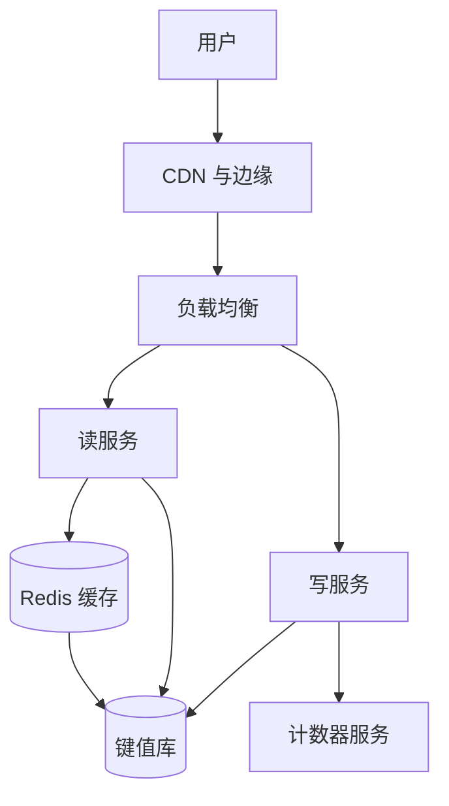

## Q
**短链接服务（URL Shortener / TinyURL）**｜系统设计

设计一个类似 TinyURL、Bitly 的短链接服务：用户提交长 URL，得到可分享的短链接；访问短链接时跳转到原始地址；用户还可以管理自己创建的短链接。常见补充：自定义别名、过期时间、点击统计；规模按 10 亿条短链接、1 亿日活设计；面试官最常追问"如何扛住海量请求"，也常问短码如何保证唯一、跳转怎样做到 100ms 以内。

给出完整解答：需求、核心实体与接口、整体设计、深入问题、取舍、不同级别的期望。

## A
**一句话。** 这是一个读写比极端悬殊（约 1000 比 1）的"键到值"查找问题：难点集中在三处——短码如何在多台写入机器上不冲突地生成、跳转读路径如何靠缓存做到极低延迟、以及规模增长时每一层怎样水平扩展。

**需求。**
功能：
1. 提交长 URL，返回短 URL。
2. 访问短 URL 时重定向到原始 URL。
3. 可选：自定义别名（如 `short.ly/my-name`）。
4. 可选：过期时间，过期后不再跳转。
5. 暂不做（先声明范围）：账号体系的细节、点击分析。

非功能：
- 短码全局唯一，不能有两条长 URL 共用一个短码。
- 跳转延迟低：端到端目标 < 100ms（服务端处理应在个位数到十几毫秒）。
- 可用性高于一致性：跳转路径 99.99%，创建路径稍弱可以接受；短暂读到旧数据可以容忍。
- 规模：总计约 10 亿条短链接、1 亿日活。

容量估算（先说假设再算）：
- 创建：约 100 万条/天，即约 12 次/秒，峰值 10 倍约 120 次/秒；三年累计约 11 亿条，与 10 亿量级吻合。
- 跳转：1 亿日活，人均每天点击约 5 次，约 5 亿次/天，约 5800 次/秒，峰值 10 倍约 6 万次/秒。读写比约 500 比 1 到 1000 比 1。
- 存储：每条记录约 500 字节（短码、长 URL、创建者、时间、过期时间），10 亿条约 500GB，一台现代数据库放得下，所以存储本身不是瓶颈，读 QPS 才是。
- 短码长度：base62（0-9、a-z、A-Z）下 7 位有 62^7 约 3.5 万亿种组合，远大于 10 亿，余量足够；6 位只有约 568 亿，也够但偏紧，7 位是常用选择。

**核心实体与接口。**
实体：`Url(shortCode PK, longUrl, ownerId, createdAt, expiresAt)`；`User(id, ...)`。
接口：
- `POST /urls {longUrl, alias?, expiresAt?}` → `{shortUrl}`；别名已存在返回 `409`。
- `GET /{shortCode}` → `302 Location: longUrl`；不存在或已过期 `404`（或 `410`）。
- 可选：`DELETE /urls/{shortCode}`、`GET /users/me/urls`。

**整体设计。**

两条独立的路径：
1. 创建：写服务校验 URL 格式（和黑名单），有别名则直接以别名做主键插入（唯一约束冲突即 `409`），没有别名则向计数器服务取下一个整数，转成 base62 作为短码，插入数据库，返回短 URL。
2. 跳转：读服务先查 Redis（键是短码，值是长 URL 与过期时间）；未命中查数据库并回填缓存；过期则返回 `404`；命中则返回 `302`。读和写拆成两个服务，是因为二者负载差三个数量级，需要独立扩缩容。
3. 点击统计（如果要做）：不放在跳转的同步路径里，而是把点击事件异步写入消息队列，由流处理消费者聚合。

存储选型：访问模式只有"按短码点查"，没有联表和范围查询，所以键值库（DynamoDB、Cassandra）或带主键索引的关系型数据库（PostgreSQL、MySQL）都行；10 亿条的体量下关系型数据库单机即可承载，所以不必为了"大"而强行选 NoSQL，关键是主键即短码、读靠缓存。

**深入。**

1. 如何保证短码唯一？
- 方案 A（差）：取长 URL 的前缀。不同长 URL 前缀相同就冲突，且无法控制长度。
- 方案 B（可用）：哈希。先把 URL 规范化（域名小写、去默认端口、统一结尾斜杠），再用 SHA-256 或 MurmurHash 取前 N 位转 base62。好处是无状态、同一 URL 得到同一短码；问题是截断后会碰撞。7 位空间约 3.5 万亿，库里有 10 亿条时，新记录撞上已有短码的概率约 10 亿除以 3.5 万亿，即约 0.03%，约 3500 次创建就有一次；所以必须依赖数据库唯一约束，冲突时加盐重算（再哈希一次），多试几次。可行，但是写路径多了"读后写"。
- 方案 C（常用）：全局计数器加 base62 编码。每次取一个递增整数转成 base62，天然唯一，不需要碰撞检查。计数器用 Redis `INCR`（单点高可用：主从加持久化，故障转移）。每个写服务实例一次领一段区间（例如 1000 个号）放在本地内存里顺序发放，这样计数器每 1000 次创建才被访问一次，不会成为瓶颈；实例崩溃只会浪费未用完的号段，对 3.5 万亿的空间无所谓。
- 问题与对策：计数器发出的短码是可猜测、可枚举的（下一个就是加一）。如果短链接需要"不可枚举"，则对计数器值做一次可逆的置换（如在 62^7 空间内用乘以与模数互质的常数再取模，或 Feistel 网络），保持唯一性的同时打散顺序；多区域部署则每个区域分配不相交的号段。
- 选择：计数器加号段为主；面试中同时说出哈希方案的碰撞概率，体现取舍判断。

2. 如何让跳转足够快？
- 层 1，数据库索引：短码是主键，已经是 B 树点查，单次几毫秒；但 6 万次/秒峰值会压垮单库的磁盘 I/O。
- 层 2，内存缓存（Redis，cache-aside）：热点集合很小——点击分布高度倾斜（少量链接占大部分流量）。假设热集是 20% 的链接，按每条约 150 字节（短码加长 URL 加元数据）算，10 亿条的 20% 约 30GB，几台缓存节点即可；用 LRU 淘汰。缓存命中后单次读亚毫秒。
- 层 3，CDN 与边缘：对热门短码直接在边缘返回重定向，用户请求不到源站。代价是失效控制更难：删除、过期、改指向要靠短 TTL 或主动清理（purge）。
- 热点 key：个别病毒式传播的短码会压垮单个缓存分片；对策是读服务进程内再放一层小的本地缓存（几秒 TTL），或对热 key 在多个缓存节点复制。
- 301 还是 302：`301` 是永久重定向，浏览器会长期缓存，之后根本不再访问我们，省流量但丢失统计、过期和改指向的能力；`302` 是临时重定向，每次都经过服务。需要统计、可过期、可编辑，就用 `302`，这是面试里几乎必问的取舍。

3. 如何扩展到 10 亿条与 1 亿日活？
- 读：读服务无状态，直接加机器；缓存按短码一致性哈希分片，加节点时只迁移一小部分 key；数据库一主多从，读副本分担未命中的流量。
- 写：写入只有约 120 次/秒，单主库绰绰有余；真正需要分片的是存储量与未来增长，按短码哈希分片，每片再有副本。
- 跨区域：多区域部署读服务和缓存，数据库用跨区域复制；计数器按区域分配号段；读路径容忍短暂复制延迟。
- 计数器服务故障：已发放的号段还能用一阵，所以创建短暂可用；主从切换后从持久化的最大值继续，跳号无害。
- 过期：`expiresAt` 字段在读路径检查，过期就不返回；后台任务（或存储的 TTL 功能）定期清理，释放空间；缓存条目的 TTL 不能超过链接的过期时间。
- 滥用：创建接口限流（见限流器相关题），URL 做恶意站点检测（拦截已知钓鱼域名），短码预留黑名单词。

**取舍与追问。**
- 同一长 URL 是否复用同一短码：复用省空间，但在计数器方案里需要多一个"长 URL 到短码"的索引和一次查询；多数产品选择不复用（每次创建都发新短码），并让用户各自管理自己的链接。
- 自定义别名与计数器短码共用同一张表和同一个命名空间：用户可能占用某个未来会被计数器发到的值，所以别名要有最小长度、字符集约束，或把别名放在不同前缀/表里，避免冲突。
- 强一致还是最终一致：创建后立刻能访问是产品期望（"读自己的写"）；可以让创建响应前把记录同时写入缓存，或让创建者的首次访问读主库。
- 10 倍与 100 倍流量：10 倍靠加缓存和读副本；100 倍则靠 CDN 边缘承接大部分重定向，源站只处理未命中和写入。
- 统计与实时性：点击事件进 Kafka，聚合后写入分析库，和跳转路径完全解耦，保证统计故障不影响跳转。

**级别期望。**
- 中级：两个接口和一个数据表，能说出短码生成方案并讲清重定向流程，知道加缓存。
- 高级：对比哈希与计数器两种唯一性方案并给出碰撞概率，Redis 缓存加热点处理，301 与 302 的取舍，用估算说明读是瓶颈而存储不是。
- 资深/Staff：号段分配与多区域计数器、短码不可枚举、CDN 边缘与失效、过期与清理、滥用防护、故障场景下每层降级的行为、10 倍和 100 倍的架构演进。

**先修概念。** [[hi-system-design-core-concepts-caching|缓存]]、[[hi-system-design-patterns-scaling-reads|扩展读]]、[[hi-system-design-core-concepts-sharding|分片（Sharding）]]、[[hi-system-design-core-concepts-api-design|API 设计]]、[[hi-system-design-deep-dives-redis|Redis]]、[[hi-system-design-core-concepts-consistent-hashing|一致性哈希]]

**同类题。** [[hi-system-design-problem-breakdowns-bitly|短链接服务（Bitly 拆解）]]、[[solution-url-shortener|短链接服务（本库解答）]]、[[hi-system-design-problem-breakdowns-top-k|YouTube 热门 Top K]]、[[hi-system-design-problem-breakdowns-distributed-rate-limiter|分布式限流器]]
