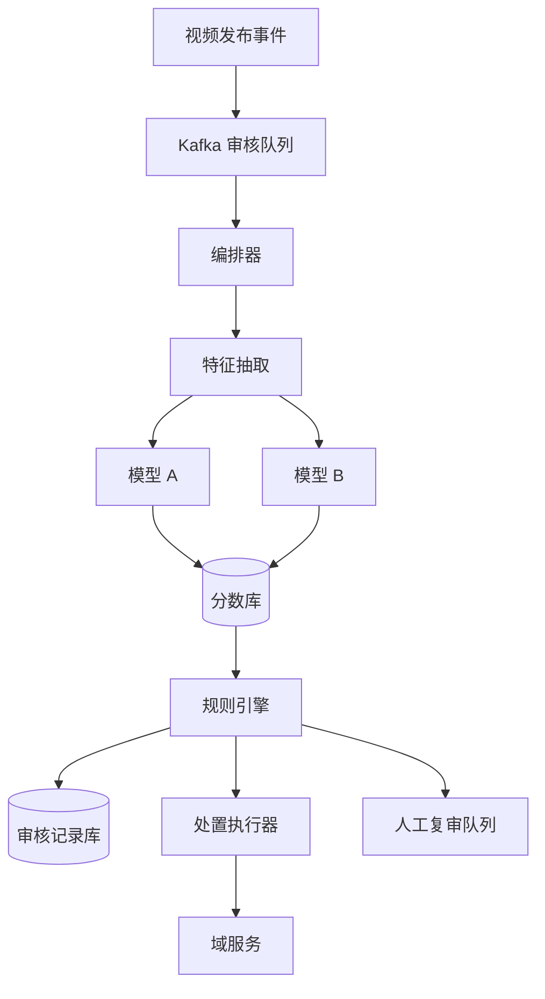

## Q
**视频内容审核系统**｜系统设计

为类似 TikTok 的全球平台设计视频审核系统：每天数百万条新视频要被近实时地审核。每条视频要接入审核流程；由多个机器学习模型各自打出 0 到 1 的风险分（越高越可能违规）；再由规则引擎根据分数组合判定是否违规，例如"模型 A 分数大于 0.9 且模型 B 分数大于 0.95 即违规"，规则由运营团队随政策变化持续维护；判定违规后要调用各业务域服务的接口执行处置（如下架视频）；每条视频的审核上下文要保存下来，用于审计和报表。

给出完整解答：需求、核心实体与接口、整体设计、深入问题、取舍、不同级别的期望。

## A
**一句话。** 这是一条"事件驱动的多阶段流水线"：难点是让昂贵的模型推理能在近实时内并行完成，让运营能安全地频繁改规则（并能用历史分数回放验证），并让"下架"这类有副作用的处置在失败重试下恰好生效一次且全程可审计。

**需求。**
功能：
1. 视频接入：每条新发布（或被编辑）的视频自动进入审核。
2. 风险打分：调用多个模型（画面、音频转写文本、标题与标签等多模态），每个返回 [0,1] 的分数。
3. 规则判定：根据分数组合出结论——通过、违规、需人工复审；规则可由运营配置、修改、回滚。
4. 违规处置：调用域服务接口（下架视频、限流作者、发通知），失败要重试，且不能重复处置。
5. 审计与报表：保存每条视频的审核上下文（分数、模型版本、命中的规则版本、结论、处置、时间），可按视频、作者、时间、规则检索与统计。
6. 范围外：申诉的完整产品流程（只需说明复审队列与结果回写的扩展点）。

非功能（假设）：
- 规模：每天 500 万条新视频，平均约 58 条/秒，峰值按 5 倍约 300 条/秒。
- 时延：发布到出结论的 p99 不超过几分钟（例如 2 分钟）；高风险内容更快。
- 可靠性：不漏审——每条视频最终必须有结论，哪怕某个模型暂时不可用；处置至少一次执行并幂等。
- 可审计：任何一次下架都能追溯到模型版本、分数与规则版本；记录不可篡改。
- 审计数据量：每条视频约 2KB 的审核记录，500 万条/天约 10GB/天。

**核心实体与接口。**
实体：`Video(id, authorId, uploadedAt, mediaRef, status)`；`ModelScore(videoId, model, version, score, ts)`；`Rule(id, version, expression, action, state[draft|shadow|active], author)`；`Decision(videoId, ruleVersions, verdict, scores snapshot, ts)`；`Action(videoId, type, state, attempts, idempotencyKey)`。
接口：
- 视频服务发布事件：`VideoPublished {videoId, mediaRef, authorId, ts}` 到消息队列（接入点）。
- 规则管理：`PUT /rules/{id}`（创建新版本，初始为草稿）、`POST /rules/{id}/promote {shadow|canary|active}`、`POST /rules/{id}/backtest`。
- 查询：`GET /moderation/videos/{id}`（完整上下文）、报表查询接口。
- 域服务（外部）：`POST /videos/{id}/takedown`（要求接受幂等键）。

**整体设计。**

1. 接入：视频服务发布事件到 Kafka（按 `videoId` 分区）。是先审后发还是先发后审，是产品取舍：先审后发最安全但延迟直接影响用户体验；常见做法是先发布（限制分发）并并行审核，高风险的新账号或敏感内容可以先审后发。
2. 编排：编排器为每条视频启动一次审核任务（工作流），先做特征抽取——抽帧（例如每秒 1 帧）、提取音轨并转写、读取标题与标签。大文件不在消息里传，只传对象存储引用。
3. 打分：各模型并行执行（扇出），每个模型是独立的推理服务（GPU 池），结果写入分数库：`(videoId, model, version, score)`。单模型有超时与重试；全部模型返回或达到截止时间后进入下一步。
4. 规则判定：规则引擎读取该视频的全部分数，按当前生效的规则版本求值，产出结论和命中规则。结论连同分数快照、模型版本、规则版本一起写入审核记录库。
5. 处置：违规则写一条待处置记录，处置执行器带幂等键调用域服务（下架）；灰区分数（例如 0.6 到 0.9）进入人工复审队列；其余通过。
6. 审计与报表：审核记录库是追加写、不可修改；同时把事件落到数据湖，供报表和模型迭代使用。

**深入。**

1. 打分阶段：扇出、超时与缺失分数。
- 问题：模型延迟各不相同，偶尔某个服务拥堵或失败；规则依赖多个分数，缺一个就无法求值。
- 做法：每个模型调用设超时和有限次重试；整条视频设总截止时间。若截止时仍有模型缺失，不能当作"分数为 0"放行——那会把故障变成漏审。选择：规则对缺失值有明确语义（`unknown`），带高风险信号的组合在缺失时转人工复审，或者把任务放回队列延迟重试；同时报警。
- 吞吐与成本：峰值 300 条/秒，每条几十帧，几个模型，GPU 推理要批处理；视频过长时抽样；低成本的小模型先过滤，明显安全的内容不再调用昂贵的大模型（级联）。
- 优先级：新账号、大 V、正在快速传播的视频走高优先级队列，传播量突增的老视频触发重新审核。
- 幂等：以 `videoId + 版本` 作为任务键，重复事件不会产生第二次审核；视频被编辑则版本递增，旧结论失效。

2. 规则引擎：运营能安全、频繁地改规则。
- 表达：把规则存成数据而不是代码——结构化表达式树（JSON），节点是比较（`score(A) > 0.9`）、与或非、阈值；执行器解释执行。避免在运营界面里让人写任意脚本。
- 版本与发布：每次修改生成新版本，不覆盖；状态从草稿到影子（shadow，真实流量上求值但不执行处置，只记录结果）再到灰度（对一部分流量生效）最后全量，随时回滚到上一个版本。记录谁在何时改了什么。
- 回放验证（backtest）：因为分数已保存，新规则可以拿过去几天的分数批量重新求值，对比与旧规则的差异（多判多少、少判多少），在上线前看到影响面；不需要重新跑模型。
- 规则变更后的存量：政策收紧时，对已通过的存量视频用保存的分数批量复评，命中的触发处置；这是保存分数的另一个理由。
- 分发：规则存数据库，规则引擎节点本地缓存并监听版本变化（推送加轮询兜底），保证一次判定只用一个明确的规则版本，并记入审核记录。

3. 处置：有副作用的步骤要可靠。
- 问题：下架调用可能超时、域服务可能暂时不可用；重试会不会重复处置？
- 方案：判定结果与"待处置"记录在同一个事务里写入（Outbox），处置执行器从中读取，带稳定的幂等键调用域服务，失败指数退避重试，多次失败进入死信队列并报警，同时对域服务设熔断，避免故障扩散。域服务按幂等键去重，重复下架无副作用。
- 多个处置动作（下架、扣信用分、通知）：分别记录状态，部分成功时能继续补完；严重违规的下架优先于通知。
- 处置状态回写到审核记录，形成"判定到执行"的完整闭环，审计时能看到延迟。

4. 审计与复审：
- 审核记录是事实：追加写，不原地更新，状态变化用新记录表示；存储可选宽表数据库（按 `videoId` 分区，高写入）加数据湖（Parquet，按日期分区做离线分析）。
- 人工复审队列：按严重度和传播量排序，复审员的结论回写并作为训练标签反馈给模型团队，也用来校准阈值。
- 申诉：用户申诉触发复审，结论改变则调用域服务恢复，并保留完整历史。
- 保留期与隐私：按地区法规设定记录保留期，涉及个人数据的字段单独加密。

**取舍与追问。**
- 精度与召回：阈值越低，误伤越多；越高，漏判越多。灰区交给人工是常见折中；不同违规类型阈值不同。
- 延迟与成本：全量用大模型最准但贵，级联过滤降本；对已有哈希匹配的已知违规内容（相同视频重传）直接用指纹库命中，跳过推理。
- 模型更新：新模型先影子运行比对，再切流；分数库按模型版本存储，规则可以指定使用哪个版本。
- 全球化：不同地区法规与政策不同，规则带地区维度；视频与模型尽量在就近区域处理，审计记录按地区合规要求存放。
- 失败模式：模型服务全挂时的降级策略要在设计时就定好——暂缓分发、转人工、或保持现状并报警，而不是静默放行。

**级别期望。**
- 中级：队列加模型服务加规则判定加处置的基本流水线，知道需要异步与重试。
- 高级：多模型并行与超时、缺失分数的语义、规则数据化与版本、幂等处置、审计记录。
- 资深/Staff：影子与灰度发布规则、基于保存分数的回放与存量复评、级联模型降本、Outbox 与熔断、优先级与背压、合规与地区化、误判代价的整体权衡。

**先修概念。** [[hi-system-design-deep-dives-kafka|Kafka]]、[[hi-system-design-patterns-multi-step-processes|多步骤流程]]、[[hi-system-design-patterns-long-running-tasks|长时间运行的任务]]、[[hi-system-design-patterns-large-blobs|大文件（Blob）处理]]、[[hi-system-design-core-concepts-data-modeling|数据建模]]、[[hi-system-design-deep-dives-temporal|Temporal]]

**同类题。** [[hi-system-design-problem-breakdowns-youtube|视频平台（YouTube）]]、[[hi-system-design-problem-breakdowns-ad-click-aggregator|广告点击聚合]]、[[solution-notification-system|通知系统]]、[[hi-system-design-problem-breakdowns-fb-post-search|Facebook 帖子搜索]]
