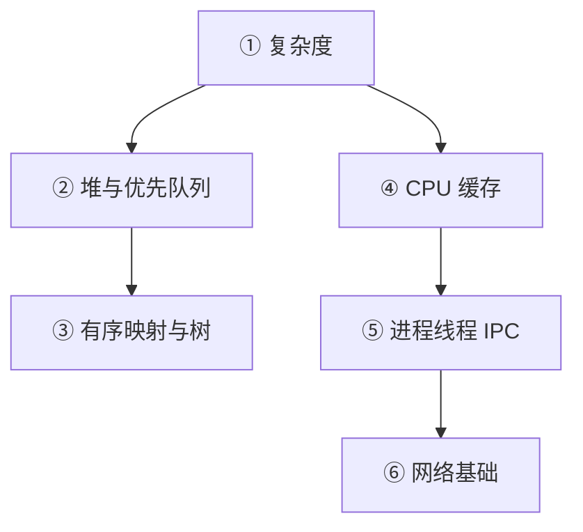

# 基础概念课本

> 每个概念回答四个问题：是什么 / 为什么需要 / 怎么工作 / Java 里怎么写；配 ASCII 图、手算例子、自测题（答案折叠在 `<details>` 里）。
> 读者设定：会写基本 Java，数据结构、复杂度、操作系统、网络都从头讲。
> 目标场景：Java Software Engineer，岗位强调 performance、Linux、networking、distributed storage；面试形式是一小时的技术视频面试。

## 阅读顺序



| 顺序 | 章节 | 一句话 | 前置 | 建议用时 |
|---|---|---|---|---|
| ① | [complexity.md](complexity.md) | Big-O 从数步数讲起；最好/平均/最坏；摊还（`ArrayList` 扩容有证明）；log n；面试里怎么估算运行时间，以及「10⁸ 次/秒」法则的六个局限 | 无 | 1.5–2 h |
| ② | [heap_priority_queue.md](heap_priority_queue.md) | 二叉堆数组布局、上浮/下沉逐步演示、建堆 O(n) 证明、`PriorityQueue` 的 API 与八个坑 | ① | 1.5 h |
| ③ | [ordered_maps_trees.md](ordered_maps_trees.md) | BST 为何退化 → 旋转 → 红黑树直觉（含高度证明）→ 跳表 → `TreeMap`/`ConcurrentSkipListMap` 的导航 API 与选择指南，联系 LSM/B+ 树 | ①② | 2 h |
| ④ | [cpu_cache_locality.md](cpu_cache_locality.md) | 内存层级与延迟数字、缓存行、局部性、`long[]` vs `ArrayList<Long>`、AoS vs SoA、伪共享、分支预测 | ① 第 8 节 | 2–2.5 h |
| ⑤ | [os_processes_threads_ipc.md](os_processes_threads_ipc.md) | 进程/线程、虚拟内存、调度与上下文切换、系统调用、IPC、`mmap`、共享内存上的 SPSC 环形缓冲（完整代码，跨 JVM 进程） | ④ | 2.5 h |
| ⑥ | [networking_basics.md](networking_basics.md) | 协议栈与套接字、TCP、UDP、延迟 vs 吞吐、Nagle 与 `TCP_NODELAY`、组播（交易所行情）、内核旁路、NIO `Selector`、虚拟线程 vs NIO | ⑤ | 2.5 h |

时间不够就按 ① → ④ → ⑤（第 7 节 SPSC）→ ⑥（第 5、6 节）读，这是岗位最可能追问的部分；②③在做合并多路流、订单簿题时再读。

## 做某道题前先读哪几章

| 题 | 先读 |
|---|---|
| Job Chain | ① |
| 买卖股票 DP | ① |
| 合并 K 个有序流 | ① ② ④(第 5 节) ⑤(第 1、3 节) |
| 递归求和 | ①，⑤(第 1 节) |
| 队列均值与快照 | ① ④ ⑤(第 7 节：环形缓冲的共享内存版) |
| 订单簿 | ① ② ③ ④（② 第 9 节解释订单簿为什么用 `TreeMap` + 价位队列而不是 `PriorityQueue`：取消订单 `remove(Object)` 是 O(n)） |
| CPU 寄存器位运算 | ④(第 8 节分支预测) |
| Order Sequence | ① ③ |

## 配套可运行代码：`examples/`

| 文件 | 对应章节 | 做什么 |
|---|---|---|
| [`ComplexityDemo.java`](examples/ComplexityDemo.java) | ① | 数比较次数、模拟扩容复制量（验证摊还）、`HashMap`/`TreeMap` 单次操作耗时、O(n²) 吞吐 |
| [`HeapDemo.java`](examples/HeapDemo.java) | ② | 手写 int 小根堆并打印每次交换；建堆 vs 逐个插入的交换次数；`PriorityQueue` 各种坑的复现 |
| [`TreeDemo.java`](examples/TreeDemo.java) | ③ | 普通 BST 的高度实验、40 行跳表、`TreeMap`/`ConcurrentSkipListMap` 导航 API |
| [`CacheDemo.java`](examples/CacheDemo.java) | ④ | 6 组微基准：`long[]` vs `ArrayList<Long>`、步长、行/列优先、指针追逐延迟阶梯、分支预测、AoS vs SoA、伪共享 |
| [`IpcDemo.java`](examples/IpcDemo.java) | ⑤ | 系统调用开销、线程交接往返、`mmap` 持久化、共享内存 SPSC 环形缓冲（同进程与跨进程） |
| [`NetDemo.java`](examples/NetDemo.java) | ⑥ | Nagle 实验、`Selector` vs 虚拟线程回显服务器、回环接口上的 UDP 组播与缺口检测 |
| [`check_snippets.py`](examples/check_snippets.py) | 全部 | 把章节里每个 ```` ```java ```` 代码块抽出来，用 `javac --release 21 --enable-preview` 编译 |

运行（JDK 21）：

```bash
J=/opt/homebrew/opt/openjdk@21/bin
cd vault/interviews/core/foundations/headlands/examples
$J/javac --release 21 --enable-preview *.java
$J/java --enable-preview ComplexityDemo
$J/java --enable-preview HeapDemo
$J/java --enable-preview TreeDemo
$J/java --enable-preview CacheDemo                      # 约 20 秒；需要约 1 GB 堆
$J/java --enable-preview --enable-native-access=ALL-UNNAMED IpcDemo
$J/java --enable-preview NetDemo
python3 check_snippets.py ../*.md                       # 章节里所有 java 代码块是否都能编译
rm -f *.class
```

`IpcDemo` 的跨进程模式：先 `IpcDemo consumer /tmp/ring.bin 50000000 &`，等一秒，再 `IpcDemo producer /tmp/ring.bin 50000000`。

## 关于数字

* 章节里的耗时数字来自 Apple Silicon / 12 核 / 16 GB / macOS / JDK 21 上的**粗糙**单 JVM 微基准（预热 + 取最小，没有用 JMH，没有绑核）。当作**量级与方向**，不是 benchmark 结论；多次运行常有 ±30% 波动，伪共享和跨核通信的波动可达数倍，波动大的地方章节里写了范围。
* 机器是 macOS 不是 Linux：系统调用、TCP 栈行为（如 Nagle + 延迟确认的 40 ms 停顿没有复现）、缓存行大小（128 B，x86 通常 64 B）都会不同。「在 Linux 上通常是……」这类说法，凡没在 Linux 上验证的，章节里都明确写了。
