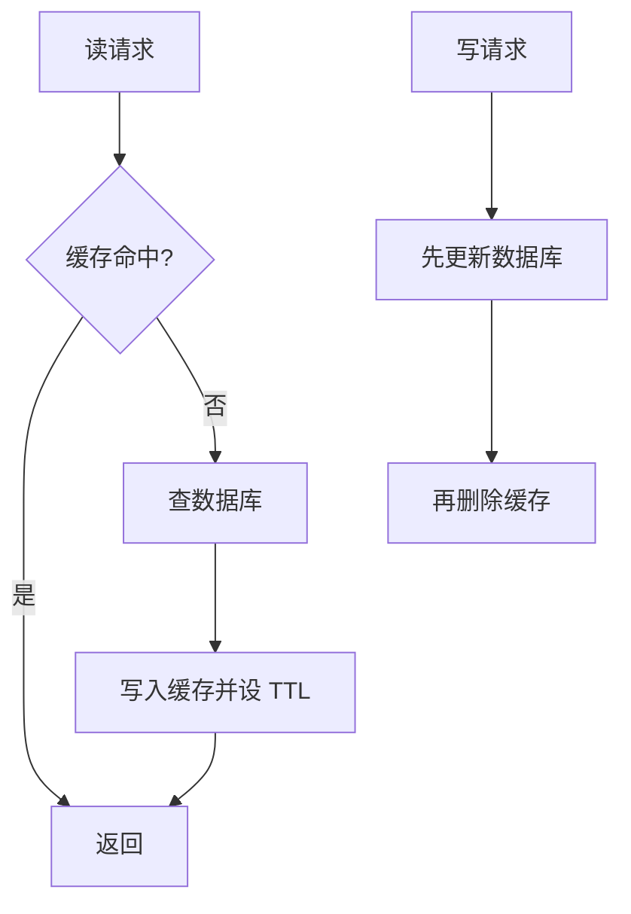

# 缓存八股：穿透、击穿、雪崩、一致性、热 key 与大 key

缓存的作用是用一块又快又小的存储（本地内存或 Redis）挡住大部分对数据库的读请求。缓存带来三类问题：缓存失效时请求涌向数据库（穿透、击穿、雪崩）；缓存和数据库的数据不一致；某个 key 太热或太大把单个节点压垮。面试官通常先让你说出三个名字的区别，再追问「你们怎么保证缓存和数据库一致」和「热 key 怎么发现、怎么处理」。每题按 **机制 → 为什么 → 数字或取舍 → 追问** 来答。Redis 本身的机制在 [[tiktok-redis]]，数据库一侧在 [[tiktok-mysql]]。

## 速记：这一页的 11 个问题

| # | 问题 | 一句话答案 |
|---|---|---|
| 1 | 旁路缓存（cache-aside）读写流程 | 读：先缓存后库再回填；写：先更新库再删缓存 |
| 2 | 为什么先更库再删缓存 | 并发下不一致的窗口最小，且需要「读慢于写」才会出错 |
| 3 | 怎么做到最终一致 | 删除失败重试；订阅 binlog 异步删；TTL 兜底 |
| 4 | 缓存穿透 | 查不存在的数据：缓存空值、Bloom filter、参数校验 |
| 5 | 缓存击穿 | 热 key 过期：互斥重建、逻辑过期、永不过期 |
| 6 | 缓存雪崩 | 大批 key 同时失效：TTL 加随机、多级缓存、限流降级 |
| 7 | 热 key | 本地缓存、key 拆副本、读从库 |
| 8 | 大 key | 拆分、压缩、UNLINK、分批删除 |
| 9 | 多级缓存怎么设计 | 本地 Caffeine + Redis + DB，短 TTL 容忍不一致 |
| 10 | 命中率与容量怎么估 | 数据库压力 = QPS × (1 − 命中率) |
| 11 | 缓存和数据库要强一致怎么办 | 缓存做不到强一致，关键读走库或加锁 |

## Q1. 旁路缓存（cache-aside）模式的读写流程是什么？

- **读**：先读缓存；没有再读数据库，然后写回缓存并设置 TTL。
- **写**：先更新数据库，再**删除**缓存（不是更新缓存）。
- **为什么删而不更新**：缓存值往往是多个表计算出来的结果，写一次就重算一次很浪费，而且很多写之后根本没人读；删除是惰性的，下次读时再按最新数据重建。另外两个并发的更新在缓存上执行的顺序可能和数据库不同，更新缓存会让缓存里留下旧值，删除没有这个问题。
- **其他模式**：读穿（read-through）和写穿（write-through）把逻辑放在缓存层；写回（write-behind）先写缓存再异步落库，吞吐高但会丢数据。互联网业务以 cache-aside 为主。

## Q2. 先更新数据库再删缓存，和先删缓存再更新数据库，哪个更好？

- **先删缓存，再更新库**：线程 A 删缓存 → 线程 B 读缓存未命中，读库得到旧值，写回缓存 → A 更新库。缓存里是旧值，直到 TTL 到期。这个交错**只需要 B 的读夹在 A 的两步之间**，窗口是整个数据库更新的时间，概率高。
- **先更新库，再删缓存**：要出错必须同时满足：B 读缓存未命中（缓存刚过期）→ B 读库（旧值）→ A 更新库并删缓存 → B 才把旧值写回缓存。这要求 B 的「读库 + 写缓存」比 A 的「更新库 + 删缓存」还慢，而读通常比写快，概率很低。
- **结论**：先更新库再删缓存，不一致窗口最小；仍然不是强一致。
- **追问 · 删缓存失败了呢？** 这是最常见的真实问题。做法：删除失败就重试（应用内重试几次，仍失败发到 MQ 异步重试，MQ 的消费者做幂等）；用 TTL 作为最后的兜底，TTL 越短不一致持续得越短。
- **追问 · 延迟双删？** 更新库后先删一次，sleep 一段时间（大于一次读库加写缓存的耗时，比如 500ms）后再删一次，清理中间被写回的旧值。缺点是睡眠时间难估、占线程，所以通常异步做（延迟消息）。

## Q3. 怎么保证缓存和数据库最终一致？

- **机制：订阅 binlog**。用 Canal / Debezium 之类的组件读数据库的 binlog，解析出变更的主键，发消息给专门的消费者删除缓存。业务代码不用管缓存，所有写入路径（包括手工改库、运维脚本）都会触发删除。
- **为什么**：业务代码里「更新库 + 删缓存」两步不是原子的，进程在两步之间崩溃就留下旧缓存；binlog 是数据库已经提交的事实，不会漏。
- **取舍**：多一条异步链路，增加几十到几百毫秒的延迟，要监控消费延迟；消息可能重复，删除本来是幂等的，没有问题；顺序错乱也不要紧，因为删除动作与顺序无关。
- **兜底三件套**：删除失败重试 + binlog 异步删 + TTL。
- **追问 · 一致性要求更高（比如价格）？** 减小窗口：写路径里同步删，binlog 链路再删一次；关键读（下单前校验价格）绕过缓存直接读库；缓存值里带版本号，写回时用 Lua 比较版本，旧版本不覆盖新版本。

## Q4. 什么是缓存穿透？怎么解决？

- **现象**：请求的数据在缓存和数据库里都不存在（恶意构造的 ID、被删除的数据），每次都打到数据库。
- **方案**：
  1. **参数校验**：ID 格式、范围非法的直接拒绝，在网关做。
  2. **缓存空值**：数据库查不到也写一个空标记，TTL 设短（30–60 秒），避免占内存；缺点是攻击者用大量不同 key 仍会撑满内存。
  3. **布隆过滤器**（Bloom filter）：把所有存在的 ID 预先放进去，不存在的请求在入口直接拒绝。它说「不存在」一定对；说「存在」可能误判（false positive）。
- **布隆过滤器的容量计算**：n 个元素、目标误判率 p，需要的位数 m = −n·ln p / (ln 2)²，哈希函数个数 k = (m/n)·ln 2。n = 1 亿、p = 1%：每个元素约 9.6 位，总共约 9.6 亿位 ≈ 120MB，k ≈ 7。
- **缺点**：标准布隆过滤器不支持删除（要用计数型或布谷鸟过滤器）；新增数据要同步加入，否则新数据被误拒绝。
- **追问 · 布隆过滤器放哪里？** 放在应用进程内存（Guava / 自己实现）或 Redis 的位图（RedisBloom）；多实例间要保证新增的 ID 同步更新。
- **追问 · 和击穿的区别？** 穿透是数据不存在，缓存永远建不起来；击穿是数据存在、缓存暂时失效。

## Q5. 什么是缓存击穿？怎么解决？

- **现象**：一个访问量极大的热 key 刚好过期，同一时刻成千上万个请求都未命中，一起去读库并重建缓存，数据库被瞬间打满。
- **方案一：互斥重建**。未命中时用 `SET lock:key NX PX 3000` 抢重建锁，抢到的去读库回填，没抢到的短暂休眠（几十毫秒）后重试读缓存。单个进程内用 singleflight（Go）或 `computeIfAbsent`（Caffeine）合并同一个 key 的并发加载，不用跨进程锁。
- **方案二：逻辑过期**。缓存里不设 TTL，value 里存一个过期时间戳。读到过期的数据时，先返回旧值，同时由一个线程（抢到锁的）异步重建。优点：永远不会有请求去等；缺点：会短暂读到旧数据，占内存。
- **方案三：热点永不过期 + 主动刷新**。后台任务定期更新热 key；已知的热点（首页、爆款商品）适用。
- **取舍**：要强一致选互斥重建（等待者有延迟）；要低延迟选逻辑过期（接受短暂旧数据）。
- **追问 · 互斥锁里的坑？** 锁要有 TTL，防止重建线程崩溃后永远没人重建；重建线程拿到锁后再检查一次缓存（double check），因为别人可能刚刚重建完；重建失败时不要让所有等待者都去打库，等待者设最大等待次数。

## Q6. 什么是缓存雪崩？怎么解决？

- **现象**：大量 key 在同一时间过期，或者 Redis 整体宕机，请求一起压向数据库。
- **方案**：
  1. **TTL 加随机抖动**：`ttl = base + random(0, base × 20%)`，避免批量写入的 key 同时过期（比如凌晨批量预热）。
  2. **多级缓存**：本地缓存 + Redis，Redis 挂了本地还能挡一部分。
  3. **高可用**：Redis 主从 + 哨兵或 Cluster，跨机架部署。
  4. **保护数据库**：限流、熔断、降级，缓存失效时只放行一部分请求，其余返回降级结果，见 [[tiktok-service-protection]]。
  5. **预热**：发布或扩容前先把热点数据加载进缓存，不要让新实例冷启动。
- **追问 · Redis 宕机怎么办？** 第一时间由熔断器和限流保住数据库（数据库能承受的 QPS 是多少，就只放行多少）；恢复后用慢速预热逐步放量，避免冷缓存被打穿再次崩。

## Q7. 热 key 怎么发现、怎么处理？

- **现象**：一个 key 的访问量远超其他（明星直播间、秒杀商品）。Redis 单个分片一个 CPU 核约能处理 8–10 万 QPS，Cluster 里这个 key 所在的节点被打满，加节点也没用，因为 key 只在一个槽里。
- **发现**：
  - 客户端或 SDK 里做滑动窗口计数（最直接，实时）；
  - 代理层（Proxy）统计；
  - Redis 自带 `redis-cli --hotkeys`（要求淘汰策略是 LFU）；`MONITOR` 开销大，只能短时间在从库上用；
  - 网络抓包分析。
- **处理**：
  1. **本地缓存**：在应用进程内给这个 key 加 1–5 秒的本地缓存，请求被各应用实例分担。一致性损失最多等于本地 TTL。
  2. **key 拆副本**：写入 `key#0` 到 `key#N-1` 共 N 份，读时随机选一份，请求分散到不同的槽和节点；代价是写要写 N 份，更新时容易不一致。
  3. **读写分离**：热 key 的读走从库副本。
  4. **限流与降级**：兜底，保护节点不被拖垮。
- **追问 · 怎么提前预判？** 营销活动提前登记热点商品，到点自动开启本地缓存和副本；实时发现的热 key 通过配置中心推送到所有实例。

## Q8. 什么是大 key？有什么危害？怎么处理？

- **定义（经验值）**：String 超过 10KB；Hash / List / Set / ZSet 的元素超过 5000 个或总体超过 1MB 就要警惕，超过 10MB 必须处理。
- **危害**：单次读写耗时长，阻塞单线程影响所有请求；占用网络带宽，容易打满网卡；删除或过期时释放大块内存导致卡顿；主从复制、集群迁移单个 key 时卡住；分片间内存倾斜。
- **发现**：`redis-cli --bigkeys`（用 SCAN 采样）、`MEMORY USAGE key`、离线分析 RDB 文件（rdb-tools）；生产上在从库上跑。
- **处理**：
  1. **拆分**：一个大 Hash 按 `hash(field) % N` 分成 N 个小 Hash（`user:1:profile:{0..N-1}`）；大 List 按时间或序号分段。
  2. **压缩**：JSON 先 gzip / snappy，或改用更紧凑的格式。
  3. **删除**：用 `UNLINK` 异步释放；集合类的大 key 用 `HSCAN` / `SSCAN` + 分批 `HDEL` / `SREM` 逐步删掉，每批几百个。
  4. **设计层面**：不要把一个排行榜或粉丝列表整个塞进一个 key，要分页、分片，评论列表只缓存最新一两页。
- **追问 · 怎么避免「自己制造」大 key？** 给所有写入的集合设置元素数量上限（写入时 `LTRIM` / 判断 `ZCARD` 后 `ZREMRANGEBYRANK`），上线前做容量评估，并对大 key 做告警。

## Q9. 多级缓存怎么设计？

| 层 | 例子 | 容量 | 延迟 | 一致性手段 |
|---|---|---|---|---|
| 浏览器 / CDN | HTTP 缓存头、CDN | 极大 | 毫秒级 | `Cache-Control`、主动 purge |
| 本地缓存 | Caffeine、Guava | 每实例数百 MB | 纳秒到微秒 | 短 TTL，广播失效 |
| 分布式缓存 | Redis | 数十 GB 到 TB | 亚毫秒到毫秒 | 删除、binlog |
| 数据库 | MySQL | 全量 | 毫秒到数十毫秒 | 权威数据 |

- **机制**：读时依次查本地 → Redis → 数据库，回填时从下往上写。
- **为什么**：本地缓存没有网络开销、吞吐不受 Redis 限制，能挡热 key；Redis 容量大、全实例共享，保护数据库。
- **取舍**：本地缓存无法在所有实例之间精确同步失效。常用做法是短 TTL（几秒到一分钟）加 Redis Pub/Sub 或 MQ 广播失效消息；能容忍的不一致时长就是 TTL。
- **Caffeine 的淘汰算法**是 W-TinyLFU：用计数草图（count-min sketch）估计访问频率，用小窗口区保护新数据，命中率比纯 LRU 高。
- **追问 · 本地缓存的内存问题？** 设最大条目数或最大权重，防止 OOM；用软引用或弱引用并不可靠；监控命中率和淘汰数。

## Q10. 怎么估算缓存命中率和容量？

- **数据库压力**：`数据库 QPS = 总读 QPS × (1 − 命中率)`。读 QPS 为 10 万时：命中率 99% → 数据库 1000 QPS；命中率 90% → 1 万 QPS，是前者的 10 倍。所以命中率从 99% 掉到 90% 就足以把数据库打垮。
- **容量**：缓存条目数 × 单条大小 ÷ 0.7（留 30% 余量和碎片）。例：2000 万条 × 1KB = 20GB，大约要 28GB 内存规划。
- **命中率目标**：核心读路径 95% 以上；监控 `keyspace_hits / (keyspace_hits + keyspace_misses)`，并按业务维度（接口、key 前缀）分别监控。
- **提高命中率**：延长 TTL、预热、拆分过碎的 key、不缓存几乎不会被重复读的数据（长尾冷数据缓存不划算）。
- **追问 · 二八原则怎么用？** 如果 20% 的数据承接 80% 的请求，缓存只放这 20% 就能把数据库压力降到约 20%；用 LFU 让热数据留下来。

## Q11. 缓存和数据库要求强一致，怎么办？

- **直接回答**：旁路缓存做不到强一致，只能缩短不一致的时间。强一致的需求要换思路。
- **做法**：
  1. **关键读绕过缓存**：下单、支付、库存扣减这些读直接读主库。
  2. **读写加同一把锁**：写时加锁 → 更新库 → 删缓存 → 解锁；读未命中时加同一把读锁再回填。吞吐明显下降，只给少量关键数据。
  3. **版本号比较**：缓存里存数据版本，回填时 `compare-and-set`，旧版本不能覆盖新版本。
  4. **把缓存当作权威数据**：写操作只写 Redis（持久化开启），异步落库，这就变成了「Redis 即数据库」，要承担丢数据的风险，一般不推荐。
- **取舍说法**：CAP 里缓存系统选择了可用性和分区容忍，接受最终一致；真正需要强一致的数据，别指望缓存，放数据库事务里。

## 延伸阅读

- Facebook：Scaling Memcache at Facebook（租约 lease 解决旧值回填和惊群）
- 相关：[[tiktok-redis]] · [[tiktok-mysql]] · [[tiktok-service-protection]] · [[tiktok-fundamentals]]
