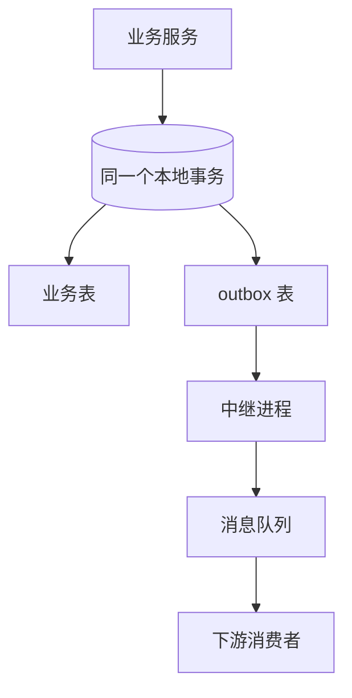

# 幂等与分布式事务八股：幂等键、2PC、TCC、SAGA、本地消息表

幂等（idempotency）是指同一个操作执行一次和执行多次结果相同。网络会超时、消息队列会重投、网关会重试，所以任何会改变状态的接口都要能被安全地重复调用。分布式事务要解决的是：一个业务操作跨多个服务或多个数据库，怎么让它们要么都成功、要么都回到一致的状态。面试官常拿支付、下单扣库存、转账来问：重复请求怎么办？扣了钱但订单没建成怎么办？每题按 **机制 → 为什么 → 数字或取舍 → 追问** 作答。支付系统的完整设计另见系统设计部分；消息可靠投递见 [[tiktok-message-queues]]，数据库事务见 [[tiktok-mysql]]。

## 速记：这一页的 11 个问题

| # | 问题 | 一句话答案 |
|---|---|---|
| 1 | 为什么需要幂等 | 超时重试、消息至少一次、用户连点 |
| 2 | 幂等有哪些实现 | 唯一键、状态机条件更新、去重表、版本号、token |
| 3 | 支付接口的幂等键怎么设计 | 客户端生成 key，服务端与业务写入同事务落表，存响应回放 |
| 4 | RPC 超时了，到底成功没 | 超时不等于失败：先查询状态，再用同一个幂等键重试 |
| 5 | 2PC 是什么，为什么少用 | 协调者 + 两阶段，阻塞、单点、长时间持锁 |
| 6 | TCC 的三个接口与三个坑 | Try 预留，Confirm 提交，Cancel 回滚；空回滚、悬挂、幂等 |
| 7 | SAGA | 本地事务序列 + 补偿，缺隔离性 |
| 8 | 本地消息表 / outbox | 业务与消息同一个本地事务，异步中继发送 |
| 9 | 事务消息（半消息） | 先发半消息，执行本地事务，再提交或回滚，Broker 回查 |
| 10 | Seata AT 模式 | 前后镜像自动回滚，全局锁防脏写 |
| 11 | 怎么选型，对账怎么兜底 | 按一致性强度和业务侵入性选；对账是最后一道防线 |

## Q1. 为什么要做幂等？哪些操作天然幂等？

- **重复来自哪里**：客户端超时后重试；用户连点提交按钮；网关或服务框架的自动重试；消息队列的至少一次投递（见 [[tiktok-message-queues]]）；运维手工补发。
- **天然幂等**：读操作；`SET balance = 100`（绝对赋值）；`DELETE ... WHERE id = ?`。
- **天然不幂等**：`balance = balance - 100`（相对变化）；插入没有唯一约束的记录；发送通知；调用外部扣款。
- **为什么要在服务端做**：不能指望客户端「只发一次」，网络层面只能保证至少一次，所以幂等是服务端对外的契约。

## Q2. 幂等有哪些实现方式？各自适用什么场景？

| 方式 | 做法 | 适用 |
|---|---|---|
| 唯一索引 | 业务唯一键（订单号 + 类型）建唯一约束，重复插入报错就当成功 | 创建类操作，最可靠 |
| 状态机条件更新 | `UPDATE order SET status='PAID' WHERE id=? AND status='UNPAID'`，影响行数 0 表示已处理 | 状态流转 |
| 去重表 | 以 messageId / requestId 为唯一键，和业务数据在同一个本地事务 | 消费消息、回调 |
| 乐观锁版本号 | `WHERE version = ?`，成功后版本加一 | 更新类 |
| Token 机制 | 先申请一次性 token，提交时 `DEL token` 成功才执行（Redis） | 表单防重复提交 |
| 分布式锁 | 对业务键加锁串行化 | 只缩小并发窗口，不能当最终保证 |

- **取舍**：Redis 的 token 或锁可能丢（主从切换、过期），所以**最终的防线必须是数据库的唯一约束或条件更新**；Redis 只负责挡掉绝大多数重复，降低数据库压力。
- **追问 · 去重表会无限增长吗？** 会。按时间分区，保留期大于最大可能的重试窗口（如 7 天）后清理；重复消息间隔超过保留期的概率要靠业务评估，必要时业务键本身就有唯一约束，不依赖去重表。

## Q3. 支付接口的幂等怎么设计？

- **契约**：客户端为每个「逻辑上的一次扣款」生成一个幂等键（`Idempotency-Key`，UUID），重试时必须带同一个。
- **服务端表**：`idempotency(key PRIMARY KEY, request_hash, status, response, created_at)`。
- **流程**：
  1. 在**同一个数据库事务**里 `INSERT` 幂等记录（状态 `PROCESSING`）并执行业务写入；
  2. 如果插入时撞主键：读出已有记录——状态 `DONE` 则直接返回当初保存的响应；状态 `PROCESSING` 返回 409（或让客户端稍后查询）；
  3. 业务完成后更新状态为 `DONE`，保存响应；
  4. `request_hash` 不一致（同一个 key 但请求内容变了）返回 422，防止滥用。
- **为什么要和业务写入同事务**：否则可能「幂等记录写了但业务没做」或「业务做了但记录没写」，两种都会导致重复或丢失。
- **对外部支付渠道**：调用渠道时同样带一个由我们生成、与订单一一对应的商户请求号，渠道侧也按它去重；渠道返回超时，用同一个请求号查询结果。
- **追问 · 幂等键保留多久？** 比客户端最大重试时间长，常见 24 小时到 7 天。

## Q4. 调用扣款接口超时了，到底扣了没有？怎么办？

- **原则**：超时只表示「没有收到响应」，不表示失败。不能直接当失败回滚，也不能盲目重新扣。
- **做法**：
  1. 订单进入「处理中/未知」状态，不要判成功或失败；
  2. 用同一个幂等键或请求号**查询**对方的最终状态；
  3. 查到成功 → 推进；查到失败 → 释放；查不到 → 用同一个幂等键**重试**（因为对方是幂等的，重试安全）；
  4. 重试要有次数和间隔上限（指数退避，见 [[tiktok-service-protection]]），超过后进入人工或对账流程；
  5. 日终**对账**（reconciliation）：和渠道的账单逐笔比对，补单、冲正。
- **追问 · 对方不支持幂等和查询怎么办？** 这样的依赖不能自动重试，只能走人工和对账，并在设计上要求对方补充查询接口。

## Q5. 2PC 是什么？为什么互联网业务很少用？

- **机制**：协调者（coordinator）+ 参与者（participants）。第一阶段 **prepare**：协调者问所有参与者「能提交吗」，参与者执行事务但不提交，锁住资源并写日志，回复 yes 或 no；第二阶段：全部 yes 则发 **commit**，否则发 **rollback**。数据库的 XA 协议就是 2PC。
- **问题**：
  1. **同步阻塞**：参与者 prepare 后一直持锁，直到收到协调者决定，延迟等于最慢的参与者；
  2. **单点**：协调者在发出 commit 之前崩溃，参与者既不能提交也不能回滚（只能等），资源被长时间锁住；
  3. **不一致**：commit 只发给了一部分参与者就故障；
  4. 吞吐低，跨服务和跨语言不通用。
- **3PC** 加了 CanCommit 阶段和超时机制减少阻塞，但网络分区下仍可能不一致，工程上基本不用。
- **适用**：同一公司内、参与者少、并发低、要求强一致（如数据库内部的跨分片事务）。
- **追问 · 和 Raft/Paxos 的区别？** 共识协议是让多个副本对同一个值达成一致，能容忍少数节点故障；2PC 是让多个不同的资源管理器原子地提交，任何一个参与者否决或故障都会影响结果。

## Q6. TCC 是什么？空回滚和悬挂怎么处理？

- **机制**：每个参与方提供三个接口。
  - **Try**：检查并**预留**资源（冻结 100 元、预扣一件库存），不做最终变更；
  - **Confirm**：真正提交，使用 Try 预留的资源；
  - **Cancel**：释放 Try 预留的资源。
- 事务管理器先调所有 Try，全成功则调所有 Confirm，任一失败则调所有 Cancel。
- **为什么**：每一步都是本地事务，资源只被「预留」而不是长时间被数据库锁住，并发好于 2PC，不依赖数据库的 XA 能力。
- **代价**：业务侵入强，每个操作要写三个接口，并且要设计「冻结」状态（账户表加 `frozen_amount`）。
- **三个必须处理的问题**：
  1. **幂等**：Confirm 和 Cancel 都会被重试，必须能重复执行；
  2. **空回滚**（empty rollback）：Try 的请求因超时或网络没到，就收到了 Cancel。此时 Cancel 要能识别「没有 Try 记录」并直接返回成功，同时插入一条「已回滚」记录；
  3. **悬挂**（hanging）：Cancel 先执行了，之后迟到的 Try 才到达，如果执行就永远不会有人 Confirm 或 Cancel，资源被永久冻结。解决：Try 先检查事务记录，发现该事务已有 Cancel 记录就拒绝执行。
- **实现办法**：建事务日志表 `(xid, branch_id, status)`；Try 插入 `TRIED`（已存在 `CANCELLED` 则拒绝）；Cancel 若无记录则插入 `CANCELLED`（空回滚），有 `TRIED` 才真正释放；Confirm 和 Cancel 都先判断状态再执行。
- **追问 · Confirm 失败怎么办？** 不断重试直到成功（Try 通过后，Confirm 理论上一定能成功，因为资源已预留）；多次失败告警人工处理。

## Q7. SAGA 是什么？和 TCC 比有什么不同？

- **机制**：把长事务拆成一串本地事务 T1、T2、…、Tn，每个 Ti 都有对应的补偿操作 Ci。顺序执行，如果 Tk 失败，就按反方向执行 C(k−1) … C1。
- **两种协调方式**：编排式（orchestration）：一个中心协调器按流程调用各服务，流程清晰、易监控，推荐；协同式（choreography）：每个服务发布事件，下一个服务监听并执行，没有中心，但流程分散、难追踪、容易出现循环依赖。
- **与 TCC 的区别**：SAGA 的每一步**直接提交**，没有「预留」，补偿是**语义上的撤销**（退款，而不是回滚到原状），所以中间状态对外可见，缺少隔离性（isolation）。
- **缺隔离性怎么办**：语义锁（订单状态设成 `PENDING`，别的流程看到就不改）；可交换的更新；把可能失败的步骤放前面、不可补偿的步骤（发货）放最后（pivot transaction）。
- **补偿的要求**：幂等；可重试（补偿本身不能失败，只能不断重试直到成功，仍失败则人工）；要处理「补偿比正向操作先到」的乱序（同空回滚）。
- **适用**：流程长、参与方多、含外部系统（旅行预订：机票 + 酒店 + 支付），不适合要求严格隔离的场景。
- **追问 · 什么时候选 TCC，什么时候选 SAGA？** 资金类、需要强隔离、希望尽量避免中间状态暴露的选 TCC；流程长、步骤多、对中间状态容忍的选 SAGA。

## Q8. 本地消息表 / outbox 模式怎么做？

- **要解决的问题**：先写数据库再发消息，两步之间进程崩溃，数据变了但消息丢了；反过来先发消息再写库，库失败了消息已经发出去。
- **机制**：业务数据和一条 outbox 记录（要发的消息）在**同一个本地数据库事务**里提交，二者要么都在要么都不在。另有中继（relay）进程把 outbox 里未发送的记录发到 MQ，成功后标记为已发送。
- **中继的两种实现**：轮询（定时 `SELECT ... WHERE sent = 0 ORDER BY id LIMIT 100`，简单，有延迟）；CDC（用 Debezium 订阅 binlog 里 outbox 表的插入，延迟低，不增加查询负载）。
- **语义**：中继发送成功但标记失败会重发，所以是**至少一次**，消费者必须幂等（消息带唯一 ID）。
- **顺序**：同一个业务实体的消息按 outbox 自增 ID 顺序发，并用实体 ID 做分区 key。
- **清理**：已发送的记录定期归档或删除，避免表膨胀。
- **取舍**：最终一致，不是强一致；多一张表和一个中继进程；但业务侵入小、可靠、实现简单，是最常用的方案。
- **追问 · 为什么不直接在事务里发 MQ？** MQ 不在数据库事务内，提交前发则回滚时消息已发出，提交后发则可能发送失败；这是经典的「双写」问题。

## Q9. 事务消息（半消息）是怎么工作的？

- **RocketMQ 事务消息流程**：
  1. 生产者发送**半消息**（half message）到 Broker，对消费者不可见；
  2. 生产者执行本地事务；
  3. 根据本地事务结果向 Broker 发 commit（消息变为可见）或 rollback（删除）；
  4. 如果 Broker 迟迟没有收到第 3 步（生产者崩溃），会**回查**（check back）生产者「这笔本地事务的状态」，生产者查自己的数据库后给出答案。
- **关键点**：回查接口必须能通过业务数据判断事务是否已提交（例如查订单是否存在），因此业务表里要有可查的状态。
- **和 outbox 的区别**：事务消息把「持久化待发消息」的职责交给 Broker，业务库不用建消息表，但依赖支持事务消息的 MQ；outbox 与具体 MQ 无关。Kafka 没有这种事务消息。

## Q10. Seata 的 AT 模式是怎么工作的？

- **角色**：TM（事务发起者）、RM（资源管理器，每个服务的数据源代理）、TC（事务协调者，独立的服务）。
- **一阶段**：RM 拦截业务 SQL，先查出修改前的数据（before image），执行 SQL，再查修改后的数据（after image），把前后镜像写入 `undo_log` 表，和业务变更**同一个本地事务提交**，同时向 TC 注册分支并申请全局锁。
- **二阶段**：全局提交时，只要异步删除 `undo_log`；全局回滚时，RM 用 before image 生成反向 SQL 恢复数据，回滚前用 after image 校验，数据被改过就报警。
- **隔离性**：本地锁在一阶段提交后释放，所以别人可以读到未全局提交的数据（读未提交）；写靠**全局锁**保证，两个全局事务不会同时改同一行；`SELECT FOR UPDATE` 可以读已提交并加全局锁。
- **取舍**：对业务代码几乎无侵入，上手快；代价是引入 TC 服务、全局锁在热点行上竞争激烈、额外的 undo_log 读写，高并发热点场景性能不如 TCC。
- **追问 · 脏写是怎么发生的？** 别的非全局事务的本地事务直接改了这一行，回滚时 after image 校验失败。所以所有对该表的写都应该走全局事务，或加全局锁校验。

## Q11. 怎么选型？最终一致靠什么兜底？

| 场景 | 方案 |
|---|---|
| 同一个数据库内 | 本地事务 |
| 少量参与者、强一致、低并发 | 2PC / XA |
| 资金冻结、库存预占，要隔离性 | TCC |
| 长流程、跨多个服务或外部系统 | SAGA（编排式） |
| 只要「业务提交后下游一定收到事件」 | outbox / 事务消息 + 幂等消费 |
| 代码改不动、想快速接入 | Seata AT |

- **共同点**：几乎所有方案最终都是「至少一次 + 幂等 + 补偿或重试」。
- **兜底：对账与监控**。
  - 对账：定时任务拿「订单」「支付流水」「渠道账单」三方比对，发现不一致（订单已支付但库存没扣、扣了钱没订单）自动补偿或告警；
  - 悬挂事务扫描：长时间停留在中间状态（PROCESSING、PENDING）的单据，主动查询并推进或回滚；
  - 指标：中间状态单据数量、补偿次数、对账差异率。
- **追问 · 为什么说分布式事务能不用就不用？** 每个方案都以复杂度、延迟或一致性为代价；先考虑能否通过合并服务边界（相关数据放在同一个库）、调整业务流程（先扣库存再付款，付款超时再释放）来避免跨服务事务。

## 延伸阅读

- Chris Richardson：Pattern: Transactional outbox、Saga <https://microservices.io/patterns/data/saga.html>
- Seata 文档 <https://seata.apache.org/docs/>
- 相关：[[tiktok-message-queues]] · [[tiktok-mysql]] · [[tiktok-service-protection]] · [[tiktok-fundamentals]]
