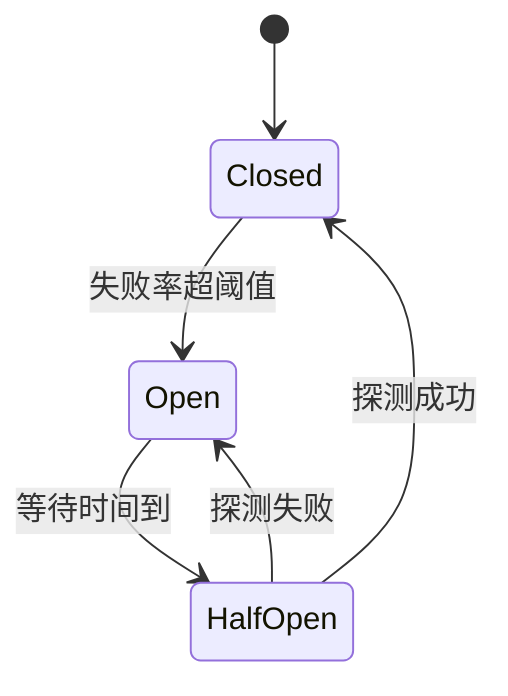

# 服务保护八股：限流、降级、熔断、重试退避、10 倍流量突增

服务保护要回答一个问题：流量突然变大、或者下游变慢变坏时，怎么保证核心功能还活着，而不是整条链路一起垮掉。常用手段有限流（rate limiting，控制进来多少）、熔断（circuit breaker，下游坏了就别再调）、降级（degradation，主动关掉次要功能）、重试加退避（retry with backoff，临时错误再试一次但别压垮对方）和隔离（bulkhead，一个依赖的问题不波及其他）。面试官爱问的场景题是「QPS 从 1 万涨到 10 万，你怎么办」和「为什么不能无限重试」。每题按 **机制 → 为什么 → 数字或取舍 → 追问** 作答。缓存与数据库的保护见 [[tiktok-cache-problems]]，消息削峰见 [[tiktok-message-queues]]。

## 速记：这一页的 12 个问题

| # | 问题 | 一句话答案 |
|---|---|---|
| 1 | 为什么需要服务保护 | 过载会雪崩：慢请求占满线程，重试放大流量 |
| 2 | 限流算法有哪几种 | 固定窗口、滑动窗口、漏桶、令牌桶 |
| 3 | 分布式限流怎么做 | Redis + Lua 计数；或本地配额分片 |
| 4 | 限 QPS 还是限并发 | 并发限制随下游变慢自动收紧（利特尔定律） |
| 5 | 熔断器三态 | 关闭 → 打开 → 半开；失败率超阈值打开 |
| 6 | 降级怎么做 | 按优先级关次要功能，返回兜底数据 |
| 7 | 重试的原则 | 只重试幂等的临时错误；指数退避加抖动；有总预算 |
| 8 | 为什么不能无限重试 | 放大流量，雪上加霜；逐层重试会指数放大 |
| 9 | 超时怎么设 | 基于 p99，上游大于下游之和，传递截止时间 |
| 10 | 隔离（舱壁） | 每个依赖独立线程池或信号量 |
| 11 | QPS 突增 10 倍怎么办 | 先判断真假，边缘挡、限流保核心、缓存与队列削峰、降级、扩容 |
| 12 | 秒杀怎么设计保护 | 分层过滤，Redis Lua 预扣，队列异步下单，数据库条件更新兜底 |

## Q1. 为什么要做服务保护？没有保护会怎样？

- **雪崩（cascading failure）的过程**：下游服务变慢 → 上游线程一直在等它，线程池被占满 → 上游自己也无法响应 → 调用上游的服务也被拖住 → 整条链路瘫痪。再叠加客户端重试，流量被放大几倍，系统更难恢复。
- **核心思想**：**让失败快速发生、局部发生**，宁可拒绝一部分请求，也不要让所有请求都变慢直到超时。
- **五类手段**：
  1. 限流：入口控制进来多少；
  2. 熔断：对坏的依赖快速失败；
  3. 降级：关闭次要功能保核心；
  4. 隔离：分开资源，故障不蔓延；
  5. 重试 + 超时：处理临时错误但有节制。
- **追问 · 它们的关系？** 限流保护「我」不被调用方压垮；熔断保护「我」不被被调用方拖垮；降级是两者触发后的兜底策略；隔离限制故障影响的范围。

## Q2. 常见的限流算法有哪些？各有什么特点？

| 算法 | 机制 | 优点 | 缺点 |
|---|---|---|---|
| 固定窗口计数 | 每个时间窗口（如每秒）计数，超过阈值拒绝 | 实现简单，一个计数器 | 窗口边界突刺：前一秒最后和后一秒最开始各放满，短时间内通过 2 倍阈值 |
| 滑动窗口 | 把窗口切成小格（如 1 秒切成 10 个 100ms），统计最近 1 秒内所有格的和 | 平滑，解决边界问题 | 格子越细越占内存 |
| 漏桶（leaky bucket） | 请求进桶，以恒定速率流出处理，桶满则拒绝 | 输出速率恒定，保护下游 | 不能应对合理的突发，突发请求要排队变慢 |
| 令牌桶（token bucket） | 以固定速率往桶里放令牌（上限 b），请求拿到令牌才通过 | 允许突发（最多 b 个），平均速率受控 | 参数要调 |

- **如何选**：保护脆弱下游、需要匀速的用漏桶；面向用户的 API 允许合理突发的用令牌桶（最常用）；简单粗放的用固定窗口；要精准的用滑动窗口。
- **令牌桶参数**：速率 r（每秒令牌数）= 长期平均 QPS 上限，容量 b = 允许的突发量。例：r = 1000，b = 200：平均每秒 1000，瞬时最多多放 200。
- **实现**：Guava `RateLimiter`（单机，令牌桶，支持预热）；Nginx `limit_req`（漏桶）；Sentinel；网关层。
- **被限流时返回**：HTTP 429（Too Many Requests）加 `Retry-After`，不要让客户端干等。
- **追问 · 限流的维度？** 按全局、按接口、按用户/租户/IP、按调用方。分维度可以避免一个大客户把所有配额占完。

## Q3. 分布式限流怎么实现？

- **Redis + Lua（固定窗口，最简单）**：

```lua
local current = redis.call("INCR", KEYS[1])
if current == 1 then
  redis.call("EXPIRE", KEYS[1], ARGV[1])
end
if current > tonumber(ARGV[2]) then
  return 0
end
return 1
```

  `INCR` 与 `EXPIRE` 放在一个脚本里保证原子，否则中间崩溃留下永不过期的计数器。滑动窗口用 ZSet：score 是请求时间戳，每次先 `ZREMRANGEBYSCORE` 删窗口外的，再 `ZCARD` 判断，再 `ZADD`。令牌桶也可以用 Lua 记录「上次时间 + 当前令牌数」来实现。
- **问题**：每个请求一次 Redis 往返，限流本身成为热点和延迟来源；Redis 故障时限流器怎么办？
- **选择**：
  - **本地 + 全局配额分片**：全局总额 10,000 QPS，10 个实例各分 1000 QPS，在本地令牌桶限流，定期（每秒）根据各实例实际流量重新分配。没有每请求的网络开销，精度略低。
  - **Redis 故障时 fail-open 还是 fail-closed**：放行（fail-open）保可用，拒绝（fail-closed）保安全。普通 API 通常 fail-open 退化为本地限流；资金类、防刷类可能 fail-closed。
- **网关层限流**：在入口统一做，覆盖所有后端，后端服务再各自做自保护的限流。
- **追问 · 为什么还需要服务自己限流？** 网关限的是外部流量，内部服务之间的调用、定时任务、重试风暴也会压垮服务。

## Q4. 限流是限 QPS 还是限并发？

- **QPS 限流**：控制单位时间的请求数，简单直观，但不感知下游变慢。
- **并发限流**（同时处理中的请求数）：根据**利特尔定律**（Little's law）：并发数 = QPS × 平均延迟。下游变慢、延迟从 50ms 涨到 500ms 时，同样的 QPS 对应的并发涨 10 倍；限制并发自动让能放行的 QPS 跟着降下来，保护资源。
- **算例**：一个服务最多支撑 200 个并发，平均延迟 100ms，则 QPS 上限 = 200 ÷ 0.1 = 2000；延迟变成 400ms，QPS 上限自动降到 500。
- **自适应并发限制**：像 TCP 拥塞控制一样，请求成功且延迟低就加并发上限，延迟升高或超时就减半（AIMD），Netflix 的 concurrency-limits、Sentinel 的系统保护规则（根据 load、RT、线程数）都是这种思路。
- **说法**：QPS 限流用来保证公平和配额，并发限流用来保护自己的资源；生产上两个都用。

## Q5. 熔断器是什么？状态怎么转换？



- **Closed（关闭）**：正常调用，统计失败率。滑动窗口内（比如最近 100 个请求或 10 秒）请求数达到最小样本量（如 20）且失败率 ≥ 50%（也可以按慢调用比例），转为 Open。
- **Open（打开）**：所有调用立即失败（走 fallback），不再访问下游，给下游喘息时间。等待一段时间（如 30 秒）后转为 Half-Open。
- **Half-Open（半开）**：放少量请求（如 5 个）探测，全成功回到 Closed，有失败回到 Open。
- **为什么**：下游已经坏了时，继续调用只会占线程等超时；快速失败既节省自己的资源，又给下游恢复的机会。
- **参数的取舍**：最小样本量太小容易误熔断；失败率阈值太低过敏；Open 时间太短探测太频繁。把「超时」「5xx」算失败，4xx 业务错误不算。
- **fallback**：返回缓存、默认值、空结果，或友好的错误；不要在 fallback 里再调另一个不稳定的服务。
- **工具**：Resilience4j、Sentinel（Hystrix 已停止维护）、Envoy/Istio 的 outlier detection。
- **追问 · 熔断和限流有什么区别？** 限流保护自己不被上游压垮，是对上游的拒绝；熔断保护自己不被下游拖垮，是对下游的快速失败。

## Q6. 降级怎么做？降级什么？

- **机制**：在资源紧张或依赖故障时，主动关闭或简化次要功能，保证核心路径可用。
- **先分级**：把功能按重要性分级。例如电商：下单、支付是 P0；商品详情、搜索是 P1；推荐、评价、浏览历史、积分展示是 P2。降级从 P2 开始。
- **常见做法**：
  1. 读降级：推荐服务挂了，返回静态热门列表；个性化排序降为按时间排序；
  2. 写降级：评论、点赞改异步写队列，延迟落库；
  3. 功能开关：关闭非核心功能（如实时统计、复杂筛选）；
  4. 返回兜底数据：缓存里的旧值、默认头像；
  5. 只读模式：数据库故障时只提供读。
- **触发方式**：手动开关（配置中心，预案演练过）；自动（熔断触发、系统负载超阈值、依赖错误率超阈值）。
- **要求**：事先写好预案并演练；降级要有监控和告警，防止长期无声降级；恢复要能逐步放量，别一下全开。
- **追问 · 降级和熔断的关系？** 熔断是自动的、针对某个依赖的技术手段；降级是业务层面的决策；熔断打开后的 fallback 就是一种降级。

## Q7. 重试应该怎么做？

- **什么时候重试**：只对**幂等**的请求（读，或带幂等键的写，见 [[tiktok-idempotency-transactions]]），且只针对**临时性错误**：超时、连接被重置、503、限流 429（要遵守 `Retry-After`）。400、401、404 这类确定性错误重试没意义。
- **指数退避加抖动（exponential backoff with jitter）**：第 n 次重试前等 `random(0, min(cap, base × 2^n))`（「完全抖动」，full jitter）。例：base = 100ms，cap = 10s：第 1、2、3 次重试前的等待上限分别是 200ms、400ms、800ms。
- **为什么要抖动**：很多客户端在同一时刻失败，如果都等 100ms、200ms 重试，会在同一刻重试，形成同步的重试浪潮；随机抖动把它们摊开。
- **次数上限与预算**：最多 2–3 次；再加**重试预算**（retry budget），重试请求不超过总请求的 10% 左右，下游整体故障时自动停止重试。
- **只在一层重试**：见 Q8。
- **截止时间传递**：整条链路设一个总 deadline，剩余时间不够就不要再重试。
- **配合熔断器**：熔断打开时不重试。
- **追问 · 重试写请求安全吗？** 只有在对方幂等时。超时的写请求可能已经成功，盲目重试会重复扣款。

## Q8. 为什么不能无限重试？

- **流量放大**：下游已经过载，每个失败的请求再重试，下游收到的流量变成原来的 2–4 倍，过载更严重，永远恢复不了（重试风暴，retry storm）。
- **逐层放大**：调用链 A → B → C，每层最多重试 3 次（共 4 次尝试），C 最坏收到 4 × 4 = 16 倍的请求；三层嵌套则是 4³ = 64 倍。这就是**只在最外层或最靠近故障的一层重试**的原因，或者用重试预算。
- **占用资源**：重试期间线程、连接一直被占用，上游同样被拖垮。
- **用户体验**：无限重试意味着用户永远得不到结果；快速失败更好。
- **应该这样回答**：有限次数 + 指数退避加抖动 + 重试预算 + 只重试幂等的临时错误 + 熔断，不行就走降级或让用户稍后再试。
- **追问 · 消息队列的消费失败怎么重试？** 同样要有限次数和退避，超过转入死信队列（见 [[tiktok-message-queues]]），不要让一条毒消息无限重试卡住后面。

## Q9. 超时时间应该怎么设置？

- **原则**：每一次远程调用都必须有超时（连接超时和读超时分开），没有默认的无限等待。
- **取值**：基于下游的延迟分布，取 p99 到 p99.9 再加一点余量；比如下游 p99 是 200ms，超时设 500ms。设得太长占资源，太短误伤正常请求并触发重试放大。
- **层层递减**：上游的超时必须大于下游超时加重试的总和，否则上游已经超时放弃，下游还在白做工。调用链示例：网关 3s > 服务 A 2s > 服务 B 1s > 数据库查询 500ms。
- **传递截止时间（deadline propagation）**：gRPC 的 deadline、请求头里带剩余时间，下游据此在剩余时间不够时直接放弃，不浪费工作。
- **追问 · 超时之后下游还在处理怎么办？** 取消传递（Go 的 `context`、gRPC 的 cancel）能让下游中止；写操作要保证幂等，因为下游可能已经执行完成。

## Q10. 隔离（舱壁，bulkhead）怎么做？

- **思想**：像船舱的隔板，一个舱进水不会淹没整艘船。
- **线程池隔离**：每个下游依赖用独立的线程池（大小有限），某个依赖变慢只耗尽自己的池，其他依赖不受影响；代价是线程多、上下文切换。
- **信号量隔离**：只限制并发数，不额外开线程，开销小，适合快速调用，但不能设置超时中断。
- **更大粒度**：核心服务和非核心服务分开部署、分开数据库；按租户或用户分组的**单元化**（cell-based architecture），故障只影响一个单元；读写分离；离线任务和在线服务分开资源。
- **连接池隔离**：不同业务用不同的数据库连接池，防止一个慢查询占满所有连接。
- **追问 · 怎么确定每个池多大？** 利特尔定律：线程数 ≈ 目标 QPS × 依赖 p99 延迟。例：500 QPS、p99 = 100ms，需要 50 个线程，再留一点余量。

## Q11. 线上 QPS 突然涨到 10 倍（比如 1 万到 10 万），你怎么办？

**先回答顺序，再展开**：判断 → 保核心 → 削峰 → 扩容 → 复盘。

1. **判断流量真假（前 5 分钟）**：是真实用户（活动、热点事件）还是攻击/爬虫/重试风暴/上游 bug？看来源 IP、User-Agent、接口分布、是否集中于某个接口。假流量在入口封禁或限流；重试风暴则要止住上游的重试。
2. **在入口挡住**：CDN 和边缘缓存吸收静态与可缓存内容；网关限流，按优先级（核心接口配额大、次要接口配额小）和按用户/IP 限流；超限返回 429 或排队页面。
3. **保护后端核心**：
   - 缓存：确保热点数据命中，防止击穿（[[tiktok-cache-problems]]），数据库压力 = QPS × (1 − 命中率)，10 万 QPS、命中率 99% 时数据库约 1000 QPS；
   - 降级次要功能（推荐、统计），关闭耗资源的非核心特性；
   - 熔断慢依赖，保护线程池和连接池。
4. **削峰填谷**：写请求先写队列（Kafka），消费者按数据库能承受的速度消费；用户体验上「提交成功，处理中」；秒杀类用排队、令牌、预扣库存。
5. **扩容**：无状态服务水平扩容（容器自动扩缩容，但冷启动要几分钟，不能指望它救急）；数据库难扩，靠读写分离、缓存和限流。算例：单实例 1000 QPS 上限，10 万 QPS 需要 100 个实例，余量留 30% 要 130 个；数据库连接数 = 实例数 × 单实例连接池，要同步核对数据库的最大连接数。
6. **复盘与预防**：压测找出系统的拐点（延迟开始陡增的 QPS）；已知活动提前扩容、预热缓存、演练降级预案；监控告警：QPS、错误率、饱和度；容量规划留出 2–3 倍峰值余量。
- **追问 · 怎么知道系统能撑多少？** 全链路压测：逐步加压，找到吞吐不再增长而延迟急升的点，那是容量；生产容量取它的 70% 左右作为安全水位。同时压测要隔离流量（影子库、测试标记）。
- **追问 · 只能撑 3 倍怎么办？** 超出的 7 倍靠限流拒绝或排队，而不是让系统接受后整体崩溃；一个撑 3 倍并优雅拒绝 7 倍的系统，好过一个试图处理 10 倍而全部超时的系统。

## Q12. 秒杀（瞬时高并发扣库存）怎么设计保护？

- **目标**：库存不超卖，系统不崩，大部分请求快速失败。
- **分层过滤**：
  1. 前端：按钮倒计时、点击后置灰、验证码（挡机器人）；
  2. CDN/网关：静态资源走 CDN，接口按用户、IP 限流，随机丢弃一部分请求；
  3. 服务层：Redis 预扣库存，用 Lua 原子完成「判断库存 ≥ 1 并减一」，库存为 0 后直接返回「已售罄」，99% 的请求到这里就结束；
  4. 成功者写队列，异步创建订单，数据库扣减用条件更新 `UPDATE stock SET n = n - 1 WHERE id = ? AND n > 0` 兜底防超卖；
  5. 支付超时未付则释放库存，回补 Redis（要幂等）。
- **热点问题**：同一个库存 key 是热 key，分成多个子库存（`stock:1:{0..9}`），随机选一个扣，抢不到时再试别的；见 [[tiktok-cache-problems]]。
- **追问 · Redis 和数据库库存不一致？** 以数据库为准；定时对账，Redis 比数据库少的补回，异常下单记录告警。

## 延伸阅读

- Google SRE Book：Handling Overload 与 Addressing Cascading Failures <https://sre.google/sre-book/handling-overload/>
- AWS Builders' Library：Timeouts, retries, and backoff with jitter
- 相关：[[tiktok-cache-problems]] · [[tiktok-message-queues]] · [[tiktok-idempotency-transactions]] · [[tiktok-fundamentals]]
