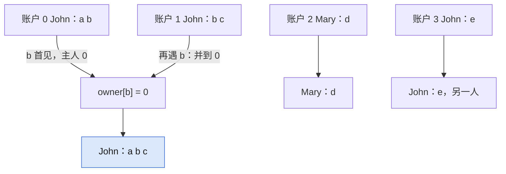

## Q
**LC 721 账户合并**｜Medium

每个账户是「名字 + 若干邮箱」，有共同邮箱的账户属于同一人（同名不一定同人）。合并后每个账户输出名字加排序后的邮箱。

## A
**一句话。** 并查集：账户为结点，邮箱第一次出现处记为主人，再遇到就合并，最后按根分组、排序。

**图解。** 邮箱 `b` 第一次出现记主人 0，账户 1 再遇到 `b` 就并到 0；同名的账户 3 没有共同邮箱，不合并。



```python
def accounts_merge(accounts):
    parent = list(range(len(accounts)))
    def find(x):
        while parent[x] != x:
            parent[x] = parent[parent[x]]   # 路径折半
            x = parent[x]
        return x
    owner = {}                   # 邮箱 -> 首次出现的账户
    for i, (_, *emails) in enumerate(accounts):
        for e in emails:
            j = owner.setdefault(e, i)
            if j != i:
                parent[find(i)] = find(j)
    groups = defaultdict(list)
    for e, i in owner.items():
        groups[find(i)].append(e)
    return [[accounts[r][0], *sorted(es)]
            for r, es in groups.items()]
```

**复杂度。** 时间 `O(N·α + E log E)`，空间 `O(N + E)`。

**易错点。**
- 按名字合并：三个 `John` 被并成一个，名字只用于输出。
- 不传递合并：`a-b`、`b-c` 要并成一个，靠 `find` 保证。
- 忘了给邮箱排序：要求 ASCII 序，`sorted` 即可。

**追问。**
- 用图 DFS 怎么做？：邮箱为结点，同账户邮箱连边，一个连通分量就是一人。
- 数据流式到来、随时查主人？：并查集是在线的，来一个 `union`，查询 `find`。

**同模式。** LC 547 省份数量、LC 684 冗余连接、LC 990 等式方程的可满足性、LC 1202 交换字符串中的元素
