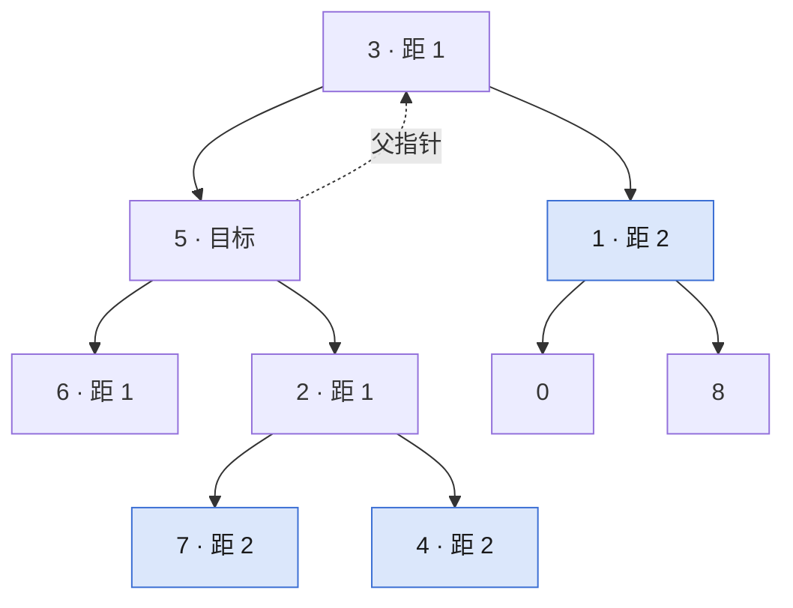

## Q
**LC 863 二叉树中所有距离为 K 的结点**｜Medium

给二叉树、目标结点 `target` 和整数 `k`，返回与 `target` 距离恰为 `k`（路径边数，可上可下）的所有结点值。

## A
**一句话。** 先遍历给每个结点补上父指针，把树变成无向图，再从 `target` 做 `k` 层 BFS，最后一层就是答案。

**图解。** 补上父指针后从目标 `5` 一层层向外扩，第 2 层 `7, 4, 1` 就是答案。



```python
def distance_k(root, target, k):
    parent = {root: None}
    stack = [root]
    while stack:                 # 迭代 DFS 记父指针
        node = stack.pop()
        for kid in (node.left, node.right):
            if kid:
                parent[kid] = node
                stack.append(kid)
    frontier, seen = [target], {target}
    for _ in range(k):           # 一层 = 距离加 1
        nxt = []
        for node in frontier:
            for nb in (node.left, node.right, parent[node]):
                if nb and nb not in seen:
                    seen.add(nb)
                    nxt.append(nb)
        frontier = nxt
    return [node.val for node in frontier]
```

**复杂度。** 时间 `O(n)`，空间 `O(n)`。

**易错点。**
- BFS 不记 `seen`：从 `5` 上到 `3` 又下回 `5`，结点被反复加入。
- 只向下搜 `target` 的子树：漏掉要先上到祖先再下去的结点。

**追问。**
- 要每个结点到 `target` 的距离？：BFS 时用字典代替 `seen`，同时记层号。
- 同一棵树大量查询？：父指针表只建一次，每次查询只付 BFS 的代价。

**同模式。** LC 2385 感染二叉树需要的总时间、LC 1740 二叉树中两结点距离、LC 236 二叉树的最近公共祖先、LC 1091 二进制矩阵中的最短路径
