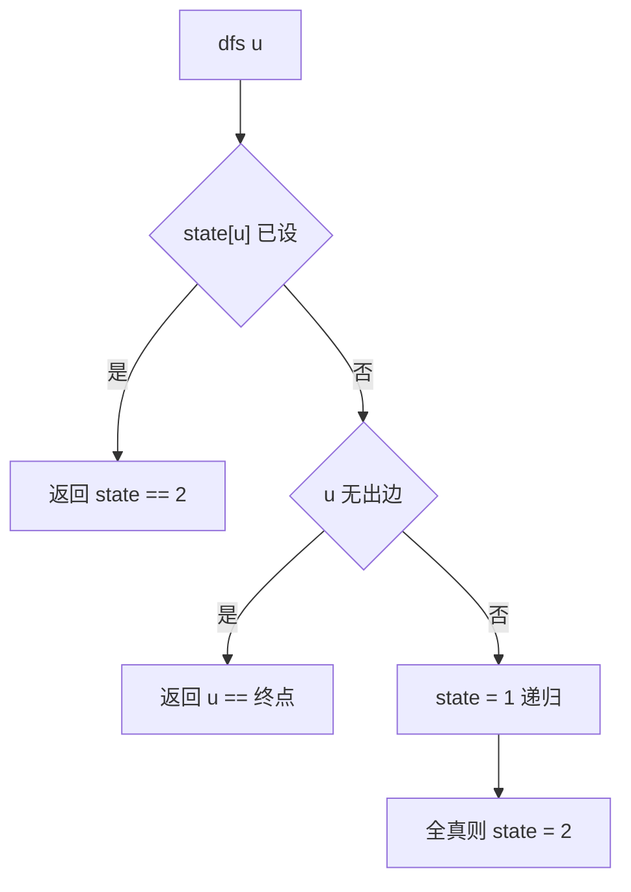

## Q
**LC 1059 从起点到终点的所有路径**｜Medium

有向图（可能有环、重边），判断从 `source` 出发的所有路径是否都在 `destination` 结束：至少一条路径，每条路径都结束在 `destination`，且不存在无限长路径。

## A
**一句话。** 三色 DFS：未访问、在当前路径上、已确认安全；走到死胡同必须是终点，再遇到路径上的结点就是环。

**图解。** 状态 1 表示在当前递归栈上，遇到它说明有环；全部后继都安全才把当前点标成 2，之后直接复用。



```python
def leads_to_destination(n, edges, source, destination):
    g = [[] for _ in range(n)]
    for a, b in edges:
        g[a].append(b)
    state = [0] * n                  # 0 未访问，1 路径上，2 已确认
    def dfs(u):
        if state[u]:
            return state[u] == 2     # 路径上再遇到：有环
        if not g[u]:
            return u == destination  # 死胡同必须是终点
        state[u] = 1
        if not all(dfs(v) for v in g[u]):
            return False
        state[u] = 2
        return True
    return dfs(source)
```

**复杂度。** 时间 `O(n + e)`，空间 `O(n + e)`。

**易错点。**
- 用二值 visited：无法区分「在当前路径上（环）」和「已确认安全（可复用）」，会把菱形结构误判为环。
- 终点有出边没处理：终点有出边时 `g[destination]` 非空，会继续走，到别处死胡同或环就返回 `False`，行为正确。
- 死胡同不是终点却返回真：必须在无出边处检查 `u == destination`。

**追问。**
- 为什么「路径上再遇到」才是环？：无向图里访问过就是环，有向图要区分当前栈上与已完成。
- 能用拓扑排序做吗？：可以，把终点之外的出度为 0 的点标坏，反向传播，复杂度相同。

**同模式。** LC 207 课程表、LC 802 找到最终的安全状态、LC 797 所有可能的路径
