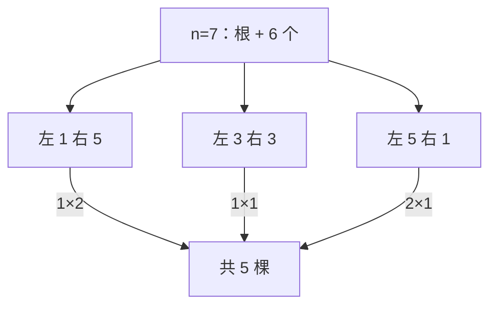

## Q
**LC 894 所有可能的真二叉树**｜Medium

真二叉树是每个结点要么没有子结点、要么恰有两个子结点的二叉树。给 `n`，返回所有恰有 `n` 个结点的不同真二叉树（结点值都为 `0`），顺序任意。

## A
**一句话。** 根占 1 个，剩下 `n-1` 个分给左右两棵子树，左边取奇数个，两边的所有解做笛卡尔积；带记忆化。

**图解。** `n = 7` 时除根外 6 个结点，左右子树大小只能是 `(1,5)`、`(3,3)`、`(5,1)`，两边的方案数相乘，三种拆分相加。



```python
@cache
def all_possible_fbt(n):
    if n % 2 == 0:
        return []                    # 真二叉树结点数必为奇数
    if n == 1:
        return [TreeNode()]
    ans = []
    for left in range(1, n, 2):      # 左子树结点数
        for l in all_possible_fbt(left):
            for r in all_possible_fbt(n - 1 - left):
                ans.append(TreeNode(0, l, r))   # 子树可共用
    return ans
```

**复杂度。** 时间 `O(C)`，空间 `O(C)`，`C` 是答案树的结点总数（方案数为卡特兰数）。

**易错点。**
- 偶数 `n` 没有直接返回空：偶数个结点不可能是真二叉树，循环里会得到空列表，但白白多算。
- 子树不能共用而去深拷贝：答案里的树不会被修改，共用同一棵子树即可，省下大量内存。

**追问。**
- 方案数是多少？：`n = 2k+1` 时为第 `k` 个卡特兰数，`n = 1,3,5,7` 依次 `1,1,2,5`。
- 为什么要记忆化？：`n` 的子问题 `all_possible_fbt(m)` 被不同的拆分反复用到。

**同模式。** LC 95 不同的二叉搜索树 II、LC 96 不同的二叉搜索树、LC 241 为运算表达式设计优先级
