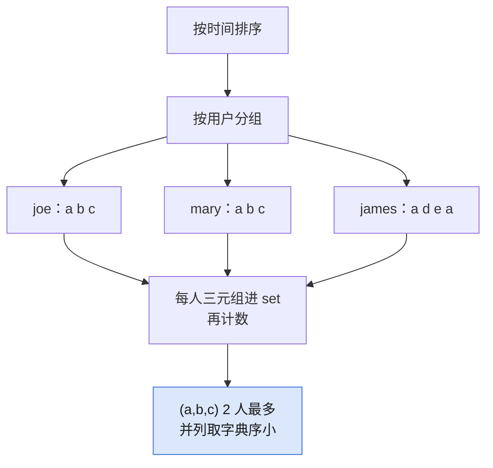

## Q
**LC 1152 用户网站访问行为分析**｜Medium

给三组等长数组：用户、时间戳、网站。「模式」是三个网站的有序三元组，用户按时间顺序访问过它们（不必连续）就算命中。返回命中用户数最多的模式，并列取字典序最小。

## A
**一句话。** 按时间排序后按用户分组，每人枚举所有三元组并用集合去重，计数后取「次数最大、字典序最小」。

**图解。** 排序分组后，每人的三元组先用 `set` 去重再计数，取次数最多、字典序最小的模式。



```python
def most_visited_pattern(username, timestamp, website):
    visits = defaultdict(list)
    for t, u, w in sorted(
            zip(timestamp, username, website)):
        visits[u].append(w)    # 按时间排好再分组
    cnt = Counter()
    for sites in visits.values():
        # 同一人同一模式只算一次
        cnt.update(set(combinations(sites, 3)))
    best = max(cnt.values())
    return list(min(p for p, c in cnt.items()
                    if c == best))
```

**复杂度。** 时间 `O(n log n + Σ C(len, 3))`，空间同枚举的三元组数。

**易错点。**
- 不去重：一个用户访问 `a, b, a, b` 会给 `(a, b, b)` 等模式重复加分，题目按用户数计。
- 忘了先按时间排序：输入不保证按时间给出，组合顺序就错了。

**追问。**
- 每人访问很多次，`C(n, 3)` 太大？：先按用户截断或只看最近窗口；或改成按模式的倒排加剪枝，面试里说明代价即可。
- 并列怎么比较？：Python 元组天然按字典序比较，`min` 直接取到。

**同模式。** LC 49 字母异位词分组、LC 347 前 K 个高频元素
