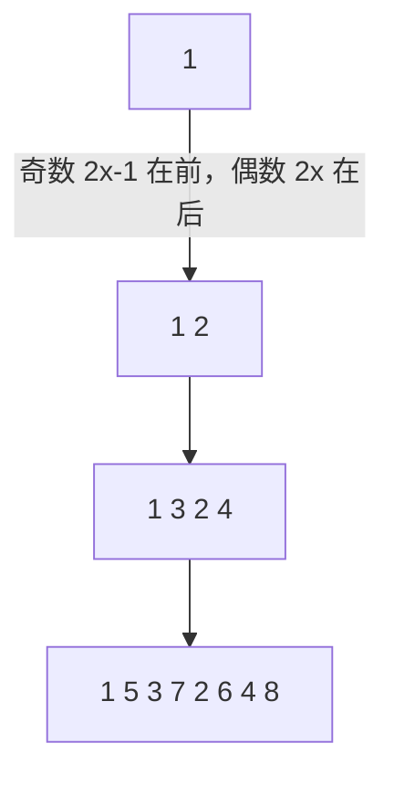

## Q
**LC 932 漂亮数组**｜Medium

`1..n` 的排列 `nums` 是漂亮数组：不存在下标 `i < k < j` 使得 `2 * nums[k] == nums[i] + nums[j]`。给 `n`，返回任意一个漂亮数组。

## A
**一句话。** 分治构造：漂亮数组做线性变换（`2x-1` 或 `2x`）仍漂亮，奇数部分在前、偶数部分在后，奇偶之和是奇数，永远不会等于 `2 * nums[k]`。

**图解。** 从 `[1]` 开始，每轮把当前数组映成奇数 `2x-1` 与偶数 `2x` 两半并拼接；超过 `n` 的数丢掉。



```python
def beautiful_array(n):
    ans = [1]
    while len(ans) < n:
        # 奇数部分 2x-1 在前，偶数部分 2x 在后
        ans = ([2 * x - 1 for x in ans]
               + [2 * x for x in ans])
        ans = [x for x in ans if x <= n]    # 去掉超出的数
    return ans
```

**复杂度。** 时间 `O(n)`，空间 `O(n)`。

**易错点。**
- 先放偶数再放奇数也行，但奇偶要分在两侧：左右各取一个数时和是奇数，不等于偶数 `2·nums[k]`。
- 变换后不过滤：数值会超过 `n`，结果不再是 `1..n` 的排列。

**追问。**
- 为什么线性变换保持漂亮？：`2x-1`、`2x` 都是 `x` 的线性函数，等差关系 `a + c = 2b` 在变换后依然只会在原来成立时成立。
- 为什么删去较大的数后还漂亮？：漂亮数组的任何子序列仍满足条件，只涉及选中的三个下标。

**同模式。** LC 667 优美的排列 II、LC 526 优美的排列、LC 60 排列序列
