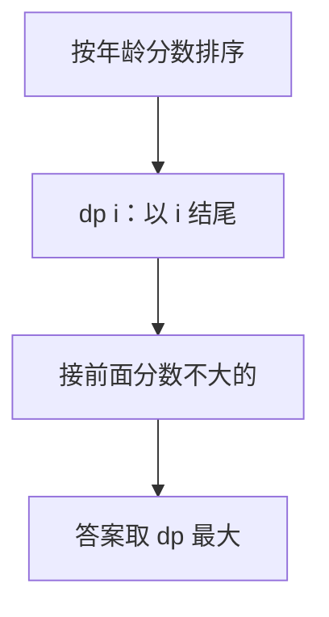

## Q
**LC 1626 无矛盾的最佳球队**｜Medium

`scores[i]`、`ages[i]` 是第 `i` 名球员的分数和年龄。选一支队伍，不能出现年龄更小的球员分数严格高于年龄更大的球员。求队伍总分最大值。

## A
**一句话。** 按（年龄，分数）排序后，问题变成"分数非降子序列的最大和"，用 `dp[i]` 表示以第 `i` 人结尾的最大总分。



```python
def best_team_score(scores, ages):
    ps = sorted(zip(ages, scores))
    dp = []
    for i, (age, s) in enumerate(ps):
        dp.append(s)
        for j in range(i):
            if ps[j][1] <= s:           # 前面的分数不超过当前
                dp[i] = max(dp[i], dp[j] + s)
    return max(dp)
```

**复杂度。** 时间 `O(n²)`，空间 `O(n)`。

**易错点。**
- 只按年龄排序：同龄不同分时顺序不定，同龄允许任意分数，要把分数作第二关键字。
- 比较写成 `<`：分数相等不算冲突，要用 `<=`。

**追问。**
- 能更快吗？：把分数离散化后，用树状数组维护前缀最大值，`O(n log n)`。

**同模式。** LC 300 最长递增子序列、LC 646 最长数对链、LC 673 最长递增子序列的个数、LC 354 俄罗斯套娃信封问题
