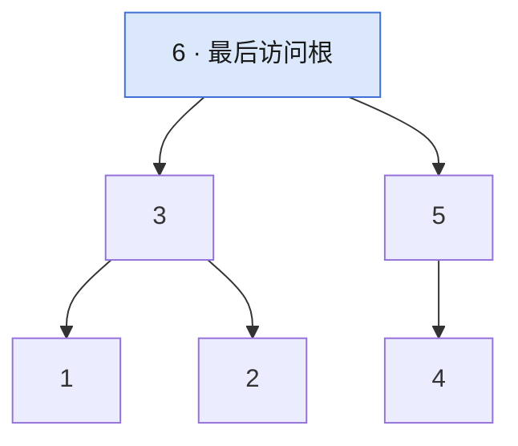

## Q
**LC 145 二叉树的后序遍历**｜Easy

给二叉树根结点，按「左、右、根」的顺序返回所有结点值。

## A
**一句话。** 先递归左右子树，回到当前结点时才记录，所以每个结点都在其整棵子树之后。

**图解。** 数字是记录的先后：叶子最先，根最后。



```python
def postorder_traversal(root):
    res = []
    def dfs(node):
        if not node:
            return
        dfs(node.left)
        dfs(node.right)
        res.append(node.val)     # 左右都完成后才记根
    dfs(root)
    return res
```

**复杂度。** 时间 `O(n)`，空间 `O(h)`。

**易错点。**
- 把记录放到两次递归之间：那是中序。
- 迭代版弹出就记录：此时右子树还没处理，要记住上一个访问过的结点才知道右边是否完成。

**追问。**
- 迭代有什么取巧写法？：按「根、右、左」做前序，再把结果整体反转，就是「左、右、根」。
- 后序适合解决什么？：需要先拿到孩子的结果再决定自己的问题，如树高、直径、删除结点。

**同模式。** LC 94 二叉树的中序遍历、LC 144 二叉树的前序遍历、LC 543 二叉树的直径、LC 106 从中序与后序遍历序列构造二叉树
