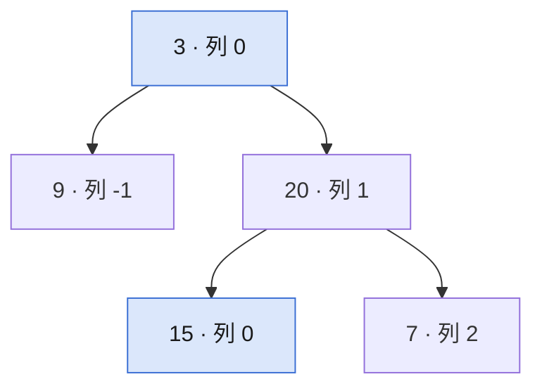

## Q
**LC 314 二叉树的垂直遍历**｜Medium

给二叉树，按列从左到右返回结点值；同一列内从上到下，同一行同一列则从左到右。根所在列为第 0 列，向左一步列号减 1，向右加 1。

## A
**一句话。** BFS 给每个结点带上列号，按层序追加进该列的列表，最后按列号排序输出；层序天然满足「从上到下、从左到右」。

**图解。** 每个结点标出列号，同列的结点按层序收进同一个桶。



```python
def vertical_order(root):
    if not root:
        return []
    cols = defaultdict(list)
    q = deque([(root, 0)])
    while q:
        node, c = q.popleft()
        cols[c].append(node.val)     # 层序保证先上后下
        if node.left:
            q.append((node.left, c - 1))
        if node.right:
            q.append((node.right, c + 1))
    return [cols[c] for c in sorted(cols)]
```

**复杂度。** 时间 `O(n log n)`（按列号排序；记下最小、最大列号可降到 `O(n)`），空间 `O(n)`。

**易错点。**
- 用 DFS 填桶：同列内的上下顺序会乱，要么用 BFS，要么 DFS 时同时记行号再排序。
- 空树不判断：`sorted(cols)` 之前要先返回 `[]`。

**追问。**
- 同行同列要按值排序怎么办？：这是 LC 987，改记 `(列, 行, 值)` 全部排序。
- 想避免排序？：BFS 过程中维护 `lo, hi`，最后按 `lo..hi` 逐列取。

**同模式。** LC 987 二叉树的垂序遍历、LC 102 二叉树的层序遍历、LC 429 N 叉树的层序遍历
