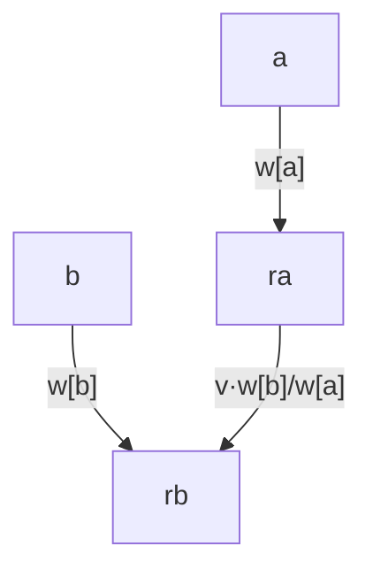

## Q
**LC 2307 检查方程中的矛盾之处**｜Hard

方程 `equations[i] = [a, b]` 与 `values[i]` 表示 `a / b = values[i]`。判断方程组是否矛盾（比值差超过 `10^-5` 算矛盾）。

## A
**一句话。** 带权并查集：`w[x]` 是 `x / root`；两个变量已在同一集合时比较 `w[a] / w[b]` 与给定值，不在就合并并设好根之间的比值。

**图解。** 合并时让 `ra` 挂到 `rb` 下，权值由 `a = w[a]·ra`、`b = w[b]·rb`、`a / b = v` 解出。



```python
def check_contradictions(equations, values):
    parent, w = {}, {}         # w[x]：x / parent[x]

    def find(x):
        if parent[x] != x:
            p = parent[x]
            parent[x] = find(p)
            w[x] *= w[p]       # 压缩后 w[x] = x / root
        return parent[x]

    for (a, b), v in zip(equations, values):
        for x in (a, b):
            if x not in parent:
                parent[x], w[x] = x, 1.0
        ra, rb = find(a), find(b)
        if ra == rb:
            if abs(w[a] / w[b] - v) > 1e-5:
                return True    # 已知比值和新方程冲突
        else:
            parent[ra] = rb    # 使 a / b = v 成立
            w[ra] = v * w[b] / w[a]
    return False
```

**复杂度。** 时间 `O(m α(m))`，空间 `O(m)`。

**易错点。**
- 路径压缩时不乘父亲的权：压缩后 `w[x]` 必须是到根的比值，否则后续比较全错。
- 用 `==` 比较浮点：要容差 `1e-5`。

**追问。**
- 误差会累积吗？：会，可改存 `log` 比值做加法，或用分数 `Fraction` 精确计算。
- 和 LC 399 的关系？：同一个结构，那题是给出查询求比值，这里是检查新方程是否与已有结论一致。

**同模式。** LC 399 除法求值、LC 990 等式方程的可满足性
