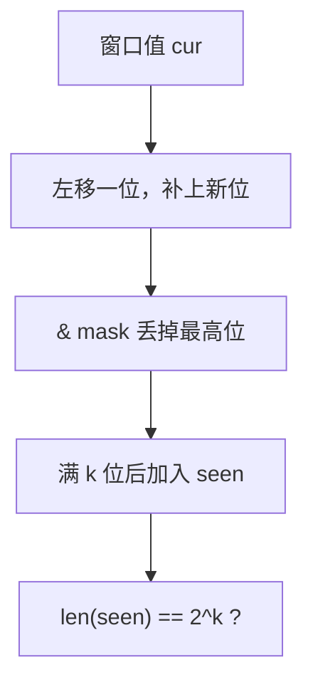

## Q
**LC 1461 检查一个字符串是否包含所有长度为 K 的二进制子串**｜Medium

二进制字符串 `s` 和整数 `k`。判断长度为 `k` 的 `2^k` 种二进制串是否都是 `s` 的子串。

## A
**一句话。** 定长滑动窗口：把窗口当成一个 `k` 位整数，右移一位只需 `左移一位 + 新位` 再 `& (2^k - 1)` 去掉最高位，把每个窗口的值放进集合，最后看集合大小是不是 `2^k`。

**图解。** 窗口每滑一格，旧值左移、挤出最高位、补上新位，得到的整数进集合。



```python
def has_all_codes(s, k):
    mask = (1 << k) - 1        # k 个 1，用来截断到 k 位
    seen = set()
    cur = 0
    for i, c in enumerate(s):
        cur = ((cur << 1) | int(c)) & mask
        if i >= k - 1:         # 窗口攒满 k 位才算一个子串
            seen.add(cur)
    return len(seen) == 1 << k
```

**复杂度。** 时间 `O(n)`，空间 `O(2^k)`。

**易错点。**
- 不满 `k` 位就加入集合：开头的前缀值比 `k` 位短，会被误当成合法子串。
- 用切片 `s[i:i+k]` 放进集合：每次 `O(k)`，总共 `O(nk)`，而位运算滚动是 `O(1)`。

**追问。**
- 怎么提前返回 `False`？：窗口个数 `n - k + 1` 小于 `2^k` 时必然不全，直接返回。
- 为什么不另做字符串哈希？：`k` 位二进制本身就是整数，直接当哈希，没有碰撞。

**同模式。** LC 438 找到字符串中所有字母异位词、LC 187 重复的DNA序列、LC 3 无重复字符的最长子串
