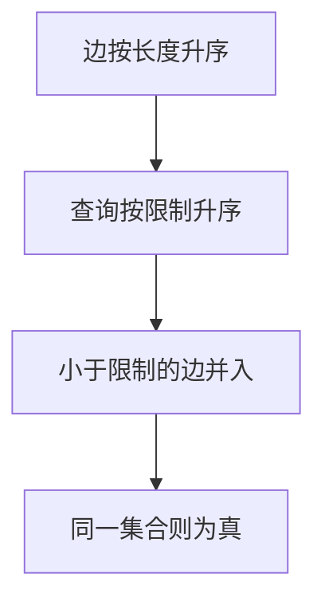

## Q
**LC 1697 检查边长度限制的路径是否存在**｜Hard

`n` 个点的无向图，`edgeList[i] = [u, v, dis]`（允许重边）。每个查询 `[p, q, limit]` 问：是否存在一条 `p` 到 `q` 的路径，路径上每条边长度都严格小于 `limit`。返回每个查询的布尔值。

## A
**一句话。** 离线处理：边按长度、查询按 `limit` 都升序，查询前把长度小于 `limit` 的边并入并查集，再看两点是否同集合。



```python
def distance_limited_paths_exist(n, edge_list, queries):
    fa = list(range(n))

    def find(x):
        while fa[x] != x:
            fa[x] = fa[fa[x]]
            x = fa[x]
        return x

    edges = sorted(edge_list, key=lambda e: e[2])
    order = sorted(range(len(queries)),
                   key=lambda i: queries[i][2])
    ans = [False] * len(queries)
    k = 0
    for i in order:
        p, q, limit = queries[i]
        while k < len(edges) and edges[k][2] < limit:
            fa[find(edges[k][0])] = find(edges[k][1])
            k += 1
        ans[i] = find(p) == find(q)
    return ans
```

**复杂度。** 时间 `O((E + Q) log(E + Q))`，空间 `O(n + Q)`。

**易错点。**
- 边条件写成 `<=`：题目要求严格小于 `limit`。
- 按查询原顺序处理：并查集只加不减，必须按 `limit` 升序，答案再按原下标写回。

**追问。**
- 为什么能离线？：并查集只会合并；`limit` 升序时，能用的边集合是单调增大的。

**同模式。** LC 1851 包含每个查询的最小区间、LC 2070 每一个查询的最大美丽值、LC 2406 将区间分为最少组数、LC 1584 连接所有点的最小费用
