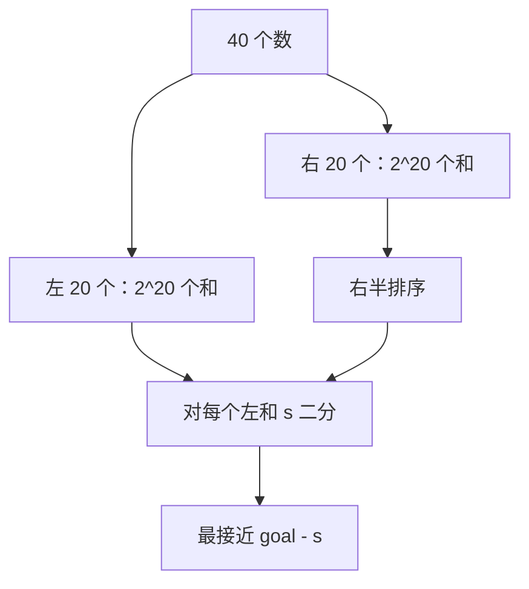

## Q
**LC 1755 最接近目标值的子序列和**｜Hard

`nums`（`n <= 40`，元素可为负、绝对值到 `10^7`），选一个子序列（可为空）使元素和最接近 `goal`，返回最小的 `|sum - goal|`。

## A
**一句话。** 折半枚举：`2^40` 太多，但两半各 `2^20` 个子集和可以全列出来；右半排序后，对左半每个和 `s` 二分找最接近 `goal - s` 的右半和。

**图解。** 把 `2^40` 拆成两个 `2^20`，再用排序加二分把两半配起来。



```python
def min_abs_difference(nums, goal):
    def sums(arr):             # arr 的全部子集和
        res = [0]
        for x in arr:
            res += [s + x for s in res]
        return res

    half = len(nums) // 2
    left = sums(nums[:half])
    right = sorted(sums(nums[half:]))
    ans = abs(goal)            # 空子序列
    for s in left:
        i = bisect_left(right, goal - s)
        if i < len(right):     # 第一个 >= goal - s 的
            ans = min(ans, abs(s + right[i] - goal))
        if i:                  # 最后一个 < goal - s 的
            ans = min(ans, abs(s + right[i - 1] - goal))
    return ans
```

**复杂度。** 时间 `O(2^{n/2}·n)`，空间 `O(2^{n/2})`。

**易错点。**
- 只看 `right[i]`：最接近的也可能是它前面那个更小的值，两侧都要比。
- 用背包 DP：值域到 `4·10^8` 且有负数，按和开数组不可行。

**追问。**
- 不用二分？：左半也排序，左升右降双指针扫一遍，`O(2^{n/2})`（不计排序）。
- 子集和怎么排序更快？：逐个加元素时用归并合并「原列表」与「原列表 + x」，直接得到有序结果，省掉 `log`。

**同模式。** LC 416 分割等和子集、LC 805 数组的均值分割、LC 2035 将数组分成两个数组并最小化数组和的差
