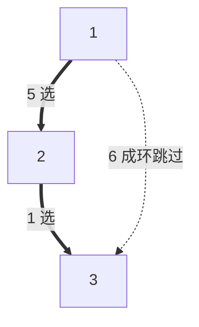

## Q
**LC 1135 最低成本连通所有城市**｜Medium

`n` 个城市（编号 `1..n`），`connections[i] = [x, y, cost]` 表示连接城市 `x` 与 `y` 的成本。返回连通所有城市的最小总成本，做不到则返回 `-1`。

## A
**一句话。** 最小生成树（Kruskal）：边按成本升序，用并查集只选不会成环的边，选满 `n-1` 条就连通了。

**图解。** 三个城市：先选最便宜的 `2-3`（1），再选 `1-2`（5），`1-3`（6）会成环被跳过，总成本 6。



```python
def minimum_cost(n, connections):
    parent = list(range(n + 1))
    def find(x):
        while parent[x] != x:
            parent[x] = parent[parent[x]]
            x = parent[x]
        return x
    cost = edges = 0
    for x, y, c in sorted(connections, key=lambda e: e[2]):
        a, b = find(x), find(y)
        if a != b:                    # 不同连通块才连
            parent[a] = b
            cost += c
            edges += 1
    return cost if edges == n - 1 else -1
```

**复杂度。** 时间 `O(m log m)`，空间 `O(n)`。

**易错点。**
- 忘了判断是否连通：选出的边数不足 `n-1` 说明图不连通，要返回 `-1`。
- 并查集大小开成 `n`：城市编号从 `1` 起，要开 `n + 1`。
- 不排序直接取：Kruskal 的正确性依赖成本升序。

**追问。**
- 稠密图用什么？：Prim 加堆，`O(m log n)`，或邻接矩阵版 `O(n²)`。
- 为什么跳过成环的边？：环中最贵的边总能被去掉而不影响连通，所以选它只会多花钱。

**同模式。** LC 1584 连接所有点的最小费用、LC 1489 找到最小生成树里的关键边和伪关键边、LC 1319 连通网络的操作次数、LC 261 以图判树
