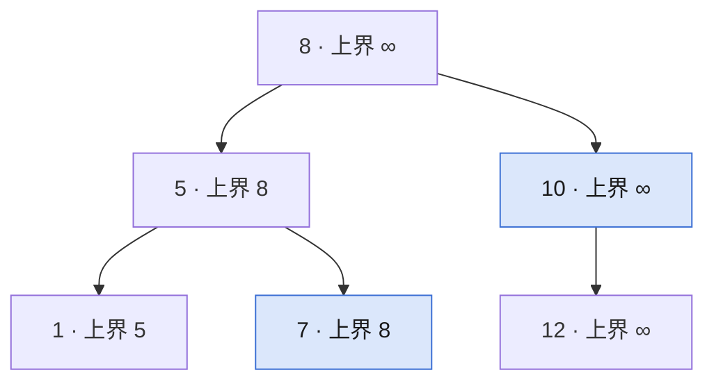

## Q
**LC 1008 前序遍历构造二叉搜索树**｜Medium

给一棵 BST 的前序遍历数组 `preorder`（值互不相同），重建这棵 BST 并返回根结点。

## A
**一句话。** 前序是「根、左、右」，递归时带上界 `hi`：当前值大于上界就不属于这棵子树，一次扫描即可建完。

**图解。** 前序 `[8,5,1,7,10,12]`：每个结点的上界是它所在子树的右边界，值超过上界就退回到祖先去当右孩子。



```python
def bst_from_preorder(preorder):
    i = 0
    def build(hi):               # 只收 < hi 的值
        nonlocal i
        if i == len(preorder) or preorder[i] > hi:
            return None
        node = TreeNode(preorder[i])
        i += 1
        node.left = build(node.val)   # 左子树上界是自己
        node.right = build(hi)        # 右子树沿用父上界
        return node
    return build(inf)
```

**复杂度。** 时间 `O(n)`，空间 `O(h)`。

**易错点。**
- 右子树上界写成 `node.val`：右孩子应沿用父结点传下来的 `hi`，否则祖先右侧的值被拒收。
- 每个结点都按 `insert` 插入：最坏 `O(n^2)`，上界法才是线性。

**追问。**
- 不用上界还能做吗？：能，第一个比根大的位置把数组切成左右两段，递归；每层找切点最坏 `O(n^2)`，二分切点 `O(n log n)`。
- 给后序遍历呢？：倒着读，顺序变「根、右、左」，先建右子树。

**同模式。** LC 105 从前序与中序遍历序列构造二叉树、LC 255 验证前序遍历序列二叉搜索树、LC 449 序列化和反序列化二叉搜索树、LC 108 将有序数组转换为二叉搜索树
