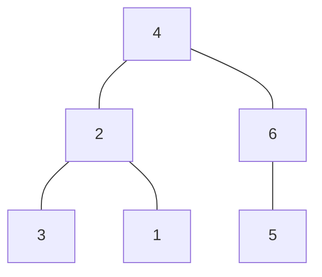

## Q
**LC 536 从字符串生成二叉树**｜Medium

字符串由整数和括号组成：根的整数后跟零到两对括号，第一对是左子树、第二对是右子树，如 `"4(2(3)(1))(6(5))"`。构造出这棵二叉树，整数可能为负。

## A
**一句话。** 递归下降：读出一个整数当节点，若下一个字符是 `(` 就递归解析左子树并跳过 `)`，再看是否还有 `(` 解析右子树。

**图解。** `4(2(3)(1))(6(5))` 对应的树，`6` 只有左孩子 `5`。



```python
def str2tree(s):
    i = 0
    def parse():
        nonlocal i
        j = i
        while j < len(s) and s[j] not in '()':
            j += 1
        node = TreeNode(int(s[i:j]))      # 读一个整数，可为负
        i = j
        if i < len(s) and s[i] == '(':    # 第一对括号：左子树
            i += 1
            node.left = parse()
            i += 1                        # 跳过 ')'
        if i < len(s) and s[i] == '(':    # 第二对括号：右子树
            i += 1
            node.right = parse()
            i += 1
        return node
    return parse() if s else None
```

**复杂度。** 时间 `O(n)`，空间 `O(h)`。

**易错点。**
- 整数只取一位：值可以是多位或负数，要连续读完数字和负号。
- 忘了跳过 `)`：递归返回后下标还停在 `)` 上，右子树的判断会出错。
- 空串：直接返回 `None`，否则 `int('')` 报错。

**追问。**
- 只有右孩子时括号怎么表示？：题目里只有一对括号一定是左子树，所以不会出现「只有右孩子」。
- 反过来，树转成这种字符串？：前序遍历，左右都空时不加括号，只有右孩子时左边补 `()`，见 LC 606。

**同模式。** LC 606 根据二叉树创建字符串、LC 297 二叉树的序列化与反序列化、LC 105 从前序与中序遍历序列构造二叉树、LC 331 验证二叉树的前序序列化
