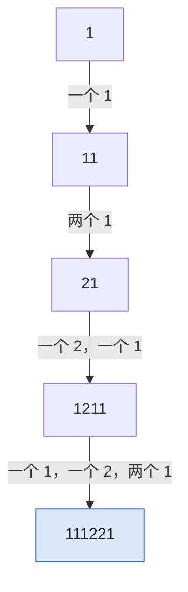

## Q
**LC 38 外观数列**｜Medium

`countAndSay(1) = "1"`，之后每一项是对上一项的「报数」：把连续相同的数字分组，念出每组的个数和数字。返回第 `n` 项。

## A
**一句话。** 从 `"1"` 出发迭代 `n - 1` 次，每次把当前串按连续相同字符分组，拼成「个数 + 字符」。

**图解。** 每一行是对上一行的朗读：`21` 读作「一个 2、一个 1」，得到 `1211`。



```python
def count_and_say(n):
    s = "1"
    for _ in range(n - 1):
        s = "".join(str(len(list(g))) + k
                    for k, g in groupby(s))   # 按连续相同字符分组
    return s
```

**复杂度。** 时间 `O(总长度)`（第 `n` 项长度约按 1.3 倍增长），空间 `O(第 n 项的长度)`。

**易错点。**
- 循环 `n` 次：第一项已经是 `"1"`，只需 `n - 1` 次变换。
- 用 `set` 或 `Counter` 统计个数：只能合并连续的相同字符，不能把不相邻的同字符合并。
- 拼接顺序写成「字符 + 个数」：应是「个数 + 字符」。

**追问。**
- 不用 `groupby` 怎么写？：双指针，`j` 向右扩到字符变化，个数为 `j - i`。
- 为什么数字只会出现 1、2、3？：本数列从 `"1"` 起，任何一项里同一数字连续出现不会超过 3 次。

**同模式。** LC 443 压缩字符串、LC 8 字符串转换整数 (atoi)、LC 1446 连续字符、LC 394 字符串解码
