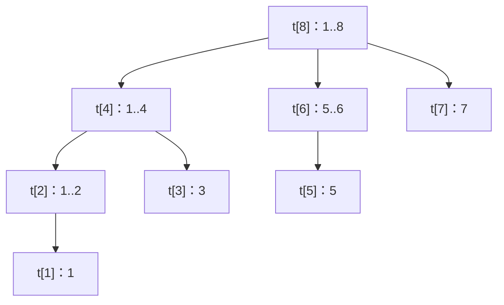

## Q
**LC 315 计算右侧小于当前元素的个数**｜Hard

整数数组 `nums`（`n <= 10^5`），对每个 `i` 求其右侧比 `nums[i]` 小的元素个数。

## A
**一句话。** 离散化后从右往左扫，树状数组里存「右侧已出现的值」；对每个数先查比它小的个数（前缀和），再把它加进去。

**图解。** 树状数组 `t[k]` 管 `(k - lowbit(k), k]`；查前缀 7 是 `t[7] + t[6] + t[4]`，每步去掉最低位的 1。



```python
def count_smaller(nums):
    vals = sorted(set(nums))
    rank = {v: i + 1 for i, v in enumerate(vals)}  # 离散化
    tree = [0] * (len(vals) + 1)
    ans = []
    for x in reversed(nums):   # 树里是 x 右侧的数
        k, cnt = rank[x] - 1, 0
        while k:               # 前缀和：比 x 小的个数
            cnt += tree[k]
            k &= k - 1
        ans.append(cnt)
        k = rank[x]
        while k < len(tree):   # 把 x 加进去
            tree[k] += 1
            k += k & -k
    return ans[::-1]
```

**复杂度。** 时间 `O(n log n)`，空间 `O(n)`。

**易错点。**
- 查询用 `rank[x]`：会把等于 `x` 的也算进去，要查 `rank[x] - 1`。
- 树状数组从下标 0 开始：`k & -k` 在 0 处死循环，下标必须从 1 起。

**追问。**
- 归并排序写法？：按值归并并带着原下标，左半元素出列时，右半已出列的个数就是它右侧更小的数。
- 值域只有 `[-10^4, 10^4]`？：直接偏移 `x + 10^4 + 1` 当下标，省去离散化。

**同模式。** LC 148 排序链表、LC 493 翻转对、LC 327 区间和的个数
