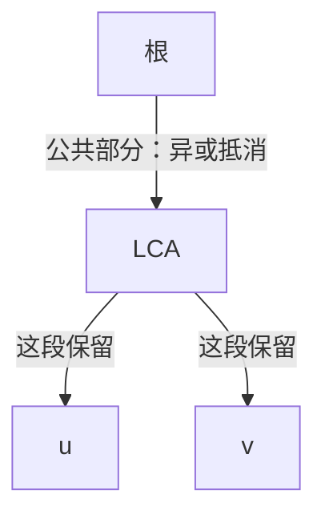

## Q
**LC 2791 树中可以形成回文的路径数**｜Hard

以 0 为根的树，`s[i]` 是边 `(i, parent[i])` 上的字符。求满足 `u < v` 且路径上的字符能重排成回文的点对数（`n <= 10^5`）。

## A
**一句话。** 记 `mask[v]` 为根到 `v` 路径上各字符出现次数的奇偶，`u` 到 `v` 路径的奇偶就是 `mask[u] ^ mask[v]`（公共部分抵消）；能成回文即异或结果至多一位为 1，用哈希表统计之前出现过的 `mask` 及与它差一位的 `mask`。

**图解。** 根到 LCA 的公共部分在两条路径里各出现一次，异或后抵消，只剩 LCA 到 `u`、`v` 的两段。



```python
def count_palindrome_paths(parent, s):
    n = len(parent)
    children = [[] for _ in range(n)]
    for i in range(1, n):
        children[parent[i]].append(i)
    cnt = Counter()            # 已访问点的 mask 计数
    ans = 0

    def dfs(u, mask):          # mask：根到 u 的字符奇偶
        nonlocal ans
        ans += cnt[mask]       # 异或为 0：全是偶数次
        for b in range(26):    # 异或只有一位：一个奇数次
            ans += cnt[mask ^ (1 << b)]
        cnt[mask] += 1
        for v in children[u]:
            dfs(v, mask ^ (1 << (ord(s[v]) - 97)))

    dfs(0, 0)
    return ans
```

**复杂度。** 时间 `O(26n)`，空间 `O(n)`。

**易错点。**
- 以为要求 LCA：异或会把公共前缀抵消，路径奇偶只看两端的 `mask`。
- 先把自己加进 `cnt` 再统计：会把 `(u, u)` 这样的空路径算进去。

**追问。**
- 和子数组版本的关系？：就是「前缀异或 + 哈希计数」搬到树上，前缀换成根到结点的路径。
- 树很深？：递归深达 `10^5`，可先用 BFS 按层求出 `mask`，再顺序统计，顺序无关。

**同模式。** LC 560 和为 K 的子数组、LC 1915 最美子字符串的数目、LC 1457 二叉树中的伪回文路径
