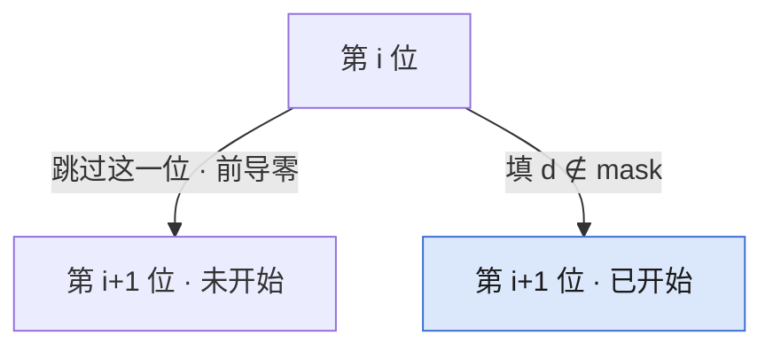

## Q
**LC 2376 统计特殊整数**｜Hard

如果一个正整数的十进制表示中每个数位都不重复，它就是特殊整数。给正整数 `n`，返回 `[1, n]` 中特殊整数的个数。

## A
**一句话。** 数位 DP：从高位到低位逐位填数，用位掩码记已用过的数字，用「是否贴着上界」和「是否已开始填数」处理上界与前导零。

**图解。** 每一位只看三个状态：用过哪些数字、前面是否一直等于 `n` 的前缀（限制）、是否已经放过非零数字。



```python
def count_special_numbers(n):
    s = list(map(int, str(n)))
    L = len(s)
    @cache
    def f(i, mask, limit, started):
        if i == L:
            return int(started)       # 至少填过一位才是正整数
        res = 0
        if not started:               # 这一位继续留空（前导零）
            res = f(i + 1, mask, False, False)
        up = s[i] if limit else 9
        for d in range(0 if started else 1, up + 1):
            if mask >> d & 1:
                continue              # 数字已用过
            res += f(i + 1, mask | 1 << d,
                     limit and d == up, True)
        return res
    return f(0, 0, True, False)
```

**复杂度。** 状态 `O(L · 2^10)`，每个状态枚举 10 个数字，时间 `O(L · 2^10 · 10)`，空间 `O(L · 2^10)`。

**易错点。**
- 前导零当作已用数字 `0`：会把 `0` 记进 `mask`，之后无法再填 `0`。
- 不区分「已开始」：`007` 和 `7` 被当成两个数，或者把全空串算成 0 个数位的合法数。
- `limit` 在跳过前导零时设为假：这时没有被前缀限制住（高位还是空），允许下面各位自由取值直到 9。

**追问。**
- 也可以用组合数学吗？：位数比 `n` 少的直接用排列数，位数相同的逐位处理前缀，思路与数位 DP 对应。
- 去掉 `mask` 可以做什么题？：LC 233 数字 1 的个数、LC 600、LC 2719 数位和，换成各自需要的状态。

**同模式。** LC 902 最大为 N 的数字组合、LC 788 旋转数字、LC 357 统计各位数字都不同的数字个数、LC 600 不含连续1的非负整数
